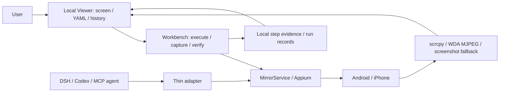

# FlowAssert

> **FlowAssert migration candidate (2026-10-24).** This repository starts from a reviewed source snapshot with independent Git history. No earlier tags, Releases, or CI logs are migrated. Historical reports and screenshots describe pre-migration work; they are not fresh FlowAssert acceptance. No FlowAssert release has been published. Use the source quickstart. See [release readiness](https://github.com/qmkCamel/flowassert/blob/main/docs/open-source-readiness.md).

[Trial FAQ (中文)](https://github.com/qmkCamel/flowassert/blob/main/docs/faq.md) · [Glossary (中文)](docs/glossary.md) · [Technical introduction (中文)](https://github.com/qmkCamel/flowassert/blob/main/docs/communications/technical-introduction.zh-CN.md) · [Optional Web visual self-test](docs/web-visual-acceptance.md)

English | [简体中文](README.zh-CN.md)

**Watch Android and iPhone on your computer, run readable YAML tests, and review retained step evidence and run history.**

FlowAssert is a local mobile test workbench. Connect a phone to watch its screen, run fixed UI flows, check assertions, and revisit screenshots and previous runs. A DeepSeek Harness plugin and generic MCP server also give Codex and other agents access to the same device observation and control core.

> **Developer Preview — source version `0.1.0-alpha.2`.** This README describes the current source; use the source quickstart below to try the workbench. The only prebuilt package channel is the verified [GitHub Release](docs/beta-installation.md); check the corresponding release notes before using a package. The source is MIT-licensed, the package remains `private: true`, and it is not published to public npm. Compatibility is pinned to DeepSeek Harness `0.2.0-rc.2` exactly; the standalone workbench needs neither DSH nor model credentials.

[Capabilities](https://github.com/qmkCamel/flowassert/blob/main/docs/capabilities.md) · [Product introduction draft (Chinese)](https://github.com/qmkCamel/flowassert/blob/main/docs/communications/product-introduction.zh-CN.md) · [Documentation index](https://github.com/qmkCamel/flowassert/blob/main/docs/README.md) · [Product TODO](https://github.com/qmkCamel/flowassert/blob/main/PRODUCT_TODO.md) · [Milestones](docs/milestones.md) · [Workbench guide](docs/test-workbench.md) · [Report reading and offline sharing](docs/report-reading-and-sharing.md)

## Product positioning

Environment checks are scoped to the selected entry and operation: Codex/MCP never checks DSH; report/Mock use does not require phone tooling. Doctor v2 is read-only and distinguishes `ready`, `blocked`, and `incomplete`. See [scoped preflight and migration](docs/environment-preflight.md).

For developers and test maintainers who repeatedly verify mobile apps. The initial scope is local Android and iOS physical devices, primarily apps you develop; Sample App is the current physical-test sample.

- **Watch the device:** the local Viewer keeps showing the phone while a test runs.
- **Repeat a flow:** version readable YAML for taps, swipes, waits, and assertions, without model calls at every step.
- **Inspect the evidence:** retain step PNGs, interface structure, logs, and assertion diagnostics; final results check required evidence completeness.
- **Trace previous results:** review steps and history, load an earlier flow, and create a new run linked to the original.

The Viewer is the human entry point for connecting, testing, and reviewing results. Agents can use the shared Device Bridge independently through DSH/MCP and open the Viewer for supervision. MirrorService/Appium continues to own device control.


*The screenshot was captured from the FlowAssert candidate on 2026-10-24 and shows a deterministic Mock demonstration. Physical-device evidence is documented separately below.*

## Five-minute Mock quickstart

Invited testers use the **main branch** and follow the **[beta task card (Chinese)](https://github.com/qmkCamel/flowassert/blob/main/docs/beta-start.md)** for source setup, success → failure → rerun → report-sharing tasks, and feedback with the commit SHA. The [offline interactive demo](https://github.com/qmkCamel/flowassert/blob/main/docs/communications/mobile-mirror-demo.html) needs no installation and uses simulated data; it is not product acceptance evidence. The source shortcut below uses the compatibility workbench; the task card follows the current case and report journey.

No phone, Appium, model credential, or host-device discovery is required. From the source checkout:

```bash
mise install
corepack enable
pnpm install --frozen-lockfile
pnpm dev
```

1. Open `http://127.0.0.1:3210`, go to **Devices**, select **Mock device · demo**, and choose **Start demo**. Avoid manual taps or swipes before running the sample so its initial action count stays unchanged.
2. Open the advanced compatibility workbench at `http://127.0.0.1:3210/#/legacy` and use the **Demo device** sample. If the editor contains a previously saved flow, copy [demo.yaml](https://github.com/qmkCamel/flowassert/blob/main/examples/flows/demo.yaml).
3. Choose **Run & retain evidence**. The sample launches the demo app, checks its title, taps the card, and asserts that one action was received. All five steps should complete with **Passed**.
4. Expand a step to inspect its original image and assertion diagnostics, then refresh the page and reopen the result from run history.
5. Before rerunning the loaded flow, return to the connection panel, stop and restart Mock to reset its action count, or update the expected count to match accumulated actions. Rerunning does not silently reset app state or overwrite the previous record.

Live viewing, theme switching, and history remain available during execution; other device control is blocked by the run lease within the same runtime. Use **Cancel run** to interrupt a flow. Device actions that already happened are not rolled back.

The top-right selector switches between English and Simplified Chinese. Raw evidence defaults to `~/.local/share/mobile-mirror/runs/` on the host and may contain page or account data. See the [workbench guide](docs/test-workbench.md) for supported YAML, verdicts, storage, and recovery behavior.

## Current maturity

### 2026-10-07 report reading and offline sharing

`dev@REDACTED_REVISION` adds report filters/50-row pagination, case history, failure navigation, historical-image zoom and qualified trend navigation. Sharing adds source-pixel masks, passive offline HTML, frozen preview, explicit review and byte-identical download. JSON remains the machine exchange format; HTML cannot be imported or replayed.

The report change is **41/46**. Actual Safari, complete physical materials/approved health signals and five non-author users remain prerequisites. Software gates passed 944 tests and 80 E2E scenarios; independent measurement of 1000 simple summaries had about 250ms p95, not a large-report or production claim. See the [guide](docs/report-reading-and-sharing.md) and [implementation evidence](https://github.com/qmkCamel/flowassert/blob/main/openspec/changes/improve-report-reading-and-sharing/implementation-validation.md). A dev push is not a new Release or whole-change acceptance.

### Six planned iterations: engineering complete, acceptance still open

As of 2026-10-03, all six agreed engineering iterations from `feat/change-acceptance-roadmap@REDACTED_REVISION` are integrated into `dev`, retaining its Worker, reference and lifecycle governance. Integration does not mean a new release or production acceptance.

| Iteration | Implemented in source | Remaining acceptance |
| --- | --- | --- |
| First acceptance | Guided setup, templates, validation, execution and project export; Android/iPhone synthetic business fixtures verified | External first-use results and independent efficiency measurements |
| Authoring and maintenance | Semantic readiness, scoped locators, Inspector drafts and linked reruns | Real-app changes and independent maintenance measurements |
| Diagnosis and follow-up | Evidence-derived checks, gaps and linked run comparisons | Independently labelled corpus and non-author study |
| Change acceptance | Commit/artifact binding, coverage, immutable revisions and PR-ready summaries | Real business changes on both platforms and independent reviewers |
| External test assets | JUnit/JSON import, attachments, project-bound authorization and acceptance links; actual Appium-client report chain verified | Maestro reports, error dialects, missing-attachment coverage and an external adopter |
| Local OCR and two-slot matrix | Frozen evaluation/approval mechanisms, checkpoint assertions, isolated scheduling and evidence aggregation | Authorized image quality evaluation, approved profiles, physical-device matrix and independent review |

As of 2026-10-05, the four OpenSpec changes have **90/103 tasks completed**, leaving **13 tasks**, not all device-dependent. Joint Android/iPhone Fixture acceptance task 5.1 is complete; partial external-report evidence does not close its full compatibility tasks. See [current physical evidence and gaps](docs/physical-validation-2026-10-05.md); the [original roadmap](https://github.com/qmkCamel/flowassert/blob/main/openspec/changes/add-change-acceptance-records/roadmap.md) retains its October 3 snapshot. Independent review needs participants and evidence. Real business changes and the Android+iPhone matrix still require devices. Synthetic OCR and Mock results do not authorize production OCR. External report ingestion does not launch Maestro or another Appium runner.

### 2026-10-05 physical validation integrated into dev

The focus fix, probes and evidence summary from `feat/physical-validation-oct@REDACTED_REVISION` are integrated into dev. Both platforms verified Inspector authoring, deliberate failure and revision rerun, readiness/assistant/business checks, controlled process faults and recovery, and 30 fixed benchmark runs with 510 artifact checks per platform. Frozen budgets calibrate future regressions, not production SLOs or cross-platform rankings.

At that October 5 candidate, physical USB removal, real-model image consumption, OCR/visual approval, two real App builds, the physical two-slot matrix and independent-user/external-pilot gates remained incomplete. Raw phone evidence stays local. This is neither a release nor OpenSpec archival; see the [validation and integration record](docs/physical-validation-2026-10-05.md).

### 2026-10-06 runtime-gate integration

The dev integration combines `feat/temporal-runtime-gates@REDACTED_REVISION` with the October 5 physical-validation changes. Opt-in temporal assertions, authorized App restart, read-only business checks and automation-observed end-to-end timing gates are implemented. Android/iPhone synthetic RuntimeFixtures cover positive/negative cases, cancellation, owned-host pause and coordinated USB interruption; interruptions remain inconclusive, not pass. This does not close unrelated USB scenarios or establish production SLOs.

Temporal OpenSpec progress is **27/28** and health/performance **28/32**. Real-business persistence/idempotency and approved latency endpoints still need an authorized App/backend; crash/ANR/hang support still needs trustworthy live sources and complete attribution/window/drain validation. Health remains engineering-preview/unsupported on current physical providers. No release or OpenSpec archival is implied; see the [runtime acceptance and integration audit](docs/runtime-gates-validation.md).

### Earlier physical-device baseline

The integrated workbench completed physical Sample App validation on both platforms on 2026-09-14:

| Sample | Positive fixed flow | Deliberate negative case | Evidence and history |
| --- | --- | --- | --- |
| OnePlus 8T / Android 14 | 12/12 steps passed, 54.5 seconds | Failed and stopped at step 3 as expected | Positive run: 12 PNGs + 12 XML files; history and file hashes verified after restart |
| iPhone 16 Plus / iOS 26.2.1 | 12/12 steps passed, 45.9 seconds | Failed and stopped at step 3 as expected | Positive run: 12 PNGs + 12 XML files; history and file hashes verified after restart |

Both reused the same device session throughout each run while media continued streaming. Durations include per-step evidence capture and do not yet meet the fast-regression goal. These are one-Android and one-iPhone baselines, not coverage of every app, OS, or account. See [physical workbench validation](docs/workbench-validation.md) for versions, run IDs, metrics, and failed attempts.

**A `pass` confirms declared conditions and required evidence only.** A registered `assertVisual` adds a deterministic pixel check; an explicitly approved `assertTextInRegion` adds a scoped OCR check. Without a configured visual assertion, visual verification remains not performed. Neither establishes general visual understanding, unknown-overlay detection, or business persistence. Declared `blockers` check only their specified interface-structure conditions.

The current source also includes reviewed locator-only repair, v2 derived sharing, and reference-aware local retention. These have Mock/browser engineering tests, not two-App build-change or external-team acceptance. Sharing requires manual pixel review; automatic cleanup is off. See the [workbench guide](docs/test-workbench.md) before using them with real evidence.

The [evidence-guided repair loop](https://github.com/qmkCamel/flowassert/blob/main/openspec/changes/add-evidence-guided-repair-loop/implementation.md) is **Preview — off by default**, with 53/65 OpenSpec tasks complete. M1 provides approved, bounded locator repair with Mock-only software verification; M2 provides a trusted-local source-patch handoff and two independent software checks through shared MCP/Cordis contracts. The opt-in M3 path can build a registered single APK or iOS `.app`, hash the artifact, request a separate exact-digest installation approval, and exercise a Mock maintenance adapter with read-only recovery. The iOS fixture is **not** proof of a development signature, and Appium installation, trusted device reset/cleanup, real-device revalidation, actual Codex/DSH host runs, and independent acceptance remain pending. The default 20 tools and original run verdict are unchanged; software or Mock results never count as physical-device verification. See the [operations guide](https://github.com/qmkCamel/flowassert/blob/main/docs/evidence-guided-repair-operations.md) and [task-level status](https://github.com/qmkCamel/flowassert/blob/main/openspec/changes/add-evidence-guided-repair-loop/tasks.md) before relying on a capability.

The [guided acceptance workflow](docs/guided-mobile-acceptance.md) connects device readiness, Inspector drafts, revision-bound validation, explicit execution and reusable local project export. Opt-in semantic readiness steps and evidence-derived next checks help author and investigate tests; explicit child-run comparison never overwrites an original failure. These additions retain separate real-device and independent-study acceptance gates.

As of 2026-09-16, owned WDA cleanup on normal disconnect, phase timings and repeated physical runs, Inspector, public text input, manual capture/recording, and run-video archives have implementation and acceptance evidence. The Android AI text business flow passed; iOS input and sending passed, but the complete text flow still fails because the user-message text is absent from the accessibility tree. Intermittent Android ADB stalls, broader recovery/device coverage, business verifiers, and a Maestro adapter remain open. See the [capability matrix](https://github.com/qmkCamel/flowassert/blob/main/docs/capabilities.md).

## Product shape

The current source uses v2 page-title anchors plus container ownership; legacy application-root grants no longer authorize taps, and the original recovery tap also checks page scope. Owned Appium WDA/MJPEG Mac forwarders bind loopback (currently fingerprint-audited XCUITest 10.19.1 only). Android navigation probes passed 10/10; the October 6 iPhone attempt could not establish a session (Xcode Offline), so fresh live revalidation is still pending, and the full repair loop is not device-accepted. See [fix evidence and boundaries](https://github.com/qmkCamel/flowassert/blob/main/openspec/changes/add-evidence-guided-repair-loop/safety-fixes-validation.md).

Repair is off by default: host `repairToolsEnabled` controls Agent tool visibility and project `repair.enabled` controls repair admission, with explicit permissions and approvals still required. A unified master switch and a Viewer toggle are not implemented yet; hiding Agent tools does not disable Viewer/CLI repair. See the [disablement notes](https://github.com/qmkCamel/flowassert/blob/main/docs/evidence-guided-repair-operations.md#停用与恢复演练).



The workbench uses the pinned AppClaw 2.7.0 native YAML parser/runner through a limited interface to the connected Appium session. No AppClaw CLI installation or second device-control service is needed. A physical-iPhone Maestro fork has completed a comparative PoC and remains a candidate for a future adapter.

The run lease serializes controls inside one runtime. New Appium sessions with an explicit device ID also use a machine-local owner claim so a second built-in Viewer/MCP runtime cannot claim the same phone through another history directory. This boundary does not control independent ADB/Appium clients. Continuous media stays local; DSH/MCP carries discrete images, structure, and control results. See the [current architecture](https://github.com/qmkCamel/flowassert/blob/main/docs/design/mobile-test-workbench-current.md) and [framework decisions](https://github.com/qmkCamel/flowassert/blob/main/docs/research/framework-decisions.md).

## Agent integration and capability boundaries

The DSH plugin and MCP server share **20 default tools, plus 5 opt-in Preview repair tools**. The default set contains ten device observation/control tools, five opt-in registered-test tools, diagnostic-context and triage readers, plus `mobile_acceptance_get`, `mobile_external_result_get`, and `mobile_matrix_status`. The three new readers return bounded, authorized summaries; they do not publish acceptance records, execute external runners, or start/cancel/retry a matrix. The triage report must first be generated explicitly in the local Viewer or CLI and remains experimental; it does not alter the test verdict. Codex is one supported MCP host. See the [Agent guide](docs/agent-test-run-control.md) for permissions and validation limits.

For CI, `test suite --url` attaches to an existing Viewer without owning it, while `test job` starts a bounded loopback runtime and writes a separate job JSON plus JUnit report. See [Managed Workbench jobs](docs/managed-job.md) for the exit-code contract and self-hosted runner prerequisites.

Opt-in [runtime assertions](docs/runtime-assertions.md) add bounded eventual/stable checks, authorized restart persistence, read-only business truth and end-to-end timing gates. The health framework is engineering-preview only: current Android/iOS sources are unsupported until complete attribution and drain evidence is demonstrated. See the [acceptance audit](docs/runtime-gates-validation.md).

| Entry point | Available now | Important boundary |
| --- | --- | --- |
| YAML workbench | Structured public text input, taps, assertions, conditional waits, app launch, directional swipes, back, automatic evidence and history | No sensitive input, arbitrary code, or natural-language/model fallback; at least one assertion is required |
| DSH / MCP | 20 shared tools for observation/control, registered tests and read-only diagnostic/acceptance/external-result/matrix summaries | Agent execution is disabled by default; screen/evidence, text and app permissions remain separate; external assets need project-bound authorization |
| Local Viewer | Device connection, media, Inspector, capture/recording, workbench video history, and manual control | Clicking run authorizes that YAML and local evidence retention without expanding agent sharing permissions |

See the [Agent test-run guide](docs/agent-test-run-control.md), [MCP host guide](docs/mcp-hosts.md), [DSH installation guide](docs/beta-installation.md), and [product capability boundaries](docs/product-shape.md) for protocols, configuration, and permissions.

## Supported baseline

| Area | Baseline |
| --- | --- |
| Source toolchain | Node 24.19.0, pnpm 11.7.0; package Node range `^22.19.0 || >=24.0.0` |
| Mock host | macOS, Linux, or Windows; no phone or model required |
| Workbench engine | Pinned `@appclaw/core@2.7.0` native executor |
| Physical workbench test stack | macOS; Appium 3.2.0, UiAutomator2 6.8.0 / XCUITest 10.19.1; Android scrcpy 4.1 / iOS WDA MJPEG |
| DeepSeek Harness | `0.2.0-rc.2` exactly; Native/PTC runtime compatibility and image/text-only catalog boundaries verified; a real provider image-model run remains separate evidence |

Physical use requires Android USB authorization or iPhone trust, Developer Mode, Xcode, and WDA signing. The connection assistant defaults to the current screen, with Settings as an optional diagnostic target; automation initialization can still change the foreground app. It does not automatically pair, unlock, install dependencies, or replace Apple authorization. Runs retain the session afterward; stopping follows existing ownership rules and does not prove every WDA child process was automatically reclaimed.

## Start here

| Goal | Path |
| --- | --- |
| Try the complete loop without a phone | [Five-minute Mock quickstart](#five-minute-mock-quickstart) |
| Connect a phone and save local settings | [Standalone Viewer and quick connect](docs/local-viewer.md) |
| Write YAML, inspect evidence, and rerun | [Workbench guide](docs/test-workbench.md) |
| Review a change or import existing reports | [Change acceptance](docs/change-acceptance-records.md) · [External assets](docs/external-test-assets.md) |
| Preview local OCR or configure two slots | [Local OCR](docs/local-region-ocr.md) · [Device matrix](docs/local-device-matrix.md) |
| Prepare a physical Android or iPhone | [Android](docs/android-real-device.md) · [iOS/WDA](docs/ios-real-device.md) |
| Install into DeepSeek Harness | [Beta installation and rollback](docs/beta-installation.md) |
| Connect Codex or another MCP host | [MCP host guide](docs/mcp-hosts.md) |
| Read the source, build, or contribute | [Technical and development guide](docs/technical-guide.md) |

## Learn more

The [documentation index](https://github.com/qmkCamel/flowassert/blob/main/docs/README.md) collects research, designs, ADRs, tasks, and evidence. Key references: [security model](docs/security.md), [overall validation](docs/validation.md), [physical workbench validation](docs/workbench-validation.md), [current architecture](https://github.com/qmkCamel/flowassert/blob/main/docs/design/mobile-test-workbench-current.md), [product TODO](https://github.com/qmkCamel/flowassert/blob/main/PRODUCT_TODO.md), and [milestones](docs/milestones.md).

## Community and license

The source is MIT-licensed. For contributing, support, vulnerability reporting, and publication readiness, see [CONTRIBUTING.md](https://github.com/qmkCamel/flowassert/blob/main/CONTRIBUTING.md), [SUPPORT.md](https://github.com/qmkCamel/flowassert/blob/main/SUPPORT.md), [.github/SECURITY.md](https://github.com/qmkCamel/flowassert/blob/main/.github/SECURITY.md), and [open-source readiness](https://github.com/qmkCamel/flowassert/blob/main/docs/open-source-readiness.md).

## Observation query and Viewer Inspector

`mobile_mirror_query_screen` is one of the ten device tools within the current 20-tool catalog. Use summary inspect followed by find/get/subtree to query a retained observation without new captures or images. Readable historical nodes remain subject to strict action freshness. The local Viewer Inspector freezes its own screenshot and tree without publishing an Agent observation. See [使用与验证边界](docs/inspector-validation.md).
