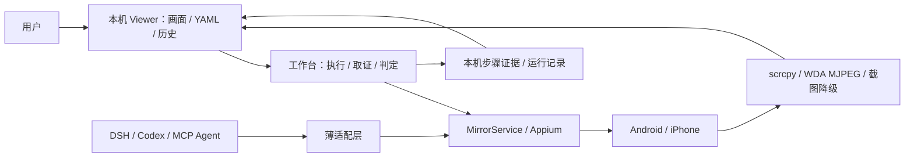

# FlowAssert

> **FlowAssert 迁移候选（2026-10-24）。** 本仓库从审查过的源码快照建立独立 Git 历史，不迁入旧标签、Release 或 CI 日志。历史报告和截图记录迁移前的工作，不代表 FlowAssert 已重新完成真机验收。尚未发布 FlowAssert 安装包，请使用源码快速开始。见[开源准备清单](https://github.com/qmkCamel/flowassert/blob/main/docs/open-source-readiness.md)。

[试用 FAQ](https://github.com/qmkCamel/flowassert/blob/main/docs/faq.md) · [术语解释](docs/glossary.md) · [技术介绍](https://github.com/qmkCamel/flowassert/blob/main/docs/communications/technical-introduction.zh-CN.md) · [可选 Web 视觉自检](docs/web-visual-acceptance.md)

[English](README.md) | 简体中文

**在电脑上实时查看 Android 和 iPhone，用可读 YAML 执行测试，保留步骤证据并回溯结果。**

FlowAssert 是一个本机移动测试工作台。连接手机后，可以一边看画面，一边运行固定 UI 流程、检查断言、查看截图和历史记录。它也通过 DeepSeek Harness 插件与通用 MCP，为 Codex 和其他 Agent 提供同一套设备观察与控制能力。

> **Developer Preview — 源码版本 `0.1.0-alpha.2`。** 本文介绍当前源码能力，工作台体验请按下方源码快速开始。唯一的预构建安装包渠道是经过校验的 [GitHub Release](docs/beta-installation.md)，使用发布包前请核对对应版本说明。源码采用 MIT，package 保持 `private: true`，不发布到公共 npm。DSH 适配的已验证版本精确固定为 `0.2.0-rc.2`；独立工作台无需 DSH 或模型凭据。

[能力总表](https://github.com/qmkCamel/flowassert/blob/main/docs/capabilities.md) · [宣传稿](https://github.com/qmkCamel/flowassert/blob/main/docs/communications/product-introduction.zh-CN.md) · [文档索引](https://github.com/qmkCamel/flowassert/blob/main/docs/README.md) · [产品 TODO](https://github.com/qmkCamel/flowassert/blob/main/PRODUCT_TODO.md) · [里程碑](docs/milestones.md) · [工作台指南](docs/test-workbench.md) · [报告阅读与离线分享](docs/report-reading-and-sharing.md)

## 产品定位

环境预检按入口和本次操作选择依赖：Codex/MCP 不检查 DSH，报告/Mock 不要求手机工具链。Doctor v2 只读，区分“前提就绪”“被阻塞”“尚未确认”；[使用方法与迁移说明](docs/environment-preflight.md)。

面向需要反复验证移动 App 的开发者和测试维护者，首期以本机 Android/iOS 真机、自研 App 为主要范围，第三方 App是目前的真机验证样本。

- **看得见**：本机 Viewer 持续显示手机画面，测试运行时仍能观看。
- **重复执行**：用版本化 YAML 描述点击、滑动、等待和断言，固定流程无需每步调用模型。
- **有据可查**：逐步保留 PNG、界面结构、日志与断言诊断，最终结果检查必需材料是否完整。
- **能够回溯**：按运行查看步骤与历史，载入旧用例重跑，新记录保留与原运行的关联。

Viewer 是人工连接、测试与回溯的入口。Agent 可以独立通过 DSH/MCP 使用共享 Device Bridge，并按需打开 Viewer 监督。设备控制仍由 MirrorService/Appium 管理。


*上图采集自 2026-10-24 的 FlowAssert 候选，为确定性 Mock 演示；真机结果另见下方验证记录。*

## 五分钟 Mock 快速开始

受邀内测用户直接使用 **main 分支**，按 **[内测任务卡](https://github.com/qmkCamel/flowassert/blob/main/docs/beta-start.md)** 完成源码启动、首次成功→失败→复验→报告分享，反馈时附提交 SHA。[离线交互演示](https://github.com/qmkCamel/flowassert/blob/main/docs/communications/mobile-mirror-demo.html)无需安装，仅模拟流程，不算产品验收。下方为源码的最小兼容工作台路径；新用例/运行记录主流程见任务卡。

无需手机、Appium、模型凭据或宿主设备发现。在源码目录执行：

```bash
mise install
corepack enable
pnpm install --frozen-lockfile
pnpm dev
```

1. 打开 `http://127.0.0.1:3210`，进入 **设备 / Devices**，选择 **Mock device · demo**，点击 **Start demo**。先不要手动点击或滑动，以保留示例的初始动作计数。
2. 进入高级兼容工作台 `http://127.0.0.1:3210/#/legacy`，使用“演示设备 / Demo device”示例。若编辑器保留了旧内容，可复制 [demo.yaml](https://github.com/qmkCamel/flowassert/blob/main/examples/flows/demo.yaml)。
3. 点击 **运行并留证 / Run & retain evidence**。示例启动演示 App、验证标题、点击卡片，再断言收到一次动作；共 5 步，应显示“通过 / Passed”。
4. 展开步骤查看原图和断言诊断，刷新页面后从运行历史再次打开结果。
5. 载入该用例重跑前，先返回设备连接面板停止并重新启动 Mock，使动作计数恢复为零；或者按当前累计值修改预期。重跑不会自动清空应用状态，也不会覆盖上次记录。

运行时仍可观看画面、切换主题和查看历史；其他设备控制在同一 runtime 内被运行租约阻止。需要中止时点击“取消运行”，已发生的手机操作不会回滚。

右上角支持英文和简体中文切换。原始证据默认保存在本机 `~/.local/share/mobile-mirror/runs/`，可能包含页面与账号内容。YAML 白名单、结果含义、保存位置和恢复行为见[工作台指南](docs/test-workbench.md)。

## 当前成熟度

### 2026-10-07 报告阅读与离线分享

`dev@REDACTED_REVISION` 已加入报告筛选/50条分页、用例历史、失败导航、历史截图缩放和趋势回钻；分享支持源像素画框遮蔽、冻结 HTML 完整预览、人工确认及同字节下载。HTML 是离线阅读文档，不能导入或复跑；机器交换继续使用 JSON。

本 change **41/46**。实际 Safari、完整真机材料/批准的健康信号及5名非作者研究仍待验。软件门禁为944项测试、80项E2E通过，1000条简单摘要独立测量 p95约250ms，不外推大报告或生产负载。见[使用指南](docs/report-reading-and-sharing.md)与[实施验证](https://github.com/qmkCamel/flowassert/blob/main/openspec/changes/improve-report-reading-and-sharing/implementation-validation.md)。合入dev不等于新版本发布或整个change验收完成。

### 六项规划：工程完成，验收尚未全部完成

截至 2026-10-03，`feat/change-acceptance-roadmap@REDACTED_REVISION` 的六项约定工程范围已合入 `dev`，保留 dev 的 Worker、引用与生命周期治理；合入不代表新版本发布或生产验收通过。

| 迭代 | 源码已实现 | 剩余验收 |
| --- | --- | --- |
| 首次验收引导 | 助手、模板、校验、运行与项目导出；双端合成业务 Fixture 已验 | 外部项目首次使用与独立效率测量 |
| 用例创作与维护 | 语义就绪、作用域定位、Inspector 草稿、关联复跑 | 真实 App 变更与独立维护效率测量 |
| 失败诊断与复验 | 证据核查计划、缺口提示、关联运行比较 | 独立标注语料和非作者研究 |
| 变更验收对象 | 提交／制品绑定、覆盖表、不可变修订、可审查 PR 摘要 | 双端真实业务变更与独立评审 |
| 外部测试资产 | JUnit／JSON 导入、附件、逐项目授权、验收关联；实际 Appium 客户端报告链已验 | Maestro 报告、error 方言、缺附件覆盖与外部使用方接入 |
| 本机 OCR＋双槽矩阵 | 冻结评测／批准机制、检查点断言、隔离调度及证据归并 | 授权图像质量、生产 profile 批准、双真机矩阵与独立判读 |

截至 2026-10-05，四个 OpenSpec change 共 **90/103** 项完成，剩余 **13 项不全依赖真机**；本轮完成前三项的双端 Fixture 联合验收 5.1，外部资产仅部分推进，不勾选完整兼容任务。当前逐项缺口见[双端真机验收增量](docs/physical-validation-2026-10-05.md)，[原路线图](https://github.com/qmkCamel/flowassert/blob/main/openspec/changes/add-change-acceptance-records/roadmap.md)保留 10 月 3 日快照。独立评审需要材料和参与者；真实业务变更与 Android＋iPhone 矩阵仍需设备。合成 OCR／Mock 通过不解锁生产 OCR；报告导入不等于产品能启动 Maestro 或另一套 Appium runner。

### 2026-10-05 真机增量合入 dev

`feat/physical-validation-oct@REDACTED_REVISION` 的焦点修复、验证探针和证据摘要合入 dev。Android/iPhone 均完成 Inspector→故意失败→新修订复验、readiness/助手/业务核查、受控进程故障与恢复，并各完成固定 30 次基准（各 510 份材料校验）。预算仅为后续回归校准，不是生产 SLO 或跨平台排名。

**10 月 5 日候选当时未全部验收完成：**双端真实 USB 拔插、真实模型图片消费、OCR／视觉批准、两次真实 App 构建、双槽真机矩阵及独立用户／外部试点仍有缺口。原始手机材料仅留本机；本次不发布、不归档。历史合并门禁与逐项边界见[验收记录](docs/physical-validation-2026-10-05.md)。

### 2026-10-06 运行时门禁合入

本次 dev 整合 `feat/temporal-runtime-gates@REDACTED_REVISION` 与 10 月 5 日真机增量。显式时间断言、授权 App 重启、只读业务校验和自动化观测端到端时间门禁已有实现；Android/iPhone 独立 RuntimeFixture 的正反例、取消、自有宿主暂停和协作 USB 断线已验。断线判为不确定而非通过，不代表其他 USB 场景全部完成，也不是生产 SLO。

时间断言 OpenSpec **27/28**，健康／性能 **28/32**。真实业务持久性／幂等性与批准时限端点仍需授权 App／后端；crash／ANR／hang 仍需可信实时来源及完整归因、窗口和排空验证，当前物理 provider 的健康支持保持工程预览／不支持。不发布、不归档；见[运行时验收与合并审计](docs/runtime-gates-validation.md)。

### 历史真机基线

2026-09-14 已完成双端第三方 App的集成工作台验证：

| 样本 | 固定流程正例 | 故意失败反例 | 留证与回溯 |
| --- | --- | --- | --- |
| OnePlus 8T / Android 14 | 12/12 步通过，54.5 秒 | 第 3 步按预期失败并停止 | 正例 12 PNG + 12 XML；重启后历史与文件哈希校验通过 |
| iPhone 16 Plus / iOS 26.2.1 | 12/12 步通过，45.9 秒 | 第 3 步按预期失败并停止 | 正例 12 PNG + 12 XML；重启后历史与文件哈希校验通过 |

两端均在同一设备会话中执行，运行期间画面持续传输。耗时包含逐步取证，尚未达到快速回归目标；这是一台 Android 和一台 iPhone 的基线，不能外推到所有 App、系统和账号。版本、runId、指标和失败记录见[工作台真机验证](docs/workbench-validation.md)。

**`pass` 仅表示已声明条件与必需材料通过。** 显式登记 `assertVisual` 加入确定性像素校验；范围获批的 `assertTextInRegion` 加入区域 OCR 校验。未配置视觉断言时视觉仍为未执行，两者都不代表通用视觉理解、未知遮挡或业务持久化验收。声明的 `blockers` 只检查对应界面结构条件。

当前源码还加入了人工审查的定位器修复、v2 派生分享与引用感知本机清理。这些只有 Mock/浏览器工程测试，尚未完成两次真实 App 构建变化或外部团队验收。分享仍需人工检查未遮蔽像素，自动清理默认关闭；使用真实材料前请阅读[工作台指南](docs/test-workbench.md)。

[证据驱动修复闭环](https://github.com/qmkCamel/flowassert/blob/main/openspec/changes/add-evidence-guided-repair-loop/implementation.md)标为 **Preview（预览能力，默认关闭）**，OpenSpec 为 53/65。M1 已接通经审批、有预算的定位器修复与 Mock 软件复验；M2 已接通可信本地仓库的源码补丁交接、两次独立软件检查及 MCP/Cordis 共享契约。M3 的 opt-in 路径可从登记配置构建单 APK/iOS `.app`、核对制品摘要、单独批准确切制品安装，并在 Mock 维护适配器中演练只读恢复。**iOS fixture 不证明开发签名；Appium 安装、可信设备 reset/cleanup、真机复验、实际 Codex/DSH 宿主运行和独立参与者验收仍待完成。**默认 20 个工具及原 run 判定不变，软件或 Mock 结果不能算真机验证。使用前请核对[操作指南](https://github.com/qmkCamel/flowassert/blob/main/docs/evidence-guided-repair-operations.md)和[逐项任务状态](https://github.com/qmkCamel/flowassert/blob/main/openspec/changes/add-evidence-guided-repair-loop/tasks.md)。

截至 2026-09-16，WDA 正常断开自动清理、阶段计时与双端重复测量、Inspector、公开文字输入、手动截图/录屏及随运行录像归档均已实现并有验收记录。Android AI 文字业务闭环已通过；iOS 输入和发送通过，完整文字业务正例仍因消息正文不可访问而失败。Android ADB 间歇超时、更多设备/恢复场景、业务验证器和 Maestro adapter 仍待推进。详见[能力总表](https://github.com/qmkCamel/flowassert/blob/main/docs/capabilities.md)。

## 产品形态

当前源码已修正页面范围：v2 标题锚点＋容器归属，旧 application 根登记不再授权点击，普通 recovery 的首次点击也检查页面。自有 Appium 的 WDA/MJPEG Mac 转发限定本机（暂限经指纹审计的 XCUITest 10.19.1）。Android 新导航探针 10/10；10 月 6 日 iPhone 复验因 Xcode Offline 未建立会话，新真机复验仍待完成，完整修复闭环仍未验收。见[修复证据与边界](https://github.com/qmkCamel/flowassert/blob/main/openspec/changes/add-evidence-guided-repair-loop/safety-fixes-validation.md)。

修复默认关闭：宿主 `repairToolsEnabled` 控制 Agent 工具可见性，项目 `repair.enabled` 控制修复准入，仍需显式权限和审批。统一总开关及 Viewer 一键切换尚未实现；隐藏 Agent 工具不代表关闭 Viewer/CLI，详见[停用说明](https://github.com/qmkCamel/flowassert/blob/main/docs/evidence-guided-repair-operations.md#停用与恢复演练)。



工作台使用固定的 AppClaw 2.7.0 原生 YAML parser/runner，通过有限接口复用已连接的 Appium 会话，无需安装 AppClaw CLI，也不另起一套设备控制服务。Maestro 真机 fork 已有对照 PoC，目前保留为后续适配候选。

运行租约串行化同一 runtime 内的控制；明确设备 ID 的新会话另有机器级 owner claim，阻止内建运行时跨目录重复认领。它不控制独立 ADB/Appium 客户端。连续媒体留在本机；DSH/MCP 只传离散图片、结构和控制结果。完整实现图与选型见[当前架构](https://github.com/qmkCamel/flowassert/blob/main/docs/design/mobile-test-workbench-current.md)和[框架决策](https://github.com/qmkCamel/flowassert/blob/main/docs/research/framework-decisions.md)。

## Agent 接入与能力边界

显式声明的 [运行时断言](docs/runtime-assertions.md) 支持有界 eventually/stable、授权重启持久性、只读业务真值和端到端时间门禁。健康采集框架仍为工程预览：Android/iOS 来源没有完整归因与排空证据前保持不支持；工程测试不等于真机放行。见 [验收审计](docs/runtime-gates-validation.md)。

DSH 插件和 MCP server 共用 **20 项默认工具，另有 5 项显式启用的 Preview 修复工具**。默认集合包括十项设备观察／控制、五项默认关闭的已登记测试运行、诊断上下文与分诊读取，以及 `mobile_acceptance_get`、`mobile_external_result_get`、`mobile_matrix_status`。新增三项只读入口返回有界授权摘要，不发布验收对象、不执行外部 runner、不启动／取消／复跑矩阵。分诊报告仍须先在本机 Viewer/CLI 显式生成，属于实验入口，不改变 verdict。Codex 是支持的 MCP 宿主之一；权限和验收限制见 [Agent 指南](docs/agent-test-run-control.md)。

| 入口 | 当前能力 | 重要边界 |
| --- | --- | --- |
| YAML 工作台 | 结构化公开文字输入、点击、断言、条件等待、启动 App、方向滑动、返回，自动留证与历史 | 不支持敏感输入、任意代码或自然语言/模型兜底；至少声明一个断言 |
| DSH / MCP | 20 工具覆盖观察／控制、已登记测试及只读诊断／验收／外部结果／矩阵摘要 | Agent 执行默认关闭；屏幕／证据、输入和应用管理分别授权；外部资产另需绑定项目授权 |
| 本机 Viewer | 设备连接、持续画面、Inspector、截图/录屏、工作台录像历史与人工控制 | 本地点击运行明确授权执行该 YAML 并留证，不自动扩大 Agent 的分享权限 |

协议、配置和权限详见 [MCP 宿主指南](docs/mcp-hosts.md)、[DSH 安装指南](docs/beta-installation.md)与[产品能力边界](docs/product-shape.md)。

## 支持基线

| 范围 | 基线 |
| --- | --- |
| 源码工具链 | Node 24.19.0、pnpm 11.7.0；package Node 范围为 `^22.19.0 || >=24.0.0` |
| Mock 宿主 | macOS、Linux 或 Windows，无需手机或模型 |
| 工作台引擎 | 固定 `@appclaw/core@2.7.0` 原生执行器 |
| 真机工作台实测栈 | macOS；Appium 3.2.0、UiAutomator2 6.8.0 / XCUITest 10.19.1；Android scrcpy 4.1 / iOS WDA MJPEG |
| DeepSeek Harness | 精确 `0.2.0-rc.2`，Native/PTC 运行时兼容与图片/文本模型目录边界已验证；真实 provider 图片调用单独计证据 |

真机需要 Android USB 授权，或 iPhone 信任、Developer Mode、Xcode 与 WDA 签名。连接向导默认查看当前画面，Settings 是可选诊断；自动化初始化仍可能切换前台。向导不自动配对、解锁、安装依赖或代替 Apple 授权。运行结束保留会话，停止只按既有所有权规则清理，不能等同于所有 WDA 子进程已自动回收。

## 从这里开始

| 目标 | 路径 |
| --- | --- |
| 不连接手机体验完整闭环 | [五分钟 Mock 快速开始](#五分钟-mock-快速开始) |
| 连接手机并保存本机设置 | [独立 Viewer 与快速连接](docs/local-viewer.md) |
| 编写 YAML、检查证据、重跑 | [工作台指南](docs/test-workbench.md) |
| 核对变更或导入已有报告 | [变更验收](docs/change-acceptance-records.md) · [外部资产](docs/external-test-assets.md) |
| 预览本机文字或登记双槽 | [本机 OCR](docs/local-region-ocr.md) · [设备矩阵](docs/local-device-matrix.md) |
| 准备 Android 或 iPhone 真机 | [Android](docs/android-real-device.md) · [iOS/WDA](docs/ios-real-device.md) |
| 安装到 DeepSeek Harness | [Beta 安装与回滚](docs/beta-installation.md) |
| 连接 Codex 或其他 MCP 宿主 | [MCP 宿主指南](docs/mcp-hosts.md) |
| 阅读源码、构建或贡献 | [技术与开发指南](docs/technical-guide.zh-CN.md) |

## 深入了解

[文档索引](https://github.com/qmkCamel/flowassert/blob/main/docs/README.md)汇总了调研、设计、ADR、任务与证据。常用入口：[安全模型](docs/security.md)、[整体验证](docs/validation.md)、[工作台真机验证](docs/workbench-validation.md)、[当前架构图](https://github.com/qmkCamel/flowassert/blob/main/docs/design/mobile-test-workbench-current.md)、[产品 TODO](https://github.com/qmkCamel/flowassert/blob/main/PRODUCT_TODO.md)、[里程碑](docs/milestones.md)。

## 社区与许可

源码采用 MIT License。贡献、支持、漏洞报告和公开准备分别见 [CONTRIBUTING.md](https://github.com/qmkCamel/flowassert/blob/main/CONTRIBUTING.md)、[SUPPORT.md](https://github.com/qmkCamel/flowassert/blob/main/SUPPORT.md)、[.github/SECURITY.md](https://github.com/qmkCamel/flowassert/blob/main/.github/SECURITY.md) 与[开源发布准备清单](https://github.com/qmkCamel/flowassert/blob/main/docs/open-source-readiness.md)。

## Observation 查询与 Viewer Inspector

`mobile_mirror_query_screen` 属于当前 20 项工具中的十项设备工具：先用 summary inspect，再对同一 observation 执行 find/get/subtree，无需重新采集或生成图片附件。历史节点仍受原严格动作时限约束。Viewer 可独立检查冻结截图、节点树与属性，不发布 Agent observation，也不修改分享策略。详见[使用与验收边界](docs/inspector-validation.md)。
