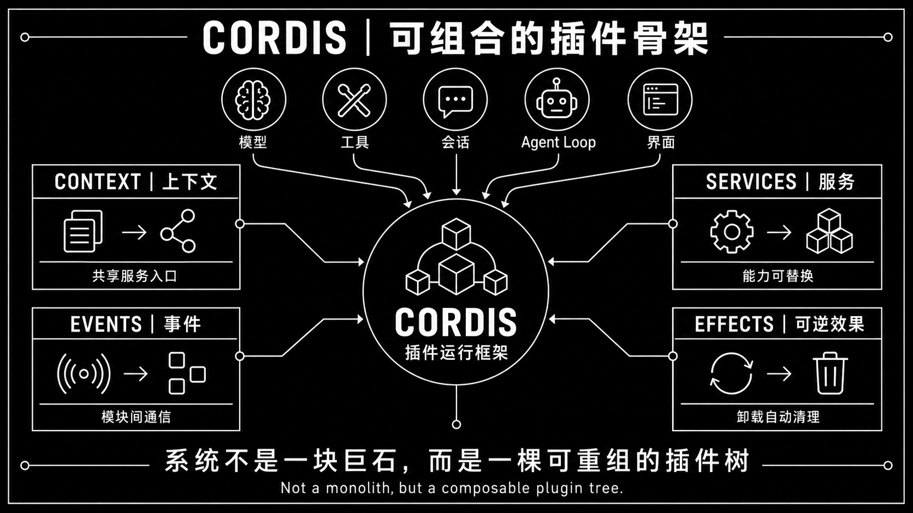
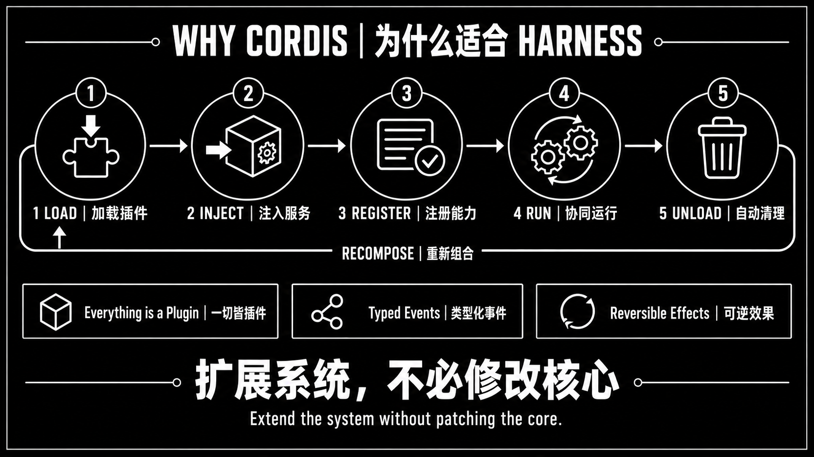

# Cordis 分享素材

用途：介绍 Cordis 的插件组合与生命周期，供技术分享、文章或演示引用。它们是概念示意图，不是真机截图、性能数据或新功能验收证据，也不表示 Mobile Mirror 修改了 Harness agent loop。

| 素材 | 内容 |
| --- | --- |
| [插件框架](cordis-plugin-framework.png) | Context、Services、Events、Effects 与插件组合 |
| [Harness 生命周期](cordis-harness-lifecycle.png) | 加载、注入、注册、运行、卸载和重新组合 |

“自动清理”指通过生命周期登记的可逆 effect，不承诺任意插件资源或手机进程都会自动回收。实际支持边界见[能力总表](../../docs/capabilities.md)；宿主编排建议见 [PTC 调研](../../docs/research/ptc-architecture-and-codex-2026-09-17.md)。原始真机媒体仍按仓库规则仅保留本机。
