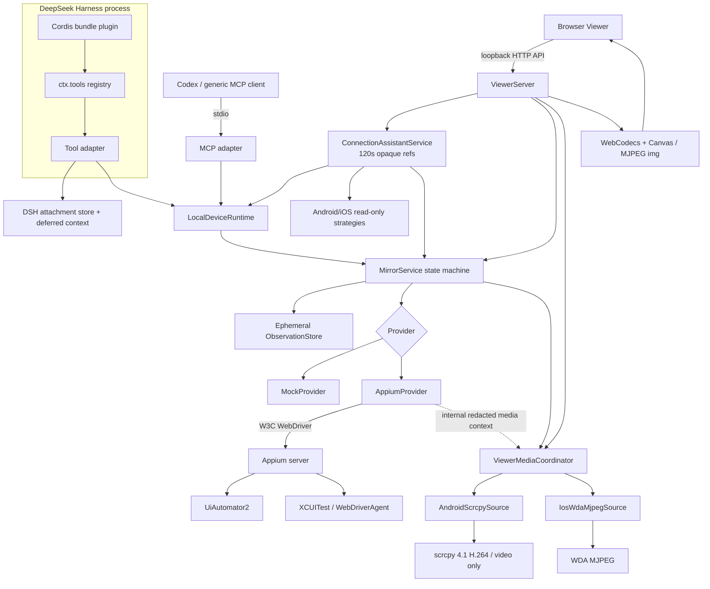
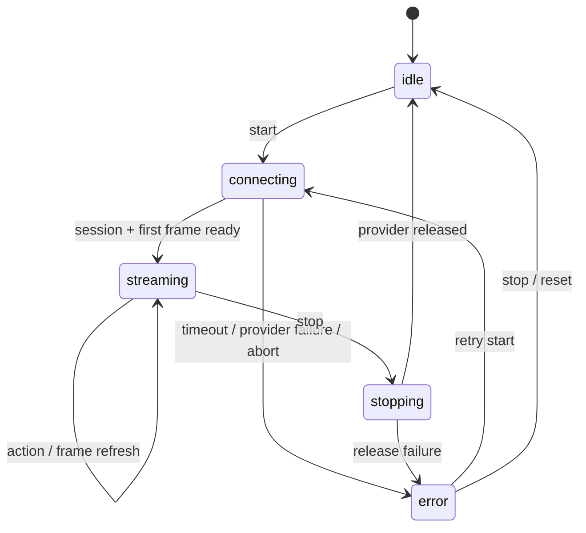
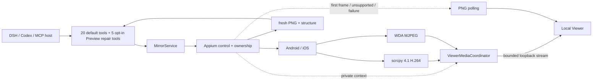

# Architecture

The evidence-guided repair loop is **Preview, off by default**. `WorkbenchApplication` composes `WorkbenchRepairCoordinator` and drains it during close. The coordinator owns repair cases, frozen verification plans and approval journals, while `MirrorService` remains the only device/maintenance owner. Source/build adapters cannot bypass it via ADB or Appium. Only Mock currently implements the maintenance/reset protocol; software checks do not grant a device verdict. Host tool visibility and project repair admission are separate gates, not a unified master switch. See [ADR 0016](https://github.com/qmkCamel/flowassert/blob/main/docs/decisions/0016-evidence-guided-repair-verification.md) and [operations](https://github.com/qmkCamel/flowassert/blob/main/docs/evidence-guided-repair-operations.md).

> For the implemented YAML workbench, shared-session execution, durable evidence and run history, see the [current workbench architecture and sequence diagrams](https://github.com/qmkCamel/flowassert/blob/main/docs/design/mobile-test-workbench-current.md). The components below describe the shared bridge; current priorities are tracked in [PRODUCT_TODO](https://github.com/qmkCamel/flowassert/blob/main/PRODUCT_TODO.md).

Workbench result projection is shared across Viewer, JSON, JUnit, CLI and Agent surfaces. The ViewerServer retains central same-origin authorization and delegates run, baseline, sharing, retention and trend routes to separate HTTP handlers; suite and comparison routes remain in the main server. WorkbenchService retains device/run scheduling; native worker RPC, business hook/private resource journal, step evidence and terminal aggregation are separate components. Cleanup journal persistence and owner-local capacity admission are separate from retention policy. Durable share jobs, suite attempt tombstones and retention journals use the same local WorkbenchStore owner boundary, but none owns device control. A suite releases attempt media references only after a verified frozen summary is committed; trends accept historical facts only with a matching cleanup journal. Viewer share, trend, retention, baseline, repair and comparison panels hold their own action state; history selection and result/provenance facts render through separate modules, while run, replay and video orchestration remain in the main Viewer module.

Experimental evidence-guided triage is another derived, read-only consumer of finished Workbench runs and an optional explicit comparison. `WorkbenchTriageService` takes store snapshots/read leases, applies deterministic rules in a bounded worker, and publishes a versioned report plus its protective reference through the store mutation gate. Viewer and attach-only CLI can request generation; MCP/DSH expose only an already generated report to an authorized registered test execution, filtered by shared-evidence policy. The report never changes the execution verdict, owns no provider session, and sends no continuous media through tools. See [ADR 0010](decisions/0010-workbench-product-contract-boundary.md) and the [triage guide](evidence-guided-triage.md) for incomplete crash/real-device acceptance.

For product positioning, the current capability map, the role of the local Viewer, and the target DSH/Codex shape, see [Product shape and capability boundaries](product-shape.md).

## Local authoring and historical analysis

`WorkbenchApplication` also owns `WorkbenchAcceptance`, `WorkbenchAuthoring`, `WorkbenchCaseLibrary` and read-only `WorkbenchInvestigation`. Acceptance shares durable IO/lifecycle mechanics between isolated Agent and Viewer channels, not authorization. Cases own immutable authoring revisions and an atomic CAS catalog under the store root; they never replace run manifests or evidence references. Receipt-bound authoring ultimately uses the existing WorkbenchService/MirrorService execution boundary. Constructors do not initialize storage or start device work. Closure stops admission, drains acceptance/case/investigation work and existing workers, then releases the store.

Native Viewer modules separate hash routing, authoring forms, analysis, and common accessible controls. Historical analysis requests registered artifacts through the original integrity/lease path and never substitutes live device media. Comparisons, triage, reviewed repair and sharing reuse existing owners. New case/history/authoring endpoints are additive; old HTTP/CLI/MCP/DSH contracts remain frozen, with no extra host tools from the authoring change itself; the separately gated repair Preview adds five. See [ADR 0015](decisions/0015-shared-durable-authoring-acceptance.md) and the [first-test guide](test-workbench.md) for budgets, consent, fixed-revision semantics and rollback restrictions. Physical-device and independent-user acceptance remain separate from software/Mock gates.

## Goals

- One agent-facing lifecycle for Mock, Android, and iOS.
- A Mac-local visual feedback loop that does not inflate model context with video frames.
- One shared runtime and provider seam for DeepSeek Harness, Codex, and other MCP clients.
- Explicit progress, cancellation, failure, and Appium session ownership.

## Components

The packaged `flowassert` CLI is a separate user-facing edge. Its doctor path uses the shared scoped preflight planner and bounded read-only checks; registered-test preparation additionally uses the existing project loader and cancellable plan compiler without executing flows or hooks. It does not register agent tools, start the Viewer or create a device session. Configuration rendering becomes host configuration only after the user reviews and applies it. See [Doctor v2](environment-preflight.md) for entry/operation scope and migration.

## Lifecycle

Transitions increment a revision. Status exposes the last usable frame time, last action, and last error. A frame-refresh failure keeps the prior frame available and records the error instead of blanking the Viewer. Control completion is independent from optional post-action capture: the Viewer refreshes asynchronously, while a timeout after a mutation request is fenced as an uncertain mutation and is never retried automatically.

## Tool boundary

Lifecycle tools keep their compatible JSON-text result. `snapshot` and `inspect_screen` return exact canonical JSON summaries. DSH stores a requested PNG through its attachment service and appends it exactly once as deferred plugin user context; MCP appends exactly one `image/png` content block. Bytes, Base64, paths and attachment locations are absent from canonical JSON, logs and `MirrorState`. Continuous Viewer frames stay on the local HTTP path.

`LocalDeviceRuntime` owns one guided Appium runtime, service, Viewer listener, connection assistant, preflight service and shared command layer. The assistant is Viewer-only: it performs one selected platform's read-only checks, stores private device/path mappings behind 120-second single-use references, and calls `MirrorService.start()` with fixed Settings capabilities. It does not register a DSH/MCP tool or create a second provider/session owner. `MirrorService.observe` coordinates one capture at a time, binds geometry/image/structure to session generation, screen epoch, revision and capture window, and publishes only after the session is still current. The in-memory store keeps at most four observations per session for 60 seconds with a 32 MiB image cap. DSH-specific attachment/message types and MCP-specific result types remain in their adapter layers.

Appium geometry, screenshot and page source are sequential requests, not a device-side transaction. The adapter reports both capture timestamps. XML is parsed with a no-external-entity streaming parser and fixed response/depth/node/field/JSON limits; raw XML never enters a tool result.

Observation-bound actions validate generation, latest revision, epoch, store TTL and a separate 15-second action freshness. Snapshot pixels map to viewport coordinates with `floor(pixel * viewportSize / imageSize)` after strict half-open boundary checks. `tap_node` performs observation-local exact lookup and converts the positive visible bounds intersection to a viewport tap; no locator fallback crosses the provider seam. `input_text` additionally requires a focused, non-sensitive input, then Appium verifies the W3C active element rect overlaps at least 50% of the smaller rectangle before clear/value. Legacy viewport actions remain compatible and deliberately have no stale protection.

Application lifecycle is a separate command rather than an action variant. The core resolves `disabled`/`session-app`/exact `allowlist`, requires an owned provider session, and passes only the internally authorized target to the provider. State is queried before and after activate/terminate. Public results expose operation, scope, state transition, outcome and epoch, but not the target id.

Actions, application management and observations share one exclusive queue. A non-serializable mutation marker distinguishes preflight rejection from a request that may already have changed the device: both success and may-have-mutated failure increment `screenEpoch`, invalidating every previous observation. Generic `control` progress is safe for DSH, MCP and Viewer projection; payloads and provider identifiers never enter it.

The DSH plugin registers through the documented `ctx.tools` service and acquires the shared runtime inside `ctx.effect()`. The MCP entrypoint exposes the same runtime over stdio. Hot replacement, EOF, SIGINT, SIGTERM or explicit close first stop the Viewer listener, abort/quiesce operations, then dispose any adapter-owned Appium session.

## Appium ownership

- A session created from capabilities is **owned**; stop deletes it.
- A supplied `sessionId` is **attached**; stop detaches and leaves it running.
- Provider start probes `/status` before session work and fails with the configured bounded timeout.
- Credentials sometimes embedded in cloud capabilities are neither logged nor returned.

Appium server ownership is separate from session ownership. `external` is the default and never signals the server process. `managed` requires an absolute executable and HTTP loopback URL, starts lazily before an Appium session, waits for `/status`, and rejects both attached sessions and a pre-existing listener. `MirrorService` closes media, then the provider-owned session, then the exact saved child handle. A connecting start has its own cancellation signal, so Viewer Stop can cancel it without scanning or terminating unrelated processes. The shared state exposes only mode, phase, owned and a stable error code.

## Continuous media boundary

The Viewer has a third path independent from control and discrete agent observation:

- `MirrorService.start()` becomes ready after the Appium session and first compatible frame; media starts lazily only when the Viewer subscribes.
- Android uses scrcpy for video only. Appium remains the only input and session-ownership stack.
- iOS uses the WDA MJPEG broadcaster on an owned non-conflicting port. Attached sessions are read-only and need an explicit port hint.
- H.264 key envelopes are self-describing with codec, size and SPS/PPS-backed key bytes. The queue holds at most two packets / 8 MiB; after a dropped delta it waits for the next key.
- The Viewer keeps polling until a media frame is actually painted, preserves the last usable media frame on failure, then replaces it only after a new PNG loads. PNG fallback is single-flight with a five-second established-session bound, exponential failure backoff, degraded status after three failures and a ten-second liveness probe. Initial page/session recovery may read the in-memory compatible frame without issuing a new Appium command; a successful fresh frame resets degradation.
- The last subscriber disconnect starts a five-second idle grace, then exact source resources are released before provider shutdown.
- MCP and DSH remain control/status planes. Continuous bytes never enter tool results, observations, attachments or persistence.

The discrete perception contract, host-neutral stdio MCP adapter, and low-latency media implementation are present. DSH `0.2.0-rc.2` has passed packed clean-profile Native/PTC runtime compatibility and catalog-level image/text-only boundaries; a historical DSH rc.8 session with an image-capable provider and a real Codex MCP session have consumed images and completed observation-bound action loops. Unlocked Android/iOS Settings pages have completed the physical MCP loop, and one device on each platform has passed the physical media performance/fallback gate. Remaining external work is broader OS/OEM/account, reconnect, rotation, lock-state, multi-device coverage, and a real provider call through the rc.2 `deepseek-flash` image route; catalog metadata alone is not model-consumption evidence.
## 2026-10-02：区域 OCR 与双槽矩阵补充

既有单设备运行时不变。区域 OCR 的识别子进程无设备权限，在同一运行租约检查点消费 PNG；冻结评测与人工批准后才可用显式断言，默认关闭。矩阵是单设备运行时的进程级组合，不是第二套 provider：父协调器持久调度，每槽独立 Store 与机器级 claim，MCP／DSH 只读摘要。见 [ADR 0015](decisions/0015-local-device-matrix.md)、[OCR](local-region-ocr.md)、[矩阵](local-device-matrix.md)。软件／Mock 验证不替代真实 OCR 质量或双设备业务验收。

## 报告展示与离线阅读边界

报告摘要查询、分析和被动 HTML 继续使用工作台权威结果投影；展示层不重新裁决结果。HTML 由现有分享 owner 将派生材料转换为严格白名单 snapshot，再交给不读取源对象/路径的被动渲染器。确认绑定冻结字节，发布沿用来源引用、lease、容量与原子提交。Viewer/CLI/MCP/DSH 的设备/连续视频/控制边界不变。操作与回滚说明见 [报告阅读与离线分享](report-reading-and-sharing.md)，设计理由见 ADR 0010。
