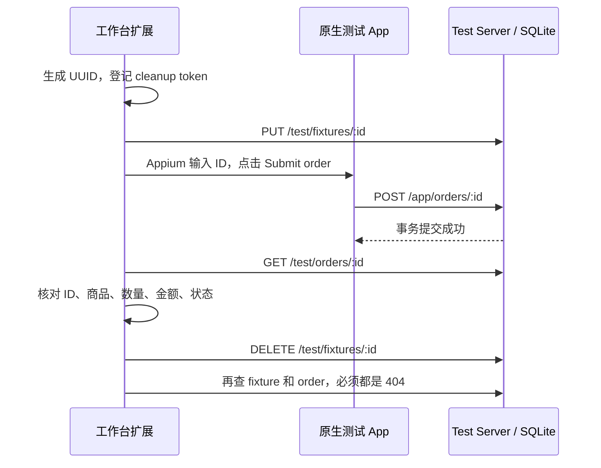

# 真实业务验收夹具

源码位于 `fixtures/business/`。这是仓库自带的最小 Android/iOS 原生 App + 本机 Test Server，仅操作合成测试订单，无账号、支付或生产接口。它验证框架的真实 UI→后端闭环，不代表第三方 App或其他生产业务已验收。



商品固定为 `fixture-item`，数量 1，金额 1200 分。订单唯一键是该轮 UUID，重复点击幂等。prepare 不创建订单，verify 不信任 UI 文案；SQLite 支持进程重启后查询。清理按该 UUID 级联删除，绝不删除整个数据库。强杀后的待清理 token 沿用工作台私有 journal，人工处理时只删除对应 UUID。

## Android

需要 Node 24、JDK、Android SDK（默认 platform android-33 / build-tools 33.0.2）。可通过 `ANDROID_PLATFORM` / `ANDROID_BUILD_TOOLS` 显式覆盖已安装版本。

```sh
ANDROID_HOME=/absolute/android-sdk node fixtures/business/android/build.mjs
adb -s SELECTED_UDID install -r artifacts/fixture/android/fixture.apk
adb -s SELECTED_UDID reverse tcp:47831 tcp:47831
```

如手机要求安装确认，在手机允许安装。只安装 `dev.mobilemirror.fixture`，不卸载/重置其他 App。debug keystore/APK/SQLite/生成项目均保留在被忽略的 `artifacts/fixture/`，不发布到插件 tarball。

复制 `fixtures/business/android/capabilities.example.json` 到本机私有路径，填写所选设备 ID。然后运行正反例探针（自带服务端，端口 47831 必须空闲）：

```sh
MOBILE_MIRROR_CAPABILITIES_PATH=/absolute/capabilities.json \
MOBILE_MIRROR_APPIUM_EXECUTABLE=/absolute/appium \
pnpm exec tsx scripts/business-fixture-physical-probe.ts
```

探针显式创建并停止自己的 Appium/Viewer，复用一个设备会话；校验正例 pass/退出码 0、错误金额反例 fail/退出码 1、两轮 cleanup pass，再重启材料存储复验所有哈希。原始 PNG/XML、扩展 JSON、suite/run ID 和 report 位于 `artifacts/physical-validation/business-fixture-*`。探针自身退出 0 表示正反例都符合预期，不是反例通过。

结束后如不再需要：`adb -s SELECTED_UDID reverse --remove tcp:47831`。测试 App 留在手机，方便复验。

## iOS

```sh
# 未签名编译检查
node fixtures/business/ios/build.mjs
# 安装真机前用自己的开发团队签名；本脚本不自动申请 provisioning
FIXTURE_DEVELOPMENT_TEAM=YOUR_TEAM node fixtures/business/ios/build.mjs
```

需要 Xcode 与 XcodeGen；生成工程在 `artifacts/fixture/ios/`。无可用签名时在 Xcode 打开工程配置开发团队并安装，不能拿未签名构建当真机通过。

iPhone 的 localhost 不是电脑。真机同一可信局域网时，探针设置 `FIXTURE_HOST=0.0.0.0`、`FIXTURE_DEVICE_URL=http://COMPUTER_LAN_IP:47831`；默认仍为 loopback。复制 `fixtures/business/ios/capabilities.example.json` 到私有路径，填写显式 UDID、开发团队并按已有 WDA 签名配置连接。首次“使用无线数据”选择“仅限无线局域网”，如再弹出本地网络访问提示也需授权。LAN 模式没有认证，只允许合成数据和可信隔离测试网络，不用于公网。

App 提交期间显示进度、禁用重复提交，Help 可切换说明；失败保留上一条成功 ID。两个平台使用 `fixture.endpoint/id/submit/help` accessibility identifier。

## 在已有 Viewer 手动运行

```sh
pnpm exec tsx fixtures/business/server.ts
# 另一个终端：host origin 给扩展，device origin 给手机
pnpm exec tsx fixtures/business/project.ts android http://127.0.0.1:47831 http://127.0.0.1:47831
MOBILE_MIRROR_TEST_PROJECT="$PWD/artifacts/fixture/android/project/project.json" pnpm dev
```

在 Viewer 连接测试 App 后运行 positive 或 negative。negative 故意期望 999 分，UI 可成功，但业务必须 fail。运行配置、模块和 YAML 都由生成项目保存为可读文件，也可以在工作台查看/维护；未引入 YAML 版本或历史兼容分支。

## 验收状态

2026-09-17：Android 与 iOS 完整业务闭环、慢请求交互均已实测。APK 构建、iOS 签名构建及真机安装通过；服务重启持久化、隔离/幂等/清理、实际注册扩展正反例有自动化测试。早期未通过记录按时间保留如下，最新双端结论见末尾。

- `pnpm check`：336 项测试、43 个文件通过，类型和契约检查通过；其中 5 项新增夹具测试，双端生成 YAML 均经过实际编译预检。
- `pnpm test:e2e`：最终完整重跑 42/42；首轮与构建同时运行时 4 项启动/交互检查失败，保留该次失败，不计为通过。
- `pnpm build`、`pnpm pack:check`、新 change OpenSpec strict 通过。
- Android 后续执行：`pm path dev.mobilemirror.fixture` 已返回安装路径。探针在 `adb shell getprop ro.build.version.sdk` 20 秒超时，独立 10 秒复查仍超时；一次 echo 成功不足以证明稳定恢复。报告为 `artifacts/physical-validation/business-fixture-android-2026-09-17T06-21-26-615Z/report.json`，cases 为空，无 suite/run 成功记录；没有执行 prepare/UI，SQLite 两张表均为零。探针持有的 Appium/服务已退出，4723/47831 无监听。
- 之后系统确认 versionName=1.0、installed=true，冷启动成功；完成下面正反例。后续复跑 run `ecd2f409-e21f-4886-9bce-6a8147fcca1f` 在 UI 断言阶段 Appium 超时，终态 inconclusive、cleanup pass，SQLite 两表为零。独立 UI 补测再次在版本读取阶段超时，故不将稳定性或慢请求交互标记通过。
- 本轮未提交、未推送。原编排任务 4.5 已完成；4.4 更广的双端编排矩阵仍待办。本夹具双端业务与慢请求 UI 已在下方最新复跑中通过。

### Android 真实业务证据

| 用例 | suiteId | runId | UI / 独立业务 / 清理 | 退出码 |
| --- | --- | --- | --- | --- |
| 正例 | c2052db7-b788-4973-b251-d9bff4487589 | 949b7264-c071-4a12-8197-e3baa53344ff | 成功 / 1200=1200 pass / pass | 0 |
| 错误金额反例 | 06e42cfe-651f-45e9-a4cf-4ee6177ec3ca | b4249e29-0e2e-4574-b47b-722b06cfbe30 | 成功 / 999≠1200 fail / pass | 1 |

完整材料位于 `artifacts/physical-validation/business-fixture-android-2026-09-17T06-24-15-525Z/`。两轮均为真实手机输入并点击提交；verifier 记录读取时间、查询 URL、订单 ID/商品/数量/金额/状态，cleanup 再查订单和 fixture 必须 404。重启后 36 份 PNG/XML/YAML/扩展材料全部哈希通过，独立读取 SQLite 确认两表均为零。

已目视检查[正例截图](../artifacts/screenshots/mobile-mirror-fixture-android-positive.png)与[反例截图](../artifacts/screenshots/mobile-mirror-fixture-android-business-negative.png)：两张 UI 都显示 Order submitted，而反例最终为业务失败。这正是独立 verifier 的作用。[安全摘要](../artifacts/metrics/mobile-mirror-business-fixture-android.json)保留 IDs 和判定，原始材料留本机。

慢请求探针给服务端 POST 注入延迟（Android 8 秒、iOS 15 秒，分别超过客户端 5/10 秒请求超时；仅进程内测试选项，上限 20 秒，无 HTTP 配置入口），检查 Submitting 期间 Help 可操作、超时后保留上一成功 ID；Android 已在下方 14:45 完整复跑中通过。`FIXTURE_UI_ONLY=1` 可单独运行双端该部分，需要手机已停在测试 App 且有上一成功结果；该模式不产生业务套件通过声明。

再次复跑（2026-09-17 14:37）：报告位于 `artifacts/physical-validation/business-fixture-android-2026-09-17T06-37-08-016Z/report.json`。独立 ADB 版本读取 10 秒超时，Appium 同命令 20 秒超时，cases 为空；没有执行 prepare/订单操作。托管进程已退出，4723/47831 无监听。尝试仅重连所选设备后短暂 offline，随后恢复 device（transport 6），但版本读取再次 8 秒超时；设备列表在线不代表命令通道恢复，未通过结果继续保留。

### 最新复跑：2026-09-17 14:45，Android 全部预期通过

ADB 版本读取恢复，返回 API 34。完整报告位于 `artifacts/physical-validation/business-fixture-android-2026-09-17T06-45-25-140Z/report.json`，`complete=true`：

- 正例 suite `c651406e-8885-4bc9-b93e-a40813edc817`，run `06787b24-a837-4a29-aa87-99df17d6f39f`：业务 pass、cleanup pass、退出码 0。
- 错误金额反例 suite `3be44926-6ea6-423c-b4c9-5f1a3d758dbf`，run `b80391c1-176f-4bbc-8701-bfc4627922bf`：业务 fail、cleanup pass、退出码 1，符合反例预期。
- 新一轮 36 份业务材料重启后哈希校验通过；独立 SQLite 查询 fixture/order 均为零，4723/47831 无遗留监听。
- 原生慢请求交互通过：已目视检查[Submitting + Help 展开](../artifacts/screenshots/mobile-mirror-fixture-android-slow-help.png)和[Network error + 上一成功 ID 保留](../artifacts/screenshots/mobile-mirror-fixture-android-network-failed.png)。对应 PNG 与结构 JSON 保留在该目录。

本轮关闭 Android 慢请求 UI 验收缺口；iOS 同等真机验证仍待完成。历史 ADB/Appium 超时保留，不据单轮恢复宣称根因已修复或稳定性通过。本轮只更新验证材料和文档，无运行时代码变更。

### iOS：2026-09-17 14:56，完整验收通过

iPhone 16 Plus / iOS 26.2.1，使用现有开发团队签名、已有 WDA，在真机安装 `dev.mobilemirror.fixture`。首次运行被系统“使用无线数据”权限拦截：run `a4e44e6c-1d7e-4077-92d4-1531c992abfb` 为 fail，business not-performed、cleanup pass，保留在 06-53-50 的本机目录。用户完成网络授权后重新运行，未覆盖该失败。

最新报告为 `artifacts/physical-validation/business-fixture-ios-2026-09-17T06-56-10-132Z/report.json`，`complete=true`：

| 用例 | suiteId | runId | 业务 / 清理 / 退出码 |
| --- | --- | --- | --- |
| 正例 | b2b8fae6-d27b-4beb-a105-96ba7502cb22 | 15dd2369-57ac-45d1-b09d-46503d4b6335 | pass / pass / 0 |
| 错误金额反例 | b107e4bb-7e7d-4d2f-9782-c5bf39d01a0d | 85d818f8-50c7-4ff6-9620-12da4166567f | fail / pass / 1 |

两轮均通过 UI 提交断言；正例独立 API 确认 1200 分，反例期望 999 而实际 1200，正确判业务失败。重启后 36 份业务材料哈希通过，SQLite fixture/order 均为零。

注入 15 秒延迟后，在客户端 10 秒超时前，Submitting 和 Help 展开均已截图/结构验证；超时后显示 Network error，上一成功 ID 保留。已目视检查该目录的 `ui-slow-help.png`、`ui-network-failed.png`；原始截图含本机 LAN 地址，保留本机，不加入公开素材。键盘展开时部分长文本会截断，此处验证交互和数据保留，不宣称全部设备尺寸的排版适配。

宿主 Appium/xcodebuild WDA 已退出，手机进程列表无 WebDriverAgent/xctest，4723/47831/8100/9100 无监听。[安全摘要](../artifacts/metrics/mobile-mirror-business-fixture-ios.json)仅记录验收 IDs、数量和结果。

当前夹具 change 7/7。此次门禁：336 项测试、42 项 E2E、构建、打包通过。该结论覆盖双端合成订单闭环，不代表外部业务或更广设备稳定性验收；原编排 4.4 的多数据/分支/子流程/取消矩阵仍未由本测试替代。
