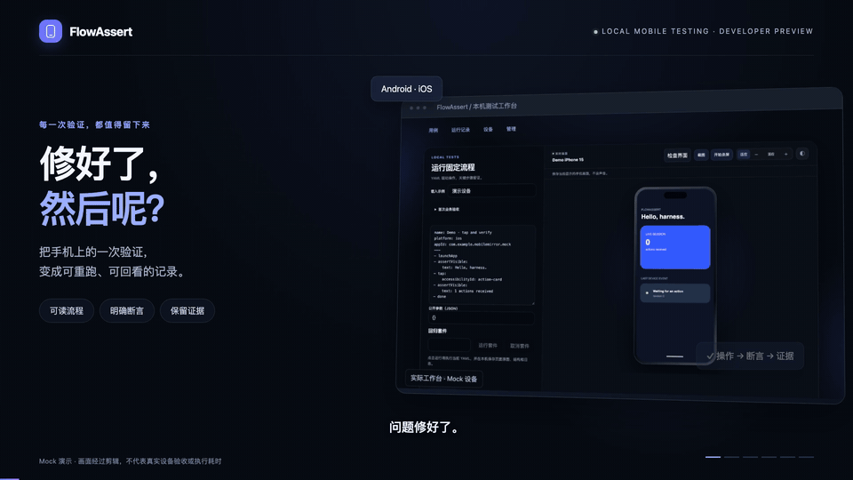

# FlowAssert 产品介绍视频



[下载完整 MP4（含旁白与配乐）](https://raw.githubusercontent.com/qmkCamel/flowassert/main/docs/communications/product-video/flowassert-introduction.zh-CN.mp4) · [中文字幕 SRT](flowassert-introduction.zh-CN.srt) · [静态封面](cover.png) · [制作记录](production.json)

README 使用 24 秒无声循环 GIF，960 × 540，10 fps，约 4 MB。从成片的六个场景各截取 4 秒，保持原速。完整视频保留配音和配乐，可通过上方直链下载。

2026-10-28 定稿，46 秒，1920 × 1080，30 fps，H.264 / AAC。采用微软晓晓 `zh-CN-XiaoxiaoNeural` 中文旁白，原生语速 `+10%`；原创 120 BPM 电子配乐包含低频脉冲、立体声琶音、轻鼓点与转场音效，人声响起时自动降低配乐音量。字幕已嵌入画面，SRT 另供复用。

画面来自 `f9d54a0533d1457b8a59aedb8db87e1fcd936d7f` 的本机 Mock 工作台采集，搭配说明性动画，沿用项目 Web 页面的暗色和蓝紫色视觉。它是经过剪辑的产品介绍，不是连续录屏、真机验收记录或执行耗时测量；当前产品仍为 Developer Preview。结尾的源码入口提示已按公开仓库状态更新。

| 时间 | 内容 |
| --- | --- |
| 00:00 | 修好了，然后呢？ |
| 00:06 | 保存可读流程 |
| 00:14 | 查看步骤证据 |
| 00:22 | 定位失败 |
| 00:30 | 复验与分享 |
| 00:38 | FlowAssert 与源码入口 |

## 重新生成 README 动图

需要 Node 和 PATH 中的 FFmpeg / FFprobe；从仓库根目录运行：

```bash
node docs/communications/product-video/source/render-gif.mjs
```

脚本从已有 MP4 提取六段画面，在 `.build/` 中生成并检查完整解码、时长、尺寸和 5 MiB 体积上限，通过后替换 `flowassert-preview.gif`，并输出文件哈希和参数。重新生成后，检查六个场景与 README 播放效果，再同步 `production.json` 的 `readmePreview` 和 `public-media-review.json` 的审查记录。

## 修改画面并重新导出

制作源文件在 [source](source/)。需要仓库锁定的 Node / pnpm、Playwright Chromium 和 PATH 中的 FFmpeg / FFprobe。先在仓库根目录完成 `pnpm install --frozen-lockfile`；尚未安装浏览器时执行 `pnpm exec playwright install chromium`。

```bash
node docs/communications/product-video/source/render.mjs --preview
node docs/communications/product-video/source/render.mjs
```

默认从现有成片提取已确认的音轨，因此只修改画面时无需调用在线语音服务。预览和中间产物写入本目录的 `.build/`，不会提交。完整导出先写临时 MP4，通过解码检查后再替换本目录的成片。首次定稿使用 macOS 字体；其他系统的字体可能影响画面布局，导出后请检查全部场景。

## 修改旁白或配乐

旁白文案在 [narration.json](source/narration.json)，画面时间轴在 [film.html](source/film.html)。音频工具独立于产品运行依赖；推荐 Python 3.12，在本目录创建隔离环境：

```bash
python3 -m venv docs/communications/product-video/.venv
docs/communications/product-video/.venv/bin/python -m pip install -r docs/communications/product-video/source/requirements.txt
```

以下命令会把六段旁白文字发送给微软在线语音服务；不发送截图或代码。`--online` 明确启用该操作。生成结果和逐词时间戳保存在 `.build/`，字幕同步更新。

```bash
docs/communications/product-video/.venv/bin/python docs/communications/product-video/source/synthesize.py --online
docs/communications/product-video/.venv/bin/python docs/communications/product-video/source/make-tech-audio.py
node docs/communications/product-video/source/render.mjs
```

配乐由本地脚本合成，无外部音乐采样。在线服务可能改变声音输出或可用性，重新生成的配音不保证与定稿逐字节一致。提交新的成片或截图前，检查字幕、完整解码、播放与音量，并按仓库流程更新 `public-media-review.json` 中对应文件的审查记录和 SHA-256。
