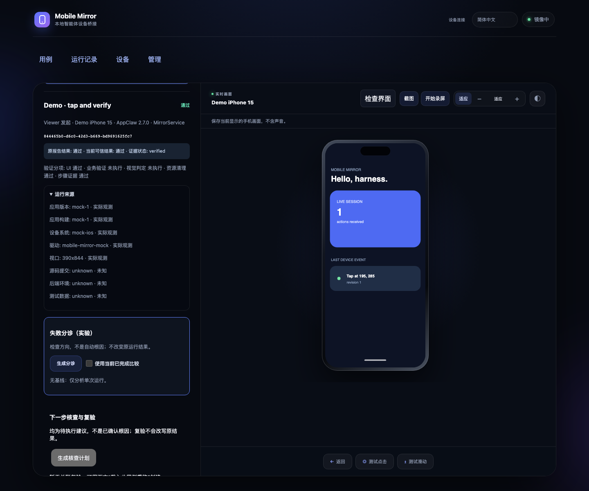
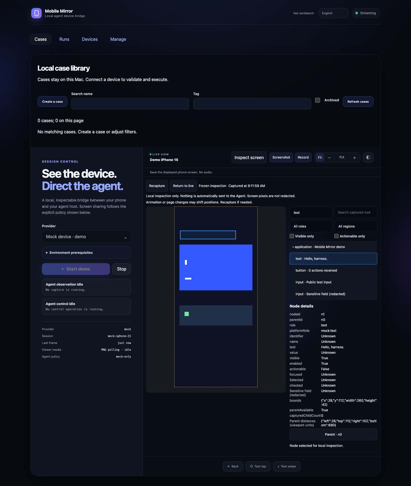
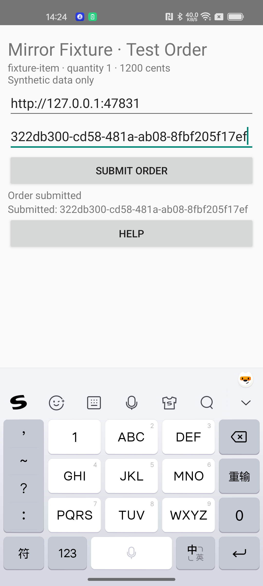
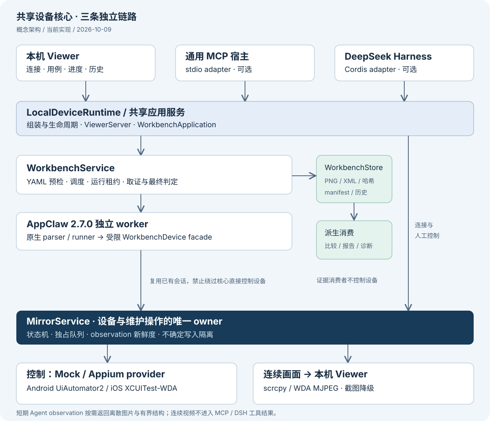
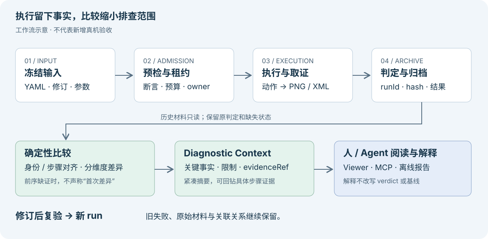
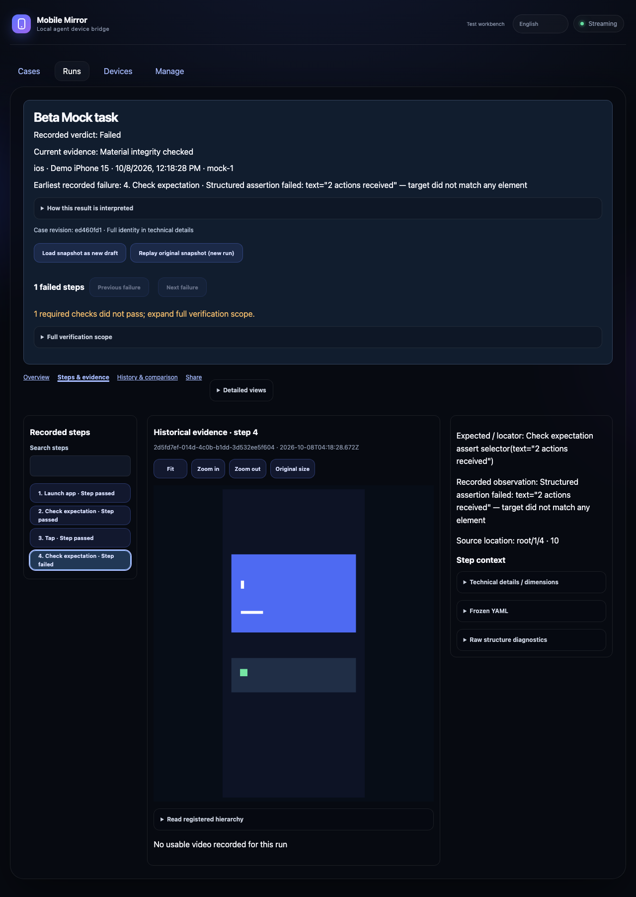
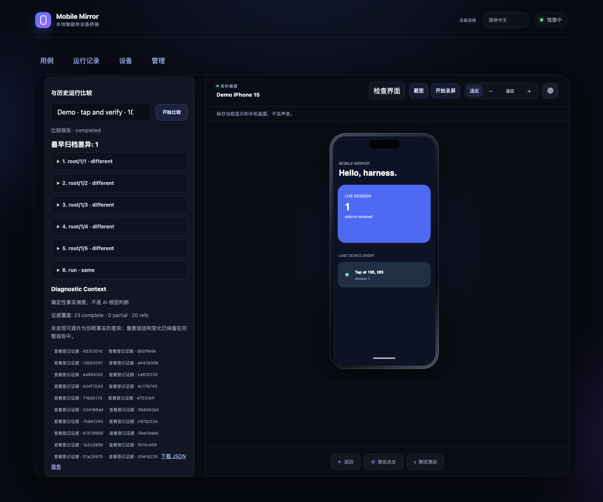
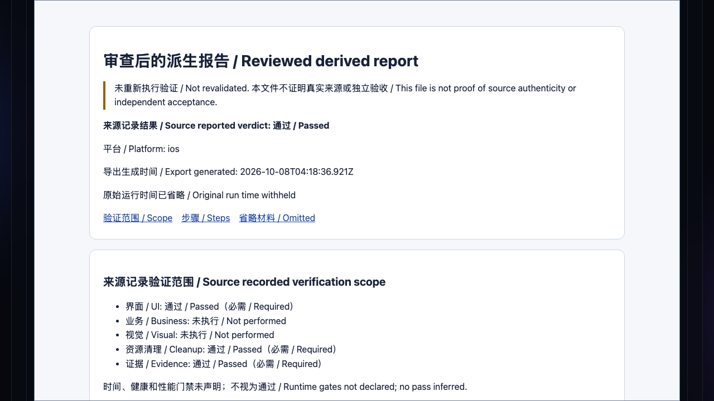

# FlowAssert 技术介绍

把手机上的一次验证，变成可重跑、可回看、可交接的工程记录。

面向移动端研发、测试开发与 Agent 工具开发者 · 2026-10-12 · Developer Preview

本文保留 2026-10-12 迁移前 `dev` 的技术介绍与既有验收记录；2026-10-25 将启动命令核对为 FlowAssert `main`。**真实设备截图、实际工作台的 Mock 截图、架构示意图分别标注**；历史验收保留原日期，本次文档整理没有重新执行真机业务。HTML 阅读版内嵌全部配图，正文可离线阅读；延伸资料链接需要仓库访问权限或网络。

术语速览：Viewer 是本机工作台界面，Inspector 是其中的界面检查器；Mock 指模拟设备，Fixture 指受控测试场景；Provider 是设备控制适配层，Observation 是带时间与有效性信息的界面观察快照。Baseline 是明确选择的比较参考，Verdict 是声明检查范围内的运行判定。完整定义与例子见[名词解释](https://github.com/qmkCamel/flowassert/blob/main/docs/glossary.md)。

## 01 · 为什么需要一个本机测试工作台

修完一个移动端问题，研发通常会拿起手机，走完一条流程，截一张图，再告诉同事“已经验证”。下一次版本改动时，流程要重走，前置数据要重新准备；一旦失败，截图、操作步骤、构建信息和后台结果往往散在不同地方。

**FlowAssert 把连接设备、编写用例、执行、留证和复验放进同一个本机工作流。** 固定流程使用可读 YAML；一次运行对应独立的 runId、输入快照、逐步截图、页面结构、断言和结果。重跑产生新记录，保留旧失败；需要交接时，可以审查并导出离线报告。

| 对谁有用 | 典型任务 | 可以留下什么 |
| --- | --- | --- |
| Android / iOS / RN 研发 | 改动后反复验证搜索、表单、导航等流程 | 可复用用例、前后两次运行及失败现场 |
| 测试开发 / 质量同学 | 把一条稳定人工流程纳入回归 | 明确断言、业务 verifier、清理结果与证据 |
| Agent 工具开发者 | 让 Agent 观察设备、执行已登记测试、解释失败 | MCP / DSH 接口、确定性结果和有界诊断上下文 |

基础工作台可独立使用，不依赖模型或 DeepSeek Harness。它适合先在开发机上做小范围真机回归试点；广泛设备兼容性、真实业务采用收益和长期稳定性仍需按项目验证。

## 02 · 实际使用效果：运行、取证、回看



*图 1｜实际 Viewer 的浏览器截图，Mock provider，2026-10-08 刷新。左侧将 UI、业务、视觉、清理、证据分开显示；右侧保留设备画面。图中业务与视觉为“未执行”，不能由总结果推断为已验证。来源：[截图刷新记录](../screenshot-refresh-2026-10-08.md)。*

典型使用路径是：连接设备 → 用界面检查器（Inspector）确认节点 → 保存 YAML → 执行并查看进度 → 打开失败步骤 → 修改后生成新运行 → 审查分享报告。用例库保存到本机，修订与运行记录分别管理；可独立运行的项目可导出后纳入团队 Git，保存用例不会自动同步给同事。



*图 2｜实际 Inspector，Mock 数据，2026-10-08 刷新。冻结截图与节点树联动，便于检查文本、可见性、可操作性及 bounds。画面中的几何块是 Mock 夹具，不是手机 App 的渲染效果。*

运行中的长操作有本地进度，可查看历史或取消。发生抓取失败时保留已有可用材料；取消会等待在途请求收敛，已经发生的手机动作不会被撤销。手动截图、录屏和可选运行录像分别服务于即时观察与历史回看。

## 03 · 真机案例：同样显示成功，业务结论可以不同

下面两张都是 **Android 真机上的 Fixture App 原始截图**，来自 2026-09-17 的业务验证。Fixture 是仓库内的测试 App，使用合成订单数据和独立服务端；这是真实设备执行，但不代表线上订单系统验收。

<div class="phone-pair">
<figure><figcaption>图 3A · 正例：UI 提交成功，独立校验金额 1200 分。</figcaption></figure>
<figure><figcaption>图 3B · 反例：UI 提交成功，故意声明错误金额 999 分。</figcaption></figure>
</div>

| 检查维度 | 正例 | 故意失败反例 |
| --- | --- | --- |
| UI | 都能看到 `Order submitted` | 都能看到 `Order submitted` |
| 业务期望 / 独立读取实际值 | 1200 / 1200 分 | 999 / 1200 分 |
| 业务判定 | pass | fail，符合反例预期 |
| 清理 | pass | pass |
| 最终结果 / 退出码 | pass / 0 | fail / 1 |

对应 runId：正例 `949b7264-c071-4a12-8197-e3baa53344ff`；反例 `b4249e29-0e2e-4574-b47b-722b06cfbe30`。原记录包含重启后 36 份材料哈希复验、独立 SQLite 查询与清理结果。数据来源：[真机验收记录](../business-test-fixture.md#android-真实业务证据)、[机器可读摘要](../../artifacts/metrics/mobile-mirror-business-fixture-android.json)。本次核对了摘要与配图，没有重新审计私有原件。

这个例子说明了为什么要单独接入业务 verifier：**屏幕上出现成功提示，只能证明声明的 UI 条件满足；订单是否以正确金额持久化，需要独立读取业务真值。** 未配置 verifier 的普通用例会明确显示业务验证未执行。


## 04 · 架构：共享设备核心，分开控制、画面和证据



*图 4｜当前实现的概念架构，2026-10-09 按源码与 ADR 整理；不是部署拓扑或性能测量。可选入口表示复用同一套核心代码，不表示独立启动的宿主进程自动共享同一个 runtime。*

| 层次 | 责任与工程落点 |
| --- | --- |
| 用户与宿主入口 | Viewer 负责人工连接、创作和报告；stdio MCP 服务通用宿主；DSH 使用 Cordis 薄适配，保持 agent loop 不变 |
| 共享运行时 | `LocalDeviceRuntime` 组装连接和设备能力；`WorkbenchApplication` 组装执行、历史、比较、分享等服务并负责生命周期 |
| 确定性执行 | `WorkbenchService` 预检和调度；独立 AppClaw `2.7.0` worker 通过受限 `WorkbenchDevice` facade 调用已有设备会话 |
| 设备核心 | `MirrorService` 维护状态、运行租约、动作队列、会话所有权与不确定写入隔离；provider 对接 Mock 或 Appium |
| 平台与画面 | Appium → Android UiAutomator2 / iPhone XCUITest-WDA；连续画面走 Android scrcpy / iOS WDA MJPEG，失败时截图降级 |
| 持久化与派生分析 | `WorkbenchStore` 保存 run、manifest、材料哈希；比较、报告与诊断消费归档，不获得第二套设备控制权 |

三条链路各有用途：

- **控制链路**：点击、输入、启动/停止和测试执行由明确 owner 调度。运行租约期间，其他入口不能抢占设备控制。
- **连续画面链路**：供人观看的 H.264 / MJPEG 留在本机 Viewer，不灌入 MCP/DSH 工具结果。
- **取证与感知链路**：运行检查点保存 PNG/XML；Agent 按请求取得离散图片与有界结构，短期 observation 与持久化 run 分别管理。

截图与页面树通过顺序请求获得，保留捕获时间窗，不承诺设备侧原子一致。Agent 的节点动作会核验 observation 的会话、版本和新鲜度；旧页面不能被当成当前页面继续点击。发生“写入请求可能已经生效”的超时，会阻止后续控制，避免盲目重试。

网络服务默认 loopback。自己创建的 Appium 会话在停止时清理；附加到他人会话只解除附加。DSH 当前锁定及测试基线为 **`0.2.0-rc.2`**，同包运行时兼容与真实模型图片消费分别验收。详见[当前架构](../design/mobile-test-workbench-current.md)、[核心架构](../architecture.md)、[DSH 验证](../dsh-020-validation.md)。

## 05 · 从一次失败到可复核的诊断



*图 5｜效果与数据流示意。新的复验创建新 run；比较和 Agent 解释不会改写旧 verdict。图内不含模拟性能数字或自动修复承诺。*

确定性流程的基本约束是：先明确动作和通过条件，再执行、取证和复核。运行至少包含一个断言；未知或不支持的步骤在设备动作前拒绝。必需材料缺失会导致不确定结果，不能因为 runner 结束就显示通过。

结果需要同时看“原运行判定”和“当前材料完整性”。旧记录曾经通过，但今天材料丢失，报告会保留原记录并显示材料不可用。`cancelled`、`inconclusive`、`evidence-conflict` 和 `evidence-contaminated` 有各自含义，不应合并为业务失败或成功。



*图 6A｜实际工作台的 Mock 故意失败截图，2026-10-08。失败留在原运行，后续复验不会覆盖它。来源：[内测演示验证](beta-demo-validation.md)。*



*图 6B｜实际工作台比较效果，Mock 运行，2026-10-08 刷新。它展示确定性事实和 evidence refs；不代表 AI 已诊断根因。*

比较过程先核对用例身份、输入、平台和环境，再保守对齐步骤，分别比较截图、结构、断言、业务、清理和耗时，最后压缩成 **Diagnostic Context**。Agent 可以从摘要回到必要证据，解释可能原因；系统不提供内置 AI verdict，像素变化也不会自动变成业务失败。跨平台或图像尺寸不同的记录可能仅适合并排阅读。



*图 7｜实际工作台的 Mock 报告预览，来源：[内测演示验证](beta-demo-validation.md)。导出的 HTML 明确标注派生、未重新验证和省略范围。*

分享前选择材料、遮蔽敏感像素、检查最终预览，再确认下载。离线 HTML 用于阅读；接收者无需访问原手机或本机服务，但该文件不会重新执行测试，也不是可导入复跑的测试工程。详见[比较指南](../run-comparison-analysis.md)和[报告指南](../report-reading-and-sharing.md)。

## 06 · 与其他方案怎么选

以下为 **2026-10-09 查阅官方资料后的定位比较**，不是同设备基准测试。不同方案可能组合使用；“需自行集成”表示该工程路径需由团队核对，并不宣称对方没有插件或扩展能力。

| 方案 | 主要入口与优势 | 采用时主要工作 | 与 FlowAssert 的关系 / 适用选择 |
| --- | --- | --- | --- |
| **FlowAssert** | 本机 Viewer + YAML + 逐步证据 + 历史/比较 + MCP/DSH | 平台环境、稳定定位器、测试数据、独立 verifier；Preview 验收 | 适合需要把本机真机操作、复验和结果交接连起来的小范围试点 |
| **Appium** | WebDriver 驱动生态，可用代码组织移动端自动化 | 自选测试框架、报告、业务检查与运行治理 | 是当前设备控制底座。已有成熟 Appium 工程时，优先评估复用现有资产，无需为 UI 重写所有测试。[官方介绍](https://appium.io/docs/en/latest/intro/) |
| **Maestro** | 可读 YAML Flows、Studio、CLI / Cloud；官方首页也提供 MCP 入口 | Flow 维护、设备支持面、业务扩展与流水线 | 适合已有 Maestro 资产或偏好其创作/云运行流程的团队。FlowAssert 当前不执行 Maestro YAML，语法相似不代表兼容。[Flows](https://docs.maestro.dev/maestro-flows) · [产品入口](https://maestro.dev/) |
| **Mobile Next / mobile-mcp** | 面向 Agent 的移动设备工具，accessibility 快照、截图/坐标交互；支持本地与云入口 | 宿主权限、规划预算，以及项目级判定和归档需求 | 适合先解决 Agent 如何操作手机。选型重点是设备工具接入还是完整的用例、证据与复验工作流；不把它描述为只有点击能力。[官方仓库](https://github.com/mobile-next/mobile-mcp) |
| **Midscene** | 视觉驱动 Agent、交互/提取 API、报告与计划缓存，提供移动平台 API | 模型配置、截图数据范围、可重复性评估和业务断言 | 适合评估视觉语义导航。FlowAssert 固定步骤不调用模型，有限 AI 恢复是显式能力；二者尚无同输入双端性能/成本对照。[官方 API](https://www.midscenejs.com/reference/) |

特别注意 iPhone 真机：本次查阅的 [Maestro UIKit 官方页](https://docs.maestro.dev/get-started/supported-platform/ios/uikit)仍标注 iOS 物理设备执行尚不支持。不要将历史 fork/PR 试验当成官方发布能力；实际选型应再次核对拟用版本。Appium 的平台能力则依赖具体驱动和环境，FlowAssert 也不会消除 WDA 签名或 ADB 稳定性问题。

按需求做选择更直接：

- 已有稳定 Appium / Maestro 回归资产：先保留执行体系，评估报告/证据接入成本；当前外部资产入口不等于可以代跑任意外部 runner。
- 从零建立本机真机回归，同时需要人工查看和 Agent 接入：可试 FlowAssert 的最小闭环。
- 核心需求是探索性 Agent 操作：优先比较 mobile-mcp 与视觉 Agent 的工具、模型及权限路径。
- 核心需求是大规模云设备并发：优先评估云运行方案；FlowAssert 本机双槽的工程实现不等于已验证的设备农场。

目前没有统一实验数据支持“更快若干倍”“节省多少人力”或“更高成功率”。评价试点时应记录首轮安装时间、重复运行成功率、失败定位时间、单次维护成本和材料可读性，而不是只比较演示视频。

## 07 · 一个可以立即体验的最小用例

先准备 Node.js **24.19.0**、pnpm **11.7.0** 与 GitHub 仓库访问权限；这是已有内测环境基线。mise 可选，已有等价工具链可以直接执行以下命令：

```bash
git clone --branch main https://github.com/qmkCamel/flowassert.git
cd flowassert
git rev-parse HEAD
pnpm install --frozen-lockfile
pnpm peers check
pnpm build
node scripts/mobile-mirror-cli.mjs doctor --operation mock
pnpm start
```

逐条执行；某一步失败先处理错误。打开终端打印的 loopback 地址，在设备页启动 Mock，再进入「用例」新建并保存下面的流程。端口占用时可用 `pnpm start --port 0`。

```yaml
name: Beta Mock task
platform: ios
appId: com.example.mobilemirror.mock
---
- launchApp
- assertVisible:
    text: Hello, harness.
- tap:
    accessibilityId: action-card
- assertVisible:
    text: 1 actions received
- done
```

`platform: ios` 在这里描述 Mock，不需要 iPhone。首次校验并执行后，应看到五步通过。然后停止并重新启动 Mock，把期望改成 `2 actions received`，保存新修订并运行，观察第 4 步失败；再次停止/启动 Mock、恢复原期望后运行，确认旧失败与新通过同时留在历史。**修改期望仅用于这个已知的故意失败示例；真实业务失败要先确认产品预期与原因。**

每轮重连是为了重置 Mock 点击计数；重跑或 `launchApp` 本身不会清零。最后按报告入口预览并下载 HTML。完整过程见[内测任务卡](../beta-start.md)，环境问题见[FAQ](../faq.md)。

真机接入另需平台准备：Android 的调试授权、ADB、Appium/UiAutomator2；iPhone 的信任与开发环境、Xcode、XCUITest/WDA 签名。先按[Android 指南](../android-real-device.md)或[iPhone 指南](../ios-real-device.md)建立可用会话，再将业务流程转成用例。

## 08 · 采用成本与当前边界

落地成本主要在测试工程本身：给关键控件稳定的 accessibility identifier，准备可重置的数据和账号，明确等待/断言条件，并为需要持久化证明的流程提供独立只读 verifier 与清理接口。被测 App 不需要嵌入 FlowAssert 专用 SDK；自绘页面、不可访问文本和动态坐标会增加维护成本。

| 状态 | 当前可以如何理解 |
| --- | --- |
| 已有真机样本 | 双端基础控制、固定流程、逐步取证、业务 Fixture 正反例、历史/录像与比较均有对应验收记录；结论只覆盖报告中的设备与场景 |
| 有工程实现，仍需业务放行 | 视觉基线/OCR profile、双槽矩阵、时间/性能门禁、外部资产与部分故障矩阵；Mock 和合成 Fixture 不能替代项目验收 |
| 有限 AI 导航恢复 | 有限定模型与双端 Fixture 证据；需显式配置和预算，保留原失败与 recovered；不覆盖业务断言失败 |
| 证据驱动修复闭环 | Preview，默认关闭；软件与 Mock 协议不代表真实 App 构建、安装、修复和复验已全面打通 |
| 尚缺广泛采用证据 | 更多设备/OEM/系统、独立用户、真实业务、长期连续运行；不能宣称生产级全覆盖 |

本地优先也有明确数据边界：基础工作台材料保存在本机；如果主动启用云模型/宿主图片消费，应按对应配置评估外发范围。连续媒体不进入工具结果，并不意味着主动发送的离散截图天然没有敏感信息。

建议首个试点选一条 **5–15 步、前置状态可重置、结果明确** 的流程。完成正例、故意失败、取消、重启回看和报告阅读；需要业务保证时再接 verifier。确认失败能准确落到步骤、材料缺失不会误绿、同事能读懂报告，再扩大流程与设备范围。采用标准见[采用指南](../adoption-guide.md)。

## 09 · 阅读地图与配图来源

| 下一步 | 入口 |
| --- | --- |
| 直接试用 | [任务卡](../beta-start.md) · [FAQ](../faq.md) · [离线交互演示](mobile-mirror-demo.html) |
| 了解能力与验收缺口 | [能力总表](../capabilities.md) · [2026-10-07 真机续验](../physical-validation-2026-10-07.md) |
| 维护用例与扩展 | [工作台](../test-workbench.md) · [编排](../test-orchestration.md) · [业务模板](../workbench-business-template.md) |
| 开发适配器 | [核心架构](../architecture.md) · [当前架构](../design/mobile-test-workbench-current.md) · [MCP 接入](../mcp-hosts.md) |
| 理解事实与推断的边界 | [比较](../run-comparison-analysis.md) · [报告](../report-reading-and-sharing.md) · [安全](../security.md) |

本文共使用 **7 张既有真实采集的 PNG**（其中两张为 Android 真机 Fixture，五张为真实浏览器运行的 Mock 界面）与 **2 张新绘制的 SVG 示意图**。未用 AI 生成手机画面，未修改截图像素。PNG 来源与字节 SHA-256 由随文 `technical-introduction-assets.json` 清单固定；旧截图中的时间、语言和界面位置属于原采集时刻。

正文是维护源；运行 `pnpm docs:render` 可重新生成内嵌图片的 HTML 与素材清单。分享 HTML 可单独传递，查看全文不请求外部字体、图片或脚本；延伸资料通过 GitHub 和官方站点链接阅读。
