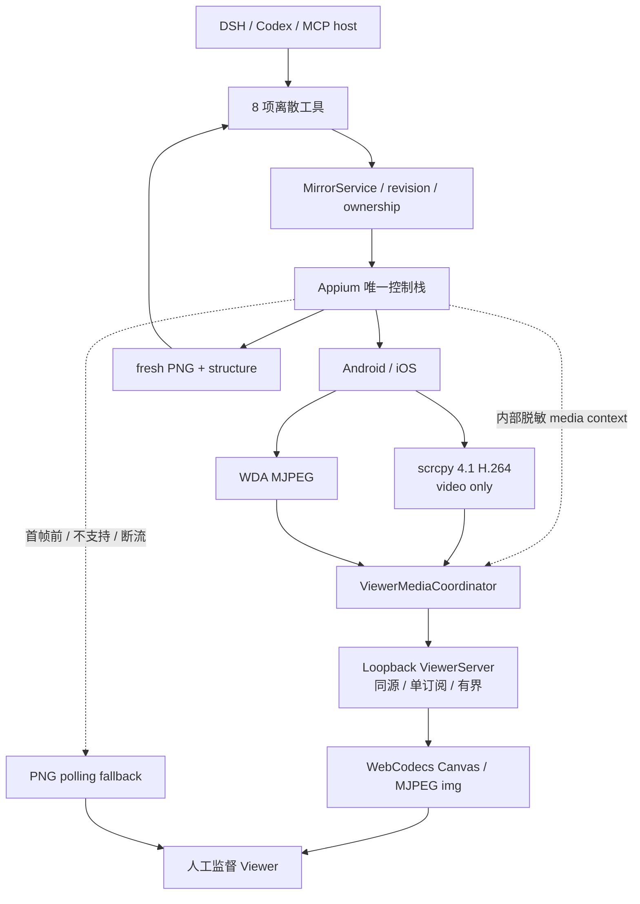

# ADR 0003：低延迟 Viewer 媒体采用 scrcpy 4.1 H.264 与 WDA MJPEG

- 状态：Accepted
- 日期：2026-08-20

## 背景

Appium screenshot 轮询跨平台且适合 fresh agent observation，但默认约 1.3 fps，无法给人工监督者提供连续反馈。媒体层必须提高 Viewer 实时性，同时保持 Appium 的唯一控制权、单帧 observation 的 freshness 语义、DSH/MCP 薄 adapter 和 loopback 安全边界。

## 决策

1. 在共享核心增加 `ViewerMediaCoordinator`。Appium session 与首张 PNG 决定主生命周期；Viewer 订阅才惰性启动媒体，最后订阅离开五秒后停止。
2. Android 固定使用 scrcpy 4.1 framed H.264。runtime 只接受显式绝对 executable/server path 或确定性安装前缀，运行版本预检，并固定 `audio=false`、`control=false`。Appium 继续处理全部动作和 session ownership。
3. scrcpy parser 保留 codec、rotation session packet、PTS、config/key/delta 边界。关键帧前置最近 SPS/PPS，并在 Viewer envelope 中同时发送 codec 与尺寸，使背压恢复后的关键帧可以独立初始化 WebCodecs。
4. Android Viewer 先执行 `VideoDecoder.isConfigSupported`，再通过同源有界 HTTP envelope 解码到 Canvas；能力缺失、解码失败或积压时回退 PNG，不下载 WASM decoder。
5. iOS 使用 XCUITest/WDA 的 MJPEG broadcaster。新 owned session 的 auto 模式探测并使用 WDA 默认设备端口 9100，再通过 Settings API 设置 15 fps、50% scale、40 quality 和 orientation fix；9100 冲突/转发竞争时保留控制 session 并回退 PNG，不随机改写设备端端口或强制重装 WDA。attached session 只读取明确 port hint。
6. 不设置 `mjpegScreenshotUrl`。Agent 的 `snapshot`/`inspect_screen` 始终继续调用 Appium fresh screenshot/source，不能用压缩、缩放或缓存的视频帧替代。
7. ViewerServer 只提供同源、loopback、单订阅、有界 relay。媒体包最大 8 MiB，队列最多两个包/8 MiB；媒体 bytes 不进入 DSH/MCP、ObservationStore、attachment 或日志；默认不落盘。用户显式点击截图/录屏时允许在当前浏览器导出，详见下方补充。
8. stop 顺序固定为 Viewer response、媒体 source/child/forward/remote jar、再到 provider。只清理本 runtime 保存的精确资源句柄。
9. ADB forward 的本地 TCP 握手不等于 device abstract socket 已就绪；Android source 只有收到首个协议字节才接受连接，并在五秒启动窗口内重试零字节关闭。

## 方案图

## 被拒绝的方案

- **scrcpy SDL 窗口：**不能嵌入现有 Viewer，也无法统一状态和降级。
- **scrcpy raw stream：**丢失 PTS、config/key 和旋转边界，背压恢复不可靠。
- **scrcpy control socket：**会产生第二套动作、坐标和 ownership 语义。
- **Tango/完整 browser ADB stack：**会复制已经由 Appium/ADB 管理的设备连接栈，并引入版本漂移。
- **ffmpeg 转 MJPEG：**增加解码/重编码 CPU、带宽和延迟；截图轮询已是兼容回退。
- **DSH/MCP 连续视频：**会膨胀上下文、日志与持久化面；工具协议只保留离散 observation 和有界状态。

## 影响

- `viewerMediaMode=polling` 可无迁移回滚；八项工具名称/输入、snapshot/inspect 图片契约和 Appium action 不变。
- scrcpy 协议不承诺跨版本兼容。4.0→4.1 官方 tag diff 显示当前使用的 H.264 codec id、rotation session packet 和 12-byte frame header 保持不变，但仍必须使用匹配的 4.1 executable/server，并以 4.1 fixture 和真机矩阵重新验收；后续升级继续走相同流程。
- 正常退出可精确回收媒体资源；进程强杀仍可能留下孤儿 forward/jar，后续生产化需设计安全的跨进程恢复。
- 显式非零 iOS MJPEG 端口仍是专家配置，使用者必须保证它与 WDA 实际 broadcaster 端口一致；auto 模式不会为绕过本机冲突改变缓存 WDA 的设备端协议。
- 工程实现通过不等于物理性能通过。Android/iOS 首帧、fps、延迟、主动断流与清理指标必须单独记录。

## 2026-09-14：Viewer 手动截图与录屏

新增 `add-viewer-screen-capture`，由独立前端模块拥有导出状态和资源。用户点击后可将已经显示的手机画面导出 PNG，或用 canvas/MediaRecorder 录制无声视频，不开启第二路设备媒体连接，不新增 Appium 命令，也不替代测试 PNG/XML 或 Agent fresh observation。

Android 保留最新解码 VideoFrame 的单个 clone，换帧/session/离开时关闭，避免 CSS 缩放、留黑边和 DPR 影响截图尺寸；PNG/MJPEG 使用 image 的源像素。录屏最长边不超过 1920，固定首帧画布，输入分辨率/旋转变化时等比留边。优先 WebM/VP8，按浏览器探测 WebM/MP4；不调用麦克风或桌面采集。

断开/换 session/页面隐藏会结束录制；10 分钟或 128 MiB 上限也触发结束。每秒分块、失败保留已有片段并标记不完整，最近一次结果在成功替换前保持可下载。PNG 换源解码的短暂无尺寸窗口保留录制画布上一帧，不误判为断开。

结果使用当前页面的 Blob URL 与浏览器下载。自动下载被拦截时仍有显式下载链接；关闭前须结束并下载。录制中离开显示浏览器确认，取消离开不拆除媒体；浏览器崩溃或强制关闭不是后端持久化保障。现有默认媒体传输、会话所有权与工具控制面不变。
