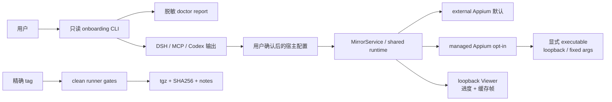

# ADR 0004：Beta 首次使用面采用只读 CLI 与显式 managed Appium

- 状态：Accepted
- 日期：2026-08-20

## 背景

核心、DSH adapter、stdio MCP、Viewer 和真机链路已经存在，但首次用户仍需从仓库构建、手工判断宿主依赖并拼装配置。直接让 agent 运行诊断或隐式搜索/启动 Appium 会扩大宿主命令、设备身份和进程所有权风险；直接公开当前 npm package 也会把 developer preview 误当稳定兼容承诺。

## 决策

1. 新增独立 `flowassert` onboarding bin。它不注册 Cordis effect、agent tool 或 Viewer，只调用可注入的 doctor/config library。
2. doctor 只执行有 timeout、abort 和 1 MiB 输出上限的只读检查。公共报告只保留稳定 code、公开版本和计数；设备 ID、签名身份、路径、端口及原始输出在本地解析后丢弃。
3. config renderer 只写 stdout，不改宿主文件。DSH、MCP、Codex 输出共享 Mock、loopback、`mock-only`、external Appium 和高风险授权关闭的默认值；Android/iOS 仅提供公开占位符。
4. Appium 进程管理必须显式选择 `managed` 并提供绝对 executable。URL 只接受 HTTP loopback，runtime 固定 address/port/base-path 参数，使用 `spawn(shell=false)`，在创建 session 前等待 `/status` ready。
5. 已有 listener 不被接管；managed 模式拒绝 attached session。normal stop 顺序为 Viewer/媒体、provider-owned session、保存的 Appium child。先停止直接 child；2026-09-14 P0 补强后，再用下述有限所有权扫描回收本次后代，仍禁止 `pkill` 或按名称/端口批量终止。
6. managed phase 只投影 mode、phase、owned、稳定 error code。连接超过 300 ms 时 Viewer 显示本地进度，保留缓存帧，并允许 status/theme/stop 继续工作。
7. 发布保持 `private: true`，只由精确 `v0.1.0-alpha.1` tag 触发 GitHub prerelease。clean runner 对一次 pack 产物执行 checksum、CLI、MCP、managed Appium 和 DSH rc.8 probes，全部成功后单次创建 Release；不执行 npm publish。
8. Viewer 提供 Android/iPhone 统一连接向导。显式平台检查可临时授权只读 ADB 或 Xcode/WDA 诊断，结果只含稳定 code、版本、计数和通用设备序号；128-bit 引用只在内存保留 120 秒并单次消费。
9. external 配置下若 Appium 未运行，用户必须在检查结果中显式选择 `managed-once`。runtime 重新验证候选摘要后才装载绝对路径，并完整复用现有 listener 冲突、固定 loopback 参数和精确 child 清理；不写回 profile；2026-09-14 起，仅已启动的 managed owner 使用下述有限进程扫描。
   Volta shim 只用于正常诊断调用；向导通过固定 `volta which appium` 解析、验证并指纹化可直接拥有的 Appium entrypoint，不能证明单一 child 所有权时不提供 `managed-once`。
10. 向导只为物理 USB Android/iPhone 生成有限安全预设：默认 current-screen（不指定 App，`autoLaunch=false`、`noReset=true`、`forceAppLaunch=false`、`shouldTerminateApp=false`），Settings 显式可选且旧 API 语义不变。Android current-screen 另设 `skipUnlock=true`；Settings 解析失败不阻塞普通连接。Android 必须确认 UiAutomator2 helper APK 副作用；iOS 只接受本次 Team ID/WDA bundle ID，profile 开启自动设备注册时向导拒绝连接。raw capabilities 仍在默认折叠的高级入口。driver 回填的前台 App 不能让无目标连接获得 target-app 管理权限；Appium 仍是唯一 session/control owner。
11. Appium listener readiness 与设备 session health 分层处理。Android 的显式 Settings 预设固定 `forceAppLaunch=true`，两种连接方式均在 session 内设置一秒的 idle/action acknowledgment 上限；拒绝连接、请求超时、session 命令超时和其他命令失败只投影稳定错误码与静态文案。一次 mutation 超时视为结果不确定，不自动重试。
12. control completion 不等待可选截图。Viewer 的 PNG fallback 同时只允许一个请求，已建立 session 的单次截图最多等待五秒；连续三次失败后进入十秒 liveness probe，并在成功后复位。最后可用帧保留，session/page 初始恢复优先读取内存缓存帧；scrcpy/WDA 媒体有五秒首帧窗口，媒体一旦绘制就取消 PNG probe。
13. 增加正式 `flowassert-viewer` 启动器，`pnpm dev`/`pnpm start` 复用相同实现。启动器读取仓库外私有 JSON；页面加载只读取脱敏的“可保存/已保存平台”摘要，不触发诊断、枚举或 Appium。
14. 连接助手只有在用户勾选“记住这台 Mac”时，才在 spawn/session 前保存重新验证的 managed Appium 路径、平台偏好和合法 WDA Team/bundle 默认值。目录/文件使用 `0700/0600`、原子替换并拒绝 symlink、未知字段和超限内容；设备标识、capabilities、凭据及副作用确认不落盘。
15. 已保存配置只提供一次可见的“检查并连接”确认：重新检查后仅在唯一设备、零阻塞、无需补字段和 runtime 明确时自动连接；否则停留在完整报告。Android 的同一次点击仍明确确认 helper APK 副作用。
16. `appiumSessionStartupTimeoutMs` 默认 120 秒，只覆盖真机 Appium session/WDA cold start。iOS 自动 MJPEG 使用可用的 WDA 默认 9100；冲突或 forwarding race 时保留控制 session 并回退 PNG，不设置 `useNewWDA` 或随机设备端口。
17. stop 仍先尝试删除 provider-owned session；若该请求失败，但本次 runtime 明确拥有的 managed Appium child 随后成功静止，则以 child 的 active-session cleanup 作为最终清理边界并返回 idle。external Appium 的 session 删除失败继续显式报告且不终止 listener。并发中的 Viewer frame 绑定 session generation/abort，停止后只保留最后帧，不回写旧错误。

## 方案图

## 影响

- 现有 external Appium、owned/attached session、DSH 八项工具和 MCP protocol 不迁移。
- doctor 能指出缺口但不安装/修复，用户仍负责可信 executable、driver、签名和设备状态。
- Viewer 向导同样不安装依赖、不配对/解锁/root 设备、不登录 Apple、不接受调试弹窗，也不修改 Agent 画面、文本或应用控制策略。
- 首次保存后需要下一次 Viewer 启动才能把 managed Appium 作为完整 runtime 默认值；已存在的 external listener 仍按冲突处理，不被自动接管。
- Android OEM 若冻结 UiAutomator2 helper，只能由用户在设备设置中解除后台/电池限制并重建 session；runtime 不自动修改 OEM 策略，也不在结果不确定的 mutation 后重放动作。
- 正常退出具有精确进程所有权；测试材料的强杀恢复见 ADR 0006；宿主整体强杀后的设备进程接管、签名制品、SBOM、公共 npm 和稳定兼容策略留给后续 change。
- managed stop 只有在 owned child 确认静止后才可吸收 session DELETE 竞争错误；这项保证不扩展到 external Appium。

## 2026-09-14 P0：detached WDA 的所有权清理

XCUITest 的 WebDriverAgent 使用 `detached: true` 启动 xcodebuild；仅停止 Appium child 或其进程组不足以回收它。显式 managed/managed-once 启动现在为 Appium 注入每次唯一的继承标记，用有界、无 shell 的 `/bin/ps` 记录本次进程谱系；孤立 xcodebuild 必须具有该标记才可认领。标记、环境、PID、命令均不进入共享 state、日志或工具结果。

停止时复核 PID、开始时间与命令身份。macOS 真机发现 Apple xcodebuild 的环境无法通过 ps 读取，因此启动期间已确认属于带标记 Appium 的后代，以记录的谱系和当前身份作为清理依据；未观察到谱系、仅凭标记认领的孤立 xcodebuild 则必须再次核对标记。未知归属的同名进程不认领。先 SIGINT，再在配置的有限宽限后对仍匹配的本次进程 SIGKILL。扫描/身份复核/清理失败返回 `managed_appium_stop_failed`，保留 owner 供重试，不允许新启动覆盖未释放的 handle。支持本机 macOS/Linux；external/attached 不启用扫描或回收，也不会因同名进程或相同端口被接管。

此规则覆盖断开、启动失败/取消、受控关闭以及 Appium 父进程先退出的情况。测试正常结束仍保留会话和 WDA；整个宿主被 SIGKILL 后没有存活的清理器，不承诺自动清理设备进程。已通过真实 detached 子进程和故障模拟验证；iPhone 三轮正例与故意失败反例均自动停止，最终独立确认宿主 xcodebuild、相关端口和设备 WDA runner 无残留。实测发现、修复及证据边界见 [P0 验证](../workbench-p0-validation.md)。
