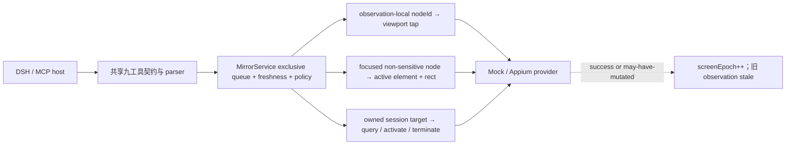

# ADR-0005：Observation-bound 语义动作与受控应用生命周期

- 状态：Accepted
- 日期：2026-08-20
- 适用版本：`0.1.0-alpha.2`

## 背景

既有 `tap`、`swipe`、`back` 能完成坐标级控制，但 agent 已从结构观察拿到 `nodeId` 后仍需自行换算坐标，也无法安全输入文本或管理当前应用。节点定位、输入内容和应用标识都可能放大隐私、陈旧状态和误操作风险，因此不能把 Appium 的 locator、shell、clipboard 或任意 execute-script 直接透传给宿主。

## 决策

1. `nodeId` 只在生成它的 observation 内有效。`tap_node` 必须通过 generation、latest revision、epoch、TTL 和 15 秒 freshness 校验，再从该 observation 的结构精确查找节点；不允许用 label、text、resource id、XPath 或其他 locator fallback。
2. 节点必须显式 `visible=true`、`enabled=true`、`actionable=true`，且 bounds 与 viewport 有正面积交集。实际 provider 只接收交集中心对应的既有 viewport tap。
3. `input_text` 只接受 512 Unicode code points 内、4 KiB 内且无控制字符的公开文本。`append` 不允许空串，`replace` 允许空串用于清空；不做 normalization 或静默截断。
4. Appium 文本输入默认关闭。启用 `agentTextInputPolicy=non-sensitive` 时仍要求结构共享已授权、目标是可见/可用/已聚焦的普通 input，并硬拒绝 `sensitive=true`、password/secure role。Android/iOS source 在发布前删除敏感节点的 name/text/value，因此 masked 长度也不会进入宿主历史。
5. Provider 只能读取当前 W3C active element 及其 rect。active element 与 observation bounds 的交叠必须至少覆盖较小矩形的 50%；`append` 发送一次 element value，`replace` 严格执行 clear 后对同一 element 发送一次 value。不使用 clipboard、ADB input、locator、execute-script fallback 或隐式点击。
6. 应用管理是独立的第九工具 `mobile_mirror_manage_app`。默认 `agentAppControlPolicy=disabled`；`session-app` 只允许 owned session 的启动 target；`allowlist` 只接受最多 32 个大小写敏感的精确 app id。attached session、未知平台、缺失 target 都 fail closed。公共 state/result 不返回 app id、capabilities、session/element id 或请求体。
7. 应用状态在 mutation 前后都通过 Appium state query 验证。Android 只使用 activate/terminate endpoint；iOS 仅在 not-running 时使用固定 `mobile: launchApp` 加 bundle id，禁止 arguments/environment/kill/remove。
8. 共享不可序列化的 `WeakSet` mutation marker 表示“请求已经发出、结果未知或可能部分生效”。成功和 may-have-mutated 失败都递增 `screenEpoch`；request 前校验失败不递增。这样任何不确定结果都会迫使 agent 重新观察。
9. action、manage-app 与 observation 共享同一 exclusive queue。公开 `control` 只显示 `acting`/`managing-app`、时间与固定错误码；Viewer 保留最后画面，stop/status/theme 在慢操作期间仍可用。

## 不采用的方案

- 不把任意 Appium locator 或 element id 暴露给 agent：它们跨 observation/session 不稳定，也容易绕过结构裁剪与 freshness。
- 不使用 clipboard、shell/ADB input 或键盘模拟：这些通道可能跨应用泄露内容，且无法绑定已观察的目标。
- 不允许任意 app id、attached session mutation 或通用 execute-script：所有权和影响范围不明确。
- 不把文本、app id 或底层错误直接写入 result/status/log：宿主历史和诊断面通常比设备内存保留更久。

## 结果

DSH 与 MCP 继续是薄 adapter，共享 parser、核心策略和 provider。默认升级仍只允许 Mock 文本输入且关闭应用管理；物理文本输入与应用生命周期必须在个人配置中显式开启。真实模型、Android/iOS 真机文本和应用生命周期分别保留独立验收层，不用 Mock、fake server、Viewer 可见或已有媒体截图替代。

## 2026-09-15：iOS 搜索框与焦点补充

真机 WDA 的 XML 搜索框为 `XCUIElementTypeSearchField` 且不包含 focused，原实现无法完成普通输入。将 SearchField 规范化为 input；仅 observation 捕获显式请求 provider 补充焦点，工作台默认源树读取保持原始 XML 和原有请求数。

provider 在 XML 前后读取 active element、平台类型与 rect。仅当两次 element id/type/rect 稳定、源树未截断、存在唯一可见启用且类型一致的输入节点，才标记 focused=true；XML 坐标舍入允许最多 1 个逻辑点的边缘差。无活动元素、接口失败、移动、类型不匹配或多个候选均不授予焦点；取消仍传播。element id 仅在 provider 内部使用。

输入执行仍重新读取 active element/rect，并保留敏感节点硬拒绝、strict observation freshness 与 mutation fence。该关联不是原生原子快照，WDA 调用期间的变化通过前后复核及执行时再检查约束。

## 2026-09-16：Android hint 追加丢字修正

系统设置搜索框真机证明：replace 后为 `MOBILE-MIRROR`，append 后只剩后缀。对应安装版本 UiAutomator2 server 9.11.0 的 [SendKeysToElement](https://github.com/appium/appium-uiautomator2-server/blob/v9.11.0/app/src/main/java/io/appium/uiautomator2/handler/SendKeysToElement.java) 默认追加分支会清空元素，若清空后读到 hint 就将先前值丢弃。

Android 改为在原 active-element/rect 校验后只读当前元素 text/hint、验证拼接结果仍满足 512 code points/4 KiB/无控制字符限制，重新核对 active-element ID，再向同一 element value 发送 `replace:true` 的完整结果并读回验证。非空 text 与 hint 相等时存在歧义，提前返回 unsupported；读取失败、内容超限或焦点变更均零写入。派发后失败/读回不符标记 mutation-uncertain 并使 observation 失效，不重试或回退。已有文本只用于本次内存请求，不进入公共状态/错误；iOS 路径不变。

这是 Android 主路径的显式兼容处理，不新增 locator、剪贴板、ADB input、执行脚本或键盘权限。append 到无法区分提示文字的空框不再冒险声称支持，调用者可显式选择 replace。真机及回归证据见 [Android 验收](https://github.com/qmkCamel/flowassert/blob/main/docs/android-acceptance-2026-09-16.md)。
