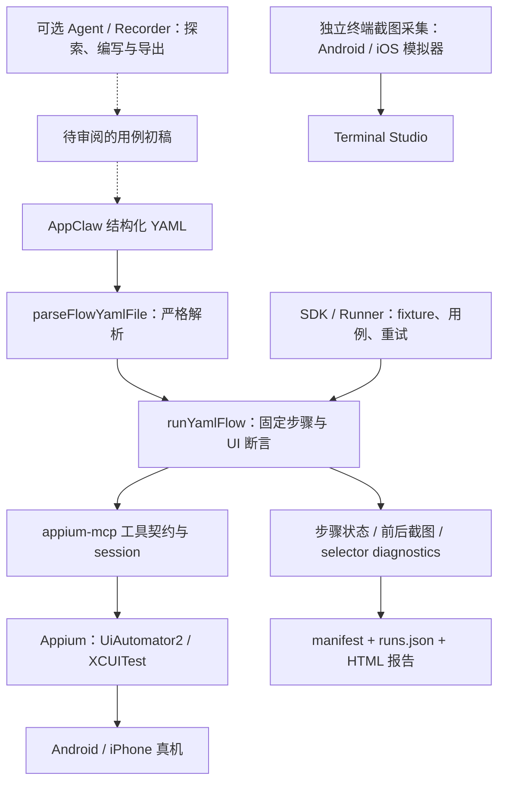

# AppClaw 纳入移动测试工作台选型

> 2026-09-14 状态说明：本文保留 2026-09-10 的独立 SDK 评估快照。当前已采用其中的有限 facade 路线，将 AppClaw 原生 parser/runner 接入 MirrorService，并完成双端最小闭环；下文“尚未集成”“Maestro 暂定默认”仅表示当时结论。当前以 [ADR 0006](../decisions/0006-native-yaml-workbench.md) 和[工作台真机记录](../workbench-validation.md)为准。

状态：源码评估与 iPhone 真机 PoC 已完成，尚未集成。核对日期：2026-09-10。

评估基线：`appclawhq/AppClaw` main 的 `9bbc6f198b9ecf81400d96977bea9a9946af360e`，提交日期 2026-09-03，仓库及 `@appclaw/core` package version 为 `2.7.0`，Apache-2.0。本次从该提交构建并完成第三方 App iPhone 真机 PoC；成功路径包含临时 RemoteXPC guard 和已有签名的 prebuilt WDA，因此不能扩张为 stock 2.7.0 开箱即用。

## 1. 结论

**AppClaw 应作为与 Maestro fork 并列的首期完整方案候选，而不只是可选 Agent。** 它已有 YAML 执行器、结构化 selector/属性断言、SDK/测试 Runner、录制导出、报告与历史入口，覆盖了 FlowAssert 原计划新增的相当一部分职责。

当前保留 Maestro fork 为暂定默认。2026-09-10 的同机对照中，AppClaw 完成 12/12 结构化步骤并保留诊断、截图与录像，但 stock 依赖会在 iOS RemoteXPC 启动阶段崩溃，preinstalled WDA 路径失败，退出后还有 WDA xcodebuild 残留；详细证据见[第三方 App iPhone 真机对照实测](sampleapp-iphone-real-device-validation.md)。不能因为它名称和首页强调 AI，就把所有 YAML 执行当成每步模型调用；也不能因为它已经有 HTML 报告，就推断其成功状态满足“必需证据完整才通过”。

选择关系：`Maestro 原生 YAML → Maestro fork` 与 `AppClaw 结构化 YAML → AppClaw → appium-mcp/Appium` 是两条完整执行路线。它们的 YAML 和设备接口不同，不串成 AppClaw → Maestro → Appium，也不要求两套引擎同时跑同一个 case。

## 2. 对照四项用户诉求

| 诉求 | AppClaw 当前已见实现 | 与 Maestro fork / FlowAssert 的比较 | 尚需验证或补齐 |
| --- | --- | --- | --- |
| 电脑准实时看到手机 | Terminal Studio 在运行旁显示画面；Android 用 ADB 截图，iOS 用 simctl | 现有 FlowAssert 的 Android scrcpy 更适合高帧率目标；两候选自带 Viewer 都没有完整物理 iPhone 投屏路径 | AppClaw iPhone 真机终端投屏未接入；Appium 路线可评估复用同一 session 的 WDA 媒体，不启动第二控制 session |
| 固定、快、模拟人工 | 自有 YAML、结构化定位、条件等待、真实触摸；有 SDK、Runner 与 fixture/hook | AppClaw 更接近现成工作台；Maestro 原生流程生态和用户已有用例可直接沿用 | 严格结构化模式下测零模型调用；默认 500ms 步骤间隔可调，但还要计树读取、截图、Appium/MCP 与条件等待 |
| 保留证据并确认结果 | 前后截图、selector diagnostics、expected/actual、步骤状态、可选录像、HTML Inspector | 可复用的产品功能比仅有底层控制多；两候选仍需独立业务校验 | 必需证据、失败返回值、最终判定、清理失败需统一；“done/动作成功”不是业务验收 |
| 结果可回溯 | 按 runId 保存 manifest，runs.json 索引、套件页、步骤详情、视频定位 | 可优先复用现有报告，减少自建页面；不必首期同时接两套报告 UI | 增加用例/构建/配置版本快照、attempt 关联、崩溃恢复、持久确认与完整性判定 |

投屏采样间隔是 Android 200ms、iOS 模拟器 350ms，即调度上限约 5fps / 2.9fps；采集忙时跳帧，不能当作实测帧率。与设计中的 Android ≥20fps、iOS ≥10fps 目标分开记录。iPhone 自动化控制通过 Appium/XCUITest，签名与 WDA 准备是独立于终端投屏的事情。

## 3. 实际结构与可复用部分

最值得复用或借鉴：

1. **录制—编辑—导出—重跑体验**：自然语言交互有助于形成初稿，结构化 selector 用于固定回归。导出的自然语言步骤或成功轨迹仍需补独立断言、唯一定位和数据前置条件；原生导出并不自动产生验收完整的用例。
2. **selector 与预期分离**：target 指明谁，properties/count 指明应是什么，失败时给出实际属性、匹配数和原因；多目标动作明确歧义，属性 unavailable 不当作 false。
3. **运行、步骤、前后截图与触摸点联动**：用户可以从失败步骤直接看对应画面和 selector 诊断；比只有终端日志更贴近本项目的回溯目标。
4. **SDK、fixture 与 lifecycle hook**：适合必要时用 TS 补充代码，按用例组织数据准备、执行、业务读取、清理，避免一切塞进 YAML。
5. **session 范围和多设备端口**：MCP 客户端按 session 包装，连接引用计数，设备 UDID 与端口分配有专门代码；可以参考其接口，但不能代替本项目跨入口排他租约。

## 4. 源码核对后的采用边界

### 4.1 “零模型”需要限定执行模式

结构化动作通过 accessibility tree 定位，不走 vision fallback；结构化属性、数量断言也有确定性求值实现。但自有 YAML 同时支持字符串指令：无法解析的字符串可送模型解释，旧文字断言可能走视觉验证。

`--strict` / parser 的 `strict: true` 只阻止未知指令的解析回退，不足以禁止已识别字符串指令在运行时进入视觉路径。回归模式应固定结构化动作/断言及明确的控制命令，禁用视觉模式和模型兜底，并用模型请求计数或测试替身验证零调用；需要视觉验证的用例另标能力和预算。

SDK `FlowRunner.run()` 当前调用 parser 时没有传入 strict；若采用 core adapter，应显式调用严格 parser 后执行，或补齐 SDK 选项，不能把 CLI 的 strict 承诺自动套到 SDK 上。

### 4.2 YAML 的 SDK 入口需要结果与报告包装

沿当前调用链：`AppClaw.runFlow()` → `FlowRunner.run()` → `runYamlFlow()`。执行失败可以返回 `success: false`，并不必然抛异常；`app.run()` 的默认 failOnError 不能据此扩张为 `runFlow()` 同样保证抛错。

一个具体风险：在 Runner 的 `test` 中仅写 `await app.runFlow(file)`，忽略返回的 `success`，test body 可能正常完成，Runner 再按“未抛异常”记为 passed。需由 adapter 检查结果并映射失败；这是基于当前调用链的静态判断，本次没有运行真机复现。

同一 `runFlow()` 也没有自动把 SDK 的 collector 注入 options，或更新 SDK `runStepCounter/runSuccess`。只调用它再 teardown，不能假定会产出完整的 SDK 报告。CLI flow 分支显式创建并传入 collector，因此不能泛称“AppClaw YAML 都没有报告”。

### 4.3 原生报告值得复用，但不是可靠事实库的全部

当前 `RunArtifactCollector` 在执行中将步骤及 base64 图片保存在内存，最后 `finalize()` 写 manifest/index。图片在 manifest 内嵌；`steps/step-xxx.png` 可以只是逻辑路径，没有同名独立 PNG 文件。导入时应读 data URI 并建立独立 artifact，而不是只复制目录并假定路径都有文件。

截图采集异常被视为 non-critical；CLI 保存报告失败只提示 warning，后续 `flow_done.success` 仍取原执行结果。Runner 还会捕获 `app.teardown()` 异常。因此本项目必须增加：

- 每个必需检查点及时持久写入、完整性校验与确认，内存累计到最后不能满足中途崩溃回溯。
- 明确的 `evidenceStatus`，磁盘满/图片缺失不允许返回干净通过。
- 最终业务状态的命名截图；视觉模式使用过的 pre-action 图片不能被当作 after-action 结果证据。
- 所有 attempt 保留并关联到同一个逻辑 case；重试恢复标 flaky。当前每次 attempt 有新 AppClaw run，套件结果主要指向最后 run，不能直接获得本设计要求的完整 attempt 链。
- 用例及其依赖内容、App build、driver、配置版本固化；路径、时间和单个 success 布尔值不足以证明可复现性。

第一阶段可导入 AppClaw 原生 manifest，借鉴/适配它的 HTML Inspector。若界面足够，Allure 放到 CI/跨引擎汇总阶段再接，避免同时维护两套相似页面；原生报告必须显示工作台最终判定及证据完整性，不能只展示引擎 success。

### 4.4 超时、取消和清理必须与设备占用一致

Runner 的 `withTimeout()` 超时会 reject 包装 Promise，当前代码不取消原 test Promise；`RunYamlFlowOptions` 也未提供贯穿全流程的 AbortSignal。这不代表每次超时都会产生额外动作，但不能据此保证“超时返回后旧执行已静止”。在 teardown/retry 或切换引擎前，要阻止旧队列发新命令，确认旧操作静止，再转移租约。

SDK session 删除为 best-effort；`teardown()` 先 finalize 再 release，前者抛错可能跳过后者，而 Runner 的 catch 又会掩盖该错误。需要把 session 释放放进 finally，并保留清理结果。首期默认关闭自动 retry，先确认数据恢复和停止语义。

进程内配置也有共享边界：AppClaw 构造器调用 `applyConfig` 更新全局 Config，多个实例不同配置时以后构造者为准。首期按运行/设备隔离 worker 进程；多设备混合配置的进程内并行需要另行验证。

### 4.5 MCP 相同不代表接口即插即用

AppClaw 的流执行依赖 `appium_get_page_source`、`appium_gesture`、session/screenshot 等具体 appium-mcp 工具及其响应格式。FlowAssert 暴露的 observation/freshness/action 合约和 Maestro MCP 的 `run/inspect_screen` 与它不同。

此外，AppClaw 部分输入与设备辅助路径直接调用宿主 ADB 等命令。评估底层替换时应审计实际调用链；仅替换 MCPClient 并不能自动接管所有设备操作。

## 5. 与 Maestro fork 的选型比较

| 维度 | Maestro fork | AppClaw |
| --- | --- | --- |
| 本项目已有真机依据 | 本次固定 `332e3834` 构建并跑通第三方 App一级 Tab 流程；最终集成制品仍需固定 | 本次固定 `9bbc6f1` 在临时 guard + prebuilt WDA 下跑通同一流程；stock 启动和完整清理未通过 |
| 固定流程 | 原生 Maestro YAML、Orchestra、JS 扩展、流程生命周期 | 自有 YAML、结构化 selector/属性/计数断言，必要时 SDK/TS |
| 编写与调试体验 | 可复用原生工具；FlowAssert 增加编写和历史界面 | Terminal Studio、录制导出、Runner、HTML 报告已较完整 |
| 与现有控制栈的接近程度 | 新 Maestro 驱动实例，须与 Appium 交接 | 同属 Appium 路线，但 appium-mcp 默认自建 session，仍须协调 owner |
| 维护负担 | JVM/Xcode/真机 fork 补丁、worker 与媒体适配 | TS/core/appium-mcp 依赖、严格执行模式、SDK/报告/取消等补齐 |
| iPhone 准实时观看 | 自带 Viewer 无物理 iPhone 后端 | 终端投屏也是模拟器限定；可评估与现有 WDA 媒体整合 |
| 证据与最终验收 | 原生产物 + 持久确认钩子 + 业务 verifier | 原生 collector/report + 增量持久化 + 结果传播/清理 + 业务 verifier |
| 对原始诉求的价值 | 优先复用原生流程执行与用户已验证路线 | 提供更完整的现成产品功能，可能省掉更多工作台开发 |

**选择规则**：以相同业务用例、同一组 Android/iPhone、相同断言和证据策略比较整体接入成本及效果。若 AppClaw 修补和集成成本低于 Maestro fork 维护加工作台补齐，且通过全部验收门槛，可以提升 AppClaw 为默认；反之保留 Maestro，并借鉴 AppClaw 的 selector diagnostics、录制和报告体验。单次演示、星数、README 的速度描述不作为决定依据。

当前对照只是一台 iPhone、一个公开页面流程和少量 attempt。它支持“Maestro 暂定默认、AppClaw 保留强候选”的工程决策，不满足 p50/p95、20 次稳定性、Android、业务写入和故障注入的最终选型门槛。

## 6. 接入方案与 P0 对照

### 两种集成深度

**先用独立 AppClaw worker 做对照 PoC。** 工作台取得设备独占锁，显式释放原控制，再让固定版本 AppClaw/appium-mcp 创建 session。收集其原生结果与产物，完成后确认清理再释放设备。此路径不要求先实现一套完整 MCP 兼容服务，便于测出实际收益；现有 Appium session 不同时驱动手机。iPhone WDA 媒体端点必须从此 owner 的已验证 session 元数据取得，不能猜端口或再开 session。

**若决定采用，再选择稳定接入边界。** 可继续由 AppClaw worker 独占底层，或为结构化 flow 的有限工具集增加通往 MirrorService/provider 的受控 MCP facade。后者需要逐项映射工具、坐标、错误、权限和 freshness，并处理直接宿主命令；不得以“双方都是 MCP”估成零成本。首期不重写整套 appium-mcp，也不将 AppClaw 指令静默转译成 Maestro。

### 共用的实验与退出条件

| 对照项 | 方法 | 通过要求 |
| --- | --- | --- |
| 固定业务 | 登录后收藏商品，跨页面重新读取，再独立读取测试环境业务状态 | 同一明确预期；模型调用数为零；目标有稳定 selector |
| 时延 | 相同关键截图策略；记录冷 session、warm 操作、等待、截图/落盘、总耗时 | 报告 p50/p95；AppClaw 默认延迟和调整后的结果分别记录，不用少截证据换快 |
| 正确性 | 错误文本、UI 成功但业务没保存、重复目标、缺失属性 | 全部检出；未知不能当通过；不能靠模型改写预期恢复绿色 |
| 停止与重试 | 慢动作时取消、断连、超时后请求重跑 | 不产生已知旧队列后续写入；未确认静止前不交接；保留旧 attempt |
| 证据 | 截图失败、磁盘满、进程中途退出、report finalize 失败 | 不报干净通过；已有必需材料仍可回溯；缺失有原因 |
| SDK 合约 | `runFlow` 返回 false、只跑 YAML 后 teardown、cleanup 失败 | 显式失败传播、必需截图/报告存在、session 清理结果可见 |
| 真机观看 | Android scrcpy 与 iPhone 同一 owner 的媒体路径，测试执行时一起测 | 满足首期观看指标；仅有模拟器终端画面不算真机完成 |
| 重复稳定性 | 3–5 个实际流程，每端每方案重复 20 次 | 比较首轮通过率、flaky、人工介入、失败检出率与证据完整率 |

2026-09-10 已安装该固定提交的依赖、构建源码，并在第三方 App iPhone 真机上执行成功与故意失败流程。实测确认 selector diagnostics、报告和录像的价值，也复现 RemoteXPC 崩溃、preinstalled WDA 失败、WDA 进程残留和 manifest 内嵌截图体积问题。性能、完整平台兼容性与修复后的效果仍需按上表的重复矩阵验收。

## 7. 核对来源

以下链接固定到本次读取的提交，便于后续升级复核：

- [项目说明与版本](https://github.com/appclawhq/AppClaw/blob/9bbc6f198b9ecf81400d96977bea9a9946af360e/README.md)
- [package 与依赖](https://github.com/appclawhq/AppClaw/blob/9bbc6f198b9ecf81400d96977bea9a9946af360e/packages/core/package.json)
- [结构化 selector 与断言说明](https://github.com/appclawhq/AppClaw/blob/9bbc6f198b9ecf81400d96977bea9a9946af360e/docs/structured-selectors.md)
- [严格解析和 LLM fallback](https://github.com/appclawhq/AppClaw/blob/9bbc6f198b9ecf81400d96977bea9a9946af360e/packages/core/src/flow/parse-yaml-flow.ts#L531)
- [结构化定位实现](https://github.com/appclawhq/AppClaw/blob/9bbc6f198b9ecf81400d96977bea9a9946af360e/packages/core/src/flow/run-yaml-flow.ts#L1634)
- [执行延迟及截图采集](https://github.com/appclawhq/AppClaw/blob/9bbc6f198b9ecf81400d96977bea9a9946af360e/packages/core/src/flow/run-yaml-flow.ts#L2956)
- [SDK runFlow 接线](https://github.com/appclawhq/AppClaw/blob/9bbc6f198b9ecf81400d96977bea9a9946af360e/packages/core/src/sdk/index.ts#L314)
- [SDK teardown 顺序](https://github.com/appclawhq/AppClaw/blob/9bbc6f198b9ecf81400d96977bea9a9946af360e/packages/core/src/sdk/index.ts#L388)
- [FlowRunner 返回值](https://github.com/appclawhq/AppClaw/blob/9bbc6f198b9ecf81400d96977bea9a9946af360e/packages/core/src/sdk/flow-runner.ts#L30)
- [报告持久化与内嵌截图](https://github.com/appclawhq/AppClaw/blob/9bbc6f198b9ecf81400d96977bea9a9946af360e/packages/core/src/report/writer.ts#L112)
- [原生报告类型](https://github.com/appclawhq/AppClaw/blob/9bbc6f198b9ecf81400d96977bea9a9946af360e/packages/core/src/report/types.ts#L65)
- [Runner attempt 与结果传播](https://github.com/appclawhq/AppClaw/blob/9bbc6f198b9ecf81400d96977bea9a9946af360e/packages/runner/src/runner.ts#L394)
- [Runner 超时包装](https://github.com/appclawhq/AppClaw/blob/9bbc6f198b9ecf81400d96977bea9a9946af360e/packages/runner/src/runner.ts#L589)
- [session 归属与清理](https://github.com/appclawhq/AppClaw/blob/9bbc6f198b9ecf81400d96977bea9a9946af360e/packages/core/src/sdk/mcp-session.ts#L80)
- [终端采样节奏](https://github.com/appclawhq/AppClaw/blob/9bbc6f198b9ecf81400d96977bea9a9946af360e/packages/cli/src/tui/stream/frame-loop.ts#L31)
- [iPhone 终端投屏限制](https://github.com/appclawhq/AppClaw/blob/9bbc6f198b9ecf81400d96977bea9a9946af360e/packages/cli/src/tui/stream/capture-ios.ts#L1)
- [CLI 显式 collector 与报告失败处理](https://github.com/appclawhq/AppClaw/blob/9bbc6f198b9ecf81400d96977bea9a9946af360e/packages/cli/src/index.ts#L904)
- [结构化动作的 Mock 测试](https://github.com/appclawhq/AppClaw/blob/9bbc6f198b9ecf81400d96977bea9a9946af360e/tests/flow/structured-selector-runtime.test.ts)
- [SDK 失败返回值测试](https://github.com/appclawhq/AppClaw/blob/9bbc6f198b9ecf81400d96977bea9a9946af360e/tests/sdk/flow-runner.test.ts)
- [录制导出](https://github.com/appclawhq/AppClaw/blob/9bbc6f198b9ecf81400d96977bea9a9946af360e/packages/cli/src/step-recorder/flow-builder.ts)
