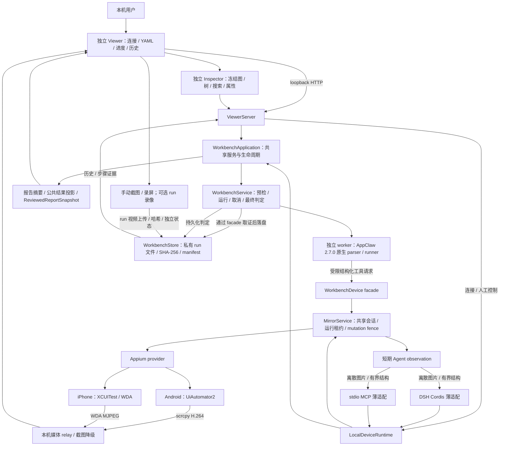
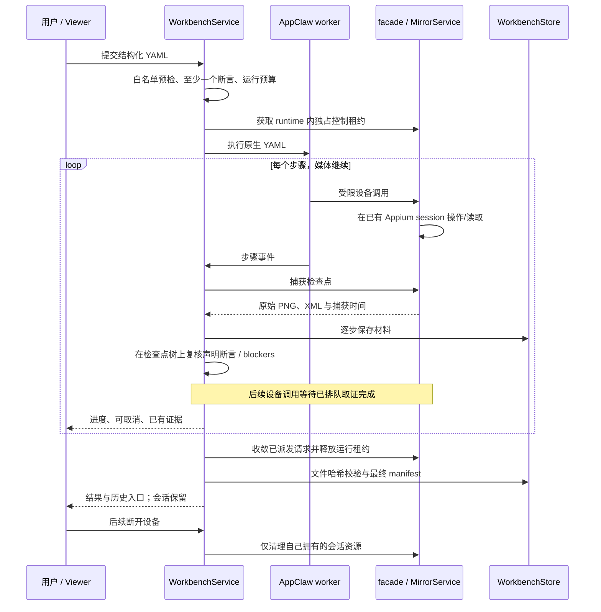

# 当前移动测试工作台架构

新增 `WorkbenchRepairCoordinator` 由 `WorkbenchApplication` 组装和排空，维护 RepairCase、冻结计划及审批 journal；设备与维护操作仍由 MirrorService 唯一拥有。修复闭环为 **Preview（默认关闭，53/65）**；M1/M2 软件链、M3 Mock 协议不代表 Appium 真机闭环。当前 DSH 固定 `0.2.0-rc.2`；见[修复边界](../evidence-guided-repair-operations.md)及[宿主验证](../dsh-020-validation.md)。

更新：2026-10-07，核对 `dev@REDACTED_REVISION`；基础工作台始于 `REDACTED_REVISION`，下图展示共享设备执行主链路，AppClaw `2.7.0`。图外已增加产品契约、登记套件、CLI/Agent 控制、趋势、分享、清理、受控修复和显式视觉基线；它们的当前状态见[能力总表](../capabilities.md)与相关未归档 OpenSpec change。早期选型和扩展目标仍在[完整目标架构](mobile-test-workbench.md)，不代表这些目标已交付。DSH 的测试版本以各项验证报告和锁定配置为准，不把历史 rc.1 结论外推到新包。

目前拆出的 HTTP 模块包括 `src/viewer-workbench-runs-http.ts`、`src/viewer-workbench-baselines-http.ts`、`src/viewer-workbench-share-http.ts`、`src/viewer-workbench-retention-http.ts` 和 `src/viewer-workbench-trends-http.ts`；入口统一执行 same-origin 与 mutation-origin 校验。运行终态与逐步取证分别收敛到 `src/workbench-run-finalization.ts` 和 `src/workbench-step-evidence.ts`，清理 journal 的原子读写收敛到 `src/workbench-cleanup-journal.ts`，依赖方向由定向测试约束。Viewer 分享、趋势和清理面板各自持有异步操作状态（`viewer/workbench-share.js`、`viewer/workbench-trends.js`、`viewer/workbench-retention.js`）。套件/比较路由仍在 ViewerServer；历史/结果/基线面板已有独立模块。WorkbenchApplication 组装用例、执行、比较、分享、引用与清理等服务；新增 journey/authoring/analysis/catalog 复用这些服务，不另起设备控制或结果判定。

## 组件与边界

图中 DSH/MCP/Viewer 是可选入口，不表示各自启动的独立进程共享同一个 runtime。一个工作台进程内只复用一份 MirrorService 会话；运行租约也只覆盖该 runtime。连续媒体不进入工具结果；持久化测试证据与短期 Agent observation 分别管理。

## 一次运行如何闭环

取消不会撤回已经发生的手机操作。不确定 mutation 会封锁后续控制，需断开重连。停止会话的既有清理不等于自动回收所有 WDA 子进程：旧版 iPhone 实测仍需精确 PID 手工收尾；本次已实现 managed 谱系/标记清理并修复 macOS 环境不可见分支，iPhone 三轮正例与反例正常断开均通过 WDA/端口/设备 runner 核验，见 [P0 记录](../workbench-p0-validation.md)。

## 证据与结果

| 项目 | 当前行为 |
| --- | --- |
| 运行输入 | 可读 YAML 快照，固定 AppClaw parser/runner；支持公开文字 replace/append/clear；仅支持可信登记扩展和显式有界导航恢复，不支持任意内联代码、无边界自然语言 fallback、敏感输入或安装 |
| 运行过程 | 步骤状态/日志，每步 PNG/XML；截图与树按顺序捕获，记录时间窗，不承诺原子一致 |
| 判定 | pass / fail / cancelled / inconclusive / evidence-conflict / evidence-contaminated；证据不完整不能 pass |
| blocker | 只覆盖用例声明的 accessibility 条件；未知广告/通知/视觉遮挡不自动识别 |
| 回溯 | 本机 runId、文件哈希、manifest、历史回看/重跑、可选 run 视频回放/下载/步骤近似定位，默认私有 runs 目录 |
| 验证强度 | UI 条件与材料完整性；显式登记并批准的 `assertVisual` 使用确定性像素规则，业务 verifier 需独立配置；未声明的分项仍为 not-performed |

具体数据与接口以[使用说明](../test-workbench.md)、[ADR 0006](../decisions/0006-native-yaml-workbench.md)、[主规范](../../openspec/specs/local-test-workbench/spec.md)和实现为准。源代码入口：`src/workbench-service.ts`、`src/workbench-device.ts`、`src/workbench-store.ts`、`src/workbench-flow.ts`、`scripts/workbench-worker.mjs`、`viewer/workbench.js`。

## 已验证与后续

双端第三方 App均完成 12 步正例和第 3 步故意失败反例，运行中继续收到媒体帧，重启后能读取历史并核对全部材料哈希。Android 正例 54,496 ms；iOS 正例 45,948 ms。Android 浏览器绘制 fps 与 iOS relay fps 不是同一指标，不能直接排名。完整 run、版本与清理边界见[真机报告](../workbench-validation.md)。

Inspector、公开文字输入、手动录屏、run 视频归档、可信注册业务 verifier、受控定位器修复与显式视觉断言均已有工程实现。2026-09-26 的本机 store 增加进程身份/nonce/generation owner、read lease、引用保护和视觉基线不可变版本；Viewer 提供人工预览/批准入口，趋势支持双 UTC 窗口对照。运行结果由公共投影保持原报告与当前证据完整性分离；Viewer/JSON/JUnit/CLI/Agent 复用。分享转换使用单 owner 的持久任务记录、有界图像 worker 与提交 manifest；HTTP 分享 handler 已从主 ViewerServer 拆分。清理逐文件 purge、剩余清单和进程 SIGKILL 切点测试已加入。历史 tombstone、容量准入和本轮报告的特定同包兼容已有工程证据；完整故障、升级/回退、其余模块拆分与外部采用仍按 active change 验收，不能称 R0—R6 整体完成。报告目录/历史趋势/失败阅读和被动 HTML 分享复用公共投影及分享服务，详见[报告指南](../report-reading-and-sharing.md)。Maestro adapter 和共享设备 daemon 未交付；双槽进程组合已有工程实现、双真机矩阵待验；真机/外部采用边界见[能力总表](../capabilities.md)。上面的 12 步用例是基础流程，不代表 iOS AI 文字业务正例通过。
