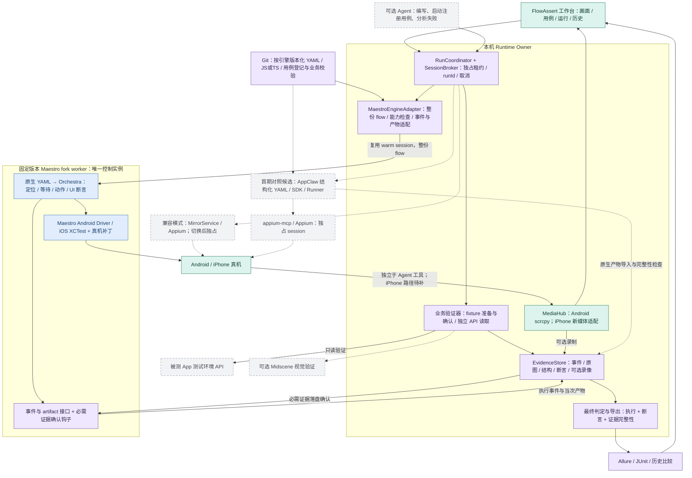
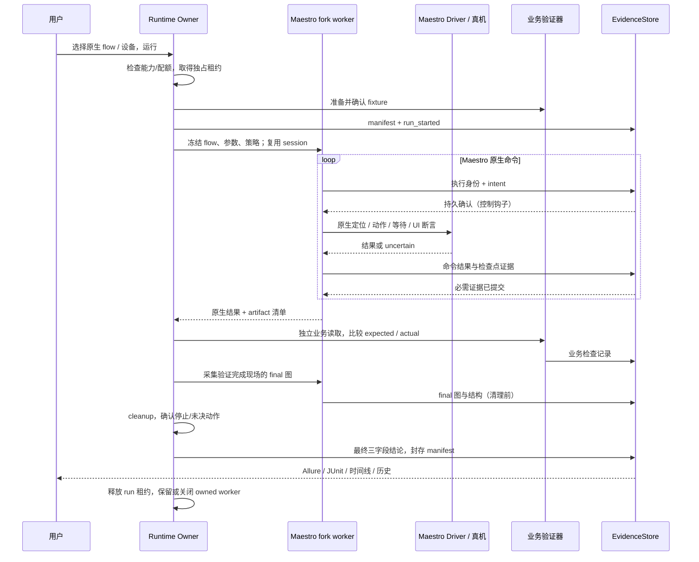

# FlowAssert 移动测试工作台：总体架构设计

2026-09-14 实施更新：最小闭环选择 AppClaw 原生执行器通过 MirrorService 复用会话；下文保留调研时的完整目标架构，当前实施边界见 [ADR 0006](../decisions/0006-native-yaml-workbench.md) 和 [使用说明](../test-workbench.md)。

历史方案状态（2026-09-09/10）：当时为 Proposed、尚未集成，并暂定 Maestro 真机 fork 优先。此后默认执行路线已调整；已实现部分见[当前架构与时序图](mobile-test-workbench-current.md)，尚未交付目标见 [TODO](../../PRODUCT_TODO.md)。下文及配套图保留当时完整目标，不作为当前实现清单。

基线：提交 `REDACTED_REVISION` 加当前工作区的连接向导、独立 Viewer 与本机配置改动。工作区存在其他开发中的修改；本设计不改写这些实现，不把工作区能力当成已发布能力。DSH 已有兼容基线为 `0.1.2-rc.1`，本设计不调整 Harness agent loop。

## 1. 用户诉求与产品定义

用户已确认：首期在本机执行，覆盖 Android 与 iOS 真机，以自己的 App 为主；流程以可读 YAML 维护，必要时补充代码。

目标产品是一个本机移动测试工作台：电脑上看见手机，选择版本化流程，通过真实 UI 操作执行测试，由预先定义的断言判断结果，并留下可以回看、比较和重新执行的证据。

| 用户诉求 | 产品行为 | 完成标准 |
| --- | --- | --- |
| 准实时看到连接的手机 | 连接后持续显示实际设备画面；运行测试时仍能看、能停止 | 测量端到端画面延迟、首帧与卡顿；降级时明确标识，不把缓存帧说成当前画面 |
| 固定流程、快、像人工操作 | YAML 版本化；设备级点击、输入、滑动；条件等待；重复执行无需每步模型决策 | 同一用例、数据、设备基线可重复执行；常规步骤模型调用数为零；等待条件满足即继续 |
| 自动替代人工验证并保留证据 | 每个业务检查点声明预期、验证器、实际结果、证据要求 | 只有所有必需检查通过且必需证据落盘完成，才可给出通过 |
| 结果可回溯 | 运行记录、步骤时间线、失败/恢复截图、视频、版本与历史比较 | 从失败结果能定位到用例行、步骤、预期/实际和证据；重跑保留旧结果 |

“模拟人工”指通过实际 UI 完成被测操作，覆盖界面、交互和业务调用链。API 可以准备数据、校验结果，但不能替代本来要测的点击/输入流程。输入法、系统权限弹窗、长按、拖拽等应分别定义真实交互测试；直接设置文本不能冒充软键盘逐键输入或输入法验收。

“替代人工验证”的范围是已声明、已校准的测试要求。界面上的“保存成功”只能证明提示出现；要声称数据保存成功，还需独立的业务读取或重新进入页面验证。没有明确断言的流程只能算执行记录。

## 2. 当前能力与需要新增的部分

以下来自当前代码，不是重新执行的真机验收结果。

| 能力 | 当前事实 | 目标变化 |
| --- | --- | --- |
| 本机运行入口 | `LocalDeviceRuntime` 组合 service、Viewer、assistant、commands；独立 Viewer 启动入口正在工作区中完善 | 工作台进程统一设备租约；选中的 engine worker 独占底层控制 session |
| 双宿主 | DSH 和 MCP 复用同一套核心，但默认各自 new runtime | 新增显式连接工作台 runtime 的 client 模式，避免跨进程争抢设备 |
| 设备控制 | `MirrorService` 有生命周期、exclusive queue、取消、epoch、owned/attached 语义 | 新增测试授权与设备租约，所有工作台控制入口遵守同一占用规则 |
| 动作 | Appium provider 已实现 W3C 触摸、back、输入、应用管理 | 现有路径保留兼容；新工作台默认由 Maestro 原生执行定位、等待、动作与 UI 断言 |
| 投屏 | Android scrcpy H.264、iOS WDA MJPEG、PNG 回退 | Android 媒体复用；Maestro 模式下 iPhone 新增媒体适配，不能直接沿用 Appium session 的 WDA MJPEG |
| 媒体订阅 | `ViewerMediaCoordinator` 当前只有一个 `#active` 订阅 | 一条设备媒体源，独立 Viewer/Recorder consumer；不能直接调用两次 subscribe |
| Agent observation | 内存最多四条、60 秒 TTL，动作还有 15 秒 freshness | 继续用于短期操作，不承担测试证据存档职责 |
| 节点查询与 Inspector | active change 共 39 项，当前 0 项完成 | 用于辅助编写 selector、排查步骤；不作为整个测试闭环的前置阻塞 |
| 测试与证据 | Vitest/Playwright 测试的是本仓库；physical probes 会保存专项截图/指标 | 新增面向被测 App 的用例、运行模型、判定、证据库与历史报告 |

关键代码入口：

- [运行实例](../../src/local-device-runtime.ts)、[DSH 创建 runtime](../../src/index.ts)、[MCP 创建 runtime](../../src/mcp-server.ts)。
- [观察采集](../../src/mirror-service.ts)、[动作执行](../../src/mirror-service.ts)、[队列](../../src/mirror-service.ts)。
- [Appium 感知与触摸](../../src/providers/appium-provider.ts)、[单订阅媒体边界](../../src/viewer-media-coordinator.ts)、[短期观察存储](../../src/observation-store.ts)。

## 3. 当前推荐与对照候选：Maestro fork / AppClaw

暂定默认主链：**FlowAssert 工作台 + 固定版本的 Maestro fork + 原生 Maestro YAML + 独立业务验证与证据库 + Allure/JUnit**。Android 复用 scrcpy 媒体；iPhone 在同一 Maestro 控制实例旁接入媒体适配。现有 Appium 保留为兼容模式，按用例显式选择。

用户已说明在 [PR #3100](https://github.com/mobile-dev-inc/Maestro/pull/3100) 上验证可用。这足以改变上一版“因官方限制而排除默认 Maestro”的选型前提。官方支持状态用于判断维护责任，不能推翻用户的实测，也不能据此要求自建一套 YAML 执行语言。本方案优先采用经过项目验证、固定版本的 fork，不等待上游合并。

### 3.1 证据与版本要分开

2026-09-09 通过 GitHub API 核对：PR #3100 仍为 open、未合并，head 为 `6b624c16da9ed299d53692d0eabe20f0dfc56deb`。它修改三个文件，补充驱动资源打包、iproxy USB 转发和部分真机设备管理。用户此前对该路线的真机验证继续作为独立事实记录。

2026-09-10 另从 `feat/ios-physical-device-support` 的 `332e3834dc90cdd1363208568bafc88c052916eb` 构建 CLI 与物理 iOS driver，在 iPhone 16 Plus / iOS 26.2.1 / 第三方 App REDACTED_APP_VERSION 上跑通原生 YAML、真实点击、断言、JUnit 与原图。临时构建 clone 为 Xcode 26.6 补了签名参数与 provisioning 更新开关；这份实测不反向绑定到 PR #3100，也不把临时构建补丁当成已交付 fork。证据见[第三方 App iPhone 真机对照实测](sampleapp-iphone-real-device-validation.md)。

本机另有 `qmkCamel/Maestro` 的 `feat/mcp-physical-ios-control` 分支，当前 HEAD 为 `041c805b41fc94710deb974cda6228e51f12348b`，工作区干净。它加入了 MCP 真机 session 创建和单进程一台物理 iOS 设备限制；但源码中 `DeviceControlIOSDevice.launch/clearAppState` 仍是 TODO，安装器中也没有 PR 的 iproxy 实现。**这两个补丁集合不能混称为同一个已验证发行版。**

因此，后续工程基线是“用户已验证构建 + 所需补丁清单 + 最终构建校验”，本机 `041c805b` 是可复用代码来源，尚不直接等于最终部署制品。合入新主线时按语义移植补丁：例如当前本机 `startScreenRecording` 签名与旧 PR 不同，不能承诺原 patch 无冲突套用。

| 能力 | 本次依据 | 架构结论 |
| --- | --- | --- |
| iPhone 真机核心 UI 路径 | 用户已验证 PR 路线；PR 描述包括启动、连接、点击与断言 | 可作为 fork 默认引擎的依据；完整用例矩阵记录到最终构建版本 |
| 原生 YAML 执行 | 本机 `RunTool` 复用 `YamlCommandReader` 与 `Orchestra.runFlow`，缓存 session | 直接复用完整 flow；无需把每一步翻译成 FlowAssert 私有命令 |
| 运行事件和产物 | `OrchestraListener`、`ArtifactsGenerator`、源位置、执行序号已存在 | 在生命周期和产物接口上做薄适配，优先采用原生产物 |
| iPhone 内置 Viewer | 本机 `StreamDeviceType.forConnected` 对物理 iOS 返回 null | 真机控制支持不等于自带真机投屏；媒体适配仍是首期工作 |
| 测试状态清理 | PR `clearAppState` 仅调用 stop；其 `getAppPid` 始终返回 null；`clearKeychain` 返回成功但不清理 | 不用这些返回值宣称环境已重置；要求显式 fixture reset + 状态确认 |
| 真机录屏 | PR 明确 unsupported；本机对应设备管理路径仍待实现 | 检查点原图为首期必需证据；视频单独接入和验收 |
| 多 iPhone | 本机 MCP 分支每进程限制一台，端口/驱动资源仍需隔离 | 首期一台 iPhone；扩展多设备须验证进程、端口、构建缓存均隔离 |

`DeviceControlIOSDevice` 中一些 UI 方法仍是 TODO 并不意味着点击/截图不可用：当前 `ios.LocalIOSDevice` 把这些操作转给 `XCTestIOSDevice`。同时，它把 launch/reset/recording 转给设备管理对象；应沿实际调用链判断。当前本机的普通 stop 走 XCTest，不能把 PR 设备管理对象的 stop 缺陷扩张为所有 stop 都不可用。

### 3.2 与上一版的差异和代价

| 维度 | 上一版：Appium + 自建 YAML/Vitest 执行层 | 本版：Maestro fork 优先 |
| --- | --- | --- |
| 用例语言 | 维护私有 schema、解释器、等待/重试/嵌套语义 | 保留原生 Maestro YAML，复用现有用例及 JS 扩展 |
| 执行器 | 额外实现 StepExecutor、MobileTestSDK 和 Vitest worker 适配 | 复用 Orchestra；工作台只管运行、能力、事件、结果与证据 |
| 手机操作 | 复用当前 Appium provider，当前接入成本较低 | Maestro 自带双端驱动；需要新 engine adapter 和真机补丁维护 |
| iPhone 观看 | 现有 Appium/WDA MJPEG 已有实现 | 需要 Maestro 模式媒体路径；不能双开 XCTest/WDA 来掩盖缺口 |
| 运行维护 | 自有流程语义长期维护 | 固定 fork/JVM/驱动/Xcode 组合，承担补丁移植和兼容回归 |
| 结果与回溯 | 仍需业务断言、证据持久化、历史索引 | 同样需要，但可以导入 Maestro 现有事件和 artifact bundle |

对于“固定流程、YAML 维护、快速复跑”的目标，fork 的复用收益更直接。它不保证单步一定快于 Appium；收益首先来自复用成熟流程执行和减少自建代码，速度仍按真机数据比较。Vitest/Playwright 继续测试 FlowAssert 自身，不进入手机流程执行热路径。

ViewInspectKit 借鉴树—截图—属性联动和定位编写；Midscene 只在结构不足或视觉检查时按需使用。首期不嵌套多个手机 MCP 服务分别控制同一设备，也不要求 Agent 逐步调用工具才能运行固定用例。

### 3.3 AppClaw：首期完整方案候选

新增 [AppClaw 详细评估](appclaw-evaluation.md)，核对 `9bbc6f198b9ecf81400d96977bea9a9946af360e` / package `2.7.0` 的源码。AppClaw 已有结构化 YAML、selector/属性断言、SDK/Runner、录制导出、截图和 HTML 报告；不能把它仅归为 Agent 或视觉补充。2026-09-10 已用同一台 iPhone 和第三方 App流程完成首轮对照；成功路径需要临时 RemoteXPC guard 与 prebuilt WDA，暂不替代 Maestro 默认。

| 重点 | 对本架构的影响 |
| --- | --- |
| 现成 YAML 与测试产品功能 | AppClaw 是 Appium 路线的现成执行层候选，不再考虑先自建 YAML/Vitest 手机执行器 |
| 严格确定性路径 | 采用结构化 selector/断言并禁止模型兜底；仅传 `--strict` 不足以保证运行时零模型 |
| 现成报告与历史入口 | 可导入原生 manifest、适配 HTML Inspector；若采用 AppClaw 且页面满足首期需求，Allure 可后移 |
| 真机观看 | Terminal Studio 的 iOS 截图走 simctl，物理 iPhone 后端未接入；评估使用同一 Appium owner 的 WDA 媒体 |
| 成功与证据 | `runFlow` 失败返回值、SDK collector 接线、report finalize 失败、取消/清理需包装或修复，才满足本项目最终验收 |
| 设备所有权 | 原生 AppClaw 默认经 appium-mcp 自建 session；先以独占 worker 做对照，不能与 MirrorService/Maestro 并发控制 |

两条用例格式分别维护：`engine: maestro-fork` 使用 Maestro YAML；未来 `engine: appclaw` 使用 AppClaw YAML。候选适配器共用设备租约、业务验证和最终证据判定；不做两种 YAML 的静默互译，也不叠加多个引擎执行同一流程。AppClaw 如要复用当前 provider，需实现有限 appium-mcp 工具契约的受控 facade 并审计直接宿主命令，不能仅替换 MCP 地址。

### 3.4 真机对照后的收敛

第三方 App首轮 Maestro 用例出现了“UI tree 断言通过、截图仍是启动广告”的绿色假阳性；排除广告后的下一次截图又被 iOS 通知遮挡。最终无遮挡 attempt 才被接受。由此把 `Surface Guard + tree/原图一致性 + evidenceStatus` 提升为最终判定的必需链路，Viewer 节点 Inspector 只承担定位和诊断。

FlowAssert 的 Appium 模式在同一第三方 App页面取得 10 秒 14.33 relay fps、112 ms relay 首帧、166 ms 浏览器首画面和 498 ms PNG 回退，并在上滑期间保持媒体可见。该结果证明 Appium owner 的“看 + 操作 + fresh observe”PoC；它与 Maestro/AppClaw 是串行运行，尚未证明固定 YAML 引擎执行期间的同 session Viewer。完整数据、限制和实测后的架构图见[真机实测报告](sampleapp-iphone-real-device-validation.md)。

## 4. 总体架构图

绿色为现有能力的复用/扩展，蓝色为采用的 Maestro 引擎，紫色为工作台新增职责，灰色为可选路径。图为目标设计，尚未实现。

可查看[架构图 SVG](mobile-test-workbench-architecture.svg)、[PNG](mobile-test-workbench-architecture.png)；可编辑源文件为[Mermaid](mobile-test-workbench-architecture.mmd)与[Graphviz](mobile-test-workbench-architecture.dot)。



三条链路独立：**观看**处理实时性，允许丢旧帧；**执行与判定**按固定流程和明确断言运行；**证据**持久保存实际发生的动作和检查材料。预览帧不能冒充某一步的检查点截图，关闭 Viewer 不影响进行中的测试和证据。

## 5. 进程、设备与 session 所有权

### 单一 owner，按设备选择一个 engine

当前“共享核心”是代码复用；`MirrorService.#operationTail` 无法互斥另一个进程。目标由一个显式启动的工作台 owner 管理设备租约、engine worker、任务和证据。Maestro worker 持有底层 Maestro/XCTest session，owner 管理其生死与归属。已有 MirrorService/Appium 模式继续兼容。

- Browser 沿用 loopback HTTP；CLI/DSH/MCP 通过私有本机 RPC 连接 owner，建议 Unix socket。Owner 与 JVM worker 使用独立控制/事件通道，不能用工作台页面是否打开作为 worker 生命周期依据。
- Agent adapter 只使用 documented tools/effects，不改 Harness loop；插件 dispose 仅断开客户端，不删除别人的设备或测试。MCP 返回状态与离散 observation，不返回连续视频。
- 一台手机一个 engine 和动作队列。原生 flow 在 Maestro 内连续执行；运行期间禁止 Viewer、Agent、第二个 flow 插入动作。Maestro 的 session 缓存不是此互斥机制的替代品。
- 空闲时的手动操作/Inspector 也必须经当前 engine facade；Maestro 模式不为一次查看偷偷创建 Appium session。尚未适配的手动能力显示 unavailable。
- 租约为 `deviceRef + ownerKind + runId + generation`，受控请求带 fencing token；worker 的命令钩子/driver wrapper 在动作前检查取消和租约。长动作显示本地进度，主题、缩放、历史与 Stop 保持可用。
- 宿主级锁协调本产品所有入口；不能阻止外部工具或手机本体触摸。首期单设备串行；当前 MCP fork 的“一进程一台物理 iPhone”限制明确保留，不把多进程等同于端口天然隔离。

切换 engine 的边界在 case/run 之间：停止发新命令 → 等待旧操作静止 → 封存证据 → 关闭本产品 owned session/相关媒体 → 明确交接 → 新 engine、新 generation。attached 外部 session 不由本产品删除，未获协调不交接。用例执行失败不能在中途静默转 Appium 然后继续报同一份通过；兼容实现是独立、版本化的用例变体，不翻译成“近似 Maestro”。

Stop 立即给本地反馈并取消等待，记录已发出但结果未知的动作，再收尾证据。进程退出不等于手机动作已停止；旧命令未确认静止前不得授予新租约。人工接管先暂停/静止，后续标 assisted/interrupted；不能继续算无人值守通过。

### Agent 与测试授权

测试授权限定于注册用例、设备/App、fixture、动作和证据留存，与 Agent 的 screen/text/app policy 分开。Agent 启动只引用已授权 caseId；不增加任意 shell/TS/inline YAML 入口。用户维护的 Maestro JS 和宿主 TS 验证器属于本地受信测试代码，不声称它们天然是安全沙箱。

## 6. 原生 YAML 与薄适配层

### 用例保持 Maestro 格式

下例使用原生 Maestro YAML 命令；不是本次已经部署、跑通的用例。平台差异通过 `APP_ID` 和稳定 selector 变量注入，业务数据由 fixture 明确准备。截图路径相对于该 attempt 的独立产物目录。

```yaml
appId: ${APP_ID}
name: 商品加入收藏并在重新进入后保留
---
- launchApp:
    clearState: false
    clearKeychain: false
    stopApp: false
- assertVisible:
    id: ${PRODUCT_TITLE_ID}
    label: product-ready
- tapOn:
    id: ${FAVORITE_BUTTON_ID}
    retryTapIfNoChange: false
    label: add-favorite
- assertVisible:
    text: 已收藏
    label: favorite-confirmed
- takeScreenshot:
    path: checkpoints/favorite-confirmed
    label: checkpoint-favorite-confirmed
- tapOn:
    id: ${FAVORITES_TAB_ID}
    label: open-favorites
- assertVisible:
    id: ${ITEM_ROW_ID}
    label: visible-after-navigation
- takeScreenshot:
    path: checkpoints/favorite-final
    label: checkpoint-favorite-final
```

`clearState: false` 不代表环境天然干净，而是避免依赖当前真机补丁中不完整的清理语义。运行前后通过自有 App 的测试接口/测试数据服务建立并验证指定状态；需要真正冷启动、清数据、权限重置的用例分别声明能力，不以 no-op 降级冒充完成。

工作台只增加“用例登记”，保存运行所需元数据，**不再发明 tap/wait/assert 的执行语法**。下例为拟议工作台接口，尚不可直接执行：

```yaml
schemaVersion: 1
caseId: favorite-item
caseVersion: 1
engine: maestro-fork
flow: .maestro/favorite.yaml
profiles: [android-local, ios-real-local]
fixture: signed-in-empty-favorites-v1
checks:
  afterFlow: [favorites-contains-v1]
evidence:
  requiredCheckpoints: [checkpoint-favorite-confirmed, checkpoint-favorite-final]
  failure: required
  final: required
  video: optional
cleanup: clear-test-favorites-v1
```

App ID、selector、参数与 fixture 输出随 run 固化，敏感值使用引用。`favorites-contains-v1` 是宿主注册的独立业务只读校验，可用 TS 编写，实际对比 fixture 指向的账号/商品。常规扩展优先用 Maestro 原生 JS；它与宿主验证器职责分开。

### 执行与事件协议

1. Adapter 校验登记元数据和平台能力；由 Maestro 自己的 parser/workspace validator 解析 YAML、subflow 和 JS。固化全部引用文件/hash；预检关键 label 唯一、参数齐全和必需检查点存在，不创建第二套解释器。
2. Owner 建立 run/attempt，准备并确认 fixture，通过租约把整份 flow 交给常驻 Maestro worker。先做 CLI 整份执行的 PoC，再接 warm worker；不为每个 tap 重启 CLI/JVM，也不让 Agent 逐步规划。
3. 复用 Orchestra 的定位、条件等待、UI 断言、子流程和错误语义。关键提交明确禁用 `retryTapIfNoChange` 和其他可能重复写入的用例重试；native 引擎已有内部重试也需审计，不能只禁外层重试便声称 exactly-once。
4. 事件统一为 `runId/attemptId/flowId/sourceRef/sequence/depth/phase/outcome`。`sourceRef` 对应文件 hash、源范围及 label；repeat/retry 的每次执行有新序号。Viewer 的全局递增 commandId 和最后状态快照不是持久主键，不能用它覆盖重试历史。
5. 原生 assertions 作为 UI 检查；宿主 verifier 默认在 flow 完成、cleanup 之前校验业务。需要中途业务检查时，绑定唯一 checkpoint label，通过阻塞钩子调用命名 verifier，再继续同一个 flow/session；不拆成每步 MCP 往返。
6. 检查点产物由 worker 从同一设备实例采集并交给 EvidenceStore；必要时导入原生 bundle。必需证据收到持久确认后才能继续，最后由 owner 汇总执行、UI、业务和证据结论。

### 不把 Viewer/SSE 和调试产物当成验收协议

本机 `McpViewerOrchestra` 只接状态展示回调，没有设置 `artifactsDir`；不能据此认为 MCP `run` 自动生成完整证据包。`TakeScreenshotTool` 还会把图片缩放并转 JPEG，适合模型输入，关键证据应直接采用原始截图/原生 artifact，而非回收 MCP 图片。

已有 `ArtifactsGenerator` 可输出命令、截图、失败结构、日志和 manifest，但有 best-effort 写入；`OrchestraListener.dispatch` 会捕获 listener 异常后继续 flow。因此：

- 展示、指标和可选产物可以接 observer；它们异常不应破坏用例。
- 动作前持久 intent、必需检查点落盘、业务验证屏障接入会向 runner 传播失败的控制钩子，例如现有 `onCommandStart/onCommandComplete` 回调的受控包装；为取消、嵌套 flow、repeat/retry 补契约验证。
- 导入产物检查文件存在、长度、hash、执行身份和采集时间。缺失必须进入最终 incomplete 状态，不能只相信 `commands.json` 中引用了文件或 MCP `success: true`。
- 保留引擎原生结果供排障；最终验收结果由工作台独立产出。适配层不是“监听 stdout 最后一行 PASS”。

稳定 id 优先，必要时明确文本/范围。原生 Maestro 的匹配/等待语义保持原样，不能声称工作台已默认实现“多匹配拒绝”或 Appium 原生属性查询；关键写入的唯一性检查作为工作台质量约束另行实现。未知是否提交成功时只读验证后置状态，无法确认则 inconclusive，不盲目重放动作。

## 7. 验证器与最终判定

验证器输出固定记录：`checkId、stepId、kind、expected、actual、verdict、observedAt、freshness、source、artifactRefs、checkerVersion`。页面文本属于被测数据，不能变成执行器指令。

| 验证类型 | 能证明什么 | 判定规则 |
| --- | --- | --- |
| UI 结构/属性 | 指定页面、文字、选中状态、数量、可见性 | 采用本次 Maestro 断言及新鲜结构/属性；记录引擎语义、超时和实际值；缓存 observation 只辅助分析 |
| 跨页面/重启重读 | UI 所示状态在重新进入后仍存在 | 只在用例授权时导航/重启；记录前后检查，避免只测瞬时 toast |
| 业务 API/测试只读接口 | 对应账号和实体的业务状态 | 使用 fixture correlation id，比较业务值，不只检查 HTTP 200；写入与读取路径的独立性记入报告 |
| 基线图片/几何 | 已定义区域的视觉差异 | 固定分辨率、主题、字体等环境；显式 mask 动态区域；基线版本受评审，不在失败时自动更新 |
| Midscene / VLM | 图标、自绘内容或语义视觉效果 | 保存图片、模型/提示/版本/输出，低置信或冲突标 review；未校准前不独立批准关键业务结果 |

特别规则：结构被截断或读取失败时，“未找到”不能证明元素不存在；需要针对目标的成功读取或完整检查范围；不足时补独立 verifier，不能把 Maestro 默认行为说成已经满足该额外约束。关键负向断言声明观察窗口，不能凭瞬时缺失通过。epoch 是 runtime 已知变化标记，不是屏幕原子一致性的证明。

一次检查的图片/source 是顺序采集，要保存开始/结束时间、前后 geometry 和 generation。检测到几何变化时拒绝把图与树当作一致检查；动画的内容差异仍需稳定条件和重取，不伪造精确同步。

把状态拆成三个字段，避免证据、执行和业务结论混淆：

- `executionStatus`：completed / error / canceled / interrupted。
- `assertionVerdict`：passed / failed / inconclusive / not-run。
- `evidenceStatus`：complete / incomplete，附缺失原因；optional video 缺失可标 degraded。

**验收通过条件**：全部必需步骤完成、全部必需断言通过、必需证据完成持久写入、没有未解决的 mutation uncertainty、没有人工干预、所需 cleanup 成功。失败断言保持失败；环境故障、断言缺失或证据不完整不给绿色通过。报告生成失败独立记录，可从事实文件重建，不删除已经完成的验证结果。

重试后成功标 `flaky` 并保留全部 attempt，默认发布 gate 不将其当成干净通过。JUnit 中失败断言映射 failure，执行/证据不完整映射 error，明确取消/不支持映射 skipped；额外 summary 保留原始多字段状态，不能把所有情况压成一个 passed 布尔值。

## 8. 证据、视频与历史

### 独立证据库

`ObservationStore` 继续保留 60 秒与四条限额，不能为了回溯无限续期。新增 `EvidenceCapture` 在测试检查点采集独立身份的数据，不更新 Agent latest observation，也不允许把 archive artifactId 当作可操作节点身份。

运行开始前明确本次持久留存；普通观看和本机 Inspector 仍不自动落盘。密码/认证信息用 secretRef，不写 YAML/事件/报告；敏感文本规范化不等于截图像素已脱敏。默认用专用测试账号/数据，发布报告前按策略处理图片与日志。后台状态验证接口由用户提供授权和字段范围，没有接口时报告仅声称已验证的 UI 范围。

拟议目录位于仓库外私有数据目录，根目录可配置：

```text
runs/<runId>/
  manifest.json                 # schema、用例/应用/环境版本、证据策略
  case-snapshot/                # 原生 YAML、JS、profiles、登记与验证器 hash
  events.ndjson                 # seq + UTC + monotonic elapsed + attempt/step
  checks/                       # expected / actual / checker version
  attempts/01/steps/<stepId>/
    before.png                  # 策略要求时
    after.png
    structure.json              # 规范化且标记截断，不存秘密 raw XML
    failure.png
  attempts/02/steps/<stepId>/
    retry.png
    recovered.png
  final.png
  media/                        # 可选分段视频、PTS 映射与 gap 清单
  result.json                   # 最终三字段结论 + completeness + 干预/重试
  artifacts.json                # artifactId、大小、MIME、SHA-256、时间窗
  exports/allure-results/
  exports/junit.xml
index.sqlite                    # 可从已封存 run 文件重建
```

不为未发生的阶段造文件：真正执行了失败/重试/恢复，才有对应命名截图；抓取失败保留明确 capture_error，不能拿前一张图片冒充失败现场。最终状态必须保留命名截图和断言材料，即便没有录像。

同一次运行固定 `runId → caseId → attemptId → stepId → checkId/artifactId`。manifest 至少包含：用例/selector/扩展 hash、Git revision 与 dirty 标志、App build 标识及可取得的 binary hash、OS/engine fork SHA/driver/runner 版本及各自制品 hash、设备配置别名、fixture id/seed、环境、locale/theme、断言阈值/基线版本、时间窗。没有取得的版本标 unknown；严格复现要求的版本未知时拒绝该等级验收。

动作发送前持久记录 intent，响应/不确定/取消另记事件；截图使用临时文件写完后原子提交，必需 checkpoint 等待 durable acknowledgement 再继续。终结 manifest 只引用已提交且通过 hash/长度校验的 artifact。Maestro 控制钩子承担持久确认，不依赖 best-effort listener。worker 崩溃时 owner 记录 interrupted；owner 崩溃后扫描未封存 run 并标 incomplete，不自动续跑可能已提交的步骤。

SHA-256 用于文件完整性和版本对应，单机文件/hash 同时可改，不构成不可抵赖审计。需要强审计时另加签名与外部只追加存储，不混入首期承诺。

### 视频不是最终判定器

媒体层从“一个浏览器订阅”扩展为同一源的 bounded fan-out。Viewer 队列优先新鲜、允许丢帧；Recorder 队列独立、落后时记录缺口，不能无界缓存或阻塞设备输入。

- Android 保存 H.264 config/key/PTS，按 rotation/codec 变化分段，封装为可播放容器；不能把任意截断 byte stream 改名 mp4。
- iPhone 默认先从同一个 Maestro/XCTest 实例按负载采集预览，动作和必需证据优先；长命令间无法提供新帧时明确显示帧龄/降级。该方案须测量，不能等同于已实现的流媒体。若达不到首期观看指标，在同一控制实例旁实现专用只读媒体后端，再验收，不额外启动 Appium/WDA 控制 session。
- 当前 fork 自带 Viewer 不支持物理 iOS 流；不能直接复用现有 WDA MJPEG URL。Maestro 模式的新 iOS 来源使用独立 capability，Appium 兼容模式才使用其 WDA MJPEG。
- iOS 截图序列/MJPEG 需采样时间戳与编码/封装；没有源 PTS 时以 host receive time 标记近似时间，不能假称设备精确时间。
- 可选编码/封装 sidecar 需固定版本、限制资源，并处理所用发行包与 codec 的许可。首期截图证据不依赖它。
- MediaHub 以实际 consumer refcount 控制来源生命周期，Viewer 关闭后仍有 Recorder 时继续；全部离开才释放。客户端解码失败只让该 Viewer 降级，不能顺带停止正常录制。
- 视频与步骤通过 run monotonic clock 和媒体时间映射关联；记录 offset/误差、掉帧/重连/黑屏区间。不能只凭系统时钟相同声称帧与动作完全同步。
- `video: required` 的流程遇到录像缺口/写盘失败按证据策略不通过；optional 的录像降级保留检查点材料并显式告知。

### 历史、留存与重跑

Allure 用于步骤、附件、趋势与重试展示；核心 run 库保留每次完整结果。每次输出目录隔离，不能把不同运行随意追加到同一个 allure-results 再当作单次报告。

Maestro 原生结果、artifact manifest 与报告先作为中间材料。ReportExporter 必须在 owner 完成 cleanup、必需证据封存和最终判定后，再发布对外 Allure/JUnit；将核心的 failed/inconclusive/evidence-incomplete 等映射到报告状态。不能出现 worker 已通过而最终截图写盘失败，外部报告仍显示绿色的情况。使用版本化映射器记录原始框架状态与最终验收状态，保留两者差异。

稳定历史键建议为 `caseId + 语义版本 + 参数集合 + platform/deviceProfile`；runId、时间、App build 是运行属性，不能都塞进历史键导致每次都是新测试。基线/用例语义变化明确新分组；不同环境的速度与成功率分别比较。

历史界面支持：按版本/设备/用例/结果检索 → 查看失败步骤 → 对照预期与实际 → 打开截图/视频时间点 → 对比上次成功 → 重新执行固定版本。**回放**是读旧证据，**重跑**是创建新 run；后者必须重新检查设备和 fixture，不能承诺恢复当时后端、网络与账号状态。

首期建议留存策略为 30 天、总额 10 GiB、可 pin 关键失败；作为可配置产品默认，需按真实用例体积调优。配额回收不删除运行中或 pinned 数据；回收记录保留 tombstone。空间不足且无法回收时，停止新运行或将当前证据标 incomplete，不能静默丢图后报通过。

## 9. 关键时序



Stop 通过独立控制通道进入 worker 的取消和 flow controller，不能排在阻塞的 `run` 请求后。原生 flow 的 `onFlowComplete` 可能先执行自己的 teardown，因此业务验收用例把破坏性 cleanup 放在宿主收尾，或在 teardown 前设置必需 checkpoint；不能拿清理后的图片代替业务成功现场。

## 10. 速度与“足够可靠”的验收

速度由 `准备 + 定位 + 动作 + 条件等待 + 检查 + 必需证据持久化` 分解测量。冷 JVM、iOS driver 构建/签名、XCTest 与兼容 Appium 启动单列，不把它计入每个 warm step，也不把浏览器 receive-to-paint 延迟当成端到端投屏延迟。

- 常规回归没有 LLM 调用；AI 用来编写初稿、分析失败，不能改动运行中已冻结的流程/预期。
- 预览媒体独立，测试在检查点采集原图/source。复用 Maestro 默认定位/等待，测出耗时再优化；它可能读取整棵树，不能宣称因换框架便天然变成小响应查询。
- 沿用 Maestro 条件等待并设置总 deadline，不额外插入固定 sleep；不叠加第二层自动等待，不关闭必要等待换取虚假速度。
- 一次 run 复用合适 session，case 之间通过显式 fixture/reset 保证独立；冷启动场景单独测试。动态内容/随机种子/网络条件固定或记录。
- 持久写入和录像处理使用独立有界队列；检查点必需证据的 durable commit 不能跳过。

建议 PoC 目标（均为待测目标）：

| 指标 | 初始目标/验收方法 |
| --- | --- |
| 本机交互反馈 | 运行/取消本地反馈 ≤100ms；长动作的状态、主题/缩放/Stop 可用 |
| 稳态投屏 | 目标端到端 p95 ≤500ms；Android 目标 ≥20fps、iOS ≥10fps；iOS 新媒体路径尚未达到此承诺，截图回退明确 degraded；P0 必须给出实测及是否满足观看需求的结论 |
| 工作台额外开销 | warm step 的解析/RPC/记账 p95 ≤100ms，独立报告设备等待与 fsync 成本 |
| 固定流程稳定性 | 先选 3–5 条真实业务流程，每端同一受控配置重复 20 次，报告首轮通过率、flaky、人工介入、p50/p95；不靠重试刷绿 |
| 误判检测 | 故意改变预期、模拟“UI 成功但业务未保存”、断网、断连、证据磁盘满，全部不得返回干净通过 |
| 可追溯性 | 100% 必需检查有 checkId、expected/actual、时间窗、来源、已提交 artifact；每次真实重试有原失败与恢复材料 |
| 清理 | cancel/crash 后无本产品遗留写入；owned 清理与 attached 保留分别验证 |

测试框架自己的 Mock/Vitest/Playwright 回归、fake Appium 协议测试、双端真机 App 场景、真实模型视觉检查分别计证据。当前仓库的测试通过数量不等于用户 App 业务测试已通过。

## 11. 分阶段落地与 fork 维护

| 阶段 | 交付范围 | 退出条件 |
| --- | --- | --- |
| P0a：固定基线与候选对照 | 归档用户已验证制品/环境，整理 PR #3100 与 MCP 补丁的区别；固定 fork SHA；整份原生 YAML CLI 执行、显式 reset、原图；同时测 iPhone 观看路径；用同一业务用例、证据要求对照 AppClaw 严格结构化路径 | Android/iPhone 各一条真实业务流程和一次故意失败；证据对应构建版本；iPhone 投屏有实测，不将单帧成功说成准实时目标达标；依据结果与维护成本确认默认引擎 |
| P0b：工作台闭环 | 单一 owner/设备租约；选定 engine 的 warm worker（当前按 Maestro 设计）；原生事件与控制钩子；业务 verifier；必需证据与最终判定；结果页/Allure/JUnit；补齐达标的真机观看路径 | 双端固定流程可反复执行并确认结果；停止可用；断连/磁盘满/业务未保存均不报干净通过；观看指标满足或明确报告仍未完成 |
| P1：完善回溯体验 | 历史检索与对比、录像/时间映射、轻量 Inspector、原生 YAML locator 辅助、更多业务场景 | 边看边录无抢占；重试保留所有尝试；从失败能回到当时截图/步骤/预期 |
| P2：按实际缺口扩展 | 已有 Appium 用例接入、Midscene 视觉验证、多设备/CI worker/对象存储 | 能力与 engine handoff 有契约；不可中途静默换引擎；跨版本回归可度量 |

不必先完成全部 Inspector 任务。先有“原生 YAML → 真机 → 明确断言 → 必需截图 → 持久结果”的闭环；现有 query/Inspector 仍用于编写和诊断，不承担 Runner 或证据存档职责。观看是首期独立验收项，不能无限推迟到 P1。

实现文件边界建议（尚未新增应用代码）：

- `src/testing/case-registry.ts`、`run-coordinator.ts`、`device-lease.ts`：用例元数据、版本、运行、占用。
- `src/testing/engines/maestro-adapter.ts`：worker 协议、能力、参数与原生产物适配；不实现 YAML 指令解释器。AppClaw 对照/采用通过独立 `appclaw-adapter.ts`，共用结果接口，不同时启动。
- Maestro fork 内小型 worker/bridge：复用 session/Orchestra/FlowController，接入取消、执行序号、持久确认和原图产物；已有 MCP 仍用于交互，原生 UI/SSE 仅作展示参考。
- `src/testing/verifiers/`、`fixture-registry.ts`：命名业务读取、测试数据准备/确认、视觉补充。
- `src/evidence/`：原生产物导入、事件、artifact 提交、最终判定、索引、报告与留存。
- `src/media/maestro-ios-source.ts` 与现有媒体层：Maestro 模式 iPhone 观看、fan-out、录制与时间映射。
- `src/runtime-client.ts` 及 Viewer 用例/运行/历史页：所有入口共享 owner，DSH adapter 保持薄层。

### 控制 fork 的维护范围

维护补丁账本：每项记录目的、涉及文件、upstream base SHA、patch/fork SHA、测试与可删除条件。优先保持四类改动：真机资源/签名/转发与设备管理；必要的 MCP session 适配；可靠事件/控制钩子与 artifact 导出；iPhone 媒体能力。用例、业务校验、历史和报告留在工作台，避免把产品功能都塞进 Maestro。

固定 source SHA、CLI/driver 制品 hash、Java/Gradle、Xcode/iOS、iproxy 版本及签名配置标识；签名密钥不入库。基线区分“用户已验证版本”“本次静态审阅版本”“工作台最终集成版本”，不能共用一个 verified 标记。发行包保留 Apache-2.0 等依赖许可及通知，并明确 fork 品牌和支持范围。

升级通过单独候选版本验证：正常/失败/重试/取消/断连/磁盘满、nested flow、JS、reset 语义、观看与证据并发；通过后切换固定版本，可回退上一制品。关键提交的重试、listener 吞错和产物采集语义是必查点。上游接纳某项补丁后才删除对应 fork 改动，不默认追随 main。

新的 engine ownership、worker transport、测试授权与持久媒体边界应在实施 change 中更新相应 ADR 和主规格。本设计为提案，不改写 Accepted ADR，不勾选既有 active change。工程门禁仍为 `pnpm check`、`pnpm test:e2e`、`pnpm build`、`pnpm pack:check`；补充 fork 构建/协议验证、Viewer 截图和双端真实业务用例。文档检查不替代这些门禁。

## 12. 核对来源与交付边界

AppClaw 补充核对读取固定提交源码、结构化 selector 测试、Runner/SDK、报告与终端媒体实现，未安装或运行；具体证据链接与适配成本见[独立评估](appclaw-evaluation.md)。

2026-09-09：读取用户给出的 PR 正文、GitHub API 最新状态和全部三个文件 diff；只读审阅本机 Maestro fork 与 FlowAssert 源码。本次没有合并补丁、安装依赖或重新执行真机验证。

- [PR #3100](https://github.com/mobile-dev-inc/Maestro/pull/3100)：真机基础补丁与其局限；[固定提交](https://github.com/manuelbieh/Maestro/commit/6b624c16da9ed299d53692d0eabe20f0dfc56deb)。
- 本机 fork session 管理（本机 Maestro 源码：`maestro-cli/src/main/java/maestro/cli/mcp/McpMaestroSessionManager.kt:21`）、原生 flow 执行（本机 Maestro 源码：`maestro-cli/src/main/java/maestro/cli/mcp/tools/RunTool.kt:83`）、物理 iOS 无内置流媒体后端（本机 Maestro 源码：`maestro-cli/src/main/java/maestro/cli/mcp/viewer/McpViewerServer.kt:58`）。
- Orchestra 接口（本机 Maestro 源码：`maestro-orchestra/src/main/java/maestro/orchestra/Orchestra.kt:130`）、listener 异常隔离（本机 Maestro 源码：`maestro-orchestra/src/main/java/maestro/orchestra/Orchestra.kt:993`）、原生证据生成（本机 Maestro 源码：`maestro-orchestra/src/main/kotlin/maestro/orchestra/debug/ArtifactsGenerator.kt:43`）。
- 真机操作分派（本机 Maestro 源码：`maestro-ios/src/main/java/ios/LocalIOSDevice.kt:16`）、本机设备管理 TODO（本机 Maestro 源码：`maestro-ios/src/main/java/ios/devicectl/DeviceControlIOSDevice.kt:59`）、MCP 截图压缩（本机 Maestro 源码：`maestro-cli/src/main/java/maestro/cli/mcp/tools/TakeScreenshotTool.kt:18`）。
- [Maestro 工作原理](https://docs.maestro.dev/get-started/how-maestro-works)、[官方 iOS 边界](https://docs.maestro.dev/get-started/supported-platform/ios/uikit.md)：官方支持范围与项目固定 fork 的验证范围分开记录。
- [scrcpy](https://github.com/Genymobile/scrcpy)、[Appium 驱动目录](https://appium.io/docs/en/latest/ecosystem/drivers/)：媒体复用与兼容控制路径。
- [Allure 附件](https://allurereport.org/docs/attachments/)、[历史与重试](https://allurereport.org/docs/history-and-retries/)：报告展示能力；采用工作台最终结果导出，不再依赖 Allure Vitest 作为手机测试运行容器。
- [Midscene](https://github.com/web-infra-dev/midscene)、[Appium Inspector](https://appium.github.io/appium-inspector/)：按需的视觉能力和调试体验参考。

本次更新范围仅为总体架构、选型、时序和实施分期，以及配套架构图；不修改应用实现、Maestro fork 或其他已有工作区改动。
