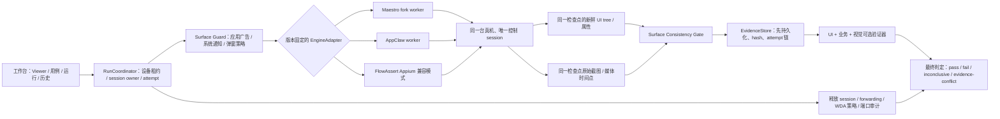

# 第三方 App iPhone 真机对照实测

应用名称、版本和标识已经脱敏；本记录保留当时的测量结论，不代表当前占位示例可直接复跑。参见[历史资料说明](../privacy-history-cleanup.md)。

> 历史实测说明（2026-09-14 整理）：本文保留 9 月 10 日三路线独立 PoC 与当时选型，不代表当前集成形态。后来采用 AppClaw parser/runner + MirrorService，见 [ADR 0006](../decisions/0006-native-yaml-workbench.md)；双端工作台最终验收见[新报告](../workbench-validation.md)。原始设备材料仅在本机保留。

状态：P0 对照 PoC 已完成；不等于工作台整体验收完成。实测日期：2026-09-10。

本次在同一台 USB 连接的物理 iPhone 上，分别验证 FlowAssert Viewer、Maestro 真机 fork 和 AppClaw。三条链路串行执行，避免两个控制 session 同时占用设备。完整环境摘要见 environment.json（仅本机：`artifacts/physical-validation/sampleapp-iphone-2026-09-10-environment.json`）。

## 1. 范围与环境

- 设备：iPhone 16 Plus（iPhone17,4），iOS 26.2.1（23C71），USB、已配对、Developer Mode 已开启。
- 被测 App：第三方 App `com.example.sampleapp`，REDACTED_APP_VERSION（3311205）。
- 宿主：arm64 Mac，Xcode 26.6（17F113），iPhoneOS SDK 26.5。
- 测试保留登录态、应用数据和 Keychain；执行启动、一级 Tab 点击、页面只读断言、截图和一次信息流上滑，没有点赞、关注、评论、发消息、发布、购买或修改账号设置。
- Appium/XCUITest 使用已有签名的 prebuilt WDA。签名、设备 ID 和本机路径只作为本机运行参数，不写入此报告。

版本固定如下：

| 链路 | 固定版本 |
| --- | --- |
| FlowAssert | 仓库基线 `REDACTED_REVISION` + 当前工作区 Viewer/媒体实现，package `0.1.0-alpha.2`；Appium 3.2.0、XCUITest driver 10.19.1 |
| Maestro fork | `332e3834dc90cdd1363208568bafc88c052916eb`，CLI 2.10.0；临时验证 clone 补了 Xcode 26.6 签名参数与 `-allowProvisioningUpdates`，再生成物理 iOS driver 资源 |
| AppClaw | `9bbc6f198b9ecf81400d96977bea9a9946af360e`，2.7.0；appium-mcp 1.87.0、内嵌 Appium 3.3.1、XCUITest driver 11.1.0、appium-ios-remotexpc 1.1.1 |

Maestro runner ZIP 的 SHA-256 为 `16a1f6bc39fe2ffcb0fa569e2a34d1dcbfeea3f55a3941b514fc1fc60bab2119`，xctestrun 的 SHA-256 为 `730088bfbbaaec0ccb31295a773190853dfd3fb23e5e3caf7c01f432295abc43`。本次只在临时 clone 构建，不把签名兼容改动混入 FlowAssert 工作区。

## 2. 固定流程与验收口径

两套 YAML 使用相同业务语义：

1. 启动第三方 App并保留现有状态。
2. 给启动广告出现窗口；断言 `跳过` 不可见，避免底层页面仍在 accessibility tree 时误判。
3. 点击 `精选`，断言页面特征 `拍摄` 可见，保留原图。
4. 点击 `首页`，断言页面特征 `关注` 与一级 Tab `首页` 可见，保留原图。
5. 框架退出后检查 Appium、WDA、iproxy 进程和 4723/8100/9100 端口。

第三方 App一级 Tab 没有向 XCUITest 暴露原生 `selected` 属性。AppClaw 的故意失败探针得到 `selected expected true, actual unavailable`，因此正式流程使用“目标 Tab 点击 + 页面专属特征 + 原始截图”确认结果。`unavailable` 不能降级成 `false` 或成功。

可执行用例：

- Maestro YAML（仅本机：`artifacts/physical-validation/maestro-sampleapp-2026-09-10/tab-switch-overlay-safe.yaml`）
- AppClaw YAML（仅本机：`artifacts/physical-validation/appclaw-sampleapp-2026-09-10/tab-switch.yaml`）
- AppClaw 选中态失败探针（仅本机：`artifacts/physical-validation/appclaw-sampleapp-2026-09-10/tab-switch-selected-state-probe.yaml`）

## 3. 结果

### 3.1 FlowAssert Viewer

FlowAssert 通过 Appium owner 打开第三方 App，在浏览器 Viewer 中持续采样 10 秒，并在媒体保持可见时完成一次安全上滑和 fresh observation：

| 指标 | 实测 |
| --- | ---: |
| WDA MJPEG relay 帧数 | 145 |
| relay fps | 14.33 |
| relay 首帧 | 112 ms |
| 浏览器首画面 | 166 ms |
| 模拟客户端渲染失败后的 PNG 回退 | 498 ms |
| 上滑后 observation | frame revision `1 → 2`，screen epoch `1 → 2` |
| 最终结构节点数 | 103 |
| Appium session / 8100、9100 forwarding | 已清理 |

证据：

- Viewer 第三方 App真机截图（仅本机：`artifacts/screenshots/mobile-mirror-ios-sampleapp-physical-media-final.png`）
- [10 秒媒体指标](../../artifacts/metrics/mobile-mirror-ios-sampleapp-physical-media.json)

`14.33 fps` 是本机 relay 收到的 MJPEG 帧率。浏览器使用 MJPEG ``，当前埋点只记录元素首画面，无法逐 JPEG 统计实际 display paint fps；本次也没有用相机或时间码测量“手机像素变化到人眼显示”的端到端延迟。因此可确认持续媒体链路与操作期间可见，不能把 112/166 ms 写成完整投屏延迟。

此轮 Viewer 与固定 YAML 引擎是串行验证。它证明 Appium provider 能同时看、操作和 fresh observe；尚未证明 FlowAssert 能在 Maestro 或 AppClaw 正在执行同一用例时复用该引擎的唯一 session。

### 3.2 Maestro fork

最终无遮挡运行结果：JUnit 1/1 success，框架用例时间 35.501 秒，进程墙钟 47.88 秒。运行使用 `--no-reinstall-driver`，仍包含 XCTest/WDA 启动、5 秒广告观察窗口、页面稳定和证据采集；单次结果不作为 p50/p95 性能结论。

证据：

- JUnit（仅本机：`artifacts/physical-validation/maestro-sampleapp-2026-09-10/junit-clean.xml`）
- 逐命令事件与耗时（仅本机：`artifacts/physical-validation/maestro-sampleapp-2026-09-10/debug-clean/第三方 App一级 Tab 切换、遮罩排除与页面特征验证/commands.json`）
- 精选原图（仅本机：`artifacts/physical-validation/maestro-sampleapp-2026-09-10/debug-clean/第三方 App一级 Tab 切换、遮罩排除与页面特征验证/takeScreenshot/featured-safe.png`）
- 首页原图（仅本机：`artifacts/physical-validation/maestro-sampleapp-2026-09-10/debug-clean/第三方 App一级 Tab 切换、遮罩排除与页面特征验证/takeScreenshot/home-final-safe.png`）

第一轮未加遮罩门禁时，Maestro JUnit 仍为绿色，但“精选”截图实际是启动广告。`拍摄` 在广告背后的 accessibility tree 中仍可见，条件等待仅用 236 ms 就通过。该 run 的框架状态保留为 passed，工作台最终判定必须改成 `evidence-conflict`：

- 错误的绿色 JUnit（仅本机：`artifacts/physical-validation/maestro-sampleapp-2026-09-10/junit.xml`）
- 广告页截图（仅本机：`artifacts/physical-validation/maestro-sampleapp-2026-09-10/debug/第三方 App一级 Tab 切换与页面特征验证/takeScreenshot/featured.png`）

第二轮排除了应用广告，但截图时出现 iOS 通知；业务断言有效，证据画面被系统层遮挡，工作台应标 `evidence-contaminated` 并重采。第三轮得到上面的无遮挡证据。三次 attempt 都保留，不能只保留最后一个绿色结果。

Maestro 结束后没有残留 WDA xcodebuild、Appium 或 iproxy 进程。它的原始 PNG、JUnit、命令事件、层级和日志按独立文件落盘，便于导入统一证据库。

### 3.3 AppClaw

最终严格结构化运行 12/12 passed，manifest 用时 52.091 秒，进程墙钟 64.56 秒，其中步骤自身累计 20.944 秒。其余时间主要用于 session、每步截图、页面树/报告和 teardown；这是单次数据，不能据此宣称某引擎稳定更快。

证据：

- 成功 manifest（仅本机：`artifacts/physical-validation/appclaw-sampleapp-2026-09-10/.appclaw/runs/20260910T033505-8b5d18/manifest.json`）
- 录屏（仅本机：`artifacts/physical-validation/appclaw-sampleapp-2026-09-10/.appclaw/runs/20260910T033505-8b5d18/recording.mp4`）
- 精选检查点抽取图（仅本机：`artifacts/physical-validation/appclaw-sampleapp-2026-09-10/appclaw-overlay-safe-featured.png`）
- 首页检查点抽取图（仅本机：`artifacts/physical-validation/appclaw-sampleapp-2026-09-10/appclaw-overlay-safe-home.png`）
- 选中态故意失败 manifest（仅本机：`artifacts/physical-validation/appclaw-sampleapp-2026-09-10/.appclaw/runs/20260910T030747-472978/manifest.json`）

AppClaw 的 selector diagnostics 很有价值：报告保存 selector、匹配数、节点 ID、bounds、expected properties、actual unavailable 和触摸坐标。选中态失败 run 正确停止在 3/7，并保留当步截图，证明它没有把缺失属性冒充成功。

本次成功不是 stock 2.7.0 开箱即用：

1. 未修改的 `appium-ios-remotexpc` 在 WDA 尚未就绪时得到空 upstream socket，随后调用 `upstreamSocket.once()`，Node 进程直接崩溃。临时验证 fork 对空 socket 做 guard、销毁本地连接并让上层重试后才继续；补丁见 validation-only workaround（仅本机：`artifacts/physical-validation/appclaw-sampleapp-2026-09-10/appium-ios-remotexpc-null-upstream-workaround.patch`）。
2. `usePreinstalledWDA` 等待 60 秒失败；改为已有签名制品的 `usePrebuiltWDA + derivedDataPath` 后成功。
3. 每次 run 结束后仍有 WDA `xcodebuild test-without-building` 进程，需要人工清理。工作台不能把 CLI exit 0 等同于设备已完全释放。
4. 当前报告把每步 PNG 以内嵌 base64 放进 manifest，`screenshotPath` 是逻辑路径而没有对应独立文件。本轮 12 步 manifest 为 61 MiB，录屏为 1.8 MiB。导入器需要拆图、增量写入和 hash，不能只复制逻辑路径。
5. `done: 文本` 会把文本当成屏幕检查；早期用例因此进入视觉兜底并受外部视觉 API 地域限制失败。正式固定流程使用 bare `done` 和独立结构化断言。

AppClaw 和 FlowAssert/Appium 两条路径都在删除 Appium session、释放 8100/9100 forwarding 后留下 WDA xcodebuild。最终审计前已按精确 PID 清理；随后确认没有相关进程，4723/8100/9100 均无 listener。若产品希望复用 WDA，应把它建模成显式缓存所有权和空闲回收策略，不能让孤儿进程成为隐式行为。

## 4. 对四项诉求的判断

| 诉求 | 本次判断 | 证据边界 |
| --- | --- | --- |
| 电脑准实时看到手机 | **PoC 通过，集成未完成** | FlowAssert 的 WDA MJPEG 10 秒 14.33 relay fps，操作时画面保持；未测端到端延迟，也未与 Maestro/AppClaw 同 session 同时运行 |
| 固定、快速、模拟人工 | **iPhone PoC 通过** | 两套 YAML 均用真实点击完成精选→首页；只有单机单用例单次耗时，不能形成稳定性或性能排名 |
| 保留证据并自动确认 | **能力存在，统一门禁未实现** | 原图、结构化断言、失败诊断、JUnit/manifest/视频均已保留；首轮广告假阳性证明不能直接采用引擎 pass |
| 结果可回溯 | **本机产物可回溯，产品历史未完成** | 有固定版本、runId、attempt、事件与截图；还没有统一 case/run/attempt 索引、证据完整性状态和历史页面 |

## 5. 选型结论

继续保留 **Maestro 真机 fork 为首期默认执行引擎**。它在本轮完成了源码构建、签名、原生 YAML、真实点击、JUnit、独立原图和干净的 CLI 进程退出；现阶段接入风险低于必须同时维护 RemoteXPC guard、prebuilt WDA bootstrap、残留进程和大 manifest 导入的 AppClaw。

AppClaw 保留为强候选。本轮逐步事件中的两次点击耗时较短，selector diagnostics、逐步截图、录屏时间线和报告体验也更完整；这些部分应直接借鉴。如果修复真机 bootstrap/RemoteXPC、session 清理、增量证据和 SDK 失败传播后，其“Appium 控制 session 同时提供 WDA MJPEG”的集成成本可能低于 Maestro 新增物理 iOS 媒体适配，届时用 20 次重复矩阵再决定是否提升为默认。

当前结论只覆盖 iPhone + 第三方 App这一条公开页面流程。Android、输入、权限弹窗、业务写入后的独立校验、断连/取消、磁盘满、报告 finalize 失败和 20 次稳定性仍未实测。

## 6. 实测后架构收敛

需要落实的设计变化：

1. **遮罩先于页面断言。** 每个关键检查点先处理已登记的应用广告、权限弹窗和系统通知，再检查目标页；未知遮罩返回 `inconclusive`，不能继续用底层节点报绿。
2. **tree 与截图组成一个检查点。** `observation` 查询和 Viewer 节点 Inspector 用于定位与诊断；最终事实还要包含同一 session、同一 generation、时间接近的原图。树和图矛盾时以 `evidence-conflict` 阻断，而不是任选一个。
3. **视觉校验独立于执行引擎。** 常规流程仍用稳定 id/属性快速断言；关键页面由可选视觉规则确认无遮罩、布局和选中高亮。视觉模型不能重写预期，只输出另一个 verifier 结果。
4. **框架 pass 只是输入。** 最终 pass 还要求必需截图已提交、hash 可验证、业务 verifier 通过、没有人工干预或 mutation uncertainty、cleanup 达标。
5. **attempt 全留存。** 广告假阳性、通知污染、重跑成功分别是三个 attempt；历史页显示原因和关联，不用最后一次成功覆盖前两次。
6. **session 与媒体共用 owner。** 运行 Maestro 时不能另开 Appium 控制 session看画面；运行 AppClaw/Appium 时从当前 owner 的 WDA 获取 MJPEG。引擎切换只发生在 run 边界，并经过静止、封存和清理。
7. **WDA 是受管制品。** 固定 source/runner/xctestrun hash、签名 Team、Xcode/SDK/driver 兼容矩阵；区分 runner App 留存、WDA 复用进程、session、8100 和 9100 forwarding 的所有权。

机器可读的最终状态见 verdict.json（仅本机：`artifacts/physical-validation/sampleapp-iphone-2026-09-10-verdict.json`），本次产物的 SHA-256 汇总见 SHA256SUMS（仅本机：`artifacts/physical-validation/sampleapp-iphone-2026-09-10-SHA256SUMS.txt`）。
