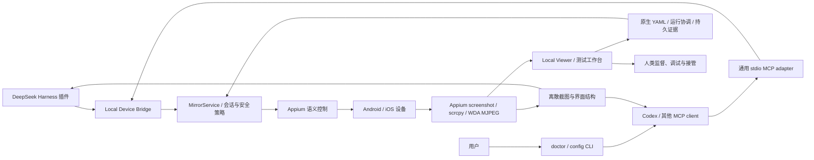

# 产品形态与能力边界

本页解释 Viewer、Agent 与设备核心的职责，并维护工具清单。逐项实现、验收和限制见[能力总表](https://github.com/qmkCamel/flowassert/blob/main/docs/capabilities.md)，操作见[工作台指南](test-workbench.md)。

## 产品定位

FlowAssert 是本机移动测试工作台与设备桥接层：用户通过 Viewer 观看手机、运行固定 YAML、核对证据与历史；Agent 通过 DSH/MCP 使用同一套核心。首期范围是本机 Android/iOS 真机，以自研 App 为主，第三方 App用于当前实测。

- 当前同时交付 DeepSeek Harness Cordis 插件和通用 stdio MCP server；Codex 是 MCP 宿主之一。
- 两种 adapter 都调用共享命令层和 `LocalDeviceRuntime`，没有第二套设备控制逻辑。
- 本机 Viewer 可通过独立命令或 adapter 启动，是人工使用与测试工作台入口，负责高频画面、连接、YAML、步骤证据、历史和停止；Agent 控制仍可独立使用工具。
- `MirrorService`、provider、会话所有权和安全策略属于共享核心，DSH 和 Codex 只保留薄适配层。

当前为 Developer Preview，源码入口为 FlowAssert `main`。独立工作台不需要模型或 DSH；可选宿主的兼容验证与真实模型图片消费分别计证据。模拟器沿用现有 Appium 接入，见[连接指南](simulators.md)。

## 当前能力

### 本机固定流程与证据

固定 `@appclaw/core@2.7.0` parser/runner 通过有限 facade 使用 MirrorService/Appium 会话。运行租约阻止其他控制插入，媒体继续；每步保存 PNG/XML、日志和哈希，重跑保留旧结果。pass 只覆盖已声明的断言及必需证据，未配置的业务/视觉检查仍为 not-performed；取消不回滚设备动作。详见[工作台指南](test-workbench.md)与 [ADR 0006](decisions/0006-native-yaml-workbench.md)。

### Agent 与控制面

DeepSeek Harness 插件与 MCP 共用 20 项默认工具，另有 5 项 opt-in Preview 修复工具。下表为十项设备工具：

| 工具 | 能力 |
| --- | --- |
| `mobile_mirror_list_devices` | 发现 Mock 设备，并在显式授权后发现主机设备 |
| `mobile_mirror_ios_preflight` | 脱敏检查 Xcode、XCUITest、设备、证书和 provisioning profile |
| `mobile_mirror_start` | 新建 Appium session，或附着已有 session |
| `mobile_mirror_status` | 返回生命周期、设备、会话、错误和 Viewer 地址 |
| `mobile_mirror_snapshot` | 获取 fresh PNG observation，并通过 DSH attachment/deferred context 交给 agent |
| `mobile_mirror_inspect_screen` | 返回有界、跨平台规范化的 accessibility 结构，可选同 observation 图片 |
| `mobile_mirror_query_screen` | 在已有 observation 内 summary/find/get/subtree 查询，不重新截图，不延长动作有效期 |
| `mobile_mirror_action` | 保留点击/滑动/返回，并增加 fresh observation-local `tap_node` 与受控 `input_text` |
| `mobile_mirror_manage_app` | 对显式授权的 owned-session target 执行 activate/terminate，不回显 app id |
| `mobile_mirror_stop` | 停止镜像，并只删除插件自己创建的 session |

其余十项共享工作台应用服务，不另建设备控制栈：

| 工具 | 能力与边界 |
| --- | --- |
| `mobile_mirror_test_catalog` | 只列已登记、已授权的 flow／suite |
| `mobile_mirror_run_start` | 策略允许时启动已登记测试，持久幂等受理 |
| `mobile_mirror_run_status` | 查询进度与原始判定 |
| `mobile_mirror_run_cancel` | 请求取消并等待受控清理 |
| `mobile_mirror_run_evidence` | 按分享策略读取已核验材料 |
| `mobile_mirror_run_diagnostic_context` | 确定性比较上下文，只读 |
| `mobile_mirror_run_triage` | 读取已显式生成的分诊报告，不改 verdict |
| `mobile_acceptance_get` | 读取授权验收修订与当前材料缺口，不发布 |
| `mobile_external_result_get` | 逐资产项目授权后读取安全摘要，不执行 runner |
| `mobile_matrix_status` | 读取当前授权项目的矩阵摘要，不启动／取消／复跑，不切换单设备目标 |

### 变更验收、外部资产、OCR 与双槽矩阵

变更验收绑定提交、制品与覆盖，保留不可变修订；外部 JUnit／JSON 是来源材料，不伪造成已在本机验证的运行。本机 OCR 在同一步 PNG 检查点上执行限定区域断言，生产 profile 需授权真实集评测与人工批准，当前仅工程门禁完成。双槽矩阵以每槽独立进程／Store／claim 组合既有运行时，提供本机显式启动、取消和安全复跑；不代表设备云或任意数量并发。

使用入口：[变更验收](change-acceptance-records.md)、[外部资产](external-test-assets.md)、[本机 OCR](local-region-ocr.md)、[双槽矩阵](local-device-matrix.md)。工程实现、真实材料与独立参与者验收分开跟踪。

### 设备与运行时

Mock 用于确定性开发；Appium provider 对接 Android/UiAutomator2 与 iOS/XCUITest/WDA。连续画面使用 scrcpy 或 WDA MJPEG，失败时保留截图路径。external Appium 为默认，managed 模式要求可信绝对命令与 loopback 地址；owned/attached 会话及服务进程分别记录所有权。实现细节见[架构](architecture.md)，准备步骤见 [Android](android-real-device.md)、[iPhone](ios-real-device.md)。

### 首次使用与交付

从 [README](../README.md#quickstart)或[内测任务卡](https://github.com/qmkCamel/flowassert/blob/main/docs/beta-start.md)启动源码。`flowassert` CLI 提供只读 Doctor 和配置生成，预检不安装或修复环境。候选包、历史包与未来 Release 的边界见[安装指南](beta-installation.md)。

### 本机 Viewer 与安全

Viewer 提供中英文界面、连接向导、局部进度和运行历史。长操作失败保留最后可用结果；页面加载不自动发现手机或启动 Appium。Agent 的图片、文字输入、应用管理和证据读取分别授权；节点动作必须使用有效 observation，连续视频不进入工具结果。完整策略与预算集中在[安全模型](security.md)，具体连接和语言行为见[Viewer 指南](local-viewer.md)。

修复闭环为 **Preview，默认关闭**。项目准入与宿主工具可见性分别控制，Mock 安装协议不代表真机修复通过；启用、审批和退出步骤见[修复操作指南](https://github.com/qmkCamel/flowassert/blob/main/docs/evidence-guided-repair-operations.md)。

## 验证层次与剩余覆盖

软件/Mock、同包宿主、真实模型、真机业务和独立使用者验收分别判断。当前逐项结论统一见[能力总表](https://github.com/qmkCamel/flowassert/blob/main/docs/capabilities.md)，原始范围与版本见[验证记录](validation.md)，未完成事项见 [PRODUCT_TODO](https://github.com/qmkCamel/flowassert/blob/main/PRODUCT_TODO.md)。

## 共享桥接形态

最终只维护一套 Device Bridge：

| 组件 | 职责 |
| --- | --- |
| DeepSeek Harness 插件 | 注册 DSH 工具并接收 agent 调用 |
| DSH attachment adapter | 把核心短期 PNG 保存为宿主持久附件，并在工具结果后投递一次图片上下文 |
| 通用 stdio MCP adapter | 把相同能力暴露给 Codex 和其他 MCP client |
| Local Device Bridge / `MirrorService` | 管理设备、会话、动作、错误、权限和所有权 |
| Appium provider | 提供跨 Android/iOS 的语义自动化 |
| scrcpy / WDA MJPEG | 提供高频媒体，不承担 agent 工具协议 |
| Snapshot/Inspect | 给 agent 提供离散、可审计的视觉输入 |
| Local Viewer / 工作台 | 连续画面、连接、YAML 执行、进度、证据和运行历史 |
| AppClaw worker / WorkbenchService / Store | 原生流程执行、共享会话租约、逐步取证与最终判定 |

DSH 插件和通用 MCP adapter 不得分别复制 provider、签名或会话逻辑。它们是控制入口，不是设备 owner。

## Viewer 为什么是 Web 页面

Viewer 是本机观看、测试与回溯的人工入口，同时可以作为 Agent 的监督面板。连续视频不适合直接放进 DSH/MCP 工具结果：

- 高频 PNG/Base64 会消耗模型上下文并膨胀持久化日志；
- MCP 和 agent tool call 适合离散请求/结果，不适合持续视频传输；
- 设备画面可能包含敏感信息，应尽可能停留在本机；
- DSH 与 Codex 不应分别实现一套视频 UI；
- 人需要独立于 agent 的观察、停止和接管路径。

使用本机 Web Viewer 可以复用浏览器媒体能力、避免额外原生客户端，并让 DSH/Codex 共用一个监督界面。如果未来宿主提供稳定的插件面板，可以把 Viewer 嵌入宿主，但底层仍应保持本机媒体通道。

人工使用可通过独立 Viewer 命令启动，配置并连接设备后运行 YAML，详见[独立 Viewer](local-viewer.md)。直接打开 `viewer/index.html` 不会启动服务。使用 Agent adapter 时的流程是：

1. 用户安装并启动 DSH 插件或 Codex adapter；
2. adapter 启动本机 Device Bridge 和 ViewerServer；
3. 工具返回 loopback Viewer URL；
4. agent 通过工具/MCP 完成观察和控制；
5. 用户只在需要监督、调试或接管时打开 Viewer；
6. adapter 退出时释放 Viewer 和插件拥有的设备 session。

## 演进优先级

优先级与未完成验收统一维护在 [PRODUCT_TODO](https://github.com/qmkCamel/flowassert/blob/main/PRODUCT_TODO.md)。新增宿主、执行器或设备规模必须沿用共享核心的所有权与证据边界；架构选择更新相应 ADR。

高帧率 Viewer 不能代替 agent 感知接口；任何新宿主 adapter 都不能绕过共享核心复制设备逻辑。
