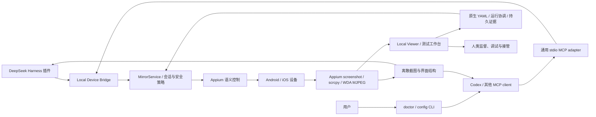

# 产品形态与能力边界

修复闭环为 **Preview（预览能力，默认关闭）**，只适合受控项目试用。M1/M2 软件验证与 M3 Mock 安装协议不等于真实 App 修复验收；项目 `repair.enabled` 与宿主 `repairToolsEnabled` 分开控制，尚无统一总开关或 Viewer 一键开关。使用范围、审批与停用见[修复指南](https://github.com/qmkCamel/flowassert/blob/main/docs/evidence-guided-repair-operations.md)。

当前还提供[报告阅读与离线分享](report-reading-and-sharing.md)；其 41/46 验收与六项迭代的历史计数分开。

## 产品定位

FlowAssert 是本机移动测试工作台与设备桥接层：用户通过 Viewer 观看手机、运行固定 YAML、核对证据与历史；Agent 通过 DSH/MCP 使用同一套核心。首期范围是本机 Android/iOS 真机，以自研 App 为主，第三方 App用于当前实测。

- 当前同时交付 DeepSeek Harness Cordis 插件和通用 stdio MCP server；Codex 是 MCP 宿主之一。
- 两种 adapter 都调用共享命令层和 `LocalDeviceRuntime`，没有第二套设备控制逻辑。
- 本机 Viewer 可通过独立命令或 adapter 启动，是人工使用与测试工作台入口，负责高频画面、连接、YAML、步骤证据、历史和停止；Agent 控制仍可独立使用工具。
- `MirrorService`、provider、会话所有权和安全策略属于共享核心，DSH 和 Codex 只保留薄适配层。

当前为 Developer Preview，源码版本 `0.1.0-alpha.2`。截至 2026-10-07 的开发分支能力、双端验收和限制统一见[能力总表](https://github.com/qmkCamel/flowassert/blob/main/docs/capabilities.md)。六项产品迭代的工程范围已实现，关联四个OpenSpec为90/103（10月5日快照）；真实材料、真机业务和独立评审仍有缺口，见[六项状态](https://github.com/qmkCamel/flowassert/blob/main/openspec/changes/add-change-acceptance-records/roadmap.md)。独立工作台不需要模型；DSH `0.2.0-rc.2` Native/PTC 打包运行时与图片/文本模型目录边界已验，真实 provider 图片调用单独计证据。Codex + MCP 的真机图片单场景独立记录，不替代 DSH 验收。

基础 YAML、Inspector、公开文字输入、截图录屏和 run 视频历史均已交付。Android AI 文字业务 UI 闭环通过；iOS 完整文字 YAML 仍因消息正文不可访问而失败。已有选定 Fixture 中断验收见[运行时记录](runtime-gates-validation.md)；更多系统/OEM/账号、完整断线/旋转/多设备恢复矩阵和稳定版支持仍未覆盖。

## 当前能力

### 本机固定流程与证据

- 固定 `@appclaw/core@2.7.0` 原生 parser/runner，严格结构化 YAML，通过有限 facade 复用已有 MirrorService/Appium 会话；默认流程无模型调用。
- 同一 runtime 内运行租约阻止控制插入，媒体继续；每步留存 PNG/XML、日志、YAML 与哈希 manifest，支持历史回看、取消和重跑。
- 基础正反例与重启后材料复验已在 Android/iPhone 第三方 App完成；P0 已有双端三轮阶段计时和样本预算，性能不是生产 SLO，详见[记录](workbench-p0-validation.md)。
- pass 仅表示已声明 UI、必需业务／视觉、清理和证据条件满足；未配置维度仍为 not-performed。公开文字、run 视频和受信注册 prepare／verify／cleanup 已接入，不开放任意代码。Maestro 报告导入已实现，执行 adapter 未实现。
- 运行后保留会话；取消不回滚，不确定动作后需重连；owned WDA 正常断开清理已通过真机验收，更广异常生命周期矩阵待验。详见[使用说明](test-workbench.md)与 [ADR 0006](decisions/0006-native-yaml-workbench.md)。

### Agent 与控制面

DeepSeek Harness 插件与 MCP 共用 20 项默认工具，另有 5 项 opt-in Preview 修复工具。下表为十项设备工具：

| 工具 | 能力 |
| --- | --- |
| `mobile_mirror_list_devices` | 发现 Mock 设备，并在显式授权后发现主机设备 |
| `mobile_mirror_ios_preflight` | 脱敏检查 Xcode、XCUITest、设备、证书和 provisioning profile |
| `mobile_mirror_start` | 新建 Appium session，或附着已有 session |
| `mobile_mirror_status` | 返回生命周期、设备、会话、错误和 Viewer 地址 |
| `mobile_mirror_snapshot` | 获取 fresh PNG observation，并通过 DSH attachment/deferred context 交给 agent |
| `mobile_mirror_inspect_screen` | 返回有界、跨平台规范化的 accessibility 结构，可选同 observation 图片 |
| `mobile_mirror_query_screen` | 在已有 observation 内 summary/find/get/subtree 查询，不重新截图，不延长动作有效期 |
| `mobile_mirror_action` | 保留点击/滑动/返回，并增加 fresh observation-local `tap_node` 与受控 `input_text` |
| `mobile_mirror_manage_app` | 对显式授权的 owned-session target 执行 activate/terminate，不回显 app id |
| `mobile_mirror_stop` | 停止镜像，并只删除插件自己创建的 session |

其余十项共享工作台应用服务，不另建设备控制栈：

| 工具 | 能力与边界 |
| --- | --- |
| `mobile_mirror_test_catalog` | 只列已登记、已授权的 flow／suite |
| `mobile_mirror_run_start` | 策略允许时启动已登记测试，持久幂等受理 |
| `mobile_mirror_run_status` | 查询进度与原始判定 |
| `mobile_mirror_run_cancel` | 请求取消并等待受控清理 |
| `mobile_mirror_run_evidence` | 按分享策略读取已核验材料 |
| `mobile_mirror_run_diagnostic_context` | 确定性比较上下文，只读 |
| `mobile_mirror_run_triage` | 读取已显式生成的分诊报告，不改 verdict |
| `mobile_acceptance_get` | 读取授权验收修订与当前材料缺口，不发布 |
| `mobile_external_result_get` | 逐资产项目授权后读取安全摘要，不执行 runner |
| `mobile_matrix_status` | 读取当前授权项目的矩阵摘要，不启动／取消／复跑，不切换单设备目标 |

### 变更验收、外部资产、OCR 与双槽矩阵

变更验收绑定提交、制品与覆盖，保留不可变修订；外部 JUnit／JSON 是来源材料，不伪造成已在本机验证的运行。本机 OCR 在同一步 PNG 检查点上执行限定区域断言，生产 profile 需授权真实集评测与人工批准，当前仅工程门禁完成。双槽矩阵以每槽独立进程／Store／claim 组合既有运行时，提供本机显式启动、取消和安全复跑；不代表设备云或任意数量并发。

使用入口：[变更验收](change-acceptance-records.md)、[外部资产](external-test-assets.md)、[本机 OCR](local-region-ocr.md)、[双槽矩阵](local-device-matrix.md)。这四个change剩余13项分别依赖设备、授权材料、独立人员或前置验收，不全是“等真机”。

### 设备与运行时

- Mock provider 已完成确定性 `start → frame → action → stop`，用于本地开发和 CI。
- Appium W3C provider 支持 Android/UiAutomator2 和 iOS/XCUITest/WebDriverAgent 的通用会话、截图与动作协议。
- iOS 已完成一次物理 iPhone 的 WDA 启动、有效 PNG、系统设置内安全导航和 owned session 清理。
- Android 已在物理 Android 14 设备完成 UiAutomator2 启动、有效 PNG、系统设置内安全滑动和 owned session 清理；受限 OEM 的 hidden API policy 错误通过 schema 默认值兼容，单次请求可显式恢复严格失败。
- iOS WDA Team、签名身份、唯一 Bundle ID 和 xcconfig 可以持久化到个人 DSH profile；单次 capabilities 拥有更高优先级。
- 主机签名诊断和自动 provisioning/device registration 分别授权，默认都关闭。
- Appium server 默认为 external；用户可用绝对 executable 和 loopback URL 显式启用 managed 模式。后者只在 Appium start 时惰性启动，拒绝 attached session/已有 listener，并按已记录身份和谱系清理自己拥有的进程及后代。

### 首次使用与交付

- 发布包提供独立 `flowassert` CLI，支持脱敏 `doctor`、完整 DSH YAML、standalone MCP JSON 和 shell-safe Codex 注册命令。
- doctor 不修复环境；host command 有 timeout/abort/1 MiB 上限，报告只保留稳定 code、公开版本和设备数量。
- `0.1.0-alpha.2` 保持 private，不发布公共 npm；GitHub prerelease 只允许由新的精确 tag 在 clean runner 上从单次 tarball 生成 `.tgz`、SHA256 和版本化说明，不覆盖 alpha.1。

### 本机 Viewer 与安全

- Viewer 只监听 loopback，使用同源 API 显示画面和操作状态。
- Viewer 界面完整支持英文和简体中文：有效的本地偏好优先，否则以 `zh` 开头的浏览器语言归一为 `zh-CN`，其他回退英文。
- 语言切换是纯展示重绘，不发起 Viewer API 请求，不重建 session/媒体、不重跑连接检查或消耗授权，并保留 report、busy 状态、最后画面和未提交输入。
- 专用 `mobile-mirror.locale.v1` 存储只允许 `en`/`zh-CN`；存储失败不阻断 Viewer，且不存放设备、session、capabilities、签名、错误详情或画面。
- Viewer 默认提供 Android/iPhone 双平台“连接设备”向导：显式只读检查、120 秒单次引用、通用设备序号、默认查看当前画面，以及可选 one-shot managed Appium。“打开系统设置”为显式可选的诊断目标，不再代表整个产品入口；任意应用启动/raw capabilities 保留在折叠高级入口。首次自动化初始化可能切换画面，不承诺连接前的前台画面完全不变。
- 连接、停止和动作有本地进度，重复操作受限，临时取帧失败会保留最后可用画面。
- Viewer 会在新建 iOS session 可能触发自动 provisioning 时显示外部状态变更警告。
- Team ID、UDID、证书名称、profile 内容、capabilities 和本机路径不会进入工具结果或共享状态。
- 新建 session 与附着 session 的所有权分开，停止插件不会删除外部 session。
- Agent observation 使用 128-bit 随机 ID、60 秒内存 TTL、每 session 4 条和 32 MiB 图片总上限；动作 freshness 另限 15 秒。
- Appium 屏幕内容默认禁止；`structure` 只开放规范化文本，`image-and-structure` 才允许 PNG 进入 DSH attachment 和模型上下文。
- 真机文本输入默认禁止；显式 `non-sensitive` 后仍只接受 fresh observation 中 focused 的普通 input，secure/password 内容在结构发布前删除且永远拒绝输入。
- 应用管理默认禁止；只允许 owned session 的 target 或精确 allowlist，attached/未知 target fail closed。成功或不确定 mutation 都递增 epoch，旧 nodeId/observation 必须重新获取。
- Viewer 连续画面不自动创建 observation/attachment；观察失败保留上一帧，并在 Viewer 独立显示捕获进度和稳定错误码。
- Android Viewer 可在显式配置 scrcpy 4.1 后使用 H.264/WebCodecs；iOS owned session 可使用 WDA MJPEG。两端都在首帧前或失败后保留截图轮询。
- 连续媒体按 Viewer 订阅惰性启动、单订阅、有界缓存；媒体状态进入共享 state，但端口、设备标识、路径、命令和媒体 bytes 不进入共享结果。

## 验证层次与剩余覆盖

### 已完成：Agent 的离散视觉闭环与双宿主证明

Mock、Appium 假服务器和核心/adapter 测试已覆盖 fresh PNG、结构、坐标映射、revision/epoch、过期拒绝、attachment/deferred context、并发和清理。真实 Codex task 已通过 MCP image content 描述可核对画面，使用 fresh observation 执行安全动作，并在 re-observe 中确认 revision 与画面状态变化；Android 与 iOS 已解锁系统设置页也已通过同一 MCP 链路。DSH `0.2.0-rc.2` 的 Native/PTC packed runtime 已通过；目录同时声明 `deepseek-flash` 支持图片、`deepseek-v4-pro` 仅支持文本，clean probe 已验证后者的 omission projection，但未发真实 provider 请求。真实图片模型消费仍沿用 rc.8 的 `openai-codex` 历史证据。

### 已完成：通用 MCP adapter 与 Codex 宿主证明

- 已由 `LocalDeviceRuntime`、共享命令和 contract 模块抽出 host-neutral 核心；
- 已通过 stdio MCP 暴露上述 20 项默认共享工具及 5 项 opt-in Preview 修复工具，已登记测试执行默认关闭，并提供 Codex/通用宿主安装、回滚和权限说明；
- 已用官方 SDK client、in-process transport、真实 built stdio 子进程和 Appium 假服务器验证协议、图片、并发、取消、所有权与脱敏边界；
- 已由真实 Codex task 通过已注册 server 完成图片内容识别、observation-bound 安全动作、再观察和 stop；
- MCP 只承载离散控制、状态和单帧 observation，不承载连续视频。

### P0/P1：物理设备覆盖

- Android USB 已解锁系统设置页的 MCP `observe → safe action → re-observe → stop` 已完成；
- iOS USB 已解锁系统设置页的 MCP `observe → safe action → re-observe → stop` 已完成；
- Android TCP/IP 真机，以及更多 OEM/Android 大版本；
- 至少两个 iOS 大版本和一个免费 Apple Developer 账号路径；
- 锁屏、旋转、断开重连、设备信任变化和多设备冲突；
- 应用 UI、系统 UI 与权限弹窗的边界；
- Appium/WDA/UiAutomator2 升级后的回归矩阵。
- alpha.2 普通文字输入和批准应用生命周期已有双端独立真机样本；验收记录见[能力总表](https://github.com/qmkCamel/flowassert/blob/main/docs/capabilities.md)。Android ADB 间歇超时和更广矩阵仍待解决。

### P1：媒体与首次使用体验

- Android scrcpy 4.1 H.264 与 iOS WDA MJPEG 的共享协调、同源 relay、浏览器渲染和截图回退已实现；
- 单台 Android 14 与单台 iOS 26 USB 真机已完成首帧、fps、receive-to-paint、主动断流恢复、concurrent observation/action 和精确清理指标，P1 连续媒体核心项已关闭；
- 在支持的平台增加 Android 音频；
- 只读 doctor、安全配置生成与受控 managed Appium 已实现；external 默认和 attached session 语义保持兼容；
- 交互式 Android/iPhone 设备检查、最小 WDA 签名输入、权限边界和故障恢复向导已实现；它不安装/修复宿主依赖，也不绕过设备端或 Apple 授权。

### P2：生产化

- 双槽隔离调度及资源限额已有工程实现；双真机矩阵验收、更大设备规模与生产承诺仍待完成；
- 崩溃恢复、孤儿 session 清理、指标和诊断包；
- 签名发布、SBOM、依赖固定和升级策略；
- 远程设备网格所需的认证、TLS、凭据管理和独立威胁模型；
- 稳定版、公共 npm、兼容性承诺和可访问性验证。

## 共享桥接形态

最终只维护一套 Device Bridge：

| 组件 | 职责 |
| --- | --- |
| DeepSeek Harness 插件 | 注册 DSH 工具并接收 agent 调用 |
| DSH attachment adapter | 把核心短期 PNG 保存为宿主持久附件，并在工具结果后投递一次图片上下文 |
| 通用 stdio MCP adapter | 把相同能力暴露给 Codex 和其他 MCP client |
| Local Device Bridge / `MirrorService` | 管理设备、会话、动作、错误、权限和所有权 |
| Appium provider | 提供跨 Android/iOS 的语义自动化 |
| scrcpy / WDA MJPEG | 提供高频媒体，不承担 agent 工具协议 |
| Snapshot/Inspect | 给 agent 提供离散、可审计的视觉输入 |
| Local Viewer / 工作台 | 连续画面、连接、YAML 执行、进度、证据和运行历史 |
| AppClaw worker / WorkbenchService / Store | 原生流程执行、共享会话租约、逐步取证与最终判定 |

DSH 插件和通用 MCP adapter 不得分别复制 provider、签名或会话逻辑。它们是控制入口，不是设备 owner。

## Viewer 为什么是 Web 页面

Viewer 是本机观看、测试与回溯的人工入口，同时可以作为 Agent 的监督面板。连续视频不适合直接放进 DSH/MCP 工具结果：

- 高频 PNG/Base64 会消耗模型上下文并膨胀持久化日志；
- MCP 和 agent tool call 适合离散请求/结果，不适合持续视频传输；
- 设备画面可能包含敏感信息，应尽可能停留在本机；
- DSH 与 Codex 不应分别实现一套视频 UI；
- 人需要独立于 agent 的观察、停止和接管路径。

使用本机 Web Viewer 可以复用浏览器媒体能力、避免额外原生客户端，并让 DSH/Codex 共用一个监督界面。如果未来宿主提供稳定的插件面板，可以把 Viewer 嵌入宿主，但底层仍应保持本机媒体通道。

人工使用可通过独立 Viewer 命令启动，配置并连接设备后运行 YAML，详见[独立 Viewer](local-viewer.md)。直接打开 `viewer/index.html` 不会启动服务。使用 Agent adapter 时的流程是：

1. 用户安装并启动 DSH 插件或 Codex adapter；
2. adapter 启动本机 Device Bridge 和 ViewerServer；
3. 工具返回 loopback Viewer URL；
4. agent 通过工具/MCP 完成观察和控制；
5. 用户只在需要监督、调试或接管时打开 Viewer；
6. adapter 退出时释放 Viewer 和插件拥有的设备 session。

## 演进优先级

当前优先级见 [PRODUCT_TODO](https://github.com/qmkCamel/flowassert/blob/main/PRODUCT_TODO.md)，状态见[能力总表](https://github.com/qmkCamel/flowassert/blob/main/docs/capabilities.md)。六项工程已完成，下一步收集授权图像与真实 runner 报告开展离线验收，安排独立使用者评审及双端业务／矩阵验收；不得将 OCR 合成识别当作 iOS 完整文字业务已补验。旧 Android ADB 故障、DSH 真图片模型、外部执行 adapter、更大设备规模与生产化继续单列。原六项验收条件见[总览](https://github.com/qmkCamel/flowassert/blob/main/openspec/changes/add-change-acceptance-records/roadmap.md)，不将源码推送等同于新版本发布。

高帧率 Viewer 不能代替 agent 感知接口；任何新宿主 adapter 都不能绕过共享核心复制设备逻辑。
