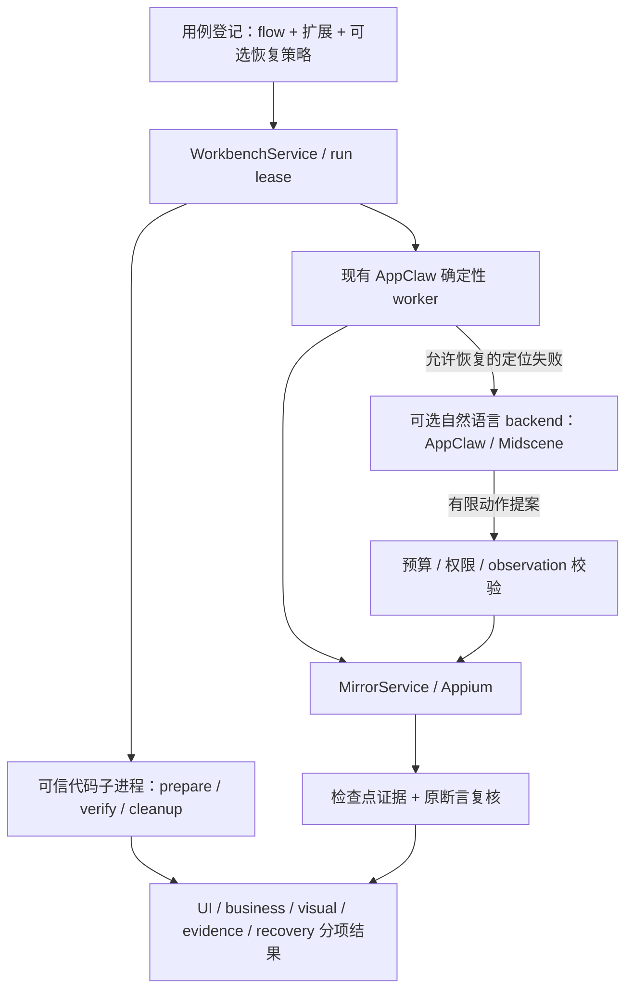

# 代码扩展与自然语言恢复：调研及接入建议

日期：2026-09-16。性质：研究与拟议方案，**两项均未实现**。基于本机 `@appclaw/core@2.7.0` 与源码 `REDACTED_REVISION`；上游在线资料为当日查询的滚动文档，不代表已锁定或验证的依赖版本。本轮未跑上游新增真机 PoC。

## 之前调研过什么

> 2026-09-17 状态补注：上文“两项均未实现”是调研当日状态。代码扩展及 Fixture App 双端业务闭环已有实现和真机证据；AI 恢复控制、证据和 Viewer 已接入，Codex 与真实模型验收仍待完成，见[当前状态](../ai-recovery.md)。下文初始建议以[正式设计](../../openspec/changes/add-bounded-ai-recovery/design.md)为准，首期收敛为一次导航 tap，recovered 与 flaky 分开。

- [AppClaw 评估](../design/appclaw-evaluation.md) 第 3/4 节：SDK、fixture、lifecycle hook；未知字符串解析可进入 LLM、文字断言可能进入视觉路径；strict parser 不等于整个执行过程零模型调用。也记录了失败返回值、报告非必需证据、超时未取消原 Promise 的静态风险。这些是旧提交审计，不自动套用到所有未来版本。
- [原目标设计](../design/mobile-test-workbench.md) 第 6/7 节：已设计宿主注册 TS verifier、fixture/cleanup、脚本依赖哈希、业务校验输出与不确定结果；当时以 Maestro 为默认，未落地，不可照搬其执行器接线。
- [框架决策](framework-decisions.md)：目前默认是 AppClaw 原生 YAML + MirrorService 受限 facade；Maestro fork 为真机 PoC/候选 adapter。

当前源码的限制是主动设置的：`src/workbench-flow.ts` 白名单拒绝任意步骤与未知字符串；`scripts/workbench-worker.mjs` 使用 strict parser、禁用 fetch；`src/workbench-service.ts` 清理 worker 环境并将 visual/business verification 初始化为 not-performed。仅移除白名单或放开 fetch，不能形成可验收的扩展能力。覆盖 fetch 也不是对恶意 Node 代码的操作系统沙箱。

## 可参考项目

| 项目 | 官方能力依据 | 借鉴点 | 本项目接入判断 |
| --- | --- | --- | --- |
| Maestro | [JS 执行](https://docs.maestro.dev/maestro-flows/javascript/run-and-debug-javascript)、[HTTP](https://docs.maestro.dev/maestro-flows/javascript/make-http-requests) | runScript、参数、output、HTTP 数据准备/读取 | 借鉴使用方式；不把 Maestro 命令直接塞进 AppClaw parser。若需执行既有 Maestro 脚本，另走 fork adapter |
| AppClaw | [SDK/Runner/hook/fixture 文档](https://appclaw.in/usage)、[仓库](https://github.com/appclawhq/AppClaw) | TS 测试扩展、setup/teardown、自然语言单步与目标执行 | 距现有引擎最近，优先复用；不能引入第二个 session owner，也不能把 SDK success 当独立业务证明 |
| Midscene | [自定义 interface](https://midscenejs.com/integrate-with-any-interface)、[YAML](https://github.com/web-infra-dev/midscene/blob/main/apps/site/docs/en/automate-with-scripts-in-yaml.mdx) | 截图/size/actionSpace 抽象，aiAct/aiAssert 分离 | 视觉恢复候选；可通过自定义 interface 接 MirrorService，避免直接启用其另一套设备驱动；兼容、取消与坐标还需 PoC |
| Playwright Test | [Fixtures](https://playwright.dev/docs/test-fixtures) | 可组合资源准备与清理、依赖生命周期 | 借鉴测试扩展设计；不是拿 Playwright 浏览器控制器替换移动驱动 |

推荐组合是“当前 AppClaw + 小型扩展协议”，自然语言 backend 在 AppClaw 与 Midscene 间用同一场景对照。暂不新增完整测试框架或更换设备 owner。Midscene 的 screenshotBase64/size/actionSpace 提供的是接入点，不是它已经兼容本项目租约和取消语义的证明。

## 一、代码扩展建议

目标：用户写少量 TS/JS，完成参数计算、数据准备、只读业务校验与清理；可以显式放在用例前后，后续再支持步骤检查点。首期不开放 YAML 内联 eval，也不宣称可安全运行任意不可信代码。

建议采用本机注册名到模块的映射。YAML 引用注册名及 JSON 参数；不允许上传 YAML 后任意指定宿主文件路径。模块内容、版本、传递依赖或打包产物及其 hash 固化到 run。首期支持可信本机 JS 模块和预编译 TS，是否内置 TS loader 在实现设计中确定。

扩展分角色：prepare 可产生测试上下文；verify 返回 expected/actual/verdict/source/artifactRefs；cleanup 在验证后执行，清理失败独立记录。verify 优先只读 API；需要写测试数据时放到 prepare/cleanup，使用指定测试环境。HTTP 方法名本身不能证明接口只读。

扩展执行使用独立子进程，设输入/输出大小、时间与子进程清理边界。进程隔离便于超时回收，但**不等于宿主文件/网络安全沙箱**。第一版只运行用户登记的可信代码；不可信模块需要额外 OS sandbox/容器设计。凭据使用本机引用，不进入 YAML 快照、日志或模型上下文；网络权限若要强制执行，必须通过代理/OS 边界，不能只约定一个 ctx.http 函数。

独立业务读取与设备动作分开。若后续扩展需要操作设备，只暴露受控 RPC，仍经 MirrorService 租约/权限/freshness 校验；不能给模块直接创建 Appium、ADB 或 Maestro session 的产品级授权。可信任代码的主机权限仍需如实说明。

建议输出保持 UI、business、visual、evidence 四维，未执行的验证保持 not-performed；超时/网络失败为 inconclusive，明确不符合预期才为 fail。返回值 schema 不合规、异常或缺少必需证据都不能 pass。

## 二、自然语言步骤与失败恢复建议

区分三个用途：

1. 自然语言生成 YAML 初稿：保存建议，人工审阅后作为固定回归用例。
2. 显式 AI 步骤：用例预先声明目标和动作预算；执行和取证均可回溯。
3. 确定性步骤失败后的恢复：默认关闭，只允许在指定失败类型与指定步骤启用。

首期恢复只覆盖“目标未找到且尚未产生动作”一类定位失败。例如模型在新截图上定位“搜索”按钮，建议目标后由受控执行器执行，再重新跑原定后置断言。目标歧义不能静默随便选一个；动作结果不确定、提交/支付/发送可能已经生效时，先只读核对，不能盲目重试写入。

业务断言失败、证据损坏、权限拒绝、密码/敏感输入、失效会话不能用 AI 兜底覆盖。iOS 消息正文缺失可以另加显式视觉 verifier，但原结构断言失败必须保留；不能仅因模型说“文字存在”就把原 YAML 判通过。视觉检查也不能等价于服务端持久化校验。

模型输入包括用户声明目标和有界新 observation。页面文字、OCR 与历史日志只是被测数据，不是新的执行指令。模型只能返回有限动作提案，不生成宿主 shell/代码。截图分享按本次显式策略启用，模型凭据走独立配置，旧确定性模式保持零模型请求。

每次恢复有动作数、总耗时、模型调用/费用预算；初始建议上限 3 个动作、30 秒、1 次恢复，需真机测量后校准。每个动作前复核 observation 和允许范围，完成/取消时停掉后续派发，迟到结果丢弃；只要 mutation 未知，封锁后续控制直至重新建立可确认状态。

结果保留原 attempt 的失败与恢复子记录；总体单独标记 recovered/flaky（具体 schema 待设计），默认 CI 不把 recovered 当成干净通过。保存前后截图、结构、动作、模型/provider 版本、prompt 模板版本、预算与耗时；不保存模型隐式思维链。模型自报完成后必须执行独立的后置检查。

## 拟议运行结构

正常执行保留现有原生 parser/runner；扩展和恢复由父层协调。断点恢复 API 不能假定上游已具备：必须先验证是否能在原 worker 静止后继续指定步骤；不能继续时结束原 attempt 并创建显式恢复 attempt。不能将有写入步骤的整个 flow 自动重跑。

## 实施顺序与验收

第一阶段实现代码注册、prepare/verify/cleanup、哈希快照和结果分项，先用本机测试服务验证：真值通过、错误预期失败、网络超时不确定、cleanup 失败、取消后无迟到设备动作、关键状态截图保留。再选择自研 App 的公开测试场景做双端验证。

第二阶段在相同失败页面分别做 AppClaw/Midscene backend PoC，比较恢复成功、错误动作、取消停止、耗时与调用成本。至少覆盖正确目标、两个相似目标、页面注入指令、已经发送但响应丢失、模型不可用和证据失败，不凭单次成功选择 backend。

第三阶段接入 Viewer，展示代码阶段、恢复请求进度、原始失败与全部 attempts；形成可重复的真机样本和故意失败反例。整个过程仍允许查看媒体和使用独立控件，运行控制保持互斥。

待形成正式 OpenSpec change：扩展配置/结果 schema、取消/隔离契约、恢复资格与 verdict/CI 语义、模型配置、Viewer 交互及迁移方案。本文不修改当前能力总表为“已实现”，也不改宣传稿承诺。
