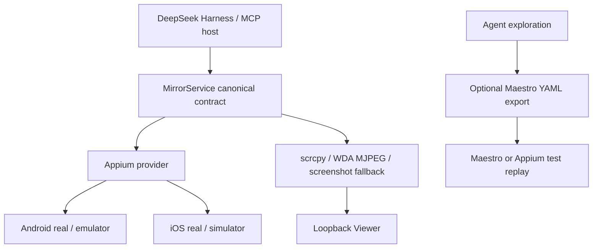

# Maestro 与 Appium：FlowAssert 的分工与选型

> 历史快照说明（2026-09-14 整理）：下文官方支持面的限制针对 2026-08-25，不适用于用户已验证的 [PR 3100 真机 fork](https://github.com/mobile-dev-inc/Maestro/pull/3100)。9 月 10 日该 fork 已通过本机 iPhone 对照；当前工作台改用 AppClaw 原生执行器复用 Appium 会话。见[决策演变](framework-decisions.md)与[同机实测](../design/sampleapp-iphone-real-device-validation.md)。本次未重新核对 Maestro 上游最新状态。

资料复核日期：**2026-08-25**。

本文是[产品、技术方案、安全与开源生态调研](product-landscape.md)的专项补充。它回答的不是“哪个工具总体更好”，而是：在 FlowAssert 已经提供 DSH/MCP 双宿主、`MirrorService`、Viewer 和明确 session ownership 的前提下，Appium 与 Maestro 应分别承担什么职责。

## 1. 结论

1. **继续以 Appium 作为 Android/iOS 语义控制底座。** 官方维护的 UiAutomator2 与 XCUITest 驱动覆盖本项目要求的双端真机、模拟器和远程 WebDriver/Appium 环境。
2. **把 Maestro 定位为可选 Flow Runner 和流程资产格式。** 它的 YAML、隐式等待、调试体验、MCP 与 Viewer 很适合把 Agent 探索结果固化为可读、可回放的测试流程。
3. **不让 Maestro 成为第二个设备 owner。** 同一设备 session 只能由一个明确的 owner 管理；否则停止、重连、应用生命周期和故障恢复会发生竞态。
4. **不把 Appium MCP 再套在 FlowAssert 核心之下。** Appium MCP 是重要竞品和设计参考，但本项目已经直接在 provider 层使用 Appium；再增加一层 MCP 会复制 session、policy 与工具契约。
5. **媒体继续与控制解耦。** Appium/Maestro 的截图和调试界面不能替代 FlowAssert 的连续 Viewer 通道；连续帧也不进入 DSH/MCP 文本工具结果。

## 2. 两者位于不同层级

Appium 更接近跨平台设备自动化协议和驱动底座；Maestro 更接近面向测试作者的声明式工作流产品。把两者作为同层替代品，会掩盖真正的架构选择。

| 层级 | Appium | Maestro | FlowAssert 的选择 |
| --- | --- | --- | --- |
| 控制底座 | W3C WebDriver server、driver、capability 与 session | Maestro runtime 与较高层命令 | Appium provider |
| 流程表达 | 由客户端测试框架负责 | 内建 YAML Flow、等待、重试和组合 | 后续可导出 Maestro Flow |
| Agent 接口 | Appium MCP 提供广工具面和扩展 API | CLI 内置 MCP、文档查询和 Viewer | DSH/MCP 使用项目自有窄契约 |
| 连续媒体 | 可提供截图、录制或 WDA MJPEG 原语 | Viewer/Studio 提供集成调试体验 | 独立 Viewer 与可替换媒体 adapter |
| 资源所有权 | session 生命周期可精确控制 | runner 管理其执行目标 | `owned` 与 `attached` 必须显式区分 |

## 3. 平台与真机覆盖

| 目标 | Appium | Maestro | 结论 |
| --- | --- | --- | --- |
| Android 模拟器 | UiAutomator2 支持 | 支持 | 两者均可用 |
| Android 真机 | UiAutomator2 + ADB，支持 | 官方支持，通过 ADB 发现 | 两者均满足 |
| iOS 模拟器 | XCUITest 支持 | 官方完整支持 | 两者均可用 |
| iOS 真机 | XCUITest/WDA 支持；需要 macOS、Xcode、信任、Developer Mode、UI Automation 与签名 | 官方 UIKit 文档仍明确标注不支持物理设备执行 | Appium 是跨双端真机的必要底座 |
| 远程设备/设备农场 | 可连接远程 Appium、Grid 或云厂商 endpoint | Maestro Cloud 提供托管执行 | 本项目未来优先复用远程 Appium 边界 |

“Maestro 不支持真机”并不准确：它支持 Android 真机。准确表述应是“官方 Maestro 当前不支持本地物理 iOS”，而物理 iOS 是本项目的硬门槛。

社区项目可能补足 Maestro 的物理 iOS 路径，但那会引入另一套 WDA、兼容矩阵和 session 生命周期，不能当作 Maestro 官方契约，也不适合作为 FlowAssert 的默认底座。

## 4. 自动化模型

### 4.1 Appium：底层能力广，集成成本高

Appium 使用 W3C WebDriver session，通过 driver 把统一命令映射到 UiAutomator2、XCUITest/WDA 等平台实现。它适合本项目的原因是：

- locator、element、gesture、context、应用生命周期和平台扩展命令覆盖广；
- 真机、模拟器、本地 server、远程 server 与设备农场共享相近的 session 模型；
- driver/provider 边界可以被 `MirrorService` 归一化，DSH 和 MCP adapter 不需要理解 capability 细节；
- 设备发现、启动、附着、停止和错误映射可以由本项目实施更窄的安全策略。

相应代价是 Appium server、driver、SDK、capability 和 iOS 签名矩阵较复杂。FlowAssert 应通过固定版本、Doctor、配置 schema、可执行文件发现和可复现验收降低这部分成本，而不是在 Agent 提示词中临时拼 capability。

### 4.2 Maestro：流程表达清晰，控制原语更高层

Maestro 通过 accessibility tree 和设备级输入执行黑盒 UI 自动化。它适合流程层的原因是：

- YAML 对产品、QA 与开发者都更容易审阅；
- 内建等待和容错减少显式 sleep 与脆弱轮询；
- Studio、Viewer、截图和流程失败信息形成较完整的调试闭环；
- Flow 可以进入仓库、CI 和代码审查，成为 Agent 探索后的稳定资产。

它不适合替代底座的原因不是 YAML 能力不足，而是平台硬门槛、平台特有原语和 session ownership 无法完全覆盖本项目要求。

## 5. Agent 与 MCP 集成

### 5.1 Appium MCP

Appium MCP 已提供本地内嵌 driver 与远程 WebDriver/Appium 两种模式，覆盖 session、设备、element、gesture、截图、录屏、应用管理和测试生成等工具，并提供扩展 API。它证明了 Appium 适合作为 Agent 控制底座，也提供以下可借鉴设计：

- create/attach/select/delete 等 session 生命周期必须显式；
- 远程 `remoteServerUrl` 应由可信配置提供，并通过 allowlist/regex 与网络边界限制；
- tool 日志与 telemetry 不应记录截图、page source、prompt、凭证等敏感载荷；
- iOS 真机准备应作为独立、可诊断的流程，而不是隐藏在第一次 session 超时里。

FlowAssert 不直接依赖 Appium MCP，是因为 DSH 与项目自有 MCP 已共享 `LocalDeviceRuntime` 和 canonical command contract。再增加一个 MCP 进程只会重复工具映射、错误语义、session store 和权限策略。

### 5.2 Maestro MCP

Maestro MCP 随 CLI 提供，当前覆盖设备列举、screen hierarchy、截图、点击、文本、应用启动/停止、Flow 语法检查与执行等能力，并能返回 Maestro Viewer URL。它非常适合作为以下用途：

- 让 Agent 辅助编写、修复和执行已有 Flow；
- 在可视环境中检查 Flow 的实时执行过程；
- 把一次性自然语言探索转化为可审查 YAML；
- 在支持的平台与 CI 中回放稳定流程。

它不应与 FlowAssert 同时争抢同一个 owned session。可接受的集成方式是“导出后独立回放”，或未来设计一个明确的 handoff/lease 协议；在此之前不共享活跃设备 ownership。

## 6. Viewer 与媒体能力

| 能力 | Appium | Maestro | FlowAssert |
| --- | --- | --- | --- |
| 单帧截图 | 标准 WebDriver/driver 能力 | CLI/MCP 支持 | observation 与 fallback 使用 |
| UI 结构 | page source 与 element locator | accessibility hierarchy | 规范化、有界结构并绑定 observation |
| 连续画面 | iOS 可通过 WDA MJPEG；Android 通常组合其他媒体组件 | Maestro Viewer/Studio 集成设备画面与命令 | Android scrcpy、iOS WDA MJPEG、失败回退截图轮询 |
| Agent 结果 | 取决于客户端封装 | MCP 返回工具内容 | 控制/status 与单次 observation；不携带连续视频 |
| 人工监督 | 需要 Inspector、客户端或额外 UI | Viewer/Studio 体验完整 | loopback Viewer 是产品契约的一部分 |

本项目保留 Viewer 的直接理由是：连续媒体的帧率、编解码、背压和生命周期与语义动作不同。让控制 provider 或 MCP 结果承载视频，会扩大上下文、内存、日志和隐私风险，也会把媒体升级绑死在 agent contract 上。

## 7. 双端运行路径

### 7.1 Android

Appium 路径：

1. ADB 发现并授权目标设备；
2. UiAutomator2 driver 创建或附着 session；
3. `MirrorService` 归一化 observation、action、状态与错误；
4. scrcpy 提供优先连续媒体，失败时回退截图轮询；
5. stop 只删除项目 owned session，attached session 仅 detach。

Maestro 路径：

1. ADB 发现模拟器或物理设备；
2. Flow 通过文本、ID、accessibility 与手势执行；
3. Viewer/Studio 展示执行与设备状态；
4. runner 独立拥有此次 Flow 的目标，不与 FlowAssert 活跃 owner 并发控制。

### 7.2 iOS

Appium 路径：

1. macOS/Xcode 识别并信任设备；
2. 设备启用 Developer Mode 和 UI Automation；
3. WDA 使用有效 provisioning profile 签名、安装并启动；
4. XCUITest driver 建立 session，WDA MJPEG 提供优先连续媒体；
5. `MirrorService` 保持 observation freshness、ownership 与失败恢复契约。

Maestro 官方本地路径目前只覆盖 iOS Simulator。因此，Maestro Flow 可以用于模拟器和云端验证，但不能作为本项目 iOS 真机验收的替代证据。

## 8. 可靠性与可观测性

| 问题 | Appium 侧风险 | Maestro 侧风险 | FlowAssert 约束 |
| --- | --- | --- | --- |
| 等待与抖动 | 客户端若直接操作易出现手写 sleep | 内建等待更友好，但隐式行为需可解释 | action 有进度、超时与结构化错误 |
| 陈旧元素/观察 | element UUID/page source 可能过期 | runner 通常在步骤执行时重新定位 | observation ID、TTL、revision、epoch 与 freshness |
| session 泄漏 | server/driver/设备进程可能残留 | runner/Viewer 也持有设备状态 | owned/attached 分离并精确清理 child |
| 媒体失败 | 截图或 MJPEG 可能阻塞/断流 | Viewer 依赖 runner 与设备支持 | 保留最后可用画面并显式降级 |
| 多控制器竞态 | 多客户端可连接同一基础设施 | Flow 与外部控制可同时命中设备 | 单一 owner；未来才引入 handoff/lease |
| 诊断信息 | capability/server/driver 链较长 | Flow 报错较易读但底层仍可能失败 | Doctor 与分层错误不得泄漏凭证、本机路径或设备标识 |

对用户触发且可能超过 300 ms 的启动、观察、动作、停止和 Flow 回放，UI 必须提供局部进度，失败时保留最后可用结果，并允许无关控件继续交互。

## 9. 安全与权限

### Appium 侧

- capability 可以启动应用、执行平台命令或连接远程 endpoint，不能直接接受不可信模型输出；
- Appium server 和远程 WebDriver 地址必须由可信配置、loopback/network policy 与 allowlist 约束；
- XCUITest/WDA 签名材料、设备 ID、Android SDK/Xcode 路径不得进入公共工具结果或日志；
- attached 外部 session 只能 detach，不能由本项目删除。

### Maestro 侧

- Flow 能执行应用与设备动作，应按可执行自动化资产审查，而不是按普通提示文本处理；
- `runFlow`、脚本、文件路径、环境变量和云端配置需要显式边界；
- Viewer URL、截图和 hierarchy 都可能包含敏感信息；
- Agent 生成的 Flow 必须经过 schema/语法检查，高风险动作仍需产品级确认策略。

### 共同原则

- 默认 loopback 或 stdio，不向不可信网络暴露控制面；
- 屏幕、UI tree、剪贴板、输入文本和应用列表均按敏感数据处理；
- 模型负责提出意图，非 LLM policy 负责 URL、host、文件、命令与 destructive action 的允许范围；
- CI 中使用受控设备、最小权限凭证和可清理环境；
- 任何跨工具 handoff 都必须携带明确的 session identity、owner 与失效规则。

## 10. 何时选择哪一种

### 选择 FlowAssert + Appium provider

- 需要 Android 与 iOS 双端物理真机；
- 需要 DSH 原生工具和通用 MCP 共享同一核心；
- 需要独立低延迟 Viewer、observation freshness 与精确 ownership；
- 需要连接远程 Appium/Grid，同时保持本地 canonical contract；
- 需要平台特有动作或更广的 selector/gesture 能力。

### 选择 Maestro Flow

- 目标平台在 Maestro 官方支持范围内；
- 测试步骤需要让产品、QA 与开发共同审阅；
- 希望依靠内建等待与声明式命令降低脚本维护成本；
- 希望在 Studio/Viewer 中快速调试，并在本地或云端回放；
- 已完成探索，需要把结果沉淀为仓库中的回归资产。

### 推荐组合

1. 使用 FlowAssert 完成 Agent 探索、视觉监督和安全受限动作；
2. 从成功轨迹生成候选 Maestro YAML 或 Appium client test；
3. 对生成内容做语法、selector、断言和高风险动作审查；
4. 在独立 session 中回放并保存报告；
5. 不让两个 runner 同时拥有同一设备。

## 11. 决策与后续验收

当前绑定决策：

- Appium 保持语义控制底座；
- `MirrorService` 保持 DSH/MCP 的唯一 canonical contract；
- Maestro 保持可选流程层，不改变 provider 或 transport 边界；
- Android scrcpy 与 iOS WDA MJPEG 继续作为优先媒体路径；
- 不把连续帧放入 DSH/MCP 工具结果。

未来引入 Maestro 集成前，至少验证：

- 导出 Flow 能在受支持目标上独立重复执行；
- 生成的 selector 不依赖一次性坐标或敏感文本；
- Flow 语法错误、执行失败和取消都保留最后可用结果；
- FlowAssert 与 Maestro 不会同时删除或控制同一 session；
- Viewer、截图、日志和报告遵守同一脱敏与保留策略；
- Maestro 官方物理 iOS 支持面若发生变化，重新评估硬门槛并更新本文和 ADR。

## 12. 主要一手资料

### Appium

- [Appium 官方驱动列表](https://appium.io/docs/en/latest/ecosystem/drivers/)
- [UiAutomator2 driver](https://github.com/appium/appium-uiautomator2-driver)
- [XCUITest 真机准备](https://appium.github.io/appium-xcuitest-driver/latest/getting-started/device-setup/)
- [Appium MCP README](https://github.com/appium/appium-mcp/blob/main/README.md)
- [Appium server 安全说明](https://appium.io/docs/en/latest/guides/security/)

### Maestro

- [Maestro 工作原理](https://docs.maestro.dev/get-started/how-maestro-works)
- [Maestro 支持平台](https://docs.maestro.dev/getting-started/build-and-install-your-app)
- [Maestro Android 支持](https://docs.maestro.dev/getting-started/build-and-install-your-app/android)
- [Maestro UIKit 与物理 iOS 限制](https://docs.maestro.dev/get-started/supported-platform/ios/uikit)
- [Maestro MCP 与 Viewer](https://docs.maestro.dev/get-started/maestro-mcp)
