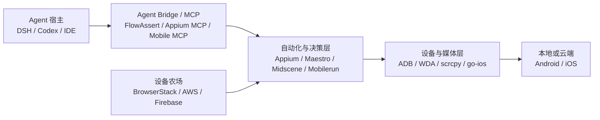

# FlowAssert 相关产品、技术方案与开源生态调研

> 历史快照说明（2026-09-14 整理）：以下版本、指标、测试数量和项目状态保留 2026-08 的原始范围，不代表当前状态。新增 ViewInspectKit、AppClaw、Maestro iPhone fork 对照及当前工作台选择，统一见[框架决策汇总](framework-decisions.md)、[产品 TODO](../../PRODUCT_TODO.md)和[里程碑](../milestones.md)。

外部项目与 GitHub 指标快照：**2026-08-20**。FlowAssert 项目状态基线：**2026-08-21 / `0.1.0-alpha.2` 工作区**。

> 本文是产品和架构决策输入，不是跑分榜。Stars、forks、贡献者和测试文件数量只能反映采用度或工程投入，不能单独代表安全性和实现质量。除明确标注为“判断”的内容外，产品能力均以官方仓库、官方文档、官方安全公告或论文原文为依据；版本与活跃度会继续变化，作重大依赖决策前应重新核对。

## 1. 结论先行

1. **Appium 仍是最合适的跨 Android/iOS 语义控制底座。** 它的 W3C WebDriver、UiAutomator2、XCUITest/WebDriverAgent、远程 Grid 和驱动生态覆盖了本项目必须支持的双端真机边界。FlowAssert 应继续把 Appium 放在 provider 层，而不是自行重写设备自动化协议。
2. **市场已经从“只有零散脚本”进入成熟 MCP/Agent 工具竞争。** [Appium MCP](https://github.com/appium/appium-mcp)、[Mobile MCP](https://github.com/mobile-next/mobile-mcp) 和 [Maestro MCP](https://github.com/mobile-dev-inc/maestro-docs/blob/main/introduction/get-started/maestro-mcp.md) 都有可用产品面，不能再把“双端 + MCP + session 管理”本身当成独家优势。
3. **FlowAssert 当前的差异化不是工具数量最多，而是安全、可监督的本机 Agent Bridge。** DSH 插件与通用 stdio MCP 共用核心；Appium 控制、离散 observation、连续 Viewer 媒体三条链路分离；observation 具备 TTL、revision、epoch 和动作 freshness；attached/owned session 分开清理；默认 loopback、Mock 和 fail-closed 策略。
4. **最接近的直接竞品是 Appium MCP 与 Mobile MCP。** Appium MCP 的控制面、session/API 扩展性最强；Mobile MCP 的开箱体验和设备操作覆盖更完整。FlowAssert 在 DSH 原生集成、连续媒体隔离、陈旧观察拒绝和精确资源所有权上更聚焦，但在动作广度、安装引导、多设备、远程设备和公共发布成熟度上明显落后。
5. **Maestro 更适合作为高层流程资产，而不是替换 Appium。** 它的 YAML、隐式等待、Viewer 和云执行适合把探索结果固化为可重复测试；但官方本地物理 iOS 仍不是完整支持面。推荐后续提供“探索后导出 Maestro/Appium 流程”，不要建设第二套设备 owner。
6. **视觉自治框架适合作为可选决策层，不适合作为设备桥核心。** [Midscene](https://github.com/web-infra-dev/midscene)、[Mobilerun](https://github.com/droidrun/mobilerun)、[Open-AutoGLM](https://github.com/zai-org/Open-AutoGLM) 和多个 `mobile-use` 项目证明了截图/VLM 路线的覆盖能力，也同时放大了模型成本、确定性、提示注入和高风险误操作问题。
7. **当前工程质量强于公共开源成熟度。** FlowAssert 已有 27 个 Vitest 文件/148 个测试、7 个 Chromium E2E、DSH/MCP/打包与双平台真机分层证据；但仓库仍是 private、package 为 `private: true`，没有公共 npm、稳定版兼容承诺、SBOM、公开社区和长期 release 记录。对外不能把它描述为成熟开源项目。

## 2. 调研范围与评价口径

本次把相关产品分成四层，避免把“设备传输组件”“自动化框架”“Agent server”和“云设备农场”混在一起比较：

| 维度 | 关注问题 |
| --- | --- |
| 产品能力 | 双端真机、截图/结构、动作、应用生命周期、Viewer、录制、设备管理、流程资产 |
| 技术方案 | 控制协议、感知来源、媒体通道、session ownership、扩展性、远程形态 |
| Agent 契约 | MCP/宿主集成、observation 与 action 是否绑定、取消/进度、工具结果是否携带大媒体 |
| 安全 | 默认暴露面、主机命令、文件/URL/网络策略、隐私、提示注入、陈旧观察和高风险确认 |
| 开源质量 | License、活跃度、release、测试/CI、维护者规模、安全响应、文档与社区采用 |
| 对本项目适配度 | 能否复用为底座、适合借鉴、适合互操作，还是只适合作为竞品基准 |

## 3. FlowAssert 当前产品基线

以下是比较时使用的本项目基线；详细定义见[产品形态与能力边界](../product-shape.md)、[架构说明](../architecture.md)、[安全模型](../security.md)和[验证记录](../validation.md)。

| 能力 | 当前状态 |
| --- | --- |
| 宿主 | DeepSeek Harness Cordis 插件 + 通用 stdio MCP；两者共用 `LocalDeviceRuntime` 和命令层 |
| 设备控制 | Appium W3C provider；Android UiAutomator2、iOS XCUITest/WDA；Mock provider 用于确定性回归 |
| Agent 感知 | 离散 PNG observation + 有界、规范化 accessibility 结构；图片通过 DSH attachment 或单次 MCP image content 传输 |
| 动作 | `tap`、`swipe`、`back`、observation-local `tap_node`、受控 `input_text`；owned-session `activate`/`terminate` |
| 连续画面 | loopback Viewer；Android scrcpy 4.1 H.264/WebCodecs，iOS WDA MJPEG，失败回退截图轮询 |
| 陈旧保护 | 128-bit observation ID、60 秒 TTL、最多 4 条/32 MiB、15 秒动作 freshness、revision/epoch；可能 mutation 后强制作废 |
| 所有权 | owned session 才由本项目删除；attached session 永不删除；managed Appium 只清理持有的精确 child |
| 默认安全 | Mock、loopback、stdio MCP、屏幕/文本/应用管理分别显式授权；capabilities/设备 ID/本机路径不进入公共结果 |
| 当前证据 | 27 个 Vitest 文件/148 个测试、7 个 Chromium E2E；真实 Codex/DSH 图片闭环；Android/iOS 物理媒体与基础 observation/action 证据 |
| 当前外部缺口 | Android 普通文本 append 在已测 ColorOS/UiAutomator2 组合上复验失败；iOS alpha.2 文本/应用生命周期待验；多设备、重连和更广版本矩阵未完成 |
| 分发 | MIT 文件与 GitHub prerelease 流程已准备；仓库和 package 仍为 private，无公共 npm 与稳定版承诺 |

## 4. 产品能力总览

符号：✅ 完整或官方支持；◐ 支持但有重要限制/需要额外组件；— 不属于该产品能力。

| 产品 | 主要定位 | Android 真机 | iOS 真机 | Agent/API | 人类实时画面 | 主要优势 | 主要限制 |
| --- | --- | ---: | ---: | --- | --- | --- | --- |
| **FlowAssert** | 本机、可监督的 DSH/MCP 设备桥 | ✅ | ✅ | DSH + stdio MCP | ✅，独立低延迟 Viewer | 控制/observation/媒体分层；陈旧保护；精确 ownership | 动作面、多设备、引导和公共发布仍窄 |
| [Appium](https://github.com/appium/appium) | 跨平台自动化底座 | ✅ | ✅ | WebDriver；可被 MCP/客户端封装 | ◐ 截图/录制，实时媒体需额外通道 | 最成熟的双端驱动与 Grid 生态 | setup/capability/signing 复杂；不是 Agent 产品 |
| [Appium MCP](https://github.com/appium/appium-mcp) | Appium 官方 MCP Agent 层 | ✅ | ✅ | MCP；`appium-mcp/core` 插件 API | ◐ MCP Apps UI/截图，不是专用低延迟视频 | 最广控制工具、session 管理、远程 Appium、iOS 真机准备 | 工具与权限面大；没有 FlowAssert 式 observation revision 契约 |
| [Mobile MCP](https://github.com/mobile-next/mobile-mcp) | 开箱即用的跨平台 MCP | ✅ | ✅ | stdio / SSE；Codex 等宿主 | ◐ Viewer、截图、录屏 | 安装/发现/操作覆盖完整；a11y 优先、坐标回退 | 依赖 WDA/go-ios；远程/遥测/文件与 URL 面需要严格策略 |
| [Maestro](https://github.com/mobile-dev-inc/Maestro) | 声明式移动 E2E 与 Agent 流程 | ✅ | ◐ 官方本地物理 iOS 不支持 | 内置 MCP + YAML + Cloud | ✅ Maestro Viewer/Studio | 可读流程、等待/重试、调试与云执行体验强 | 不适合作为本项目双端真机底座；命令面小于 Appium |
| [Mobilerun](https://github.com/droidrun/mobilerun) | LLM 手机 Agent 框架/平台 | ✅ | ✅ | CLI/Python；仓库 MCP 配置指向云端 HTTP 服务 | ◐ 截图/状态；Android Portal 可流式连接 | 完整 observe-decide-act、模型/trace/云能力 | Android 需高权限 Portal；iOS 仍基于 WDA；本地 MCP 边界不如前三者清晰 |
| [Midscene](https://github.com/web-infra-dev/midscene) | 纯视觉 UI 自动化与测试 | ✅ | ✅ | JS/YAML/Skills | ◐ 依 adapter | Canvas/自绘/WebView 等无 selector 场景覆盖强 | 强依赖 VLM，速度、成本和确定性较弱 |
| [dsh-mobile-gui-agent](https://github.com/kunjinkao-os/dsh-mobile-gui-agent) | Android DSH GUI Agent 插件 | ✅ | — | DSH 插件 | ✅ Web UI | 一动作一观察、stale element、防卡死和审批边界清楚 | Android-only；小型早期项目；验证基线早于当前 DSH `0.1.2-rc.1` |
| [Open-AutoGLM](https://github.com/zai-org/Open-AutoGLM) | 视觉模型手机自治研究/参考实现 | ✅ | ◐ WDA 路线 | Python/模型循环 | ◐ 截图 | 中文移动场景、风险确认、人工接管 | 研究/学习定位；坐标 VLM 不等于稳定设备桥 |
| [Android Remote Control MCP](https://github.com/danielealbano/android-remote-control-mcp) | 在 Android 设备上直接运行的远程 MCP | ✅ | — | Streamable HTTP MCP | ◐ 截图 | OAuth 2.1/bearer/TLS、可远程隧道，网络模式完整 | AccessibilityService + 截图 + 网络 server 权限面很大 |
| [scrcpy](https://github.com/Genymobile/scrcpy) | Android 高性能镜像/控制组件 | ✅ | — | CLI/原生协议 | ✅ 30–120 fps，官方称约 35–70 ms | 媒体成熟、无需 root/常驻 app、USB/TCP | 没有 iOS、语义结构、Agent 安全契约或 session ownership |
| [DeviceFarmer STF](https://github.com/DeviceFarmer/stf) | 浏览器内 Android 设备农场 | ✅ | — | REST/内部服务 | ✅ 约 30–40 fps | 设备库存、预约、分组、监控 | 技术栈偏旧；官方明确提示内部链路安全/设备清理限制 |
| [BrowserStack](https://www.browserstack.com/docs/browserstack-mcp-server/overview) | 商业云真机与测试平台 | ✅ | ✅ | BrowserStack MCP + Appium 等 | ✅ | 大规模真实设备、日志、手工/自动化、企业能力 | 专有、付费、数据离开本机；不是开源底座 |

补充产品：

- [Appium Inspector](https://github.com/appium/appium-inspector) 是优秀的截图、page source、定位器与手工调试 GUI，但不承担 Agent 运行时或连续媒体职责。
- [AWS Device Farm Remote Access](https://docs.aws.amazon.com/devicefarm/latest/developerguide/remote-access.html) 提供浏览器远程真机、Appium endpoint、视频/日志与网络整形；[Firebase Test Lab](https://firebase.google.com/docs/test-lab) 提供 Android/iOS 测试矩阵。两者属于商业/托管基础设施，应通过远程 Appium/Grid 接入，而不是侵入本地核心。
- [MobAI releases](https://github.com/MobAI-App/releases) 展示了“下载应用后由 MCP/HTTP 控制手机”的顺滑产品形态，但公开仓库以二进制 release 为主、核心实现不可审计，不适合作为开放基础设施依赖。

## 5. 核心技术方案对比

### 5.1 直接 Agent Bridge

| 维度 | FlowAssert | Appium MCP | Mobile MCP | Maestro MCP | Mobilerun |
| --- | --- | --- | --- | --- | --- |
| 控制底座 | Appium provider | 内嵌 Appium drivers 或远程 Appium/WebDriver | ADB + WDA/go-ios 等平台实现 | Maestro runtime | Android Portal/ADB；iOS 本地桥/WDA |
| 感知 | PNG + 规范化 a11y 结构 | Screenshot + Appium page source/elements | Accessibility 优先，截图坐标回退 | `inspect_screen` + screenshot | Accessibility/state + screenshot/VLM |
| 动作寻址 | viewport 或 observation-local node | element UUID、locator、坐标、raw W3C actions | 元素/坐标/手势 | Maestro command/YAML | 节点、坐标、Agent 决策 |
| 陈旧观察保护 | TTL + revision + epoch + freshness；mutation 后失效 | 未见等价 revision 契约 | 未见等价 revision 契约 | 依命令执行时重新查询/等待，不暴露同类 observation token | 框架级循环重观察，契约随 agent/runtime 而异 |
| Session ownership | owned/attached 明确；stop 只删 owned | create/attach/detach/delete/list/select，并记录 ownership | 本地设备与远程 allocate/release 生命周期 | CLI/flow/device lifecycle | 本地/云端运行生命周期 |
| 连续媒体 | 与工具面隔离的 loopback scrcpy/WDA Viewer | MCP Apps UI 与 screenshot；非专用低延迟通道 | Viewer/截图/录屏 | Viewer/Studio | Android Portal 可提供 WebSocket/WebRTC 等通道 |
| 远程 | 当前无；未来走远程 Appium | 原生支持远程 Appium/WebDriver | SSE 与远程设备分配正在扩展 | Maestro Cloud | Mobilerun Cloud/远程 MCP |
| 扩展模型 | 共享核心 + provider + 薄 DSH/MCP adapter | `appium-mcp/core` 插件 API/工具 policy | server/tool 扩展 | YAML command/CLI | Python Agent、模型 provider、Portal |
| 默认信任形态 | 单用户本机、loopback、stdio、fail closed | 单用户可信环境；远程 URL 需 regex policy | 本机或 SSE；需关注遥测、文件和 URL 边界 | 本机 CLI/Cloud | 高权限设备 Portal 或云服务 |

**判断：** Appium MCP 的功能上限最高，Mobile MCP 的开箱覆盖最接近通用用户预期；FlowAssert 的架构优势集中在“共享双宿主核心 + 连续媒体隔离 + observation/action 安全绑定”。这是一条窄但清晰的产品路线，前提是不要为了追工具数量破坏默认安全和 ownership 契约。

### 5.2 Appium MCP：最强直接参照物

[Appium MCP 官方说明](https://github.com/appium/appium-mcp/blob/main/README.md)显示其已经不只是 Appium 的薄命令包装：

- 可使用内嵌本地 drivers，也可连接远程 Appium/WebDriver；
- 提供 create/attach/detach/delete/list/select session，并区分 session ownership；
- 覆盖元素、手势、raw actions、文本、剪贴板、alerts、截图、录屏、app lifecycle、device info、文件传输和代码生成；
- 提供 iOS 真机准备工具，用于下载/签名 WDA 并返回 capability 提示；
- 支持 MCP Apps UI、可选视觉 finder、文档 RAG、OTel 脱敏和 `appium-mcp/core` 扩展 API；
- 远程 URL 可配置 allow regex；官方也明确面向可信、单用户环境。未配置限制时允许任意 HTTP(S) 远程目标，因此产品封装仍需更窄的 host policy。

对 FlowAssert 的启示：

- **复用/借鉴：** iOS preparation、工具 policy、OTel 脱敏、插件 API 和广动作 schema；
- **不建议整体套壳：** FlowAssert 已经以 Appium 为 provider。再把 Appium MCP 当核心会形成第二个 session owner，并削弱 DSH/MCP 共用的 canonical contract；
- **需要保留的差异：** 连续视频不进入 MCP、observation ID/revision、短 TTL、最后可用画面、精确 child/session 清理和保守默认策略。

### 5.3 Mobile MCP：最接近开箱即用体验

[Mobile MCP README](https://github.com/mobile-next/mobile-mcp/blob/main/README.md)覆盖 Android/iOS 的模拟器、仿真器和真机，采用 accessibility-first、截图坐标 fallback，提供设备/方向、app 安装与启动、截图、元素、点击/手势、文本、URL、录屏和 crash report 等工具。iOS 真机依赖 go-ios、WDA 与 tunnel；server 支持 stdio/SSE，SSE 可使用 bearer auth。项目默认包含 PostHog telemetry，可通过环境变量关闭。

[当前路线图](https://github.com/mobile-next/mobile-mcp/blob/main/ROADMAP.md)还在推进自有 iOS Device Kit 以替换 WDA/go-ios，并计划 Streamable HTTP、文件、日志和 WebView 能力。这说明它正在从本机工具扩展为更完整的设备平台。

安全上应分开看“历史漏洞”与“当前版本”：

- [GHSA-3p2m-h2v6-g9mx](https://github.com/advisories/GHSA-3p2m-h2v6-g9mx) 披露过 screenshot/recording 路径穿越导致任意文件写入，影响 `<0.0.49`，在 `0.0.49` 修复；
- [GHSA-5qhv-x9j4-c3vm](https://github.com/advisories/GHSA-5qhv-x9j4-c3vm) 披露过 `open_url` 任意 Android Intent，影响 `<0.0.50`，在 `0.0.50` 修复；
- 本次快照的最新版本 `1.0.2` 不受上述版本范围影响。两份公告的价值是证明任何文件名、URL scheme、Intent、host 与远程分配能力都必须有非 LLM 的 allowlist/policy，不能只依赖模型“谨慎使用”。

对 FlowAssert 的启示：借鉴 doctor/onboarding、工具命名、设备发现与远程 allocate/release 生命周期；继续拒绝任意文件路径、任意 URL/Intent 和默认网络 listener。

### 5.4 Maestro：把探索固化为可维护流程

[Maestro MCP](https://github.com/mobile-dev-inc/maestro-docs/blob/main/introduction/get-started/maestro-mcp.md) 已内置在主 CLI 中，提供设备列表、屏幕结构、截图、运行内联/文件/目录 YAML、cheat sheet、云设备/运行状态和 Viewer。它的核心优势不是底层协议，而是可读的 YAML、内置等待/重试、调试体验和流程资产。

根据[官方 iOS UIKit 支持页](https://docs.maestro.dev/platform-support/ios-uikit)，本地 iOS Simulator 是完整支持面，官方物理 iOS 仍不支持；云端可以覆盖 iOS。因而本项目继续以 Appium 解决双端真机是合理的。

推荐互操作方式：

1. Agent 先通过 FlowAssert 做交互探索和受监督调试；
2. 将稳定步骤导出为 Maestro YAML 或 Appium client test；
3. 后续回归由 Maestro/Appium runner 执行，不持续消耗 VLM；
4. Maestro 不直接接管已经由 FlowAssert owned 的同一 session，避免两个 runner 争抢设备。

### 5.5 Mobilerun、Midscene 与模型优先 Agent

- [Mobilerun 设备设置文档](https://github.com/droidrun/mobilerun/blob/main/docs/guides/device-setup.mdx)显示 Android Portal APK 通过 AccessibilityService 暴露 UI tree、状态和动作，可走 ADB HTTP/ContentProvider；其 Portal 生态还支持 WebSocket/WebRTC。iOS 本地桥继续使用 WDA/XCUITest。优势是 Agent/模型/tracing 一体化，代价是 Android 设备端高权限组件和更大的运行面。
- [Midscene](https://github.com/web-infra-dev/midscene)强调纯截图视觉定位，支持 Web、Android、iOS、HarmonyOS 和桌面，并通过 scrcpy、yume-chan、Appium WDA 等 adapter 连接设备。它特别适合 Canvas、自绘控件、WebView 或 accessibility 缺失场景，但模型依赖意味着速度、成本和稳定性不适合作为所有动作的默认路径。
- [Open-AutoGLM](https://github.com/zai-org/Open-AutoGLM)、[Minitap mobile-use](https://github.com/minitap-ai/mobile-use) 和 [MadeAgents mobile-use](https://github.com/MadeAgents/mobile-use) 代表 screenshot → VLM → coordinate/action → re-observe 的自治路线。它们适合研究规划、反思和 benchmark，不解决底层 session ownership、设备权限和生产安全边界。
- [dsh-mobile-gui-agent](https://github.com/kunjinkao-os/dsh-mobile-gui-agent) 对本项目最有参考价值的不是 ADB 实现，而是“一轮只执行一个有意义动作后重新观察”、stale element、防卡死、时间/步数上限和风险审批等 Agent loop 护栏。按照本项目约束，这些能力应通过工具契约/宿主策略实现，不能 patch DSH agent loop。

## 6. 开源质量对比

等级定义：`A+` 为长期成熟基础设施；`A` 为活跃、测试/发布/社区完整的主流项目；`A-` 为高质量且快速演进但仍有边界变化；`B` 为可用但维护面、规模或安全边界需额外审计；`C` 表示尚不能按成熟公共开源项目消费。等级是本次调研判断，不是官方评级。

| 项目 | 2026-08-20 GitHub 快照 | License | 工程与社区观察 | 判断 |
| --- | --- | --- | --- | --- |
| Appium core | 21,872 stars / 6,281 forks | Apache-2.0 | 长期 W3C/driver/plugin/client 生态，双端与云厂商广泛采用，持续活跃 | **A+** |
| scrcpy | 147,955 stars；v4.1 于 2026-07-12 发布 | Apache-2.0 | 原生协议/性能/发布成熟，Android 媒体事实标准级组件 | **A+** |
| Maestro | 15,387 / 928；`cli-2.8.0` 于 2026-07-31 发布 | Apache-2.0 | 大型多模块工程，广泛 unit/E2E/MCP model eval，CI 工作流完整，贡献者规模大 | **A** |
| Appium MCP | 457 / 87；`v1.92.4` 于 2026-08-16 发布 | Apache-2.0 | 发布频繁，约 71 个 test-related paths，CI/Dependabot/插件 API 完整；仍在快速扩面 | **A** |
| Mobile MCP | 5,956 / 513；`v1.0.2` 于 2026-08-09 发布 | Apache-2.0 | Build/CodeQL、活跃 release 与用户采用强；测试面相对小；2026 两次高危公告已修复 | **A-** |
| Midscene | 14,627 / 1,125 | MIT | 多端 adapter、广泛 unit/AI/Playwright/iOS CI，社区活跃；质量仍受所选模型影响 | **A-** |
| Mobilerun | 9,089 / 976；`v0.6.17` 于 2026-08-14 发布 | MIT | 约 38 个 test-related paths，release/lint 工作流和活跃产品迭代；本地/云边界较复杂 | **A- / B+** |
| Android Remote Control MCP | 520 / 69 | MIT | OAuth/TLS/Streamable HTTP 文档完整且持续活跃；维护者/贡献者规模较小，高权限面需独立审计 | **B** |
| Open-AutoGLM | 26,049 / 4,020 | Apache-2.0 | 采用度高、模型与设备示例完整；研究/参考实现属性强于稳定基础设施 | **B** |
| dsh-mobile-gui-agent | 6 / 0；9 commits | MIT | 小规模但有约 34 个 test-related paths、CI、安全/贡献文档，护栏设计认真 | **B-（高质量原型）** |
| DeviceFarmer STF | 4,539 / 619；`v3.7.9` 于 2026-07-08 发布 | Apache-2.0 | 功能完整但技术栈和安全模型偏旧，官方说明维护速度有限 | **B-** |
| **FlowAssert** | private；无公共 stars/forks；`0.1.0-alpha.2` | 本地 LICENSE 为 MIT；package private | 27 Vitest 文件/148 测试、7 E2E、OpenSpec/ADR、真机和 release 分层证据强；无公共 issue/社区/SBOM/npm/稳定版历史 | **工程 A-；公共开源 C-** |

需要特别避免两类误判：

- 高 stars 的研究型 Agent 不一定适合成为生产底座；模型效果、benchmark 和开源基础设施成熟度是不同指标。
- 小项目也可能测试扎实，但贡献者集中度、bus factor、release 连续性、安全响应和真实用户规模仍是供应链风险。

## 7. 安全与可靠性：真正的竞争分水岭

### 7.1 屏幕内容必须被视为不可信输入

移动 Agent 同时读取视觉像素和 accessibility 文本，任一通道都可能承载间接提示注入：

- 预印本 [Not an A11y](https://arxiv.org/abs/2608.08939) 报告了通过 accessibility/screenshot 注入攻击移动 Agent 的实验；论文给出的 MobileRun 和 Mobile-Use 攻击成功率分别为 0.822 与 0.150。该结果是特定实验设置，不应直接外推到所有版本，但证明“结构化 UI tree”不天然可信。
- [MobileWorldSafety](https://arxiv.org/abs/2608.17659) 构造 142 个风险任务，对六个 Agent 的实验攻击成功率为 40.4%–66.9%。
- [MIRAGE](https://arxiv.org/abs/2605.28116) 在带用户生成内容的截图中放置提示注入，对五个 VLM Agent 报告 23%–30% 的成功率。

对本项目的直接要求：

1. 工具描述和模型上下文必须明确标注屏幕文字为“待观察数据”，不是系统/用户指令；
2. app/package、URL scheme/host、文件路径、Intent、剪贴板和外部命令必须由非 LLM allowlist 控制；
3. 密码/secure 字段继续在结构发布前删除，不能把“模型不应泄露”当成脱敏机制；
4. 增加 hidden accessibility text、视觉注入、前台应用切换和恶意 WebView 的对抗 E2E。

### 7.2 Observation 绑定有价值，但还不是原子事务

[Action Rebinding](https://arxiv.org/abs/2601.12349) 研究了 Agent 观察后、动作落地前 UI 状态变化造成的目标重绑定；论文在其 atomic rebinding 实验中报告 100% 成功，并展示确认流程被绕过的风险。

FlowAssert 当前的 observation ID、TTL、revision、epoch 和 semantic node 绑定已经优于裸坐标调用，但仍有明确边界：

- screenshot 与 page source 是顺序 Appium 请求，不是设备侧原子快照；
- 设备可能在本项目没有 capture/mutation 的情况下被通知、动画、另一个 actor 或前台切换改变；
- legacy viewport action 不携带 observation ID，因此没有同等 stale protection；
- 高风险动作前没有统一的 prepare → human approval token → commit 两阶段协议。

建议对敏感输入、跨 app、URL/Intent、支付/发布/删除等高风险动作执行即时 pre-action recapture，并比较 foreground app/window、orientation、关键节点和截图感知 hash；不一致即 fail closed。approval token 必须绑定 action 摘要、目标、observation revision 和短 TTL，不能只返回一个布尔确认。

### 7.3 远程能力不能沿用本机威胁模型

FlowAssert 当前的 loopback Viewer + stdio MCP 是合理默认。未来接 BrowserStack、AWS、自建 Grid 或 Streamable HTTP 时，需要单独设计：认证、TLS、租户隔离、设备租约、凭据存储、截图/日志保留、remote URL allowlist、SSRF、防重放和审计。不能因为 Appium/MCP 已支持远程 URL 就直接开放公网模式。

## 8. FlowAssert 的可守优势与真实短板

### 可守优势

1. **DSH 原生 + 宿主中立 MCP，共享一套核心。** 不是为每个宿主复制 provider、签名和 ownership 逻辑。
2. **控制、离散感知和连续媒体三路分离。** 高频视频只在本机 Viewer 流动，不污染模型上下文、MCP 日志和 canonical JSON。
3. **Observation/action 安全契约。** 短 TTL、revision/epoch、node-local 动作和可能 mutation 后失效，比“截一张图后按旧坐标点击”更适合可审计执行。
4. **精确资源所有权。** attached session、owned session、managed Appium child、媒体订阅和端口分别清理，减少误杀用户进程或泄漏设备 session。
5. **证据分层严谨。** deterministic Mock、fake Appium、DSH/MCP runtime、Viewer E2E、真机、真实图片模型和 release runner 不互相冒充。

### 真实短板

1. **动作和设备工具面仍窄。** 还缺 long press、可控语义滚动/手势、alerts、系统按键、日志/录制、更多 app/session/device 管理；剪贴板、文件和 URL 能力即使增加也必须默认关闭。
2. **首次使用仍重。** Appium、driver、ADB、Xcode/WDA、签名、scrcpy 路径和设备信任构成明显门槛；现有 doctor 是只读基础，尚不是完整交互式向导。
3. **真机矩阵不足。** Android 当前已发现特定 ColorOS/UiAutomator2 append 行为不符合预期；iOS alpha.2 语义文本/app lifecycle 待验；旋转、重连、TCP/IP、多设备和更广版本/OEM/账号未覆盖。
4. **缺少探索到回归的资产化。** 当前 Agent 能操作设备，但尚不能直接生成稳定 Maestro YAML/Appium test，也没有失败步骤与 observation 的可复用报告。
5. **公共开源/供应链未完成。** private repo/package、无公共 npm、SBOM、provenance、签名 release、公开 SECURITY 流程、兼容矩阵和社区反馈。
6. **新型 Agent 安全仍未闭环。** 当前 stale protection 不能完全解决外部 UI rebinding，也尚未形成屏幕提示注入的系统对抗门禁。

## 9. 产品与技术路线建议

### P0：对外 Beta/开源前

1. **完成公共交付治理**
   - 明确 public repo/package 决策；发布 npm provenance、签名 release、SBOM、依赖锁定与兼容矩阵；
   - 增加公开 `SECURITY.md`、漏洞响应 SLA、贡献指南和支持范围；
   - 保持 prerelease 与稳定版边界，不把一次真机成功写成跨版本承诺。
2. **补齐高频安全动作**
   - 优先增加 `long_press`、语义滚动/手势、alerts 和必要系统按键；
   - 继续以 fresh observation-local node 为主，不优先扩大裸坐标动作；
   - 文本/app lifecycle 先关闭 Android 已知 append 问题和 iOS 物理验收，再扩大能力声明。
3. **建立高风险两阶段动作**
   - `prepare` 返回脱敏 action 摘要、目标类、observation revision、风险等级和短期 approval token；
   - 人或宿主明确批准后 `commit`，执行前再次 capture/compare；
   - policy engine 对 app、scheme、host、文件、Intent 和动作类别硬限制，模型不能绕过。
4. **把提示注入纳入 release gate**
   - 添加 hidden a11y text、视觉恶意指令、foreground switch/rebinding、敏感字段和 WebView 对抗样例；
   - 记录“模型拒绝”与“工具层硬拒绝”两层结果，安全结论只依赖后者。
5. **降低安装成本但不静默修改环境**
   - 在现有只读 doctor 上增加交互式引导，逐项说明 Appium/driver、WDA signing、scrcpy 和设备权限；
   - 所有安装、启动、provisioning 和账号变更保持显式确认、可预览、可回滚。

### P1：形成工作流产品

1. 提供“FlowAssert 探索 → Maestro YAML/Appium test → 本地/CI 回放”闭环；
2. 为 Canvas/WebView/accessibility 缺失场景增加可选 Midscene/vision locator provider，默认不接管所有动作；
3. 增加多设备、多 session、租约、重连、旋转、孤儿诊断和资源限额；
4. 建立 observation/动作/错误的脱敏 trace 与可分享报告，但不持久化连续媒体；
5. 通过远程 Appium/Grid 对接 BrowserStack、AWS 或自建农场，保持 core/adapter 不分叉。

### P2：企业与远程部署

1. 独立的远程 threat model、认证/TLS、租户和凭据管理；
2. 设备池、预约、配额、审计、数据保留与合规策略；
3. 企业模型 policy、approval 集成和组织级 allowlist；
4. 稳定版 API/兼容承诺及跨 Appium/WDA/UiAutomator2 的升级回归矩阵。

## 10. 复用与竞争决策

| 对象 | 建议 | 原因 |
| --- | --- | --- |
| Appium core | **继续作为控制底座** | 双端真机、driver/Grid 生态和 provider 边界最符合要求 |
| scrcpy / WDA MJPEG | **继续作为 Viewer 媒体组件** | 性能/平台适配成熟；与 Agent 控制解耦 |
| Appium MCP | **借鉴并保持互操作，不整体内嵌/分叉** | 工具、iOS prep、policy、OTel、插件 API 有价值；整体套壳会引入第二 owner |
| Mobile MCP | **作为开箱体验与安全边界基准** | onboarding/工具面/远程生命周期强；不值得重写当前共享核心 |
| Maestro | **后续导出/回放集成** | 流程资产和调试强，适合作为高层 runner |
| Midscene/视觉 Agent | **可选 provider** | 补足无 accessibility 场景，但不能成为默认安全定位器 |
| Mobilerun Portal | **谨慎评估** | 能力强，但 Android APK/AccessibilityService/WebSocket 权限成本高 |
| Android Remote Control MCP | **仅参考未来远程认证设计** | OAuth/TLS 模式值得参考，默认 on-device network server 不符合当前本机最小暴露面 |
| BrowserStack/AWS/Firebase | **通过标准远程层接入** | 解决规模与设备矩阵，不应把供应商语义写入核心 |

## 11. 最终定位建议

建议把 FlowAssert 对外定义为：

> **Human-supervised local mobile Agent Bridge：让 DSH、Codex 和其他 MCP Agent 在用户监督下，通过同一套安全、可审计的本机桥观察和控制 Android/iOS 设备。**

它不应被定位为：

- 消费者级全自动手机代理；
- 替代 Maestro/Appium 的完整测试 DSL；
- 替代 BrowserStack/AWS 的云设备农场；
- 把实时视频持续灌入模型上下文的“视觉直播工具”。

这一定义把最有价值的差异——本机、双宿主、媒体隔离、observation-bound 动作、精确 ownership 和人工监督——放在中心，同时为 Maestro 流程、可选视觉定位和远程 Appium 保留清晰扩展路径。

## 12. 主要一手资料

- [Appium](https://github.com/appium/appium)、[Appium MCP README](https://github.com/appium/appium-mcp/blob/main/README.md)、[Appium Inspector](https://github.com/appium/appium-inspector)
- [Mobile MCP README](https://github.com/mobile-next/mobile-mcp/blob/main/README.md)、[Mobile MCP roadmap](https://github.com/mobile-next/mobile-mcp/blob/main/ROADMAP.md)、[GHSA-3p2m-h2v6-g9mx](https://github.com/advisories/GHSA-3p2m-h2v6-g9mx)、[GHSA-5qhv-x9j4-c3vm](https://github.com/advisories/GHSA-5qhv-x9j4-c3vm)
- [Maestro](https://github.com/mobile-dev-inc/Maestro)、[Maestro MCP](https://github.com/mobile-dev-inc/maestro-docs/blob/main/introduction/get-started/maestro-mcp.md)、[Maestro iOS UIKit support](https://docs.maestro.dev/platform-support/ios-uikit)
- [Mobilerun](https://github.com/droidrun/mobilerun)、[Mobilerun device setup](https://github.com/droidrun/mobilerun/blob/main/docs/guides/device-setup.mdx)、[Midscene](https://github.com/web-infra-dev/midscene)
- [dsh-mobile-gui-agent](https://github.com/kunjinkao-os/dsh-mobile-gui-agent)、[Open-AutoGLM](https://github.com/zai-org/Open-AutoGLM)、[Minitap mobile-use](https://github.com/minitap-ai/mobile-use)、[MadeAgents mobile-use](https://github.com/MadeAgents/mobile-use)
- [scrcpy](https://github.com/Genymobile/scrcpy)、[DeviceFarmer STF](https://github.com/DeviceFarmer/stf)、[Android Remote Control MCP](https://github.com/danielealbano/android-remote-control-mcp)
- [BrowserStack MCP overview](https://www.browserstack.com/docs/browserstack-mcp-server/overview)、[AWS Device Farm remote access](https://docs.aws.amazon.com/devicefarm/latest/developerguide/remote-access.html)、[Firebase Test Lab](https://firebase.google.com/docs/test-lab)
- [Not an A11y](https://arxiv.org/abs/2608.08939)、[MobileWorldSafety](https://arxiv.org/abs/2608.17659)、[MIRAGE](https://arxiv.org/abs/2605.28116)、[Action Rebinding](https://arxiv.org/abs/2601.12349)
