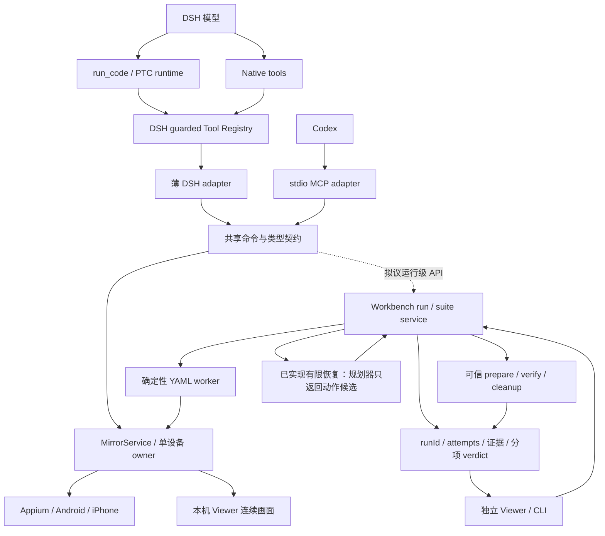

# PTC 重构对 FlowAssert 的影响与升级建议

日期：2026-09-17。性质：源码调研与拟议方案，不代表新架构已经实现或通过验收。读取时本库 HEAD 为 `REDACTED_REVISION`，存在宿主升级、业务夹具等未提交改动；以下明确区分代码、规划和历史证据。本次没有修改运行代码或连接手机。

同日提交前校正（源码截至 `REDACTED_REVISION`）：rc.2 兼容升级现已 8/8 完成；业务夹具和有限 AI 恢复已提交并有双端真机证据。下文当前建议据此更新，最初调研的失败记录保留在末节。上游版本表是调研时快照，本次文档整理未重新查询 dist-tags/master，不代表实时最新版。

## 结论：现在适合增量升级，不适合迁移执行底座

`0.1.5-rc.2` 宿主兼容升级已完成。下一步建议先做 DSH/Codex 同场景契约 PoC，再设计宿主无关的测试运行控制 API，让两种入口能发起、查看、取消同一类受控运行。保留 MirrorService、设备 provider、AppClaw YAML worker、业务扩展与证据存储的职责。

不要为了接入新 PTC 把 FlowAssert 变成 DSH runtime 的插件化测试执行器，也不要给 MCP 增加任意 `eval/run_code`。PTC 适合减少模型编排的往返，不自动提供测试断言、设备锁、幂等、历史回放或业务正确性。

**优先级建议：DSH/Codex 同场景契约 PoC → 运行级 API → 有数据证明需要时才抽取通用执行接口。** 复用已验收的业务夹具与有限 AI 恢复闭环，不因 PTC 重构重新开一套 Runner。产品待办见 [PRODUCT_TODO](../../PRODUCT_TODO.md)，未承诺本次实现。

## 最新是什么：必须拆开版本层次

本次通过 npm dist-tags 和上游 Git ref 实时查询：

| 层次 | 2026-09-17 核对结果 | 对本项目的意义 |
| --- | --- | --- |
| npm `latest` | `0.1.5-rc.1` | 默认安装指向，不能理解为无预发布后缀的稳定版 |
| npm `next` | `0.1.5-rc.2` | 已有升级 change 的精确候选；不要使用浮动 tag 固定生产契约 |
| npm `alpha` | `0.1.6-alpha.1` | 单独兼容试验，不自动替代 rc.2 基线 |
| 上游 `master` | `0d1f50007f9bca3f52b06e1c3074fa14d5fb0720` | 本文新 runtime 架构的源码快照，不等于 npm alpha 的实现完全相同 |
| 本库（提交前更新） | `0.1.5-rc.2` 升级 tasks 8/8 | 同 tarball、clean-profile Native/PTC 与模型目录边界已验；真实 DSH provider 图片消费仍单列 |

查询命令：`pnpm view @deepseek-ai/dsh dist-tags --json`、`git ls-remote https://github.com/deepseek-ai/deepseek-harness.git refs/heads/master`。GitHub API 当时限流，改用 git ref 与固定 SHA 的 raw 文件核对；未依赖搜索摘要确定实现。

历史 `0.1.2-rc.1` Native/PTC 验收保留在[打包验证](../packaged-runtime-validation.md)。已完成的 rc.2 工作见[归档升级设计](../../openspec/changes/archive/2026-09-18-upgrade-dsh-0.1.5-rc.2/design.md)和[任务](../../openspec/changes/archive/2026-09-18-upgrade-dsh-0.1.5-rc.2/tasks.md)。支持声明应跟验收结果走，不跟最新 tag 走。

## 对引用对话的校正

引用对话的主线成立：模型侧 `run_code` → runtime → tools bindings → guarded registry；FlowAssert 仍应保持薄 adapter。但以下内容必须按版本修正：

1. **PTC 已可组合现有工具。** 本库 `scripts/dsh-runtime-probe.mjs` 已包含真实宿主 `run_code` 的多调用 Mock 生命周期：summary、query、tap_node、input_text、拒绝敏感输入、stop、stale rejection，以及 deferred image 检查。不是“以后第一次让 PTC 调用 mobile 工具”，更不是仅注册十个名字。这是探针代码覆盖，不等于本轮重新执行或真实模型自主编排通过。
2. **最新 Node runtime 不只是进程隔离。** 固定 SHA 的实现通过 `ctx.sandbox`、`ctx.subprocess` 和 session policy 启动进程，受限模式不可用时失败；结果另报 sandbox enforcement。正确表述是“进程隔离本身不等于沙箱；最新 Node provider 已使用宿主平台沙箱，实际强度仍看后端与运行配置”。不能直接把这些新边界归给旧 rc.1/rc.2。[Node runtime 源码说明](https://github.com/deepseek-ai/deepseek-harness/blob/0d1f50007f9bca3f52b06e1c3074fa14d5fb0720/packages/ptc-runtime/ptc-runtime-node/README.md)
3. **120 秒 / 600 秒是 Node 的默认/最大 elapsed 配置，不是 CPU 预算。** 包含嵌套调用和审批等待；清理可能使返回更晚。模型 `run_code` 仅接受正数覆盖，但服务 API 允许 `timeoutMs: null`，最新 workflow adapter 使用该路径，不能说所有 workflow 都受十分钟硬限制。[runtime seam](https://github.com/deepseek-ai/deepseek-harness/blob/0d1f50007f9bca3f52b06e1c3074fa14d5fb0720/packages/ptc-runtime/ptc-runtime/README.md)
4. **runtime 并不知道工具和 session。** `resolve(request)` 解析执行选项，`run(spec)` 执行程序与命名 bindings；工具权限、可见性、并发、子调用事件由 tools consumer 负责。直接把 MirrorService 方法绑到 runtime 会绕开 registry 的那部分治理。[能力边界](https://github.com/deepseek-ai/deepseek-harness/blob/0d1f50007f9bca3f52b06e1c3074fa14d5fb0720/docs/capability-seams.md)
5. **Python 不是当前升级目标。** 上游将 Python provider 描述为 private/experimental，且没有 Node provider 相同的文件限制。语言可替换不等于能力、策略和错误语义完全一致。
6. **并行不是手机操作的主要优化点。** 同一台手机的点击、输入、观察有前后依赖；不能照搬并行读文件示例。PTC 的主要收益是结构查询和短控制段减少模型往返。Native 本身也可能批量发出工具调用，不能用“Native 每个工具必经一次模型”作为确定的性能基准。

`transport` 在 DSH 文档里可指保留的模型调用入口；本项目文档统一写“模型侧入口”。MCP 的 stdio/Streamable HTTP、Viewer 的 MJPEG/H.264 分别是其他层的传输方式。

## 本项目实际边界与缺口

| 当前入口/模块 | 已有职责 | PTC 不应替代的部分 |
| --- | --- | --- |
| `src/index.ts` / `src/tools.ts` | Cordis effect、defineTool、附件与结果投影 | 宿主注册和图片呈现 |
| `src/tool-contracts.ts` / `src/mobile-mirror-commands.ts` | 十工具定义、参数解析、共享命令 | DSH/MCP 一致的设备能力 |
| `src/mcp-server.ts` | stdio MCP、structuredContent、image content、进度 | Codex 通用协议入口 |
| `LocalDeviceRuntime` / `MirrorService` | provider、会话、observation、动作与运行占用 | 同设备串行、有效性检查及资源所有权 |
| `WorkbenchService` / suites / store | YAML、run/attempt、证据、取消、结果 | 固定回归和可恢复历史 |
| `src/workbench-extensions.ts` | 登记的可信代码扩展子进程、输入验证、超时、清理登记 | prepare/verify/cleanup 的业务语义与凭据策略 |

结构化编排和可信代码扩展已提交，见[编排验收](../test-orchestration-validation.md)；[业务夹具](../business-test-fixture.md)双端 UI→SQLite→清理闭环已验。[有限 AI 恢复](../ai-recovery-validation.md)双端各 36/36 符合预期、各 402 份证据复验通过；SDK 对照、真实浮层与更广编排矩阵仍未完成。它们不等于运行级 MCP/DSH API 已交付。

**真正的缺口**：十工具主要是设备观察/控制，尚无统一的 MCP/DSH 测试运行级契约。PTC 调用若干 action 后返回成功，并不自动形成 Workbench 的逐步 PNG/XML、业务判定、manifest 和 JUnit 记录。宿主子调用日志不能代替产品验收证据。

还有跨入口所有权问题：DSH plugin 和 MCP server 各自创建 LocalDeviceRuntime；“复用同一份实现”不等于跨进程共享同一 session。当前单 runtime 租约也不等于全机互斥。先禁止同设备同时启动两个 owner；如需真正同时接入，再设计单个本机 owner 的连接协议与认证，不让每个宿主直接另建 Appium 会话。

## 目标架构（虚线部分为拟议）

图中共享模块表示代码与契约复用，不承诺多个宿主进程已共享活跃 owner。DSH PTC runtime 由宿主装配；Codex 不加载 DSH runtime。工具返回控制信息、紧凑结构和按需离散图片，视频仍留本机。

### 第一阶段：适配层和契约补齐

- 复用已完成 rc.2 change 的精确 pin、打包和 clean-profile Native/PTC 验收；对 master/alpha 另立兼容矩阵，不混进 rc.2 成功记录。
- 输出契约先审计再改：当前部分 DSH data 工具返回 JSON 字符串，inspect/query 返回对象，MCP 使用 structuredContent。PTC 按生成的 canonical output 使用值；不要假设所有工具都可直接 `.nodes`，也不要对对象再 JSON.parse。若统一对象输出，应同步当前消费者与 probe；默认不增加历史兼容或版本分支，需要兼容时先询问用户。
- 只有确认纯本地、只读且不会改变会话/observation 生命周期的操作才考虑声明并发安全。MCP `readOnlyHint` 不是 DSH concurrency contract；状态读取和冻结 observation 查询也需要先证明实现线程/异步安全。inspect 会取证、改变缓存，不能仅因“看屏幕”就声明并行。
- 每个有副作用动作后重新 inspect；query 使用该 observationId。旧节点、TTL、frameRevision、变更边界由核心验证；不要给观察序列套无界循环或对不确定的 tap/type 自动重试。
- 长段拆成短段：结构足够时可连续查询/分支/动作；需要模型理解图片时，结束当前调用，把图交给模型再决定下一段。DSH deferred image 在外层结果后呈现，不是程序里的视觉推理函数。

### 第二阶段：新增运行级 API，而非任意代码入口

拟议名称如下，**均非当前可用工具**：

| 操作 | 请求 | 返回/约束 |
| --- | --- | --- |
| `mobile_mirror_run_start` | 登记 caseId/suiteId、合法参数、requestId | 短调用返回 runId；拒绝任意路径和任意代码；相同请求可查询既有受理结果 |
| `mobile_mirror_run_status` | runId | 阶段、当前步骤、分项 verdict、简短错误、证据摘要 |
| `mobile_mirror_run_cancel` | runId、owner 授权 | 取消请求已接收；是否完全停止由状态确认；不承诺撤回设备动作 |
| `mobile_mirror_run_evidence` | runId、步骤、允许的材料类型 | 有界分页/摘要、授权图片；不一次返回完整 XML/视频/base64 包 |

服务内部继续复用 WorkbenchService 和既有 suite/attempt/存储，不能在 MCP handler 内直接创建第二个 worker owner。首期不扩展成后台无人值守：宿主连接丢失的默认处理应明确为请求取消、等待清理、结果不确定时标 inconclusive；需跨会话持久运行时再独立设计身份与 reconnect。

启动幂等需落入受理 journal：同 requestId、同 payload 只受理一次；同 key 不同 payload 拒绝。网络超时后先查受理状态，不能直接重发发送消息流程。若实现尚无可查询 requestId 的机制，就不能声称 start 可安全重试。

错误保留至少两层：宿主/PTC 错误（timeout、abort、worker-exit、output-limit 等）与领域错误（stale observation、policy denied、device busy、assertion failed、evidence missing）。runtime crash 不等于手机动作没发生，也不能自动把 run 判成 pass 或普通 fail。

拟议关联字段为 host、hostCallId、parentCallId、runId、attemptId、stepId；宿主调用 ID 当不透明字符串，禁止解析 `:ptc:` 推断步骤。DSH 日志与证据按显式映射关联；MCP 请求 ID 不充当持久 runId。先审计现有 exec 上下文是否暴露所需标识，缺失时不伪造宿主事件。

### Codex 如何适配

Codex 继续走现有 stdio MCP，不需要安装或模拟 DSH 的 `ctx.ptcRuntime`。现有启动方式见[宿主指南](../mcp-hosts.md)，官方仍支持 `codex mcp add <name> -- <command>` 和 stdio/Streamable HTTP；FlowAssert 当前实现的是 stdio，不因客户端支持 HTTP 就宣称服务端支持。[OpenAI MCP 文档](https://learn.chatgpt.com/docs/extend/mcp?surface=cli)

- **通用路径**：Codex 直接使用所发现的 MCP 工具，读取 structuredContent，按需接收 image content。工具发现得到的实际名字/schema 为准，不硬编码 DSH 的 `tools.mobile_*` SDK 名称或 `run_code`。
- **可选宿主编排**：若所在 Codex 环境暴露代码编排工具，可以组合调用 MCP；它是宿主能力而非 FlowAssert 的可移植 API。没有该入口时，直接 MCP 调用仍覆盖同样的设备动作与运行能力。
- **固定回归**：运行级 API 交付后，Codex 一次受理运行，再查询结果/证据；模型不逐步重新生成点击逻辑。当前可以使用已有 CLI 工作台流程，但不要暗示 run_* MCP 已可调用。
- **图像路径单独适配**：DSH 经 attachments/deferContext；MCP 返回标准 image block。代码编排宿主可能需要显式把图片内容交回模型，不能只 stringify 工具结果便称“模型看过图”。MCP 返回图、宿主展示图、模型成功判断是三项不同验收。
- **权限保留两层**：Codex 的审批/沙箱与 FlowAssert 的设备策略各司其职；宿主批准不覆盖敏感输入禁令、observation freshness 或 run lease。无需为了提速永久关闭审批。

## 为什么不把现有代码扩展换成 PTC

| 方案 | 收益 | 成本/判断 |
| --- | --- | --- |
| 维持薄 DSH + MCP，补运行 API | 宿主无关，复用证据和设备控制；固定流程无需模型往返 | 最推荐，适合现在 |
| 内嵌 DSH PTC runtime 运行所有 YAML/扩展 | 可复用语言执行与进程限制 | 引入 fs/subprocess/sandbox/sandboxPolicy 装配；需迁移凭据、prepare/cleanup journal、模块快照与失败恢复。没有证明收益足够，不做 |
| 全改成模型生成 TS 工作流 | 灵活临时探索、过滤结构化结果 | 不能天然复现固定回归；没有独立断言/证据则“代码跑完”不等于“验证通过”。只用于短探索段 |
| 自建通用 MCP eval | 所有宿主看似都有 PTC | 多维护一个代码执行与权限面，绕开已登记用例边界；不做 |

可借鉴上游 `resolve/run` 的职责分离、结构化错误、进程清理和有界输出，但只有出现第二个实际扩展执行 backend，才值得抽取 ExecutionBackend。不能为了接口对称同时维护 Node/Python/DSH 三套实现。

## 验收与升级门槛

先用仓库业务 Fixture，减少第三方 App 变化和重复发送造成的噪声；Android/iOS 同一场景、同一证据要求。第三方 App用于后续展示与补充覆盖。

| 层次 | 最小验收 | 不得外推 |
| --- | --- | --- |
| 宿主兼容 | 同 tarball、clean profile，Native/PTC 十工具及拒绝分支、图片投影 | Mock 成功不是模型自主规划成功 |
| PTC 短程序 | inspect summary → query → tap → re-inspect；含 stale、取消、审批拒绝、输出超限 | 外层成功不是 Workbench run pass |
| Codex MCP | 同参数/结果/错误，原始 image 到模型的真实单场景 | 客户端显示图片不等于理解正确 |
| 运行 API | accepted→running→terminal、请求幂等、取消、断连、重启回查、逐步取证 | runId 存在不等于证据完整 |
| 同设备并发 | 第二 owner/第二动作拒绝，运行租约期间手动写入受控 | 单进程锁不等于跨进程锁 |
| 真机 | 双端 UI 正反例、独立业务 verifier、清理与失败后证据保留 | UI pass 不等于业务 pass |

性能采用相同输入场景的对照：Native primitive、PTC 短程序、确定性 YAML 各至少 10 次，分别记录模型轮数/token、设备动作耗时、取证耗时、审批等待、总时长、成功率与证据完整率。未取得这些数据前只承诺“可减少模型往返”，不承诺固定倍数加速。

升级放行条件：rc.2 正式验收闭环；alpha/master 的变动只影响薄 adapter；故障分支没有把未知写入自动重放；Codex 和独立 Viewer/CLI 无 DSH 依赖。任何条件失败，保留既有支持基线与 probe，新增协议默认关闭。

## 落地分工和后续文档

- 现有 `upgrade-dsh-0.1.5-rc.2`：仅完成宿主兼容，不夹带架构迁移。
- 后续拟议 change：运行级跨宿主 API、owner 接入、请求幂等、证据引用与验收矩阵；在真正开始实现前再建 OpenSpec proposal/design/tasks。
- 现有 `add-bounded-ai-recovery`：继续让 planner 返回候选，由 Workbench 在原 run lease 内执行和复核；PTC 可作为未来 planner 宿主，不能成为新的设备 owner。
- [ADR 0008](../decisions/0008-ptc-host-neutral-orchestration.md)记录本次拟议边界；未改变现有主规格、支持版本或完成状态。

## 最初调研的历史校验记录与限制

- 本文与 ADR 的本地链接、Markdown diff 检查通过；读取了 OpenSpec 活动清单与项目 context。
- 对已有 `upgrade-dsh-0.1.5-rc.2` 运行 OpenSpec 1.9.0 strict 校验失败：`Installable DeepSeek Harness bundle` 的 MODIFIED 块遗漏主规格中的 `Installing the current bundle in an rc.1 profile`、`Installing the alpha prerelease`、`Reviewing a newer unpublished source tag` 三个场景。该 change 仍在编辑，先修正规格替换语义再宣告升级完成。本次未改动其内容。
- 本次源码调研不证明 alpha/master 可安装兼容、PTC 真机工作流或真实模型图片判断通过；这些均需上述验收矩阵独立执行。
- 调研时工作区工程门禁：类型/契约、build、pack:check 通过；check 为 336 通过、1 失败，原因是既有 `mobile-mirror-streaming.png` 与公开清单哈希不符。恢复到本轮测试前的原始工作区截图后仍如此，未覆盖为 HEAD 来掩盖其他进行中工作。E2E 首轮 41 通过、1 个 iPhone 签名向导用例等待超时；保留失败现场后单独重跑通过。原始日志和截图保留本机，不将本轮描述为全库首次全绿。

以上是旧快照，不再表示当前阻塞：后续源码验收为 377 项测试、43 项浏览器回归、构建/打包通过，见[恢复验证报告](../ai-recovery-validation.md)。本次仅整理研究、TODO 与分享材料，不增加任何可调用 API，不宣称上游 alpha/master 兼容已验证。

提交前复核：本地文档/图片链接与 diff 检查通过；重新运行 OpenSpec 1.9.0 对 `upgrade-dsh-0.1.5-rc.2` 的 strict 校验通过，旧规格失败已不再复现。仅文档与分享图片变更，未重复运行运行时测试。
