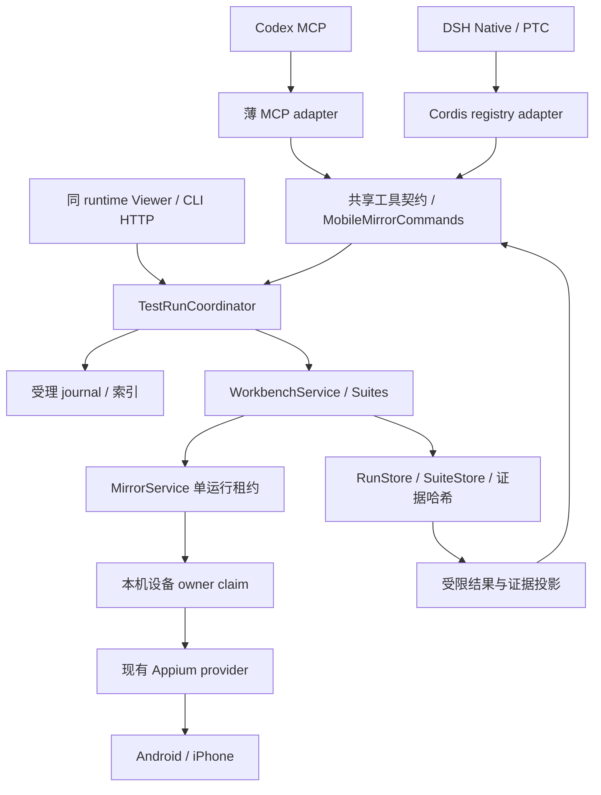

## Context

2026-09-18 源码审计：`LocalDeviceRuntime` 创建 MirrorService、ViewerServer 与 MobileMirrorCommands；工作台及套件由 ViewerServer getter 延迟创建，命令层没有运行依赖。Viewer 的 `/api/test-project`、`/api/workbench`、`/api/suites` 已提供本地入口，CLI 已能启动套件。WorkbenchService/Suites 负责执行、互斥、取消、快照和证据，不能另建一套 Agent Runner。

`WorkbenchStore` 的目录锁只保护同一存储目录，不是设备锁；不同 root 的 DSH/MCP runtime 可竞争同一手机。`WorkbenchService.start` 自行分配 ID 并进入执行，不能在它返回之后才补幂等映射，否则存在重复执行窗口。`get` 会复验文件，不能直接用于高频状态轮询。

依据为仓库源码与 [ADR 0008](../../../docs/decisions/0008-ptc-host-neutral-orchestration.md)、[PTC 调研](../../../docs/research/ptc-architecture-and-codex-2026-09-17.md)。本方案未重新评估上游 SDK，不升级依赖。

## Goals / Non-Goals

目标：Agent 发现已允许测试、一次受理固定流程、查询进度、显式取消、按需读取已校验证据。Viewer 与 Agent 在同一 runtime 看到同一个运行，原始失败、业务/清理分项及 recovered/flaky 完整保留。

首期一个本机项目、一个显式设备、单活跃 run/suite，不提供忙时排队。支持 flow 与 suite，不接受任意 YAML、代码、文件路径、凭据、安装 App、自动切换设备或修改断言。不做 daemon、多宿主共享活动会话、无人值守后台运行、自动修复用例、完整视频经模型传输。独立 Viewer 进程与 MCP 进程不能同时控制同设备，Agent 场景使用该 MCP/DSH runtime 自带 Viewer。

## Decisions

### 1. 统一协调器与所有权

把工作台创建/关闭从 Viewer 的延迟 getter 移入 `LocalDeviceRuntime` 的 `TestRunCoordinator`；Viewer 保留注入访问入口，CLI HTTP handler 和 Agent 共享该实例。协调器复用 WorkbenchService/Suites，新增受理与投影，不接管叶子执行。避免直接从命令层借 Viewer getter 造成 UI 与域服务循环依赖。

内置 runtime 在任何真机连接前取得 `platform + normalized deviceId` 的机器本地 claim，私有固定根目录，不随 runsDir 改变；记录 PID、进程启动身份、随机 owner nonce 与 session generation。独占创建及失效回收用同一串行锁协议，不能简单 read→unlink；PID 复用、无法查证、崩溃留下 managed 驱动时拒绝接管，给人工诊断状态。正常释放必须再次匹配 nonce，等在途动作、managed session 清理完成。外部 Appium 客户端无法被本协议约束，明确不承诺全机强制设备隔离。它阻止第二个本工具 owner，而非让第二宿主转发到第一个 owner。

### 2. 五个工具与明确的 ID

工具共用 JSON Schema 和命令实现；以下均为新增拟议接口，不是已经可调用。

| 工具 | 关键输入 | 返回与用途 |
| --- | --- | --- |
| mobile_mirror_test_catalog | kind=flow/suite/all、cursor、limit | 已允许条目、参数 schema、平台/App、能力摘要、catalogRevision；默认 20，最大 50 |
| mobile_mirror_run_start | requestId、target:{kind,id}、catalogRevision、params、可选 tags/platform 筛选 | executionId、runId 或 suiteId、phase=accepted；只受理，不等待整场测试 |
| mobile_mirror_run_status | executionId 或 requestId（二选一）、cursor、limit | 进度、case/attempt、原 verdict/exitCode、分项和 failure 摘要、证据摘要、nextPollAfterMs |
| mobile_mirror_run_cancel | executionId | cancelRequested 与当前 phase；重复取消/已终态为幂等查询，不回滚动作 |
| mobile_mirror_run_evidence | executionId、可选 runId、artifactId 或 cursor/limit、format=metadata/text/image | 默认元数据列表；显式读取一项，返回 hash/截断信息，图片走宿主附件 |

executionId 是一次工具受理的稳定标识；单流程映射 runId，套件映射 suiteId 及其原有 case/attempt。Agent 不需根据 UUID 格式猜对象类型。suite 下证据必须属于实际登记 attempt；禁止跨 execution 读取。工具只读取当前 configured project/授权范围的运行，新 journal 不接管来源未知旧记录；原 Viewer 历史照常保留，不迁移或删除。

catalogRevision 对允许集合及其内容快照做哈希；start 时变化返回 project_changed，要求重新发现。params 仅公开值，复用现有参数校验与优先级；requestId 为客户端生成的 1–128 字符不透明标识。单请求最大 64 KiB，拒绝未知字段。单流程无多行自动展开；多数据通过已登记 suite。

### 3. 持久受理与幂等

步骤：校验授权/项目 revision/参数/设备 → 冻结计划 → 串行占用当前 runtime → 预分配 executionId 和 runId/suiteId → 原子持久化 request journal 与计划哈希 → 持久化初始运行 manifest → 开放 execute gate → 返回 accepted。

必须调整内部 start 为 prepare/accept/execute 三阶段，或等价的持久受理屏障。不允许先执行 prepare hook、launch、tap 再写映射。start 迟于 300ms 时发进度，Viewer 显示受理阶段，其他只读控件仍可用。

幂等域：configured project 的稳定内部 identity + requestId。同 ID 同规范化输入返回原 executionId，即使文件已修改也不自动重跑原请求；同 ID 不同 target/params/revision/filter 返回 request_conflict。并发同 ID 合并为一个受理；不同 ID 遇 busy 即拒绝，不建队列。记录同受理计划保留，不按短 TTL 删除幂等键。

断点规则：journal 持久化前失败保证零副作用；journal 后、manifest 前崩溃恢复为 interrupted/inconclusive，绝不重新派发。manifest 已存在则关联其真实结果；无法确定动作是否执行时不自动重试。响应丢失后通过 requestId 查询，找到记录返回原结果，确认未受理才允许用同 ID 再次 start。保留最小受理 tombstone，避免清理材料后重复执行；删除策略不在首期引入。

### 4. 生命周期、状态与取消

受理状态：accepted→running→cancelling→finished；当前工作台 preparing/executing/verifying/cleaning/archiving 作为 stage，terminal verdict 与 exitCode 直接沿用。accepted 不是测试成功；recovered/flaky 默认非零，UI pass 不覆盖业务/清理失败。

start 调用取消：受理前终止，保证无执行；受理后取消原执行并保留查询索引，调用取消不意味着结果消失。status/evidence 单次查询取消只取消读取，不取消测试。显式 run_cancel 才取消活跃运行。MCP transport 关闭、DSH 插件销毁进入协调器有界取消与清理；一次 PTC 程序返回不等于插件销毁，运行可继续至宿主存活期限内结束。默认无断连继续运行选项。

进程 SIGKILL 无法保证实时取消，依托持久证据重建为中断，不自动续跑或释放身份不明的设备 claim。重连仅查询历史；新运行需设备状态及 claim 重新确认。主机生成 hostInstanceId；hostCallId 仅在宿主实际提供时保存，不伪造，也不用 MCP request ID 当持久身份。

状态查询从紧凑索引读取，不逐次校验全部历史文件；返回 evidenceVerification=pending/verified/failed，只有既有终结归档校验完成才宣称 verified。读取具体证据时重新校验哈希，损坏后持久标记证据失败，最终结果按现有规则降为 inconclusive，不让后续 status 再显示干净 pass。

### 5. 信息投影与授权

本机显式配置 agentTestControl.enabled、projectPath、允许的 flow/suite、允许的 App/平台与参数 schema；catalog 不是任意文件列表。入口授权同时覆盖测试的 prepare/verify/cleanup 与 recovery 模型外发策略，不能让模型借注册用例修改凭据/模型端点或执行未批准 App。默认不录像；录像仍需现有 Viewer 支持，不通过 Agent 开启浏览器录制。

status 默认不包含参数值、原始 XML、完整日志、私有 cleanupToken、主机路径或凭据。错误用稳定 code + 有界 message + executionId，区分执行判定与调用错误。典型调用错误：not_enabled、not_registered、project_changed、request_conflict、device_busy、owner_conflict、artifact_denied、artifact_corrupt、not_found。

evidence 默认最多 20 项元数据、最大 50，JSON 总量 64 KiB；text 一项最多 16 KiB，返回 originalBytes/truncated，XML/日志仅在本机显式允许的种类内读取，已知密钥脱敏并不等于可自动识别所有隐私。只接受存储登记的 artifactId，不接受路径或 URL。图片复用现有屏幕外发政策，并校验该历史 run 的 App/设备范围，不能用当前 App 授权代替旧图授权；用户必须明确允许 historical-image 分享。默认关闭原始 XML/日志/历史图外发，仅元数据和判定摘要可用。

单次最多一张图片，先校验原件 SHA，再在内存缩放至宿主和产品限制的较小值（产品 2 MiB/400 万像素上限）。保留 originalHash 与 renditionHash/尺寸，不覆盖原始文件。MCP 返回 image content，DSH 经 attachments/deferContext，JSON 不含 base64。PTC 获得附件引用不代表程序有视觉能力，图片在外层给模型解读。视频只返回材料状态，查看留在本机 Viewer。

### 6. 参考对象与取舍

- 当前 CLI/Viewer 是行为基线：复用已验证 suite/case/attempt、JSON/JUnit、共享租约，减少新增判定分支。
- ADR 0008 / DSH PTC：只增加 registry 中的领域工具，宿主决定如何组合；不把工作台迁移到 PTC runtime。
- 既有 AppClaw 2.7.0：继续执行 YAML 叶子，不引入 SDK 第二控制会话。
- Playwright 式 run/attempt 与 fixture 思路已体现在本地实现，本次不安装新 Runner。请求 journal 是本项目新增可靠性要求，不声称 MCP 协议天然提供 exactly-once。

### 7. 分批交付与验收

A：协调器/设备 claim/受理 journal，先证明同 runtime 复用、并发幂等、崩溃不重放。B：五工具、摘要/证据权限和两宿主投影。C：Viewer 进度、文档/打包与端到端验收。

确定性测试覆盖重复请求、响应丢失、各持久化断点、同 ID 冲突、目录变化、取消四阶段、宿主退出、证据篡改/跨运行拒绝。两个不同 runsDir 的独立进程竞争同设备，第二 owner 无 Appium 写入；正常释放与异常残留分别验。

同 packed tarball 在 MCP 和 DSH rc.2 Native/PTC 完成 catalog→start→status→evidence，以及 fail/recovered/cancel 分支，校验 schema/语义一致。双端 Fixture 各跑单流程和数据套件、业务反例、取消、重启证据读取；串行使用宿主，禁止同时接管。真实模型图片消费与“附件成功返回”分开记录；当前模型不可用时保留该项 pending，不以 Mock 替代。

工程门禁 pnpm check、test:e2e、build、pack:check、strict specs；Viewer 修改保留截图并验证慢受理时其他控件可用。完成范围不以工具注册数量或 start 返回 accepted 代替真实业务验收。

## Risks / Trade-offs

- [跨进程 crash 留下身份不明 owner] → 拒绝自动接管并给诊断，不用 PID 存在与否一项判断。
- [journal 与执行不在同一原子事务] → 持久化前执行 gate 关闭；崩溃宁可不确定，也不重放。
- [共享库重构影响已有 Viewer] → 保留同实例、相同关闭顺序及全量浏览器回归；不做双套协调器过渡。
- [status 轮询造成取证开销] → 索引投影、分页与建议轮询间隔 1 秒；不返回连续视频。
- [Agent 看不到未授权原图影响诊断] → 明确 evidence denied 与缺失的区别，用户在 Viewer 查看；不自动提升权限。

## Migration Plan

新增五工具与当前生产者/消费者同步更新；不提供旧 schema 兼容分支，不改旧证据原件。初始配置 disabled，指定 Fixture 测试项目通过后再启用自研 App。关闭 agentTestControl 停止新受理，已有运行先有界取消/归档，再卸载；回退不删除 journal 或复用 requestId。ADR 0008 在实施验收后再从 Proposed 改为 Accepted。
