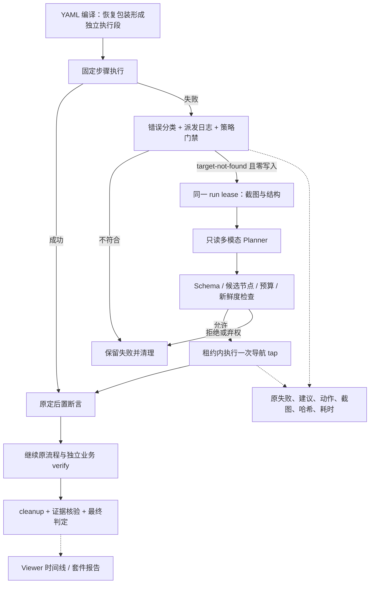

## Context

实施补注（2026-09-17）：控制/证据/Viewer 部分已实现，当前状态见 [ai-recovery.md](../../../docs/ai-recovery.md)。用户改选 DeepSeek API，使用 deepseek-flash 与显式 thinking=disabled；保留原 1024 输出 token、次数、时限及字节限额，取消 Codex 预算调整待确认项。真实图片对照已通过；开源对照与双端真机矩阵仍待完成。下面保留原方案基准。

动机见 [proposal](proposal.md)。截至 2026-09-17，固定 YAML、代码扩展、套件及 Fixture App 双端业务闭环已有实现和真机证据；AI 恢复尚未实现。本方案只交付设计。

代码约束决定了不能直接嵌入另一套 agent runner：

- `workbench-service.ts` 的 worker 当前把多类错误转成字符串或 FlowAssertionFailure，缺少可靠的“未派发动作”证明；RPC 失败后还会阻止 worker 继续走底层输入兜底。
- `mirror-service.ts` 的 run lease 独占控制权；普通 observe/action 在 run 中拒绝执行。恢复必须使用租约内部接口，不能从外部 MCP 绕回来。
- worker block 可能包含多个步骤；重放整块可能重复提交。恢复包装必须成为编译边界。
- `workbench-store.ts` 的 `run.recovery` 已表示中断后证据材料恢复，新功能使用 `aiRecovery`，避免混淆。
- 现有 observation 动作 freshness 为 15 秒，普通 agent 的截图权限不能自动授权向新增模型端点外发图片。

## Goals / Non-Goals

**Goals:** 在明确授权的导航步骤定位失败时，利用截图和结构找到替代节点，继续原测试，并能解释每个动作与最终结果。正常流程不调用模型。

**Non-Goals:** 首期不恢复提交、发送、支付、删除、文本输入、系统权限、业务断言、设备断连或 ADB 超时；不提供任意自然语言任务、不生成并自动执行代码、不改写 YAML 或验收条件。无节点的画布坐标操作暂不自动恢复。

## Decisions

### 1. 执行器保留确定性，模型只提议



新增 `RecoveryPlanner`（无设备权限）、`RecoveryController`（生命周期/预算）、`RecoveryPolicy`（本机可信登记）及租约内部 observation/action 接口。设备动作继续由 MirrorService/provider 执行。DSH/MCP 只传状态与控制，不传连续视频，不修改 Harness agent loop。

不直接调用 AppClaw runGoal 或 Midscene 的整套手机执行器：它们的连接管理和自由动作循环会破坏现有独占、取消与证据边界。

### 2. YAML 显式启用，限定为一个导航动作

拟议语法（需实现，当前 parser 不支持）：

```yaml
name: Search navigation
platform: ios
appId: dev.mobilemirror.fixture
---
- recover:
    id: open-search
    policy: search-navigation
    step:
      tap: { accessibilityId: search_entry }
    postcondition:
      visible: { accessibilityId: search_input }
```

`recover` 是流程 AST 节点，内层首期只能有一个 tap；id 在展开后的路径内可唯一定位。policy 引用项目可信登记，包含平台/appId、意图、允许的候选选择器、模型引用、图片外发范围及 suggest/auto 模式。用例不能覆盖主机最大预算或传模型端点/密钥。未知 policy 或不允许的内层动作在执行前拒绝。

`postcondition` 预先定义，固定 tap 成功也执行；恢复后必须通过同一个确定性断言。自动策略须由用例作者把目标明确标为无业务写入的导航，并给出候选范围；不能根据按钮文案或模型自报安全性推断权限。候选不得包含 submit/send/delete 等业务动作。首次在 Fixture App 的导航页面验证，业务提交按钮不启用恢复。

默认关闭；`suggest` 只产出建议并结束为原失败，不等待人工、不操作设备；`auto` 是已登记策略范围内自动执行。默认不做历史兼容，不加 version: 2 开关。

### 3. 恢复资格由动作事实决定

新增稳定错误码和设备写入派发日志：`not-dispatched / dispatched / settled / unknown`，绑定 run、session generation、节点路径与循环迭代。只有 `target-not-found + not-dispatched` 可进入恢复。歧义目标、assertion-failed、provider-timeout、cancelled、permission-denied、证据故障及未知错误均不触发模型。

派发必须在所有设备修改入口记录；不能用错误字符串匹配或“没有返回值”推断未发生动作。原 worker 停止并排空消息/设备操作后才能转入恢复。恢复包装前后分段执行，使用编译好的节点游标继续，不重跑前序步骤、prepare、条件判断或循环已完成迭代。

如果动作派发后超时且结果未知，禁止重试、禁止套件切到下一用例，沿用控制不确定状态，直到重新建立可确认的会话。不能靠 cleanup 成功解除设备控制不确定状态。

### 4. Planner 协议和预算

输入是最小化 observation：截图、逻辑尺寸、app/session 标识、采集时间窗、允许候选节点及原意图；页面文本仅是数据。输出仅允许：

```json
{"decision":"propose","observationId":"obs-123","action":{"kind":"tap","nodeId":"node-7"},"reason":"匹配搜索导航入口"}
```

或 `{"decision":"abstain","reason":"候选无法区分"}`。严格 schema 拒绝额外命令、URL、代码、坐标和隐藏动作。reason 是简短可审计说明，不要求或保存思维链。模型置信度不能解除门禁。

初始硬上限：每个 run 最多一次恢复尝试、最多一个设备动作、最多两次模型请求（仅允许执行前画面变化导致的一次重新规划）、恢复总时长 30 秒、每次请求最多 10 秒、输出 1024 tokens。最多一张图、100 个候选节点、图片 2 MiB；无法在保留可辨识性的条件下满足输入预算则拒绝。实际 token 用量/费用能取得时记录，未知不填写为零；两次请求与输入字节上限仍强制执行。

动作前重新采集并将候选与新结构确定性重新绑定，检查 app、session generation、页面结构指纹、目标唯一性和现有 15 秒 freshness；改变则重新规划或弃权。重新采集不能把旧 observation 的时间戳刷新后继续用。截图与结构保留各自时间窗，不声称原子快照。只能执行当前 observation 中再次确认的节点，首期不自动点击纯视觉坐标。

取消会终止请求并丢弃迟到结果；预算到期禁止新派发，已派发操作依照现有 lease 等待收敛。清理有独立期限，不能因模型耗尽时间而跳过 cleanup。

### 5. 模型与开源参考

| 参考 | 借鉴内容 | 接入方式与选择理由 |
| --- | --- | --- |
| AppClaw | 自然语言定位、失败上下文组织 | 优先验证当前依赖附近的定位/规划能力；已有执行栈，但 SDK 自带 MCP 会话管理，不能整套 runGoal 接管 |
| Midscene | screenshot/size/actionSpace 自定义接口、多模态定位 | 视觉能力对照候选；接口动作回调必须变成受控 proposal，不能直连驱动 |
| Maestro | 显式流程与边界 | 继续借鉴可读用例，不为 AI 再引入一套 runner |
| Playwright fixtures | 独立验证、清理、失败附件 | 保持 verify/cleanup 和原断言权威，AI 不兼任裁判 |

上游依据：[AppClaw Usage](https://appclaw.in/usage)、[Midscene 自定义接口](https://midscenejs.com/integrate-with-any-interface)，2026-09-17 查阅。在线最新 API 不等于本仓库锁定的 AppClaw 2.7.0；PoC 必须记录实际版本。

设备/结果契约现在固定，backend 在 PoC 后选一个。候选必须能隔离为一次只读建议、遵守取消和 schema、无隐藏设备连接；不通过门禁即淘汰，不伪造动作成功来驱动 SDK 下一轮。若两者都不满足，使用直接多模态模型结构化输出适配同一 Planner 协议，不把它们的 runner 带入产品。

当前 Codex + MCP 图片理解记录只证明人机协作验证过图片，不提供可由产品调用的模型服务。实施使用本机登记的真实多模态端点、modelRef 与环境变量密钥引用。先验证图片输入实际有效，再做真机恢复；缺模型配置则明确标记模型验收待完成。

图片外发权限按模型端点与 App/页面范围登记，复用已有截图权限理念但单独授权。第一阶段只使用合成 Fixture 页面；未知页面、敏感输入页面不发图。保存实际外发的脱敏输入及哈希，密钥/授权头不入档；不能宣称自动遮罩能可靠识别所有隐私。

### 6. 证据、结果和套件契约

新增 `aiRecovery.attempts`：原失败引用、游标、派发证明、policy/model/backend/prompt 版本、输入附件及哈希、原始结构化输出、拒绝原因、动作前后 observation、耗时/用量、独立断言及 cleanup 结果。原 failed step 不删除，用 recoveredBy 关联恢复子记录；不把所有步骤改成 passed。

增加独立 verdict `recovered`：仅当恢复动作执行、预定后置断言及后续原用例/业务验证通过、cleanup 完成、证据完整时成立。固定流程成功仍为 pass。恢复失败保留 fail；安全弃权/无模型/预算耗尽且无派发保留原 fail 并附原因；协议损坏、动作结果未知为 inconclusive。取消、证据污染/冲突、业务失败不能被 recovered 覆盖，保留各类原因并沿现有优先级汇总。

套件区分 recovered 与 flaky（重跑后成功）；recovered 默认不再重试，CI 退出码为 1，JUnit 输出 failure 类型 recovered，不能渲染绿色成功。恢复后业务验证失败仍 fail。历史回看展示原失败到恢复的完整路径；重跑会产生新观察、新预算，不能重放历史 AI 动作。

Viewer 展示“正在分析/校验候选/执行/验证”、耗时、取消按钮和独立恢复时间线。动作超过 300ms 有进度；分析失败保留最后可用画面。历史查看等不冲突控件仍可交互，手动控制仍受运行租约限制。

### 7. 实施顺序与验收

1. **确定性底座**：类型化失败、全入口派发日志、包装 AST 与分段游标；用 fake planner 覆盖故障，证明不会重放前序写入。
2. **只读对照 PoC**：Fixture 新增导航入口 ID 漂移、语义近似、歧义目标、遮挡、无节点等样例；AppClaw/Midscene 在相同截图/结构上比较建议，不先给设备权限。
3. **双端自动恢复**：选定 backend，接同一租约，增加真实多模态模型正反例、取消和过期观察测试。
4. **产品收口**：Viewer、报告、套件/CI、证据哈希重验及文档同步。

拟议 PoC 样本：每平台 5 个可恢复导航变体 + 5 个必须拒绝场景，每场景重复 3 次，每 backend 共 60 次。可恢复场景总成功率至少 90%，分别报告两端比例，不以均值掩盖单端失败；每端至少 80%。必须拒绝场景错误派发为 0，正常流程模型调用为 0。该规模只作为首期准入样本，不代表通用安全性证明。记录 p50/p95、调用数和实际成本，不能用 fake 模型结果替代实测。

额外故障覆盖：页面提示注入、原动作已派发、迟到结果、session 变化、页面动画导致目标变化、取消、模型不可用、预算耗尽、cleanup 失败、业务金额反例、证据损坏、重启后附件哈希。已有业务 Fixture 正负例继续通过，不允许借恢复修正错误预期金额。

所有运行改动完成后执行 pnpm check / test:e2e / build / pack:check；Viewer 保存并检查运行时截图。真机报告关联设备版本、模型版本、runId、截图、结果及局限。

## Risks / Trade-offs

- [候选范围太窄导致恢复率低] → 首期接受拒绝，先验证节点定位漂移；跨页探索/滚动/纯视觉坐标另立方案。
- [把产品缺陷藏成成功] → 独立 recovered，CI 默认非零，保留原定位失败供修复 YAML。
- [SDK 无法隔离规划和执行] → PoC 硬门禁；使用独立结构化模型适配，不牺牲单 owner。
- [模型延迟超过 freshness] → 重新采集并确定性重绑定，有限重规划；到期停止。
- [截图包含隐私或提示注入] → 显式外发范围、合成页面先验收、候选白名单，页面文字无指令权限。

## Migration Plan

### 2026-09-17 用户授权的画面门禁调整

Android 有唯一且属于当前 App 的原生 `android:id/content` 时，使用其解码像素指纹；全宽、顶部不超过 20%、底部不超过 10%、无可见异包节点为必要条件，所有允许候选必须完整在范围内。无法确认则比较整屏，iOS 保持整屏。比较同时包含范围和图片尺寸，区域变化不能复用旧建议。源树/App/session/新鲜度及派发预算不变，原图照常留存并外发，新增 visual 元数据可审计。单像素内容变化与纯像素遮挡反例用于保护此边界。

线材/接口/设备端异常与该修复独立：只读 ADB 基线已经在无 Appium 下复现超时；换线单变量对照完成前不宣称硬件根因。见 docs/android-link-diagnostics.md。

默认不做历史兼容。新增语法与 verdict 的当前生产者/消费者在同一变更更新，不增加版本门槛或旧格式迁移；历史文件保留原样。部署初始全部策略关闭，先 suggest PoC 后启用指定 Fixture auto 策略。回退通过关闭策略停止新恢复；已经生成的证据不删除，回退旧程序不承诺理解新增 verdict。
