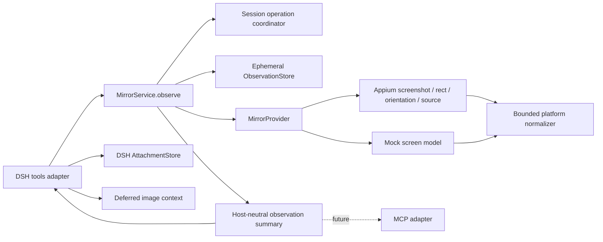

## Context

当前 `MirrorProvider` 只有 `frame()` 与 `action()`；`MirrorService` 缓存最后一帧供 Viewer 使用，但没有 agent 可消费的 observation 数据模型。DSH 工具统一返回 JSON 文本，因此 agent 只能读取生命周期和最后动作，无法看见当前屏幕。Viewer 的 `/api/frame` 是面向本机人类的连续轮询接口，不能直接作为 agent 协议：它没有 observation 身份、结构、坐标契约或过期校验，把 Base64/高频 PNG 放进工具结果还会放大会话日志和模型上下文。

本仓库固定的 DSH `0.1.0-rc.6` 已提供两条必要宿主能力：

- `ctx.attachments.saveImage(...)` 可以把经过校验的 PNG 保存为不可变 `ImageAttachmentRef`；
- `ToolRunContext.deferContext(...)` 可以在工具结果之后追加带来源的用户上下文，Code Mode 的子调用也会把该上下文传递到外层结果之后。

因此 DSH adapter 可以返回紧凑 JSON 元数据，同时把一张真正的图片作为后续模型上下文交给 agent，而不在 JSON 或日志中嵌入 Base64。代价是 DSH attachment 当前是持久化存储且没有插件级删除/GC API；物理屏幕图片必须经过显式配置授权，留存边界必须在配置与文档中公开。

Appium 可通过截图、`/window/rect`、`/orientation` 与 `/source` 获取图片和界面结构，但这些请求是顺序发生的，不能宣称为设备侧原子快照。结构质量也取决于应用是否正确暴露 Android accessibility 或 iOS XCTest 属性。

## Goals / Non-Goals

**Goals:**

- 提供 `mobile_mirror_snapshot` 与 `mobile_mirror_inspect_screen`，形成可测试的离散感知入口。
- 用同一套 host-neutral observation contract 支撑 DSH adapter，并为后续 MCP adapter 保留二进制投影边界。
- 将图片、结构、viewport、方向、捕获窗口、session 世代和 screen epoch 绑定到一个不可变 `observationId`。
- 让基于 observation 的坐标动作可以检测过期、跨 session、旧 revision 和坐标空间错误。
- 对 Appium XML、图片、节点、文本、TTL、并发、失败回退和敏感内容建立硬边界。
- 保持 Viewer 持续可用；观察失败不清除最后可用画面，状态/停止在观察期间仍可操作。

**Non-Goals:**

- 不实现 OCR、视觉模型、图像描述或远程图片上传服务。
- 不把持续视频、MJPEG、scrcpy 帧流或音频放入工具/MCP 结果。
- 不增加 Appium element find/click、XPath 执行或基于 `nodeId` 的语义动作；本变更只为现有坐标动作提供安全绑定。
- 不保证截图与 page source 在设备动画期间像素级原子一致，只提供捕获时间窗和插件动作一致性。
- 不实现多设备、多 session、图片脱敏/打码或 DSH attachment 垃圾回收。
- 不修改 DeepSeek Harness agent loop。

## Decisions

### 核心只提供一次 observation，两个工具是薄投影

在 `MirrorService` 增加一个核心入口：

```ts
observe(request: {
  image: boolean
  structure: boolean
}, signal?: AbortSignal): Promise<ScreenObservation>
```

`mobile_mirror_snapshot` 调用 `{ image: true, structure: false }`；`mobile_mirror_inspect_screen` 默认调用 `{ image: false, structure: true }`，当 `includeImage=true` 时一次请求同时捕获两种通道。核心不会依赖 DSH `ContentBlock`、attachment 或 MCP 类型，adapter 只把同一个 `ScreenObservation` 投影成宿主协议。

拒绝让两个工具分别直接调用 `/screenshot` 和 `/source`：那会复制 session、并发、TTL 和版本逻辑，也无法让未来 MCP adapter 复用安全规则。

### Observation 是不可变、扁平、有界的 bundle

对外安全摘要包含以下字段：

| 字段 | 语义 |
| --- | --- |
| `observationId` | 128-bit 随机 base64url 标识，同时防止猜测；不含 sessionId/UDID |
| `capturedAt` / `captureEndedAt` | 捕获开始和结束时间，明确顺序采集窗口 |
| `expiresAt` | 内存资源失效时间，不代表图片附件的持久化期限 |
| `frameRevision` | 当前 session 内每次成功发布 observation 单调递增 |
| `screenEpoch` | start/stop/成功动作后变化，用于判断插件已知的屏幕突变 |
| `viewport` | Appium 动作坐标空间的宽高与方向 |
| `image` | PNG 媒体类型、编码字节数、像素宽高和投递状态，不含 bytes/Base64/路径 |
| `structure` | 节点数量、截断状态和扁平节点数组；不含原始 XML |

`ScreenObservation` 的内部形态可以持有 `image.bytes`，但公开的 `ScreenObservationSummary` 必须剥离字节和内部 session generation。`observationId` 只在当前 service 实例、当前 session generation 内有效。

结构使用扁平数组而不是递归 JSON：

```ts
interface ScreenNode {
  nodeId: string               // 仅在当前 observation 内有效，例如 n0
  parentId?: string
  role: string                 // button, text, input, image, switch, container, unknown
  identifier?: string          // resource-id / accessibility identifier，长度受限
  name?: string                // accessibility label / content-desc
  text?: string
  value?: string
  bounds?: { x: number; y: number; width: number; height: number }
  visible: boolean | null
  enabled: boolean | null
  actionable: boolean
  focused?: boolean
  selected?: boolean
  checked?: boolean
}
```

扁平数组更容易限制节点总量、支持 Code Mode 类型生成并避免深树递归/栈溢出。`nodeId` 不是 Appium element id，不能跨 observation 使用。

### 捕获过程保证插件动作一致性，不虚构设备原子性

`MirrorService` 为 action 和 observe 建立单 session operation coordinator：

1. 确认 lifecycle 为 `streaming`，记录内部 `sessionGeneration` 与 `screenEpoch`；
2. 获取 viewport 和方向；
3. 按请求获取 fresh screenshot 和/或 page source；
4. 再次检查 generation/epoch，任何 start、stop 或成功动作介入都丢弃本次结果；
5. 全部请求项成功后一次性发布 observation、递增 `frameRevision` 并写入短期内存 store。

action 与 observation 不并发执行，避免插件自己制造结构/图片错位；状态读取不加锁，stop 可以中止当前捕获并优先清理 session。Viewer 的普通帧轮询可以复用已有 screenshot promise，但不得把缓存帧伪装成 fresh observation。

应用自身动画、系统时钟和网络刷新仍可能在步骤 2–3 之间改变屏幕，因此结果同时返回 `capturedAt`、`captureEndedAt`。验收只保证“同一 session、无插件动作介入的有界捕获窗口”，不声称设备事务快照。

### Observation freshness 与动作校验分层处理

所有现有 action 参数继续兼容。新增可选参数：

- `observationId`：提供后启用严格 stale check；
- `coordinateSpace`：`viewport`（默认，兼容现有调用）或 `snapshot`。

带 `observationId` 的动作必须同时满足：当前 session generation 一致、资源未过 TTL、observation 是当前最新 revision、`screenEpoch` 未变化、捕获结束未超过 15 秒。任何一项失败都拒绝动作，不自动降级为无校验动作。

`viewport` 坐标直接送给 Appium；`snapshot` 坐标必须提供 observation，并按以下关系转换：

```text
viewportX = floor(snapshotX * viewport.width  / image.width)
viewportY = floor(snapshotY * viewport.height / image.height)
```

转换前要求 snapshot 坐标处于 `[0, image.width)` / `[0, image.height)` 半开区间，转换后再执行有限数、非负和 viewport 半开区间校验，不进行静默 clamp。使用 `floor` 可以保证最后一个有效图片像素不会映射到 `viewport.width` / `viewport.height` 之外。方向已经体现在 observation 的 image/viewport 尺寸中；当 image 或 viewport 尺寸缺失时拒绝 snapshot 坐标。结构节点的 `bounds` 始终使用 viewport 坐标。

15 秒只能限制插件已知风险，不能发现应用被外部触摸或自行刷新。需要强安全性的 agent 应在动作前立即重新 observe。

### Appium provider 负责读取，独立 normalizer 负责安全解析

扩展 provider 契约：

```ts
interface MirrorProvider {
  // existing start/stop/frame/action
  screenGeometry(signal?: AbortSignal): Promise<ScreenGeometry>
  screenSource(signal?: AbortSignal): Promise<ProviderScreenSource>
}
```

Appium provider：

- `GET /session/:id/window/rect` 获取 viewport；
- `GET /session/:id/orientation` 获取方向，若 driver 不支持则根据宽高推断并标记来源；
- `GET /session/:id/source` 获取 XML；
- 创建 session 时记录 platform，附着 session 时从 session capabilities 恢复 platform；
- 对 source 响应设置 4 MiB 硬上限，禁止无界 `response.text()`。

XML 使用直接依赖并锁定版本的 `saxes` 流式 parser；遇到 DOCTYPE/实体声明立即拒绝，不构造通用 XML 对象。normalizer 只保留白名单属性：

- Android：`class`、`resource-id`、`text`、`content-desc`、`bounds` 及 clickable/enabled/focused/selected/checked/displayed 等布尔字段；
- iOS：`type`、`name`、`label`、`value`、`x/y/width/height` 及 enabled/visible/accessible 等字段。

第一版硬限制为：原始 source 4 MiB、深度 64、节点 500、单文本字段 512 Unicode code points、规范化 JSON 256 KiB。达到限制时停止继续收集，返回 `truncated=true` 和稳定原因；不会把原始 XML 作为错误内容返回。

Mock provider 从统一的 `MockScreenModel` 生成结构数据和 agent PNG。Viewer 可以继续渲染 SVG，但 agent PNG 必须是 raster；使用仓库内纯 TypeScript 的确定性 PNG encoder/简单绘制器，避免引入 `sharp`、Canvas 或平台原生二进制。两种投影共享 action count、last action、viewport 和 revision 模型。

### DSH 图片通过 attachment + deferred context 投递

插件增加对 `attachments` 的显式注入，并把 `@deepseek-ai/dsh-attachment`、`@deepseek-ai/dsh-llm` 声明为与固定 Harness 版本兼容的必需直接 peer dependencies。它们由 DSH 宿主提供，不重复加入插件 devDependencies；仓库在 `pnpm-workspace.yaml` 设置 `autoInstallPeers: false`，adapter 通过可注入 message factory 测试，生产路径再从宿主动态加载 `createUserMessage`，避免 pnpm 为测试插件复制整套宿主可选 peer 图，同时由 Cordis inject 在 attachment 服务缺失时启动失败。

`mobile_mirror_snapshot` 的执行顺序为：

1. 核心生成 observation；
2. 使用 `ctx.attachments.imageLimits` 检查 PNG 字节、像素和消息图片数量限制；
3. 调用 `saveImage`，得到不可变 `ImageAttachmentRef`；
4. 调用 `exec.deferContext(createUserMessage(...))`，追加 `source.kind='plugin'`、`form='notice'` 的文本元数据和一个 `ImageBlock`；
5. 工具本体只返回 `ScreenObservationSummary`，其中 `image.delivery='deferred-context'`。

`mobile_mirror_inspect_screen(includeImage=true)` 复用同一流程。纯结构调用不创建 attachment。

选择 deferred context 而不是直接在 tool-result renderer 中放 image，原因是 Code Mode 的子工具只把 canonical JSON 返回 worker；deferred context 会被 DSH 传递到外层 `run_code` 结果之后，Native/Code 两种 presentation 都能在下一次模型请求中收到图片。工具 renderer 保持纯文本/JSON，避免同一图片重复出现在 tool result 和后续上下文。

如果 attachment 校验/保存失败，本次工具失败且不发布模型上下文；核心短期 observation 可被回收，普通日志只记录稳定错误码，不记录 bytes、路径或 Base64。

### 物理屏幕内容采用显式策略，Mock 默认可用

新增 schema 字段 `agentScreenContentPolicy`：

| 值 | 行为 |
| --- | --- |
| `mock-only` | 默认值；Mock 允许图片和结构，Appium observation 拒绝 |
| `structure` | Appium 只允许规范化结构；图片与 `includeImage=true` 拒绝 |
| `image-and-structure` | Appium 允许结构，并允许将图片保存到 DSH attachment 后发送给模型 |

配置说明必须明确：结构化文本会进入工具结果/会话历史；图片模式会把屏幕 PNG 保存为 DSH 持久附件并发送给所选模型 provider，当前插件无法承诺附件删除时间。Viewer 本机显示不受此策略影响。

拒绝把物理图片默认开启，也拒绝只用一个 boolean：三态策略能让只需要 accessibility tree 的用户避免图片外发，同时保持 Mock 开箱可验证。

### 内存 store 与持久附件分开管理

核心 `ObservationStore` 每个 session 最多保留 4 个 observation，默认 TTL 60 秒，总图片字节硬上限 32 MiB。新增图片会先清理过期项，再按最旧 observation 顺序逐出直到满足条目数与字节上限；单张图片超过 32 MiB 时直接拒绝。start、stop、dispose、session 替换和逐出都会移除条目并 best-effort 清零图片 `Uint8Array`。store 不写磁盘、不进入 `MirrorState`、不提供目录/list API，也不把内部 bearer URL 返回给工具。

DSH attachment 是另一个生命周期：一旦 `saveImage` 成功，引用随 deferred user context 进入 DSH session，恢复/fork 可能继续使用。插件不伪装能够删除它；未来若 DSH 提供引用计数/GC API，再单独设计 retention 迁移。

未来 MCP adapter 直接把内部 bytes 投影成一次 MCP image content 或受控 resource，不需要经过 DSH attachment，也不得复用 DSH 的持久引用作为跨宿主协议。

### 进度、失败与错误码可见但不污染主 lifecycle

`MirrorState` 增加紧凑的 observation 子状态：`phase`（`idle|capturing`）、`startedAt`、`lastCompletedAt`、`lastErrorCode`。观察不把主 lifecycle 从 `streaming` 改成其他值，Viewer 仍显示最后帧；状态和 stop 保持可用。

fresh observation 失败时不覆盖上一条成功 observation，也不把旧结果静默当作新结果返回。稳定错误码至少包括：

- `screen_observation_disabled`；
- `screen_image_sharing_disabled`；
- `screen_observation_in_progress`；
- `screen_capture_failed`；
- `screen_geometry_unavailable`；
- `screen_structure_unavailable`；
- `screen_structure_invalid`；
- `screen_observation_too_large`；
- `screen_observation_expired`；
- `screen_observation_stale`；
- `screen_observation_session_mismatch`；
- `screen_coordinate_space_invalid`；
- `screen_attachment_failed`。

同一 session 已有 observation 捕获进行时，第二个 observation 请求 fail fast 返回 `screen_observation_in_progress`；action 进入同一 coordinator 队列，stop 通过 session abort signal 抢先中止捕获。这样避免隐式堆积多个昂贵 source 请求，并保持停止能力可用。

错误摘要经过现有脱敏边界，不包含 page source、屏幕文本、图片、sessionId、UDID、capabilities 或本机路径。

### 模块与依赖边界

目标模块关系如下：



DSH 类型只能出现在 `tools.ts`/adapter 边界；provider、normalizer、store 和 service 不导入 Harness 包。Viewer 继续调用 `MirrorService.frame()`，不依赖 attachment。

## Risks / Trade-offs

- [DSH attachment 当前没有 GC，物理截图可能长期留存] → Appium 默认禁用，图片模式单独显式开启，配置和文档披露持久化/模型发送边界；不把核心临时 TTL 描述成附件 TTL。
- [模型 provider 不支持图片] → 结构工具仍可独立使用；图片验收必须使用声明支持图片输入的 DSH provider，并把 provider 不支持报告为宿主能力阻塞，不伪报成功。
- [截图和 XML 不是原子获取] → 序列化插件动作、返回捕获时间窗和 epoch；文档要求动作前重新观察，不承诺外部变化检测。
- [Appium page source 很大或恶意构造] → 响应、深度、节点、字段和 JSON 五层硬限制，使用流式无外部实体 parser，原始 XML不持久化。
- [平台属性语义不同] → 只规范化跨平台最小字段，未知 role 保留 `unknown`，原始 class/type 可作为有界 `platformRole` 而不是伪映射。
- [图片像素与 viewport 比例不同] → 显式返回两套尺寸并只做确定比例换算；缺尺寸、越界或方向不明时 fail closed。
- [TTL 太短导致模型思考后动作被拒] → 内存 TTL 60 秒，动作 freshness 15 秒分离；拒绝后可自动重新观察，不延长旧 observation。
- [观察与动作串行增加延迟] → 只串行化同一 session 的感知/动作，状态与 stop 不阻塞；结构默认不附带图片，避免无需求时双请求。
- [Mock PNG 与 Viewer SVG 投影不完全像素一致] → 两者共享同一 screen model 和 revision，测试语义、viewport 和动作状态一致；不要求渲染器像素同构。

## Migration Plan

1. 先增加 host-neutral observation 类型、store、operation coordinator 与 Mock screen model，不注册新工具，确保现有 Viewer/action 回归不变。
2. 扩展 Appium geometry/source 接口并增加有界 XML normalizer；用假 W3C server 覆盖 Android/iOS 属性映射和异常响应。
3. 增加 service `observe`、revision/epoch、TTL 和带 observation 的 action 校验；默认策略仍只允许 Mock。
4. 接入 DSH attachment/deferred context，注册两个工具，验证 Native Mode 与 Code Mode 的图片上下文顺序。
5. 更新配置、README、安全文档、架构/产品形态和 runtime probe；在发布包中验证新增直接依赖与文档。
6. 完成 Mock 全闭环，再分别在 Android/iOS 物理设备验证 screenshot、source、坐标映射、过期拒绝和 stop 清理。

回滚时移除新工具和 observation 配置即可；现有 start/status/action/stop、Viewer API 和 Appium session ownership 不迁移数据。已经写入 DSH attachment store 的图片不能由插件回滚删除，必须遵循 DSH 自身的保留/清理策略。

## Open Questions

无阻断实现的问题。实现验收时必须记录所用 DSH 模型 provider 是否支持图片输入；如果固定的生产 provider 不支持图片，本变更只能把结构感知报告为可用，图片闭环保持未通过，不能用 Viewer 人工可见代替。
