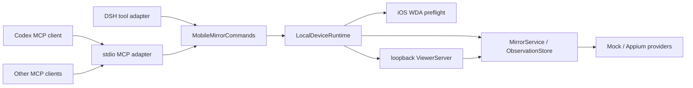

## Context

仓库已经有三层边界：`MirrorService`/provider 负责设备与 observation 语义，`ViewerServer` 负责 loopback 人工监督界面，`src/tools.ts` 负责 DSH 工具与 attachment/deferred context 投影。核心已经支持 Mock、Android Appium、iOS Appium/WDA、session ownership、单帧 PNG、规范化界面结构、TTL、frame revision、screen epoch、stale protection、坐标转换和可见进度，但运行时的创建/释放及命令参数仍由 DSH adapter 直接组装。

目标产品需要同时服务 DeepSeek Harness、Codex 和其他 MCP 客户端。Codex 因此是兼容性与视觉验收宿主，不是核心依赖；MCP 是新的标准控制入口，不是新的 provider 或媒体通道。

约束如下：

- 不修改 DeepSeek Harness agent loop，只通过已有 Cordis effect/registry 接入。
- 不复制 Appium、WDA、device discovery、session ownership 或 observation 状态机。
- MCP/tool result 只承载离散控制、状态、结构和单帧图片，不承载 Viewer 的连续轮询帧。
- 默认屏幕内容策略保持 `mock-only`，host discovery、签名诊断和 provisioning 变更保持显式 opt-in。
- MCP stdio 的 stdout 是协议专用通道；诊断必须走 stderr 且脱敏。
- 任何可能超过 300 ms 的操作必须暴露进度，失败时保留最后可用 Viewer 帧/observation，并允许 status/stop 保持响应。

## Goals / Non-Goals

**Goals:**

- 提供一个宿主无关、默认 stdio 的 MCP server，让任意兼容客户端复用同一 Local Device Runtime。
- 让 DSH 和 MCP 共用命令解析与业务调用层，适配器只处理宿主 schema、结果和图片投影。
- 完整暴露现有八项工具能力，并保持 DSH 公开行为兼容。
- 在 MCP 中安全投递一张 fresh PNG 与/或有界结构，保留 observation-bound action 的全部安全语义。
- 提供可安装的 package export/bin、独立配置、优雅关闭、自动化协议测试和 Codex 实际验收说明。

**Non-Goals:**

- 不增加 Streamable HTTP/SSE、远程访问、认证或多租户 MCP 服务。
- 不通过 MCP 传输 Viewer 连续视频、帧轮询、Appium 原始 XML 或 observation list/read API。
- 不增加另一套 Android/iOS driver，不改变 Appium 新建/附着 session 的所有权。
- 不让多个宿主进程共享同一个内存 runtime；一个 stdio server 进程只拥有一个 Local Device Runtime。
- 不在本 change 中实现多设备并发、崩溃后的孤儿 session 回收、高帧率媒体或 Codex 专属 UI/plugin bundle。
- 不重命名现有 npm package 或移除 DSH bundle 入口。

## Decisions

### 1. 以共享 Local Device Runtime 作为唯一设备所有者

新增 `LocalDeviceRuntime`，统一拥有配置、`MirrorService`、`ViewerServer`、`IosWdaPreflightService` 以及幂等的 `listen()`/`close()`。DSH 的 `apply()` 与 MCP server 都只创建这一 runtime；关闭顺序固定为：拒绝新 adapter 调用、关闭 Viewer listener、中止/等待核心操作、调用 service dispose、按 provider ownership 清理 session。

`ViewerServer` 不再被视为业务 runtime，但仍是 loopback 媒体/人工控制表面。实现时可通过构造注入已有 `MirrorService`，避免 Viewer 与 adapter 分别创建 service；它的 HTTP API 继续调用同一实例。

选择该方案而不是让 MCP 包装 DSH 工具，是因为 DSH attachment/deferred context 是宿主私有协议；选择该方案而不是新增 daemon，是因为当前单用户、单 session 范围不需要跨进程所有权和认证复杂度。

### 2. 抽取宿主无关的命令层，适配器只做投影

新增 `MobileMirrorCommands`（或等价命名），集中定义八个稳定名称、描述、输入校验和核心调用：

1. `mobile_mirror_list_devices`
2. `mobile_mirror_ios_preflight`
3. `mobile_mirror_start`
4. `mobile_mirror_status`
5. `mobile_mirror_snapshot`
6. `mobile_mirror_inspect_screen`
7. `mobile_mirror_action`
8. `mobile_mirror_stop`

命令层可以返回 `MirrorState`、脱敏 preflight/device 结果或内部 `ScreenObservation`，但不得导入 DSH attachment/message 类型或 MCP content/result 类型。`capabilitiesJson` 仍由共享解析器接收为 JSON object 字符串，action 的数值、类型、`observationId` 与 `coordinateSpace` 也只解析一次。DSH adapter 与 MCP adapter 的 input schema 从同一只读 contract 常量生成或由 conformance test 逐字段比较，防止两个宿主悄然产生不同参数。

DSH 保留当前 attachment/deferred context projector；MCP 新增独立 projector。两者共享 `summarizeObservation`，并将 `image.delivery` 分别设置为 `deferred-context` 与 `mcp-image-content`。

共享 contract 还定义保守的 MCP tool annotations：list/preflight/status/snapshot/inspect 标记 read-only，start/action/stop 标记可能改变状态或具有 destructive effect，访问设备/host 的工具标记 open-world。annotations 只是宿主审批提示，不能替代核心的 screen policy、显式 provisioning/host diagnostics 开关或 session ownership 校验；文档要求宿主对 action/start/stop 使用其自身确认策略。

### 3. MCP v1 server 使用 stdio 与低层 JSON Schema handler

运行时依赖锁定 `@modelcontextprotocol/sdk@1.30.0`，与当前 Node 22/24 支持范围兼容。使用 SDK 的 `Server`、`StdioServerTransport`、`ListToolsRequestSchema` 和 `CallToolRequestSchema`：低层 handler 可以直接消费共享 JSON Schema contract，避免为 DSH 与 MCP 各维护一套 Zod/JSON Schema 定义。

server identity 使用稳定名称 `mobile-mirror` 和当前 package version。MCP capabilities 只声明 `tools`；不声明 resources、prompts 或 sampling。默认且唯一实现的 transport 是 stdio，不打开 MCP TCP 端口。Viewer 仍按现有 schema 只绑定 `127.0.0.1`、`localhost` 或 `::1`。

MCP tool success 同时返回：

- `structuredContent`：不含二进制的 JSON object，便于支持结构化结果的客户端消费；
- `content[0]`：同一 object 的确定性 JSON text fallback；
- 仅图片 observation 再追加恰好一个 `content[type=image]`。

每项工具声明与结构化结果一致的 `outputSchema`。未知工具、输入不合法与业务失败通过 MCP tool error 返回，不使 stdio server 崩溃。

### 4. 单帧图片只投影为当次 MCP image content

MCP `image` block 的协议字段要求 Base64，因此 adapter 在构造/发送当次结果时进行一次临时编码；Base64 字符串只能存在于该 image content block 及其协议序列化中，不得进入 `structuredContent`、JSON text、日志、`MirrorState`、ObservationStore key 或错误。MCP 不注册 screenshot resource/list/read URI，避免在工具调用之后形成新的可寻址图片生命周期。

新增 MCP adapter 限制 `maxImageBytes`，默认 8 MiB、硬上限 32 MiB，并继续受核心 32 MiB observation 上限约束。超限时返回 `screen_observation_too_large`，不伪报 image 已投递。结果发送后，核心 bytes 仍按既有 60 秒 TTL/4 条策略处理；JavaScript Base64 字符串无法可靠原地清零，此限制在安全文档中明确。

不选择 MCP resource 的理由是当前使用场景只需要 fresh 单帧与同调用 metadata；resource 会引入 URI、读取授权、缓存和额外留存契约。不选择连续 image result 的理由是 token、内存、日志和客户端背压均不适合视频。

### 5. 进度、取消、并发与错误遵循核心状态机

除纯读取 `status` 外，所有可能访问 host/provider 的 MCP call 都使用 SDK request signal 传给共享命令层。server close、stdin EOF、SIGINT 或 SIGTERM 触发同一个 `closeOnce()`，先 abort adapter 请求，再关闭 runtime；重复关闭不得重复删除 session。

当客户端提供 MCP progress token 时，adapter 对 list devices、iOS preflight、start、snapshot/inspect、action 和 stop 发送开始、超过 300 ms 的当前 phase、完成/失败进度通知。无 progress token 时，MirrorState/Viewer 仍暴露可用的 `connecting`、`stopping` 或 observation phase；`mobile_mirror_status` 是无锁读取，捕获期间可并发返回，`mobile_mirror_stop` 可中止捕获。

adapter 将已知 `ScreenObservationError`/WDA preflight 错误投影为稳定、脱敏的 `{ok:false,error:{code,message}}` JSON text，并设置 `isError=true`；未知异常统一映射为 `mobile_mirror_operation_failed`，不得回传 stack、config path、capabilities、UDID、原始 XML、图片或 host command。核心失败保留旧 Viewer 帧/observation 的既有行为，adapter 不把旧数据伪装成 fresh 成功。

### 6. 独立 MCP 配置文件复用同一 Config schema

MCP bin 支持无参数安全默认值，以及 `--config <json-file>`。文件最大 64 KiB，顶层由现有 Mirror `Config` 字段和可选 `mcp.maxImageBytes` 组成；未知键、无效 JSON、非 object、非 loopback Viewer host 或超限值在连接前 fail closed。配置解析先做 allowlist，再调用现有 Schemastery `Config`，保证 DSH profile 与 MCP 配置的默认值/限制一致。

不从命令行接受内联 capabilities、Team ID 或屏幕策略，也不自动读取未声明环境变量，避免宿主进程列表与隐式环境造成配置漂移。配置文件路径和内容不得写入协议或普通日志。`--help`/`--version` 仅作为独立 CLI 模式输出并立即退出，不与 MCP transport 同时运行。

### 7. 打包为一个通用 MCP server，而不是 Codex 专属实现

`package.json` 保留现有 `.` DSH export，增加 `./mcp` public export 和 `flowassert-mcp` bin。`tsdown` 增加 MCP library entry；小型带 shebang 的 bin launcher 只导入已构建的 MCP entry。tarball 必须包含 launcher、MCP build、Viewer 和 MCP/Codex 配置文档，但不包含个人配置或真机标识。

README 展示通用 `command + args` MCP 配置模型，Codex 文档给出一个经当时官方 CLI/配置方式验证的实例；其他宿主只需启动相同 stdio command。代码中不得导入 Codex SDK、写入 Codex 配置目录或根据宿主名称改变工具语义。

### 8. 验证分为协议、宿主和设备三层

自动化使用 SDK `Client` 连接 in-process transport，验证初始化、工具发现、input/output schema、Mock 完整闭环、图片 block、结构、stale action、error、取消和 close。子进程测试通过真实 bin/stdin/stdout 验证 JSON-RPC、stdout 纯净、stderr 脱敏、EOF/signal 关闭和 owned/attached session 行为。DSH/MCP conformance fixture 比较八个工具名称、参数、成功 canonical object 和核心错误码。

Codex 验收使用已打包 tarball/bin 注册一个本地 MCP server，完成 Mock `list/start → snapshot/inspect → observation-bound safe action → re-observe → stop`，并由 Codex 实际描述图片中 action revision 的变化；这证明一个真实视觉宿主消费成功，但不代表所有 MCP 客户端都支持 image content。Android/iOS 真机复验与通用协议基线分层报告，缺少设备或授权不得被 Mock/Codex 结果替代。

## Risks / Trade-offs

- [MCP SDK 1.x 后续升级可能改变 handler/result 类型] → 固定 `1.30.0`、只使用公开 exports、增加协议与 pack 测试，升级走独立变更。
- [MCP image 在线路上不可避免地产生 Base64 内存副本] → 限制单帧 8 MiB、只存在于当次 image block、不记录/缓存/资源化，并记录无法可靠清零字符串的限制。
- [两个 adapter 的 schema 或错误语义漂移] → 共享命令解析/contract 常量并增加逐工具 conformance suite；adapter 不直接调用 provider。
- [stdio 被普通日志污染后客户端无法解析] → stdout 只交给 SDK transport，所有诊断走注入式 stderr logger；子进程测试注入启动/错误场景。
- [宿主不支持 image content 或模型不消费图片] → 协议测试、宿主传输测试、模型视觉理解测试分别报告；结构-only 始终可单独使用。
- [部分 MCP 宿主忽略 tool annotations 或不提供逐调用审批] → 使用保守 annotations 与文档警告，保留核心策略/ownership 硬校验，并只在用户显式配置的本机 stdio 子进程中暴露工具。
- [MCP 进程异常崩溃来不及删除 owned session] → 正常 EOF/signal 路径保证清理，异常崩溃风险写入文档；持久化租约/孤儿回收留给后续 daemon change。
- [Viewer 端口与另一 DSH/MCP 实例冲突] → 保持明确失败并支持配置 `viewerPort=0`；不自动连接或抢占另一进程的 runtime。
- [配置文件复制 DSH profile 默认值后发生漂移] → 共用 Schemastery Config 和 allowlist/default 测试，文档仅展示最小覆盖项。

## Migration Plan

1. 先引入共享 command/runtime 与 conformance tests，让现有 DSH adapter 切换到共享层；运行现有测试证明行为无变化。
2. 加入 MCP SDK、projector、server 和 in-process 协议测试，默认只用 Mock 与 stdio。
3. 加入 bin、多入口构建、子进程生命周期/pack contract，再更新 ADR 与文档。
4. 使用 packed artifact 做 Codex Mock 视觉闭环；可用时再分别做 Android/iOS 物理设备复验。
5. 发布时 DSH 用户无需迁移；MCP 用户显式添加新的 command/args 配置。回滚只需移除新增 export/bin 和依赖，DSH 入口及核心数据不需要迁移。

## Open Questions

无阻断开发的问题。远程 MCP transport、宿主插件面板、package 重命名、跨进程共享 runtime、孤儿 session 回收和持续媒体 transport 均明确延期到后续独立 change。
