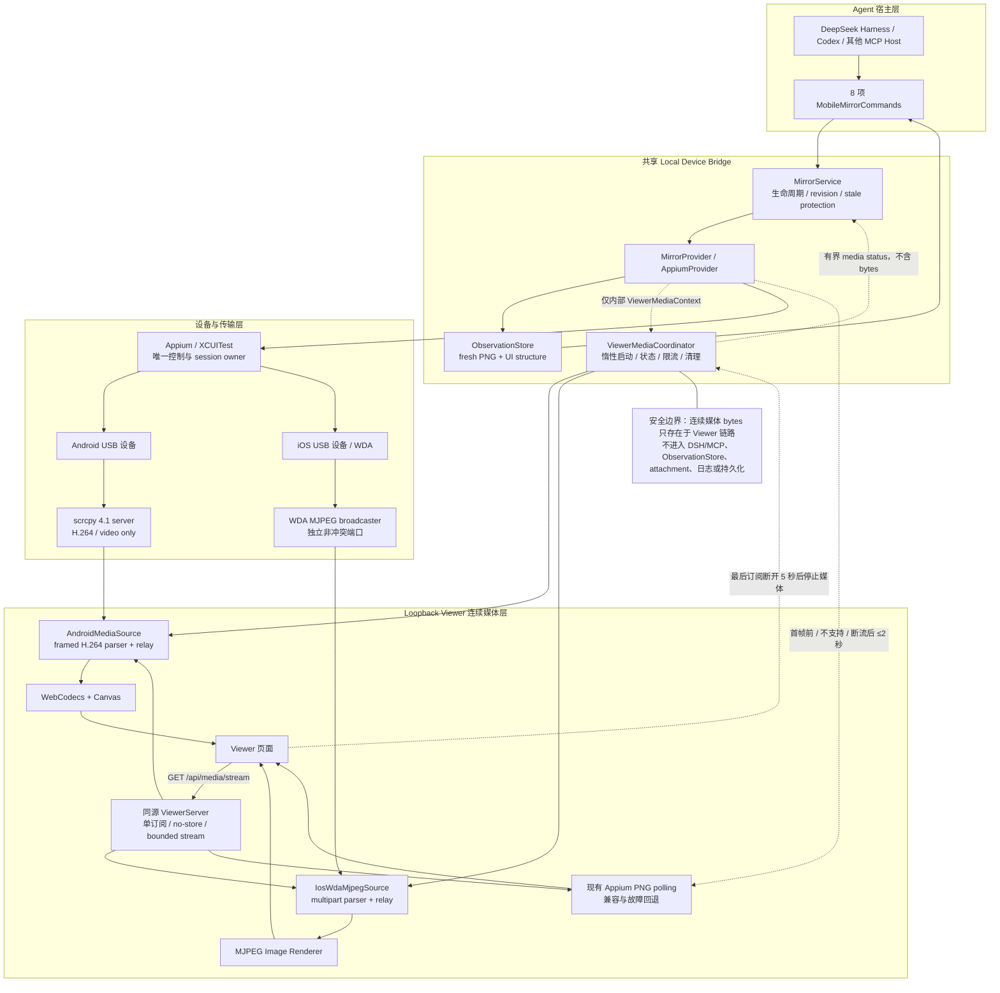

## Context

当前 `MirrorService.frame()` 通过 provider 拉取一张 PNG/SVG，Viewer 的 `/api/frame` 每 750 ms 请求一次。该链路跨平台、易于验证，也是 agent fresh observation 的可靠回退，但每秒约 1.3 帧，快速滚动时会丢失中间状态。P0 已证明 Appium/XCUITest/UiAutomator2 的控制、单帧图片、结构、stale protection 和 session ownership；P1 只需要替换人类 Viewer 的媒体面，不应重写控制面。

本设计以 2026-08-20 的官方资料和本机基线为准：

| 路径 | 官方能力 | 适用结论 |
| --- | --- | --- |
| Appium screenshot | 每次 WebDriver 请求返回一张图片；当前工程统一得到 PNG | 兼容性最好，继续作为启动前、失败后和不支持浏览器的回退 |
| [scrcpy 4.1](https://github.com/Genymobile/scrcpy/releases/tag/v4.1) | 官方声明 30–120 fps、约 35–70 ms；设备用 MediaCodec 编码，默认 H.264；4.1 新增 VP8/VP9 并改进编码器约束 | Android 主媒体源；只使用 H.264 视频，不使用 scrcpy control/audio |
| [scrcpy developer protocol](https://github.com/Genymobile/scrcpy/blob/v4.1/doc/develop.md) | 视频 socket 有 codec、旋转 session packet、12-byte PTS/key/config frame header；协议明确不向前/向后兼容 | 固定并验证 4.1，保留 frame metadata，不用丢失 PTS/帧边界的 raw mode |
| [WDA MJPEG guide](https://appium.github.io/appium-xcuitest-driver/10.43/guides/mjpeg/) | HTTP `multipart/x-mixed-replace`，默认端口 9100、10 fps、100% scale、25 quality；允许 1–60 fps | iOS 主媒体源；使用独立端口、流式解析和同源代理 |
| [XCUITest settings](https://appium.github.io/appium-xcuitest-driver/latest/reference/settings/) | 可动态设置 framerate、scale、quality、orientation fix | iOS 默认目标设为 15 fps / 50% / 40 quality，均可配置且有范围限制 |
| [WebCodecs](https://www.w3.org/TR/webcodecs/) | 浏览器可直接硬件解码编码帧，但不保证每个 codec 都可用 | Android Viewer 使用 H.264 + `VideoDecoder`，运行时 feature/config probe 失败即回退 |
| [Secure Contexts](https://www.w3.org/TR/secure-contexts/) | `127.0.0.0/8`、`::1` 和合规 `localhost` 可视为 potentially trustworthy | 现有 loopback Viewer 可使用 WebCodecs，无需为了媒体增加 HTTPS/远程监听 |

本机当前已安装匹配 executable/server 的 scrcpy 4.1；XCUITest driver 为 10.19.1。之前 iOS 真机验收时，默认 9100 被旧 Simulator WDA 占用，Appium 仍能完成离散截图，但 MJPEG 不可用。这说明媒体必须独立报告、分配端口并回退，不能把媒体失败提升为控制 session 失败。

## Goals / Non-Goals

**Goals:**

- Android USB/ADB session 通过 scrcpy H.264 为本机 Viewer 提供低延迟连续画面。
- iOS owned/attached Appium session 在可安全获取 WDA MJPEG 时提供连续画面。
- 媒体启动、首帧、live、fallback 和错误对 Viewer 可见，超过 300 ms 时不冻结 stop、主题或安全控制。
- 媒体失败、浏览器不支持、端口冲突或外部进程退出时自动恢复现有截图轮询，并保留最后可用画面。
- 把媒体生命周期、资源上限和清理放在共享核心/provider 边界，DSH/MCP adapter 继续保持薄层。
- 在真实 Android/iOS 上记录 time-to-first-frame、活动画面 fps、host-receive-to-paint 延迟、降级和资源清理证据。

**Non-Goals:**

- 不通过 DSH/MCP tool result、resource、attachment 或模型上下文传输连续视频。
- 不让 scrcpy 注入输入；所有 tap/swipe/back 继续走 Appium W3C actions。
- 不用连续媒体替代 `snapshot`/`inspect_screen` 的 fresh PNG、结构或 observation freshness。
- 首版不做 Android/iOS 音频、录制、回放、远程设备网格、多个并发 Viewer 或多 session 复用。
- 不自动下载、安装或升级 scrcpy，不把机器路径、UDID、端口或上游原始错误写入共享配置/日志。
- 不以 ffmpeg 转码作为主链路；ffmpeg 只保留给未来录制需求，避免额外解码/重编码 CPU 和延迟。

## Decisions

### 1. 控制、离散 observation 和连续媒体保持三条独立路径



图中有三条彼此独立的产品链路：

1. **控制链路**：Agent host → commands → `MirrorService` → Appium → 设备；Appium 始终是唯一控制与 session ownership 来源。
2. **离散观察链路**：Appium fresh screenshot/source → provider → `ObservationStore` → snapshot/inspect 工具；它继续承担 revision、epoch 和动作 freshness 语义。
3. **连续展示链路**：Viewer 订阅后由 coordinator 惰性启动 Android scrcpy H.264 或 iOS WDA MJPEG，只进入 loopback Viewer；首帧前、不支持或断流时切回 Appium PNG polling。

`MirrorProvider.frame/snapshot/screenSource/action` 契约继续存在。新增 `ViewerMediaCoordinator` 只接收 provider 生成的内部 `ViewerMediaContext`，不得调用 DSH/MCP adapter。`MirrorState` 增加不含地址、端口和标识符的媒体状态；工具最多返回这段控制/status 元数据，不返回媒体 bytes。

选择该边界而不是“从视频中截 agent 图片”，因为视频帧可能被缩放、压缩、丢帧、缓存或落后于当前 UI，不能满足 observation 的 capture window、revision、epoch 和 15 秒动作 freshness 契约。

### 2. 媒体按 Viewer 订阅惰性启动，主 session 不等待媒体

`MirrorService.start()` 仍以 Appium session 和首张兼容帧成功作为 `streaming` 条件。媒体协调器只规划来源并进入 `ready`；Viewer 请求 `/api/media/stream` 后才进入 `starting` 并占用编码器、端口或 adb 进程。最后一个订阅断开 5 秒后停止媒体源，避免纯 agent session 长时间占用设备编码器。

媒体状态如下：

```ts
type ViewerMediaState = {
  mode: 'auto' | 'polling'
  phase: 'idle' | 'ready' | 'starting' | 'live' | 'fallback'
  transport: 'appium-screenshot' | 'scrcpy-h264' | 'wda-mjpeg'
  startedAt: string | null
  firstFrameAt: string | null
  lastFrameAt: string | null
  width: number | null
  height: number | null
  targetFps: number | null
  lastErrorCode: string | null
}
```

`starting` 超过 300 ms 时 Viewer 显示局部进度，继续轮询 `/api/frame`。media coordinator 在第一张有效媒体帧被解析并写入同源 response 后切换到 `live`；Viewer renderer 只有实际呈现第一帧后才停止 polling。任何 source/parser/decoder/HTTP 失败都进入 `fallback`，恢复轮询而不改变主 `MirrorLifecycle=streaming`。

### 3. Android 使用 scrcpy 4.1 framed H.264，禁用第二控制栈

首版配置：

```yaml
viewerMediaMode: auto # auto | polling
androidScrcpyPath: /absolute/path/to/scrcpy # 空字符串表示未启用 Android 低延迟媒体
androidScrcpyServerPath: '' # 非标准安装可显式给出绝对路径；通常从 scrcpy executable 推导
androidScrcpyMaxSize: 1280
androidScrcpyMaxFps: 30
androidScrcpyVideoBitRate: 4000000
```

规则：

1. `androidScrcpyPath` 非空时必须是绝对路径；runtime 以 `execFile/spawn`、`shell=false` 执行 `--version`，当前只接受 4.1。
2. server 文件优先使用绝对路径 `androidScrcpyServerPath`；缺省时只从 portable sibling 或解析后的安装 prefix `share/scrcpy/scrcpy-server` 推导；不读取任意环境覆盖、不扫描磁盘、不联网下载。
3. 使用现有 `adbPath` 和 Appium 内部 context 的目标 device id，生成随机 scid、本机端口、ADB abstract socket 和唯一远端 jar 路径。ADB forward 的本地 TCP connect 只有收到首个协议字节后才视为 ready；server abstract socket 尚未监听导致的零字节关闭在 5 秒启动窗口内重试。
4. 启动参数固定 `audio=false control=false video_codec=h264 send_frame_meta=true send_stream_meta=true`，并施加 max-size/max-fps/bit-rate 上限。scrcpy 只负责视频，不能发送触摸、键盘、剪贴板或设备管理命令。
5. 解析 codec、rotation session packet、config/key/delta flags、PTS 和 payload size；单 packet 超过 8 MiB、未知 codec、非法尺寸/时间戳或协议不同步立即停止该媒体源并回退。
6. 记录最近的 SPS/PPS config。转发 key frame 时把 config 前置，使 W3C AVC Annex-B 规则下的新 decoder 能从关键帧恢复；从 SPS 解析 profile/constraints/level 形成准确 `avc1.*` codec string。

不采用以下方案：

- **scrcpy SDL 窗口**：不能嵌入当前 Viewer，也无法统一状态/降级。
- **scrcpy raw stream**：会丢掉 PTS、key/config 标记和旋转 session packet，浏览器恢复与背压更脆弱。
- **scrcpy control socket**：与 Appium 形成第二套动作语义、坐标和 session ownership，违反核心边界。
- **Tango/ya-webadb 完整栈**：其浏览器解码思路可参考，但完整 ADB/scrcpy client 会复制设备连接栈，且稳定包与 scrcpy 4.1 协议版本不同步。
- **ffmpeg 转 MJPEG**：跨浏览器简单但需要二次解码/编码，增加 CPU、带宽和延迟；已有 Appium PNG 可承担兼容回退。

### 4. Android 浏览器链路使用同源 framed HTTP + WebCodecs

ViewerServer 增加 `GET /api/media/stream`，Android 返回 `application/x-mobile-mirror-h264; version=1` 的 chunked body。内部 envelope 使用固定 big-endian header，区分 metadata、session、config、key 和 delta packet，包含有限的 codec/尺寸/PTS/长度；不得携带 UDID、adb path 或远端 socket 名。

Viewer 在 `VideoDecoder` 存在且 `VideoDecoder.isConfigSupported()` 通过后才订阅。decoder 使用 Annex-B H.264，输出 `VideoFrame` 到 `<canvas>`，绘制后立即 `close()`。`decodeQueueSize` 或 HTTP writer 出现背压时丢弃 delta packet，并在下一个 key frame + config 恢复；不建立无界队列。首版每个 runtime 只允许一个活动连续媒体订阅，第二个返回 409 并继续允许截图轮询。

H.264 response metadata 包含不透明、每次订阅唯一的 media generation。若 WebCodecs 在订阅后 configure/decode/render 失败，Viewer 只可向 `POST /api/media/client-failure` 回报当前 generation 与固定枚举 `decoder-unsupported`、`decoder-failed` 或 `render-failed`；server 验证 generation 后终止当前 source 并映射稳定错误码。接口拒绝任意错误文本、旧 generation 和跨源请求，避免浏览器错误成为日志/状态注入面。

如果浏览器没有 WebCodecs、codec config 不支持、页面进入错误状态或流中断，Viewer 保留最后绘制的 canvas，先重新启用截图轮询，待新的兼容帧加载成功后再替换画面。不会自动加载 WASM decoder。

### 5. iOS 使用 WDA MJPEG，但不设置 `mjpegScreenshotUrl`

首版配置：

```yaml
iosMjpegPort: 0 # 0 表示为 owned session 选择空闲端口
iosMjpegFramerate: 15
iosMjpegScalingFactor: 50
iosMjpegScreenshotQuality: 40
```

owned iOS session 创建前：

1. 若 request 已显式给出 `appium:mjpegServerPort`，保留请求值；否则从 loopback 选择空闲非特权端口并注入 capability。
2. Appium/XCUITest 负责 WDA 与真实设备间的 USB forwarding；runtime 不另起第二个 iproxy。
3. session 成功后通过 Appium Settings API 设置 framerate/scale/quality，并保留 `mjpegFixOrientation=true`。设置失败只让媒体回退，不删除已成功的控制 session。
4. 连接 `http://127.0.0.1:<planned-port>`，要求 `multipart/x-mixed-replace`，解析 boundary 和每个 JPEG；单帧上限 8 MiB、尺寸必须有效，再以 runtime 自己的固定 boundary 同源发布。

attached iOS session 不新增、替换或删除 port forwarding。只有 attached capabilities 明确给出可达 MJPEG port 且协议验证通过时才只读订阅；否则使用截图轮询。

绝不设置 `appium:mjpegScreenshotUrl`。官方 driver 在设置该值后会让 screenshot command 返回“最新流帧”，这会混淆 fresh observation；本项目继续让 Appium screenshot endpoint 独立生成 agent PNG。

### 6. ViewerServer 只做代理和有界 fan-out，不暴露上游地址

同一 `/api/media/stream` 按当前内部 context 选择 Android H.264 或 iOS MJPEG。路由只接受 loopback Viewer 同源请求，验证 `Origin`/`Referer`（浏览器提供其一时必须精确匹配），设置 `Cache-Control: no-store`、`X-Content-Type-Options: nosniff` 和现有 CSP。响应、状态、日志和错误不包含 upstream URL、端口、UDID、sessionId、绝对路径或 scrcpy/adb 完整命令。

有界策略：

- 单 encoded packet/JPEG 最大 8 MiB；流 metadata 最大 4 KiB。
- 单 runtime 一个活动连续订阅；写端背压时不缓存超过 2 个 packet 或 8 MiB。
- MJPEG parser 不信任上游 `Content-Length`，按 boundary 流式读取并限制 frame。
- H.264 慢消费者丢 delta 直到下一个 key frame；MJPEG 慢消费者只保留最新完整 JPEG。
- 不写磁盘、不保留媒体历史、不创建 DSH attachment/MCP resource。

### 7. 生命周期和 ownership 采用“媒体先停、控制后停”

正常 stop/dispose 顺序：

1. 拒绝新媒体订阅并 abort Viewer response/decoder source。
2. 关闭上游 TCP/H.264/MJPEG stream。
3. Android 等待 adb shell server 退出，必要时只终止本 runtime 保存的本机 child handle；移除精确 owned adb forward 和唯一远端 jar。
4. iOS 由 Appium 删除 owned session 时回收它创建的 WDA forwarding；attached session 的 forwarding 不做任何修改。
5. 调用既有 provider stop，按原规则只删除 runtime-owned Appium session。

每个清理步骤幂等并有超时。媒体启动中收到 stop 时必须取消启动、等待 media task quiesce，再进入 provider stop。进程异常退出可能留下 ADB forward 是已知 P2 orphan-recovery 风险；P1 不通过模糊 `pkill` 或删除其他实例的 forward 来“清理”。

稳定错误码至少包括：

- `viewer_media_unavailable`
- `viewer_media_scrcpy_missing`
- `viewer_media_scrcpy_version_unsupported`
- `viewer_media_port_unavailable`
- `viewer_media_protocol_invalid`
- `viewer_media_frame_too_large`
- `viewer_media_decoder_unsupported`
- `viewer_media_stream_ended`

### 8. 配置默认自动选择，但执行外部 Android 二进制仍需显式路径

`viewerMediaMode=auto` 是新默认：Mock 继续轮询；iOS 可使用 Appium 已授权的 WDA MJPEG；Android 只有 `androidScrcpyPath` 非空且验证通过才启动 scrcpy，否则无副作用地回退。`viewerMediaMode=polling` 完全保持旧行为，不探测 scrcpy、不规划 iOS MJPEG 端口。

这在“开箱优先”和“主机命令必须显式”之间取平衡：媒体能力默认可协商，但 Android 不会因为 PATH 中偶然存在同名程序就执行；配置文件仍受现有 64 KiB/未知键/loopback 校验，个人路径不进入仓库默认 patch。

### 9. 验收指标分为协议、浏览器和真机三层

自动化门禁：

- fake scrcpy server 覆盖 fragmented header/payload、rotation、config/key/delta、oversize、EOF、abort、背压和 owned cleanup。
- fake MJPEG server 覆盖随机 boundary、跨 chunk boundary、缺失/伪造 length、oversize、多个 frame、EOF 和取消。
- Appium fake server 覆盖 owned iOS 端口注入/Settings、attached 不变、媒体失败不影响 screenshot/action/stop。
- Playwright 覆盖 starting 时主题/stop 可用、Android decoder supported/unsupported、iOS MJPEG、首帧切换、流断开后保留画面与轮询恢复；保留最终截图。
- `pnpm check`、`pnpm test:e2e`、`pnpm build`、`pnpm pack:check`、strict OpenSpec 和 `git diff --check` 全部通过。

真机验收：

- Android USB：scrcpy 4.1/H.264 在持续变化 10 秒窗口中，首次可绘制帧不超过 5 秒，绘制帧率至少 15 fps，host receive-to-paint p95 不超过 100 ms；断开媒体后 2 秒内恢复可用截图轮询，stop 后无该 runtime 的 child/forward/远端 jar。
- iOS USB：当前 XCUITest/WDA 基线使用非冲突 MJPEG 端口，首次可显示帧不超过 5 秒，持续变化窗口至少 8 fps；默认 9100 被占用时仍能选新端口通过，断流后 2 秒内回退，owned session stop 后对应 forwarding 释放。
- 两个平台同时证明 Appium action 仍有效，`snapshot/inspect_screen` 仍返回 fresh PNG/结构，媒体帧没有进入 MCP/DSH 结果。

这些是本项目链路指标，不把 scrcpy 官方宣传的 35–70 ms 直接当成本机实测结果。

## Risks / Trade-offs

- [scrcpy protocol 明确不兼容其他版本] → 当前只接受 4.1，协议 parser 带 version fixture；后续升级必须单独改 spec、fixture 和真机矩阵。
- [Android encoder/profile/rotation 差异导致 WebCodecs 解码失败] → 固定 H.264、从 SPS 派生 codec、传递 session packet、key frame 前置 config；失败立即回退，不自动改用 H.265/AV1。
- [WebCodecs 并非所有浏览器可用] → runtime feature/config probe；Appium screenshot 是完整功能回退，不下载 WASM。
- [WDA MJPEG 是连续 JPEG，设备 CPU/USB 开销高] → 默认 15 fps/50% scale/40 quality、惰性订阅、5 秒 idle stop，并允许 `polling` 全局关闭。
- [端口预分配存在 release-to-bind 竞争窗口] → 只在 auto-generated port 失败且错误明确属于 MJPEG forwarding 时换端口重试一次；其他 Appium 错误不重试、不掩盖。
- [流量会增加本机攻击/DoS 面] → loopback-only、同源验证、单订阅、严格帧/队列限制、无 upstream proxy 参数和 no-store。
- [进程崩溃可能留下 Android forward] → 正常关闭精确回收并记录诊断；跨进程 orphan 扫描推迟到 P2，禁止宽泛删除。
- [连续媒体与 Appium 页面状态可能短暂不同步] → 媒体只做人类展示，动作/observation 坐标与 freshness 仍以 Appium viewport/fresh capture 为准。

## Migration Plan

1. 新增配置与状态时保持 `viewerMediaMode=polling` 的完整兼容测试，再把 schema 默认切到 `auto`；仓库默认 patch 不设置个人 scrcpy 路径。
2. 先实现 fake sources、media coordinator 和轮询回退，再接 iOS MJPEG；iOS 不需要新增浏览器 decoder，风险较低。
3. 实现 scrcpy 4.1 parser/relay 和 WebCodecs renderer，完成协议 fixture 后才连接真机。
4. 更新 ADR 0001 或新增 ADR 0003，记录 framed H.264/WebCodecs、WDA MJPEG、无第二控制通道和无 MCP 视频的决策。
5. 通过自动化和双平台真机指标后更新 milestones/product-shape/validation；未达到指标时保留功能 behind auto capability fallback，不把 P1 标为完成。
6. 回滚只需把 `viewerMediaMode` 设为 `polling`；旧 `/api/frame`、Appium session、工具协议和 observation 不变。

## Open Questions

没有阻塞实现的产品问题。音频、录制、多 Viewer、远程媒体和 scrcpy 4.1 之后的升级均明确推迟到独立 change；实现阶段只需要用目标 Android 编码器 fixture/真机确认 SPS-derived codec 与关键帧恢复满足上述 contract。
