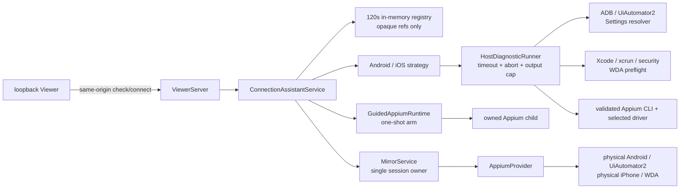

## Context

当前本地链路已经具备五块可复用能力：`DoctorService` 的 Android/iOS 宿主检查、`IosWdaPreflightService` 的签名预检、ADB/UiAutomator2 的 Android 真机链路、`ManagedAppiumRuntime` 的精确子进程所有权，以及 `MirrorService` 的唯一 provider/session 生命周期。缺口不是新的设备控制协议，而是把这些能力组合成一个不要求用户手写 capabilities 的双平台本地产品入口。

现有 Viewer 直接把 `sessionId` 和 raw capabilities POST 到 `/api/start`，`LocalDeviceRuntime` 在构造时固定 `MirrorService` 与 Appium runtime。Android 的 ADB 发现和 iOS 预检都没有 Viewer 用户手势授权边界，因此无法安全表达“用户刚在本机页面点击一次平台检查”。本变更需要跨 Viewer、runtime 和平台诊断，但不能把主机命令或进程启动能力暴露给 DSH/MCP adapter。

约束如下：

- Appium provider 与 session 仍由 `MirrorService` 唯一拥有；不得复制控制栈。
- 主机命令只经可注入 runner 执行，必须有 timeout、abort 和输出上限。
- Viewer 绑定 loopback；所有状态变更请求必须严格 same-origin。
- Android serial、iOS UDID、Team ID、设备名称、证书/profile、绝对路径和完整 capabilities 不进入响应、日志或 Agent 上下文。
- 用户操作超过 300 ms 时必须有局部进度，并保留最近一次可用结果。
- 现有高级 Appium 表单、external/managed 配置和 MCP/Harness 工具兼容。

## Goals / Non-Goals

**Goals:**

- 让已完成设备准备的用户在 Viewer 内通过“选择平台 → 检查 → 选择设备 → 连接设备”完成 Android/iOS 首次连接，默认查看当前画面，打开系统设置为显式可选项。
- 自动发现并验证 Android 的 Appium/UiAutomator2/ADB/授权设备与 iOS 的 Appium/XCUITest/Xcode/WDA 前提，同时只返回脱敏状态。
- Appium 未运行时，经二次明确确认后一次性启动已验证的 Appium 可执行文件。
- 复用个人 DSH profile 或独立本机 Viewer 私有配置中已经沉淀的 WDA 默认值；缺失时允许只为本次连接补充最小字段，并由用户显式选择是否保存到此电脑。
- 把 Android 解锁、USB 调试、ADB 授权、UiAutomator2 helper APK 和 hidden API compatibility 作为明确边界；scrcpy 缺失仅降级媒体。
- 在 Android OEM 冻结 UiAutomator2、持续 accessibility 事件或截图路径失活时，让控制结果、画面刷新和 Appium server 健康度独立表达，避免一次慢截图把按钮阻塞到全局 timeout。
- 保证短期引用、原子消费、进程/session 精确所有权、失败恢复和可测试性。

**Non-Goals:**

- 自动安装或升级 Node、Appium、UiAutomator2 driver、XCUITest driver、Xcode、WDA、ADB 或 scrcpy 等宿主依赖。
- 登录 Apple Developer、导入证书/私钥、打开自动设备注册或绕过设备信任/Developer Mode。
- 自动改写 `~/.dsh` profile、浏览器存储或仓库文件。Viewer 只允许在用户显式勾选后写入独立、权限收紧的本机私有配置；未勾选时输入仍只存在于本次内存。
- 自动接受 Android 调试授权、无线 ADB 配对、root/系统授权，或隐藏 UiAutomator2 session 可能安装/更新 helper APK 的副作用。
- 支持 Android emulator、iOS Simulator、任意应用发现/选择或修改 Agent 画面、文本、应用控制策略。
- 向 MCP/Harness 返回视频、主机诊断命令、原始设备标识或可执行路径。

## Decisions

### 1. 新增 host-neutral 的 `ConnectionAssistantService`

在 `src/connection-assistant.ts` 新增核心服务，由 `LocalDeviceRuntime` 组合 `MirrorService`、Android/iOS strategy 和可装载 Appium runtime 后注入 Viewer。ViewerServer 只做 HTTP 边界、输入解析和错误映射；DSH/MCP adapter 不注册该服务的工具。



选择该方案而不是把流程写进 `viewer-server.ts`，是为了保持 HTTP 层薄、让诊断/引用/过期逻辑可以单元测试，并保留以后由其他本地主机 UI 复用的可能。选择不注册 Agent 工具，是因为“找主机命令并启动进程”不属于模型控制面。

### 2. 显式两阶段协议：check 与 connect

新增三个 Viewer API，所有 POST 在读 body 前要求 `Origin === viewerOrigin`：

| API | 输入 | 输出 | 副作用 |
| --- | --- | --- | --- |
| `POST /api/connection-assistant/check` | `{ platform: "android" | "ios" }`，最大 1 KiB | 平台脱敏 report、`assistantId`、设备 `deviceRef` | 所选平台只读主机命令；不启动 Appium |
| `POST /api/connection-assistant/connect` | `assistantId`、`deviceRef`、`targetPreset`、`runtime`、平台 allowlist 确认/短期字段，最大 8 KiB | 现有脱敏 Viewer state | 原子消费上下文；可启动 owned Appium 并创建 session |
| `POST /api/connection-assistant/cancel` | `assistantId`，最大 1 KiB | `{ cancelled: true }` | 清除未消费上下文和一次性候选 |

`runtime` 只接受 `configured` 或 `managed-once`。`targetPreset` 必须与检查上下文平台一致，只接受 `android-current-screen`、`ios-current-screen`、`android-settings` 或 `ios-settings`；保留原 Settings 值及其语义，不静默改变旧 API 请求。Android 只接受布尔 `confirmHelperApkSideEffect=true`；iOS 只接受 allowlist 内的短期签名对象。connect 不接受 raw capabilities、sessionId、命令参数、路径、任意应用或 provisioning 字段；高级表单继续走既有 `/api/start`。

公开检查结果固定为 `schemaVersion: 1`，核心字段如下；所有 `message`/`action` 都由稳定 code 的静态映射生成：

```ts
interface ConnectionAssistantReport {
  schemaVersion: 1
  assistantId: string
  platform: 'android' | 'ios'
  status: 'ready' | 'action-required' | 'blocked'
  checkedAt: string
  expiresAt: string
  checks: Array<{
    id: 'appium-endpoint' | 'appium-cli' | 'appium-driver' | 'adb' | 'device' |
      'settings-target' | 'scrcpy' | 'xcode' | 'wda-signing'
    status: 'pass' | 'warning' | 'blocked' | 'manual'
    code: string
    version?: string
    count?: number
    action: string
  }>
  devices: Array<{ deviceRef: string; label: string; platform: 'android' | 'ios'; osVersion?: string; settingsAvailable?: boolean }>
  runtimeChoices: Array<'configured' | 'managed-once'>
  signing?: { profileDefaultsReady: boolean; requiredInputs: Array<'team-id' | 'wda-bundle-id'> }
  confirmations: Array<'android-unlocked' | 'usb-debugging' | 'adb-authorized' |
    'uiautomator2-helper-apk' | 'device-trust' | 'developer-mode' | 'ui-automation'>
  media: { mode: 'polling' | 'scrcpy-available'; code: string }
}
```

`ready` 表示可直接连接；`action-required` 用于确认一次性 managed 启动、Android helper APK 副作用或补充 iOS 签名字段。Android 缺少 UiAutomator2/ADB/已授权设备，iOS 缺少 Xcode/XCUITest/设备/WDA，任一平台没有可用 Appium 路径，或 iOS profile 已开启 provisioning/device registration 时为 `blocked`。Android Settings 解析失败只产生 warning 并令对应设备 `settingsAvailable=false`，不能阻塞 current-screen。connect 在原子消费前重算输入是否补齐所有 action，任何 blocked 报告都在 spawn/session 之前拒绝；scrcpy 缺失只产生 warning。

选择两阶段而不是“一键扫描并直接连接”，是为了让用户在任何进程启动和 session 创建前看到结果、人工边界与 managed 启动确认。选择独立路由而不是扩展 `/api/start`，可以保持高级 API 兼容并使用更窄的输入 schema。

### 3. 服务端保存原始发现，浏览器只拿短期不透明引用

`ConnectionAssistantRegistry` 只在内存保存最多 8 个上下文，每个上下文 120 秒 TTL：

```ts
interface AssistantContext {
  idHash: string
  platform: 'android' | 'ios'
  expiresAt: number
  consumed: boolean
  devices: Map<string, AndroidDeviceSecret | IosDeviceSecret>
  appiumCandidate?: { executableFingerprint: string; version: string }
  publicReport: ConnectionAssistantReport
}

interface AndroidDeviceSecret {
  platform: 'android'
  serial: string
  platformVersion?: string
  settingsActivity: string | null
}

interface IosDeviceSecret {
  platform: 'ios'
  udid: string
  platformVersion?: string
}
```

`assistantId` 与每个 `deviceRef` 使用 `randomBytes(16)`；registry 只保存 token hash，比较使用 timing-safe equality。Appium 候选保存 canonical path 的内部摘要而不是路径本身；connect 重新发现并验证同一摘要后才把本地绝对路径短期交给 runtime。公开设备标签为 `Android 1`/`iPhone 1` 等通用序号，可附非识别性的系统 major/minor 版本，但不使用用户设备名、Android model 或 serial/UDID。新上下文、过期清扫、连接消费、取消和 dispose 都会清除旧引用；连接采用单线程临界区/原子状态转换，避免跨平台替换和并发重放。

选择内存 registry 而不是 cookie、localStorage 或文件，是因为 assistant token、deviceRef 和设备/路径映射只服务一次连接。独立本机配置只保存经过 allowlist 验证的长期默认值，不保存 token、设备标识、完整 capabilities 或命令输出；两者是不同的生命周期与权限边界。

### 4. Appium 发现与执行分离

检查阶段按确定顺序获取候选：

1. 若 profile 已配置绝对 `appiumExecutablePath`，先验证该路径。
2. 否则在本次用户授权的诊断中通过注入 runner 定位 `appium`，解析为绝对/real path。
3. 验证可执行权限，使用绝对路径执行 `--version` 与 `driver list --installed --json`，按所选平台确认 UiAutomator2 或 XCUITest。
4. 公开结果只保留版本和 ready/blocked code；registry 只保留候选摘要，检查请求结束前丢弃原始路径。
5. connect 重新执行同一有界发现并校验摘要；只有匹配时才把绝对路径交给一次性 runtime，避免把漂移后的 PATH 候选直接执行。

运行时本身永不搜索 PATH。只有用户在 connect 中选择 `managed-once` 时，助手才把 registry 中的已验证路径装载到 `GuidedAppiumRuntime`。因此“发现候选”和“执行候选”之间存在清晰的二次确认。

不选择自动安装/修复，是因为 package manager、全局目录和 driver 安装会改变宿主环境且难以回滚。不选择把路径写回 DSH profile，是因为 id patch 会替换整个 config，自动编辑可能覆盖用户的其他设置；用户明确要求记住时只写独立 Viewer 配置。

### 5. 用 `GuidedAppiumRuntime` 扩展既有生命周期，而不是创建第二个 manager

在 `src/managed-appium-runtime.ts` 中增加 `ArmableAppiumRuntimeLifecycle` 和 `GuidedAppiumRuntime`：

- 持久配置为 managed 时，正常委托现有 `ManagedAppiumRuntime`。
- 持久配置为 external 时，默认委托 `ExternalAppiumRuntime`。
- `armOnce()` 只接受助手内部的绝对路径、上下文 hash 和 expiry；它不会成为公共 config 或 state。
- 下一次 `ensureReady()` 原子消费 arm，构造一次性 `ManagedAppiumRuntime` 并完整复用 listener 冲突、`spawn(shell=false)`、ready probe 和 child cleanup。
- `stop()`、连接失败和 runtime dispose 清理 active delegate 与未使用 arm，随后回到持久配置的基础模式。

`LocalDeviceRuntime` 先创建 guided runtime，再把它注入 `MirrorService`，然后创建 assistant 和 Viewer。已有测试中注入自定义 `MirrorService` 时必须同时显式注入 fake assistant；不允许 Viewer 隐式创建第二个 service/runtime。

### 6. 用平台 strategy 隔离发现和 capabilities 生成

`ConnectionAssistantService` 依赖 `DeviceConnectionStrategy` registry，而不是在 HTTP 或核心状态机中散落平台判断：

```ts
interface DeviceConnectionStrategy {
  readonly platform: 'android' | 'ios'
  check(input: StrategyCheckInput, signal: AbortSignal): Promise<StrategyCheckResult>
  validateConnect(input: StrategyConnectInput, secret: DeviceSecret): Promise<void>
  buildCapabilities(input: StrategyConnectInput, secret: DeviceSecret): Record<string, unknown>
}
```

`AndroidConnectionStrategy` 只在显式检查中执行：

- 解析当前配置的 `adbPath`；若为命令名，通过同一受限 runner 定位并验证实际 executable，不向客户端返回路径。
- 运行 `adb devices -l`，严格区分 `device`、`unauthorized`、`offline` 和其他状态；P0 还要拒绝 `emulator-*`、host:port TCP serial，并要求 USB transport 证据，只为已授权 USB 物理设备创建引用。
- 对每个可连接候选运行有界、只读的 `getprop ro.build.version.release` 和 `cmd package resolve-activity --brief -a android.settings.SETTINGS`；只在返回包为 `com.android.settings` 且 activity 格式合法时保存目标。
- 检查 Appium UiAutomator2 driver；检查显式配置的 scrcpy 4.1 仅用于媒体提示，失败不阻塞 session。
- 不执行 `adb kill-server/start-server`、pair/connect、install、root、`settings put/delete`、`am start` 或任何 ADB input。

`IosConnectionStrategy` 复用 `IosWdaPreflightService`、xcrun 物理设备发现和现有 WDA 配置合并。两种 strategy 都只返回统一 report 片段，并把原始设备标识留在 registry。Viewer 用户手势只形成单次 strategy grant：即使 `allowHostDeviceDiscovery=false`，本次检查也能运行，但它不修改 config，且 MCP/Harness 的普通 discovery 继续按原配置拒绝。

选择 strategy 而不是 `if (platform)` 铺满 service/viewer，是为了让共享 TTL、same-origin、managed runtime 和 MirrorService ownership 保持单一实现，同时能独立注入 fake Android/iOS runner。未来扩展模拟器或其他 host 时必须新增独立 change，不能通过宽松平台字符串穿透当前 allowlist。

### 7. 复用 WDA 预检，但增加作用域授权和短期覆盖

`IosWdaPreflightService.run()` 扩展为接受内部 `IosWdaPreflightRequest`：

- `authorization: "profile" | { kind: "viewer-once"; tokenHash; expiresAt }`
- 可选 `appiumExecutablePath`、`xcodeOrgId`、`updatedWdaBundleId` 的服务端短期覆盖

默认 MCP/Harness 调用不传 request，行为完全不变：只有 `allowHostSigningDiagnostics=true` 才执行命令。助手使用由 same-origin 用户点击创建并在 `run()` 开始时消费的授权。覆盖字段只在局部调用栈存在，完成后不进入 service state。

Team ID 限制为 10 个 ASCII 字母数字字符；WDA bundle ID 限制为 3–255 字符的反向域名段。输入对象使用 allowlist 严格拒绝未知 key。助手永远不接受 `allowProvisioningDeviceRegistration` 输入；若个人 profile 已显式打开该配置，助手将报告标为 blocked 并要求用户关闭该持久授权或改用高级入口，避免向导把高风险授权变成惯性点击。

选择扩展预检请求而不是临时修改全局 `Config`，可以避免并发请求看到彼此的 Team/bundle 或授权。选择不收 Apple ID、证书和 xcconfig 路径，是为了把凭据与任意文件读取排除在 HTTP 边界之外。

### 8. 服务端生成通用连接与可选 Settings capabilities

Viewer 主按钮为“连接设备 / Connect device”，连接方式默认“查看当前画面”，另提供“打开系统设置”。快速连接固定使用 current-screen，不记忆上次显式 Settings 选择。两个平台的 current-screen 均设置 `autoLaunch=false`、`noReset=true`、`forceAppLaunch=false`、`shouldTerminateApp=false`，不传 `app`、`bundleId`、`appPackage` 或 `appActivity`，不查询/重新激活当前前台 App。Android 还设置 `skipUnlock=true`，保留用户手动解锁边界和下述 session 级 idle/action 参数。provider 与 session ownership 不变，未指定 app 的连接不授予 target-app 应用管理能力。

这里只承诺助手不指定或主动启动、重启业务 App；首次 XCUITest/WDA/UiAutomator2 引导可能切换到自动化启动页或主屏，不能承诺像素级保留连接前前台。界面明确提示首次连接可能短暂切换画面，用户可以在手机上打开所需页面。能力依据：[XCUITest capabilities](https://appium.github.io/appium-xcuitest-driver/latest/reference/capabilities/) 的 autoLaunch/noReset/shouldTerminateApp 与 [UiAutomator2 capabilities](https://github.com/appium/appium-uiautomator2-driver#capabilities)；实现同时核对本机 driver 的 WDA session 与 performSessionPostExecSetup 路径。

报告新增可选、脱敏布尔 `settingsAvailable`：Android 逐设备输出；false 时 Viewer 禁用 Settings 选项，但不清除设备。旧报告省略该字段时保持兼容，服务端仍独立重验 Settings。目标选择只在页面内存保留；检查失败、语言切换保留选择，平台切换/清除重置默认。慢操作锁住该操作的目标选择与重复提交，主题/状态/高级面板仍可交互；快速检查期间切换平台或取消时不得继续提交连接。

用户显式选择 Settings 时，Android 由助手构造：

```json
{
  "provider": "appium",
  "capabilities": {
    "platformName": "Android",
    "appium:automationName": "UiAutomator2",
    "appium:udid": "<server-held>",
    "appium:appPackage": "com.android.settings",
    "appium:appActivity": "<server-resolved>",
    "appium:noReset": true,
    "appium:forceAppLaunch": true,
    "appium:settings": {
      "waitForIdleTimeout": 1000,
      "actionAcknowledgmentTimeout": 1000
    }
  }
}
```

`appActivity` 必须来自同一设备在 check 阶段的只读 intent resolver，并在 connect 时重新验证；不能接受客户端 activity 或使用 OEM 猜测。Appium provider 继续按现有规则合并 `appium:ignoreHiddenApiPolicyError`。该字段只控制 UiAutomator2 对 hidden API policy 写失败的处理方式，助手本身不执行 policy 写入。创建 session 前必须收到 `confirmHelperApkSideEffect=true`，因为 UiAutomator2 可能安装或更新自己的 automation helper APK。

`forceAppLaunch=true` 用于避免 `noReset` 复用后台 Settings 进程却把其他应用误当作验收目标。`appium:settings` 只设置 session 级 UiAutomator2 参数：`waitForIdleTimeout=1000` 限制持续 accessibility 事件造成的等待，`actionAcknowledgmentTimeout=1000` 限制动作确认；它们不写 Android 系统设置，不改变设备电池策略，也不授权自动重试可能已发生的 mutation。

iOS 连接时由助手构造：

```json
{
  "provider": "appium",
  "capabilities": {
    "platformName": "iOS",
    "appium:automationName": "XCUITest",
    "appium:udid": "<server-held>",
    "appium:bundleId": "com.apple.Preferences"
  }
}
```

若用户提供本次 Team/bundle，追加既有 provider 支持的 `appium:xcodeOrgId` 与 `appium:updatedWDABundleId`；否则由 Appium provider 按现有优先级合并 profile 默认值。助手不设置 `allowProvisioningDeviceRegistration`，也不返回最终 capabilities。两端设备版本仅在 Appium 明确需要且来自同一发现记录时加入。

Settings 作为可选诊断预设保留，便于验证基础 UiAutomator2/WDA 链路，不扩展为任意 package/bundle 启动。Android Settings 本身不由助手安装，但两种模式下 UiAutomator2 helper APK 副作用都必须明确确认。自定义 app 启动继续使用高级表单和既有策略。

### 9. Viewer 使用独立状态机并保留最后成功结果

前端新增 `assistantState = idle | checking | ready | connecting | error`，与 `mirror.lifecycle`、`media.phase` 分离。检查和连接各自只禁用重复提交；主题、状态刷新、高级面板以及 session 可用后的 stop 始终可操作。

Android/iOS 各自最后一次成功 report 连同 `checkedAt` 保存在页面内存；切换平台显示对应结果，不复用另一平台 token。后续检查失败时，页面继续渲染同平台旧 report，并显示 `stale`、新错误码和重试按钮；不得用失败的空结果清屏。页面卸载不持久化 assistant token、设备引用或 helper 确认。签名输入默认也只存在于本次内存；只有用户勾选“记住此电脑”并提交连接时，服务端才可写入 allowlist 后的本机私有默认值。连接成功后清空短期输入和上下文 token，高级 JSON 默认折叠但保持现有行为。

选择前端内存而不是浏览器持久化，是为了避免跨运行时重放和个人配置泄漏。真正需要长期复用的 Appium/WDA 默认值可以继续沉淀到个人 DSH profile，或由用户明确保存到独立本机 Viewer 配置；浏览器始终拿不到保存值。

### 10. 稳定错误与日志红线

新增稳定错误族：

- `assistant_origin_required`
- `assistant_platform_unsupported`
- `assistant_check_timeout`
- `assistant_appium_unavailable`
- `assistant_uiautomator2_unavailable`
- `assistant_xcuitest_unavailable`
- `assistant_adb_unavailable`
- `assistant_android_device_unauthorized`
- `assistant_android_device_unavailable`
- `assistant_android_settings_unresolved`
- `assistant_android_helper_confirmation_required`
- `assistant_ios_device_unavailable`
- `assistant_signing_incomplete`
- `assistant_context_stale`
- `assistant_context_consumed`
- `assistant_input_invalid`
- `assistant_managed_start_not_confirmed`
- `assistant_persistence_unavailable`
- `assistant_persistence_failed`

HTTP 错误响应为 `{ code, message }`，message 只能来自静态映射。主机命令 stdout/stderr、异常 stack、请求 capability/signing 内容和 registry 内部值不得进入日志；测试使用 canary Android serial、iOS UDID、设备名、Team、路径和证书名称扫描所有响应、日志与截图文本。

### 11. 文档和架构决策同步

实现时更新 ADR 0001 与 ADR 0004：补充“Viewer 显式双平台一次性诊断与 managed arm”是 DSH profile 之外的受限本地入口；原始 Appium/ADB 路径不进入公开 service state，active runtime 只在被确认的生命周期内持有 Appium 路径；独立 Viewer 配置只能保存 allowlist 默认值，DSH/MCP 权限面不变。`docs/android-real-device.md`、`docs/ios-real-device.md` 和 beta 安装文档增加统一引导、持久化和快速连接流程。

### 12. 将 Appium server 健康、session 命令和 Viewer frame 分层

`GET /status` 只证明 Appium server listener 可达，不能证明 UiAutomator2/WDA session 命令健康。`AppiumProvider` SHALL 对连接拒绝/DNS/端口失败与已建立 session 上的 AbortSignal timeout 使用不同的稳定错误分类；Viewer 公共状态只暴露静态错误码和脱敏消息，不返回 session path、设备 id 或底层异常。

控制动作与画面刷新使用同一 Appium session，但完成语义不同：pointer/back 请求成功即代表控制请求已被 driver 接受，后置截图只是可选视觉刷新。因此 `MirrorService.action()` SHALL 在 provider mutation 成功后完成 control 状态并返回，不同步等待已有或新建的 frame promise；Viewer 可以在动作完成后异步请求新帧，失败只更新 frame/media 降级状态，不把已成功的动作重新报告为失败，也不自动重试 mutation。

PNG polling 保持单一 in-flight 请求，并为连续失败维护页面内存计数：单次轮询最多等待 `min(startupTimeoutMs, 5 秒)`，首次失败使用基础间隔，随后指数退避，最大 10 秒；连续三次 timeout 后进入 degraded polling，只以 10 秒间隔探测，任一成功帧立即清零并恢复配置的 `frameIntervalMs`。首次建连截图仍使用完整 startup timeout，避免把慢启动误判成已建立 session 的轮询故障。页面首次装载或 session 切换时先读取 `MirrorService` 已有兼容帧缓存，不为展示同一帧再次发 Appium screenshot。scrcpy/WDA 低延迟媒体正在等待首帧且已有建连兼容帧时，Viewer 把第一次新鲜 PNG fallback probe 延后到 5 秒首帧 SLA；媒体先成功绘制则取消 probe，媒体显式失败则立即进入 polling。状态与 stop 继续每 250 ms 独立刷新。该退避只影响 Viewer 截图，不延迟 Agent 显式 snapshot/inspect，也不把 continuous bytes 暴露给 DSH/MCP。

本地 `scripts/dev.ts` 可以从显式环境变量读取绝对 scrcpy 4.1 executable/server 路径，但不得搜索 PATH、下载或自动安装。路径为空时仍安全回退 PNG polling。生产 profile schema 与现有受信任路径校验保持 source of truth。

### 13. 独立本机私有配置与正式 Viewer 启动入口

新增 `LocalViewerConfigStore`，默认读取用户配置目录下的 `deepseek-harness-mobile-mirror/viewer.json`，CLI 只允许通过绝对 `--config` 覆盖路径。文件由进程以 `0700` 父目录、`0600` 文件权限创建，同目录临时文件写完后原子 rename；已有目标为符号链接、格式非法、未知字段、超过 64 KiB 或路径不是绝对路径时 fail closed。仓库 `.gitignore` 同时忽略显式的本地覆盖文件，但默认配置放在仓库外。

文件由两部分构成：`mirror` 保存 schema 校验后的 Mirror config，`local.preferredPlatform` 只接受 `android|ios`。连接助手仅在请求包含 `rememberOnThisMac=true` 时调用注入的持久化回调，并且只可保存已经重新发现/验证的 `appiumExecutablePath`、`appiumRuntimeMode=managed`、平台偏好，以及格式已验证的 iOS `iosWdaXcodeOrgId`/`iosWdaUpdatedBundleId`。它不得保存 UDID/serial、设备名、assistant token、capabilities、Apple 凭据、证书、provisioning 授权或 Android helper 确认。写入失败必须发生在 spawn/session 前，返回稳定静态错误并保留检查结果。

新增 `flowassert-viewer [--config <absolute>] [--port <loopback-port>]` 正式命令，构造同一个 `LocalDeviceRuntime` 并打印 loopback URL；`pnpm dev`/`pnpm start` 复用同一启动实现。若保存配置存在，启动时加载为 runtime 默认值，但不执行主机诊断、不启动 Appium、不枚举设备。公开 Viewer state 只返回“是否可保存/是否存在已保存的平台默认值”，不回显具体路径、Team 或 bundle。

### 14. 已保存配置的快速连接确认

Viewer 在存在已保存平台默认值时显示“检查并连接”主操作。单次用户点击仍创建 same-origin 的显式诊断授权：前端先调用 check；仅当恰有一台设备、报告无 blocked、无需补充签名字段且 runtime 可以由保存配置确定时，才在同一个用户操作状态机中提交 connect。iOS 自动带上已有的受管 Appium/WDA 默认值；Android 仍必须在按钮文案和旁边说明中明确 UiAutomator2 可能安装/更新 helper APK，并以该次点击作为显式确认。任何歧义、多个设备、人工缺口或失败都停在完整报告，不自动选错设备或循环重试。

快速连接不是页面加载副作用，也不绕过 120 秒 context、设备重验、same-origin、MirrorService ownership 或 provisioning 禁令。它只把“检查”和“连接”两个已有协议步骤组合成一次可见操作；状态机仍显示 checking/connecting 进度，其他安全控件继续可用。

### 15. 分离 Appium server ready 与真机 session cold-start timeout

配置新增 `appiumSessionStartupTimeoutMs`，默认 120 秒；既有 `startupTimeoutMs` 继续约束受管 Appium `/status` ready、Mock start 与首次兼容帧。`MirrorService` 仅在启动 Appium provider/session 时使用新的 session timeout，避免首次 WDA 编译/安装超过 30 秒就终止 owned Appium；session 建立后的 screenshot/action 仍沿用各自已定义的短 timeout，不被 120 秒放宽。取消信号在所有阶段保持生效。

### 16. iOS 自动 MJPEG 与缓存 WDA 端口对齐

XCUITest/WDA 的默认设备端 MJPEG 端口为 9100。iOS `media=auto` 且未显式配置端口时，provider SHALL 先探测本地 9100 是否可监听；可用时把 `appium:mjpegServerPort=9100` 交给 Appium，使本地转发与已缓存/复用 WDA 的设备端端口一致。端口不可用或转发失败时不随机选择另一个设备端口，也不通过 `useNewWDA=true` 卸载/重装 WDA，而是保留 Appium session 并安全回退 PNG polling。显式非零专家配置保持原语义并由用户承担与 WDA 启动端口一致的责任。

该修复只改变 Viewer 的可选连续媒体协商，不改变 Appium 的 session/control 所有权，也不向 MCP/Harness 返回连续字节。测试覆盖默认 9100、端口冲突降级、显式端口和缓存 WDA 复用。

### 17. owned managed Appium 的停止以子进程静止为最终边界

Viewer 停止时仍按“媒体 → provider-owned session DELETE → managed child”顺序清理。真机验证发现 Appium session DELETE 可能在清理竞争中返回失败，但随后 owned Appium child 的有界关闭仍会执行其 active-session cleanup 并释放 4723/8100/9100。对于本次 runtime 明确拥有的 managed child，只要 child 成功静止，MirrorService 就以该更强的所有权边界完成 `idle`，而不是把已经释放的会话误报为停止失败；child 自身停止失败仍然报错。external Appium 没有该保证，因此 session DELETE 失败继续向用户报告，且绝不终止外部 listener。

Viewer frame 请求同时绑定 session generation 与 session AbortSignal。stop 开始后会中止仍在飞行的兼容截图，保留最后可用帧，但该旧请求不得在新 generation 或 `idle` 状态写入错误。这避免后台取帧与停止并发时出现残留错误横幅。

## Risks / Trade-offs

- [本机恶意进程仍可访问 loopback] → 所有变更 POST 要求精确 Origin，连接上下文使用高熵短期 token、单次消费和有界 registry；不把高风险 provisioning 暴露给助手。该措施不宣称抵御已控制用户账户的本地恶意软件。
- [PATH 中的 Appium/ADB 不是用户期望版本或在两阶段之间漂移] → 检查只展示公开版本/driver 状态并保存 Appium 候选摘要；connect 重新发现和验证候选，真正 spawn 仍需要第二次用户确认并使用 canonical absolute Appium path。
- [本机私有配置泄漏或覆盖] → 仅在显式勾选后写 allowlist 字段，拒绝 symlink/未知字段/过大文件，收紧目录与文件权限并原子替换；默认路径在仓库外，浏览器只看到配置状态。
- [快速连接选错设备或隐藏副作用] → 只在唯一设备、零阻塞、无需补字段时继续；多设备或任何歧义停在报告，Android helper APK 仍以按钮文案和说明明确确认。
- [WDA 首次启动较慢] → 单独给 session cold start 120 秒并保持可取消，server ready、常规命令和媒体超时不随之放宽。
- [9100 被其他本地进程占用] → 自动媒体不争抢或随机改写缓存 WDA 端口，直接使用 PNG fallback；显式端口保留专家入口。
- [session DELETE 与 managed shutdown 竞争] → 先尝试删除 provider-owned session；只有 runtime 明确拥有 Appium child 且 child 已成功静止时才把其清理视为最终成功，external 模式仍保留原错误。
- [Android OEM Settings activity 不一致] → 只接受所选设备通过只读 `android.settings.SETTINGS` resolver 返回的 `com.android.settings` activity，并在 connect 重验；失败时阻止预设而不猜测。
- [UiAutomator2 可能安装或更新 helper APK] → check 本身不安装；connect 前显示独立确认，未确认时在 Appium/session 之前拒绝，并在文档中说明清理/卸载不由助手自动执行。
- [检查结果在 120 秒内漂移] → connect 再验证 expiry、设备引用、Appium candidate、Android Settings target 和 executable access；Appium runtime 仍执行 listener/ready 检查，UiAutomator2/WDA session 失败由现有分类路径解释。
- [并发 check/connect 导致错误清理] → registry 原子消费、单一 in-flight assistant operation、复用 MirrorService start/stop 锁和 managed child handle。
- [严格 Origin 让脚本化 Viewer POST 失效] → 这是有意的浏览器安全收紧；仓库测试与本地脚本显式发送当前 Viewer Origin，高级 UI 行为不变。
- [ADB/Xcode/安全命令较慢] → 只对用户选择的平台并发执行有界只读检查、支持 AbortSignal、独立进度；失败保留同平台上一 report，最大输出沿用 1 MiB 或更小限制。
- [ColorOS/OPlus 等 OEM 冻结 UiAutomator2 或截图实现退化] → session capability 限制 idle/action acknowledgement，Viewer frame 单飞并退避；动作成功与截图失败分开报告，文档提供人工电池/后台限制检查但不自动修改设备策略。
- [driver 命令已执行但响应在 timeout 后丢失] → mutation timeout 继续视为结果不确定且不自动重试；仅已收到成功响应的动作可以先于视觉刷新完成，后续由 fresh observation 核对状态。

## Migration Plan

1. 先实现纯核心数据结构、registry、平台 strategy、解析和 scoped diagnostics，不接入 Viewer；保持现有工具/API 不变。
2. 引入 `GuidedAppiumRuntime`，用 fake runner 覆盖装载、并发消费、过期和精确清理，再由 `LocalDeviceRuntime` 注入 MirrorService。
3. 增加 Viewer API 与严格 Origin；同步修正所有现有 Viewer POST 调用和测试。
4. 增加双平台前端连接助手，保留高级区域；完成平台切换、慢操作交互、失败保留和敏感信息 canary 测试。
5. 增加本机私有配置 store、正式 Viewer CLI、快速连接状态机、session timeout 分层和默认 9100 MJPEG 协商，并先用 deterministic tests 验证权限、持久化和 fallback。
6. 更新 ADR/指南，运行完整门禁、保留并检查 Viewer 截图，再分别执行真实 Android 和 iPhone 的只读检查与 Settings session smoke。

回滚时可以移除助手路由/UI和 guided runtime 注入，恢复现有 `createAppiumRuntime(config)`；个人 profile、外部 Appium、raw capabilities、高级 sessionId 和 MirrorService/provider 契约不需要迁移。独立 Viewer 配置可直接备份/删除，不会修改 DSH profile、仓库或设备。

## Open Questions

没有阻塞开发的开放问题。模拟器、无线 ADB、自定义应用目录、写回个人 DSH profile 和 Apple provisioning 自动化均作为后续独立 change 评估，不在本变更中预留越权字段。
