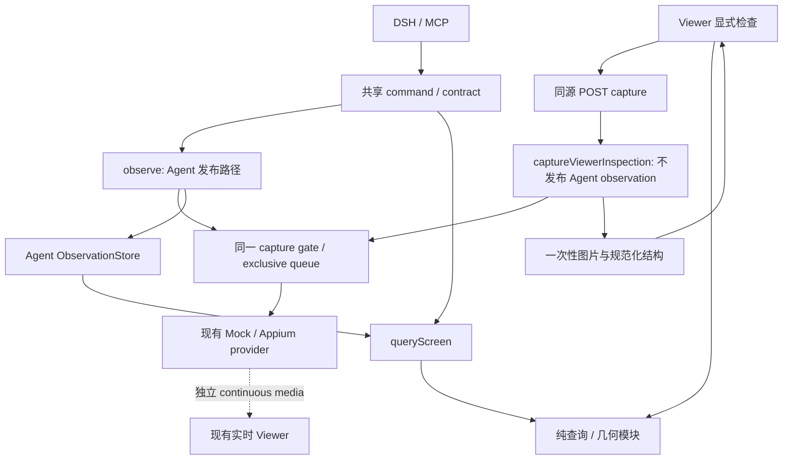

## Context

本方案对应用户选择的“observation 内查询 + Viewer 节点检查”，状态为 **Implementing / 验收中**。基线为 `REDACTED_REVISION`（2026-09-07）；当前支持 DSH `0.1.2-rc.1` Native/PTC，Node `24.19.0`。2026-09-15 已按用户授权开始实现，当前基线 REDACTED_REVISION；原规划目标与实际验收分开记录。

### 当前实现与问题

| 当前入口 | 已有事实 | 本次需要补齐 |
| --- | --- | --- |
| `src/mirror-service.ts` 的 `observe()` | geometry → PNG（可选）→ source；进入同一 exclusive queue；发布新的 Agent revision | 复用已捕获结构查询；让 Viewer 捕获不干扰 Agent 的 latest revision |
| `src/observation-store.ts` | 最多 4 条/session、TTL 60 秒、图片总额 32 MiB；动作还检查最新 revision/epoch/15 秒 | 增加只读访问语义，不能借查询续期或放宽 action 校验 |
| `src/screen-source-normalizer.ts` | 最多 500 节点、64 层、字段 512 code points、JSON 256 KiB；屏蔽 secure 节点 name/text/value | 只查询这些已规范化字段，不重新读取原始 XML 或引入白盒属性 |
| `src/tool-contracts.ts` / `src/mobile-mirror-commands.ts` | 统一九工具与 parser；`inspect_screen` 仅有 `includeImage` | 增加 summary 投影和一个查询工具，避免多个适配器重复业务逻辑 |
| `viewer/app.js` / `styles.css` | PNG、MJPEG、WebCodecs 三种实时来源；Fit/50%–200%；独立错误/进度 | 冻结截图的检查表面、节点导航和几何映射，不能给实时视频叠旧框 |
| `src/viewer-server.ts` | loopback、CSP、POST Origin、独立媒体路径 | 同源、有限响应的一次性本机检查捕获；无 observation 列举/下载目录 |

ViewInspectKit 仅提供设计参考：按字段与区域查询、属性按需展开、明确坐标来源。不引入其 SDK、OID 命名空间、评分式自动选目标或设备控制栈。

## Goals / Non-Goals

**Goals:**

1. Agent 可以先获取摘要，再在同一 observation 中查询、分页、读详情；查询本身对 provider 请求数、revision、epoch 和 TTL 的增量均为零。
2. 用户能在 Viewer 对一张有明确时间的截图检查节点、父子关系与矩形边界；选择操作绝不触发设备输入。
3. Viewer 检查捕获不替换、逐出或延长 Agent observation；现有严格动作保护保持不变。
4. 所有输出有界、敏感字段脱敏；长捕获可取消，失败保留仍有效的旧检查结果；Stop、状态、语言、主题和缩放保持可用。
5. Mock 与 fake Appium 给出确定性验收，真实 Android/iOS 和真实模型作为独立证据层。

**Non-Goals:**

- 不增加 Inspector 内设备点击、输入、属性修改、定位器执行或自动点击唯一结果。
- 不增加任意 XPath/CSS/regex/脚本查询、模糊评分、OCR、颜色字号/约束检查、跨 observation 稳定节点 ID。
- 不增加多设备 daemon、写租约、ViewInspectKit SDK、白盒 provider、录屏/瞬态 burst、截图导出或跨会话历史。
- 不把原始层级、500 节点以前被裁掉的数据或设备侧原子快照作为能力承诺。
- 不把 Inspector UI 当成 Agent 操作的前置条件；不改 Harness agent loop 或已有业务输入语义。

## Decisions

### 1. 一个查询工具，三个操作；采集与投影分开

新增第十项工具 `mobile_mirror_query_screen`，操作为 `find|get|subtree`。不扩展 `inspect_screen` 成“既采集又偷偷读缓存”的混合命令，因为调用者需要明确知道是否产生设备请求与新 observation。

`mobile_mirror_inspect_screen` 新增可选 `structureMode: 'full' | 'summary'`，默认 `full`：

- `full`：旧输入/旧输出逐字段保持兼容，不为了增加模式而改变既有结果形状。
- `summary`：仍执行一次正常 fresh observation，完整结构照常进入 Agent store；返回原有 observation 元数据及 `structureSummary: {nodeCount, truncated, truncatedReason?}`，不返回 `structure.nodes`。
- `includeImage` 与上述模式正交。`summary + includeImage=true` 在授权时仍产生一次原有 image/attachment；`summary + includeImage=false` 和所有 query 都不产生图片。
- Core capture 返回原始 observation；共享 commands 增加显式的 observation 投影选择。DSH/MCP 只能按这个选择生成摘要与图片，不能在 adapter 内重复查询或重新拼完整节点。
- Output schema 使用两种 object 分支：full 维持旧契约，summary 要求 `structureSummary`、禁止 `structure`；分支不依赖新增必填字段区分。DSH output projection 与 MCP `structuredContent` 必须接受等价结果。

推荐调用链：

```jsonl
{"tool":"mobile_mirror_inspect_screen","args":{"structureMode":"summary"}}
{"tool":"mobile_mirror_query_screen","args":{"observationId":"<returned-id>","op":"find","text":"登录","textMatch":"exact","role":"button"}}
{"tool":"mobile_mirror_query_screen","args":{"observationId":"<same-id>","op":"get","nodeId":"<returned-node-id>"}}
```

此流程省去首次整棵树的宿主输出；不会降低第一次 Appium `/source` 的成本。小页面只需一次 full inspect 时可以继续用旧方式，不宣称 query 总能减少轮次或延迟。

### 2. 查询输入采用可验证的严格规则

共同输入为 `observationId`（非空、不超过 128 字符）、`op`；get/subtree 的 nodeId 同样非空、不超过 128 字符。所有未知键、错误类型、非有限数字、非法组合必须在读取 store 前拒绝。

| 操作 | 可用参数 | 默认与限制 |
| --- | --- | --- |
| `find` | `text`, `textMatch`, `caseSensitive`, `identifier`, `role`, `region`, `visibleOnly`, `actionableOnly`, `offset`, `limit` | `textMatch=contains`；`caseSensitive=false`；`visibleOnly=true`；`actionableOnly=false`；offset=0；limit=20，范围 1–100 |
| `get` | `nodeId` | 必填；返回该节点详情，不应用可见性过滤，不接受分页或 find 参数 |
| `subtree` | `nodeId`, `depth`, `offset`, `limit` | 根必填，depth=2，范围 0–8；包括根节点；offset=0；limit=20，范围 1–100；不应用 find 过滤 |

字符串查询非空、最多 128 Unicode code points / 512 UTF-8 bytes，不做静默 trim；允许普通空格，不接受控制字符。`textMatch/caseSensitive` 没有 `text` 时拒绝，offset 必须为 0–500 的整数。role 使用现有 `ScreenNode.role` 枚举；不增加任意 platformRole/类名执行语义。

匹配顺序与含义：

1. 各种已提供过滤条件为 **AND**。text 可在同一节点的已脱敏 name/text/value 中任一匹配；identifier 始终大小写敏感、完整匹配。
2. textMatch=exact 比较完整字段；contains 做字面子串匹配。非大小写敏感使用 Unicode `toLowerCase()`，不依赖系统 locale、不做 NFKC、不采用正则或相似度排名。
3. visibleOnly=true 必须满足节点显式 visible=true、bounds 为有限正矩形且与 viewport 有正面积交集；false 表示不按该条件筛除。未知值不是 true。enabled、actionable 等属性缺失统一显示“未知”，不补默认真值。
4. actionableOnly=true 要求 visible 条件及 enabled=true、actionable=true；这是对捕获数据的筛选，不是设备动作授权或 hit-test 证明。false 不筛除任何节点。
5. region 为 top/bottom/left/right/topLeft/topRight/bottomLeft/bottomRight/center。按节点与 viewport 交集的中心归一化为 u/v：[0,1/3) 为左/上，[2/3,1) 为右/下，中间为 [1/3,2/3)。角区域取两个条件交集，center 取中间区域交集；缺少可映射矩形不能匹配区域。
6. find 保持原 observation 数组顺序；subtree 按父子关系前序遍历、同级保持原数组顺序；get 精确查 nodeId。都不重新生成节点 ID。
7. 层级出现重复 ID 或环时返回 `screen_structure_invalid`；缺失 parent 的节点作为截断边界，详情返回 `parentAvailable=false`，不虚构祖先。正常叶节点与“source 已截断”分别表示。
8. find 允许无显式字段过滤，用默认 visibleOnly 和分页浏览可见节点。offset 超出结果返回成功空页；不存在的 get/subtree 根返回 `screen_node_not_found`。

不采用 ViewInspectKit 的加分法：区域加减分、多个条件部分命中会让 Agent 误以为拿到严格匹配。命中多个节点时直接返回多个，不自动选择或执行。

### 3. 输出预算、分页与“没有找到”的证明范围

统一输出：

```ts
type ScreenQueryResult = {
  observationId: string
  frameRevision: number
  screenEpoch: number
  capturedAt: string
  captureEndedAt: string
  expiresAt: string
  op: 'find' | 'get' | 'subtree'
  actionBinding: {
    status: 'current' | 'superseded' | 'screen-changed' | 'action-expired'
    validUntil: string // min(captureEndedAt + 15 s, expiresAt)
  }
  source: { nodeCount: number; truncated: boolean; truncatedReason?: string }
  nodes: ScreenQueryNode[]
  page: {
    offset: number
    returned: number
    totalMatches: number // 只计已捕获且符合本次条件/深度的节点
    nextOffset?: number
    limitedBy: Array<'limit' | 'bytes'>
    depthLimited: boolean
  }
}
```

- ScreenQueryNode 保留 nodeId、parentId、role、identifier、bounds 和已知状态。find/subtree 提供 name/text 的 128 code point 摘要及 `fieldsTruncated`，不带 value；get 返回完整的已规范化节点（字段原有上限不变）、`parentAvailable` 和 `capturedChildCount`。get 不塞入最多 500 个 childId，子节点通过 subtree 分页获取。
- 匹配使用完整的已规范化字段，之后才做展示摘要；必须标记摘要截断，不能让缩略文本参与 exact 匹配。
- 结果 JSON UTF-8 上限 **64 KiB**，在完整元数据和分页信息计入后按完整节点收纳。因字节预算提前停止时 nextOffset 指向第一条未返回的匹配节点，不跨页丢项。
- limit 和 bytes 分别记录；subtree 的 depthLimited 与 source.truncated 分别记录。get 至少能容纳一个最大合法规范化节点；若未来节点扩展导致单节点超额，返回 `screen_query_result_too_large`，不输出半个节点。
- `totalMatches=0` 只证明当前保留结构中未匹配。source.truncated=true 时，文档与 Viewer 空态必须明确不能推断完整设备页面不存在该元素。翻页不重新访问设备，也无法恢复源捕获时被裁掉的节点。
- 原始 XML、Appium element/session id、图片 bytes/Base64、文件路径、查询串回显都不进入 query 结果或错误。页面 name/text 属于显式授权查询内容，不进入额外 debug 日志。

### 4. 可读取与可操作使用不同有效性判断

`ObservationStore.getForRead(id, generation)` 负责 TTL、容量逐出、session generation 和不可变读取；不会执行 latest revision/epoch/15 秒 action 校验，不更新 capturedAt/expiresAt，不调整 LRU 顺序。保留 `getForAction` 行为及 `MirrorService.#requireFreshObservation` 的严格动作路径。

| 状态 | query | 带 observation 的 action |
| --- | --- | --- |
| 最新、同 epoch、≤15 秒、在 store | 成功；actionBinding=current | 仍须通过节点、策略和 provider 检查 |
| 同 session，后来发布了新 observation | 成功；superseded | 拒绝 stale |
| 同 session，设备经本 runtime 动作改变 epoch | 成功；screen-changed | 拒绝 stale |
| 已过 15 秒，但尚在 60 秒 TTL 内 | 成功；action-expired | 拒绝 expired |
| TTL 到期/容量逐出 | expired/stale 错误 | 拒绝 |
| session stop/替换 | session_mismatch 错误 | 拒绝 |

多个原因并存时 actionBinding 优先级为 screen-changed → superseded → action-expired → current。这是查询时刻的元数据，不保证之后动作成功，也不能检测未被 runtime 观察到的外部触摸/动画。

Agent query 再次检查当前结构分享策略；默认 mock-only 对物理设备仍拒绝，即使调用者猜到 ID 或 Viewer 正在显示设备。query 仅使用 Agent store，没有 Viewer inspectionId 的解析入口。无结构的 snapshot-only observation 返回 `screen_structure_unavailable`。

读取最多 500 节点，不进入 provider exclusive queue。查询期间允许状态读取、Stop 和其他捕获；同步纯计算后再做 generation/取消检查即可返回，不引入长期跨 await 的 observation 引用。

### 5. Viewer 获取独立、一次性本机 inspection

不直接调用现有 `observe()`：它会创建新的 Agent revision 并可能逐出 Agent 正在使用的 observation。不在 Viewer 启动时自动抓取，也不每秒采集无障碍结构。



新增 `MirrorService.captureViewerInspection(signal)`，返回内部 `ViewerInspectionSnapshot`：inspectionId（随机，仅本地关联）、不透明 generationToken、screenEpoch、capturedAt/captureEndedAt、expiresAt、viewport/orientation、PNG bytes 和规范化结构。**不包含 Agent observationId、frameRevision，不写入 Agent store，不更新 latestObservationRevision、screenEpoch、Agent observation phase 或连续媒体状态。**

允许纯抽取共用 capture 函数，但不得把授权/发布混成传入任意 purpose 的公开工具参数：

- Agent 走原 `#authorizeObservation` 和 observation 发布路径；Viewer 只能由同源 HTTP adapter 调用专用方法。
- 当前语义规定“Viewer 本机显示不因 Agent 分享策略改变”。Inspector 延续本机显示边界：用户显式点“检查界面”才获取本机 PNG/结构，三种 Agent 策略下均可本机查看；不修改策略、不向宿主推送数据。入口文案说明“仅在本机查看；不会自动发送给 Agent”。
- sensitive 节点使用同一个 normalizer；图片仍是实际画面，不能宣称像素已脱敏。
- Inspector 与 Agent 共用单捕获互斥。已有任一捕获时另一个捕获立即返回 `screen_observation_in_progress`；不无限排队。控制仍走既有 exclusive queue，status/Stop 不等待该队列。
- 从调用开始的总预算为 `min(startupTimeoutMs, 10_000)`，含等待既有控制的时间。capture 顺序为 geometry-before → PNG → source → geometry-after；geometry 的 origin/size/orientation 改变则丢弃，返回 `viewer_inspection_geometry_changed`。这只能检测几何变化，不能证明动态内容原子一致。
- stop/session replacement/dispose/request disconnect/cancel 信号都能取消捕获；返回前再次核对 generation、epoch 和 signal。HTTP 请求体已读完后的浏览器 Abort 必须通过 response close 关联的 signal 传递，不能仅监听 request.aborted。
- 浏览器收到的数据仅属于该次本机 inspection，不能拿 inspectionId 调用 query/action；测试必须证明“Viewer 捕获前的 Agent observation 在原 freshness 内仍可操作”。

### 6. HTTP 使用一次性有界响应，不新增可遍历资源库

| 路由 | 请求/响应 | 边界 |
| --- | --- | --- |
| `POST /api/inspection/capture` | 请求 `{}`；响应 metadata + `image:{contentType:'image/png',width,height,base64}` + 完整规范化 structure | 仅固定来源；必需精确 Origin；禁止多余键/参数 |
| `GET /api/state` | 在 Viewer 专用 projection 增加 `inspectionContext:{generationToken,screenEpoch}`，非 streaming 时为 null | 不加到 DSH/MCP MirrorState，不含节点或文字 |
| `GET /inspection-query.js` | 共享纯查询模块的浏览器构建结果 | 固定静态路径，不允许任意 lib 文件路径 |

选择一次 JSON 响应是为了原子替换客户端的图片与树、复用现有错误处理，避免维护第二个 server-side store 与可重取图片 URL。Base64 仅存在于这一个本机 HTTP 响应，不进入 Agent tool/attachment；代价是编码与短期内存开销，使用严格预算约束。

- 请求最多 1 KiB，PNG 原始 bytes 最多 8 MiB，规范化结构最多 256 KiB；单次完整响应（含 Base64）最多 **12 MiB**。声明的 Content-Length 及实际流式读取计数都校验，客户端超额立即 Abort。
- 单张解码图最多 16,777,216 像素，width/height 均不超过 16,384；编码前/解码前校验 PNG 尺寸；decode 后核对 natural dimensions。超限返回 `screen_observation_too_large`。这只是 Inspector 的可控预算，不调整旧截图工具上限。
- Server 全局最多 1 个 Inspector 捕获/待发送响应，直到 response finish/close 才释放 gate；发送受同一个 10 秒总预算约束，慢客户端不能无限占用内存。不排队第二个响应。
- 捕获/发送完成后不保存截图或提供再取接口；server 用 try/finally 释放临时引用并 best-effort 清零自有 bytes。JSON string/浏览器 Blob 的物理清零不可承诺。
- 复用 loopback、CSP、no-store、nosniff、frame denial；拒绝 Origin 缺失、跨源、Origin=null、错误 Content-Type。无 CORS 开放、任意 upstream、截图 list 或磁盘导出。
- HTTP 错误统一 `{code,message}`，400 参数、403 Origin、409 capture busy、410 context expired/changed、503 provider unavailable、504 timeout；关闭连接的取消不强行写响应。固定错误消息不包含 source/text/URL/设备标识。

### 7. 检查模式始终对应冻结截图

默认是现有实时预览；工具栏新增“检查界面”。进入后立即显示本地捕获进度，旧实时画面继续可用。PNG decode 与树校验都成功后才一次性替换检查数据并进入检查模式。

桌面原型（不增加第三条全页侧栏）：

```text
┌ 既有连接/状态区 ┐ ┌ 预览工具栏： [实时] [检查界面]    Fit  −  +  主题 ┐
│ 连接向导       │ │ 检查截图 · 捕获于 14:32:10 · 仅在本机查看          │
│ Agent 状态     │ │ [重新获取] [返回实时]                              │
│ Stop           │ ├───────────────────────────────┬─────────────────┤
│                │ │                               │ 搜索文本或标识  │
│                │ │     冻结 PNG + 选中边界框      │ [节点树] [详情] │
│                │ │     parent 虚线 / node 实线   │ 层级与结果列表  │
│                │ │                               │ 角色、文字、状态│
│                │ │                               │ x/y/w/h、父边距 │
└────────────────┘ └───────────────────────────────┴─────────────────┘
```

- 在 stage 可用宽度 ≥800 CSS px 时，内部为 `minmax(0,1fr) 320px`；不足时下排检查面板，截图与列表均有独立可滚动区域。880px 及以下继续继承现有外层单列；390px 不横向溢出、不覆盖 Stop/toolbar。按 stage 的实际宽度计算，不能只按 window 宽度。
- 默认显示节点树；搜索切换为匹配结果，支持 text/identifier 两种显式模式、角色、区域、仅可见、仅可操作过滤。搜索纯本地，100 ms debounce；无网络请求。空结果和 source 被截断使用不同提示。
- 节点树初始展开根及第一层，按需展开；结果每页 50 条（显式使用共享 limit 参数），按“加载更多”继续，不引入新虚拟列表库。实际总节点仍最多 500。
- 树节点、结果行和截图选择联动到同一 inspectionId+nodeId；高亮只用于本地。详情显示原始规范化角色/平台角色、允许的文字与标识、true/false/未知状态、bounds、父子关系和截断提示。
- 详情不显示不存在的样式数据，不把 actionable=true 称作“可保证点击”。不增加“执行点击”“输入文本”“保存图片”等按钮。
- tree 使用键盘上下/左右、Home/End 和 Enter/Space 选中，提供层级/展开/选中语义；Tab 可到搜索、刷新、返回实时和 Stop。Esc 退出拾取/检查并恢复进入按钮焦点。`aria-live` 只播报完成、错误、选中/过期，不按秒播报计时。
- 所有静态文案走 en/zh-CN 目录；动态节点文字用 textContent，不拼入 innerHTML、CSS selector 或日志。语言/主题切换不重捕获，不清掉有效 selection。

### 8. 坐标依据 inspection 自身，而非实时 renderer

现有 PNG/MJPEG 用 object-fit:cover，Android canvas 使用 contain。Inspector 新建独立表面，PNG **固定 contain**，不复用实时 canvas，也不改变旧 renderer 的适配方式。

设截图尺寸为 Wi×Hi，inspection 表面 content box 为 Wc×Hc，viewport 为 (Vx,Vy,Vw,Vh)：

```text
s = min(Wc/Wi, Hc/Hi)
Ox = (Wc - Wi*s)/2; Oy = (Hc - Hi*s)/2
node 在图片像素中的 x = (node.x - Vx) * Wi / Vw
node 在图片像素中的 y = (node.y - Vy) * Hi / Vh
node CSS x = Ox + imageX*s; node CSS y = Oy + imageY*s
width/height 分别乘 Wi/Vw*s、Hi/Vh*s
```

- bounds 先按 viewport 求交集，只对有限、正面积矩形绘制；不修改原始节点的 bounds。部分越界在详情保留原值和“部分超出可视范围”。
- overlay 为该 inspection 表面内的绝对定位 SVG/CSS 层，取真实 content box；滚动、Fit、50%–200% 和 ResizeObserver 只重算 CSS 几何，无 API 调用。CSS 坐标不额外乘 DPR，devicePixelRatio 不能进入节点坐标。
- 点击先减去表面 getBoundingClientRect 偏移和 letterbox，再逆变换为 viewport 点；letterbox/空白/装饰 bezel 不选节点。不做设备坐标请求。
- 候选按“树深度降序 → 可见交集面积升序 → 原始顺序”展示。存在多个候选时保留可见的候选列表和切换入口；这个次序只方便检查，不称作真实原生 hit-test。
- 父边界绘制独立虚线，显示 child 相对直接 parent 的 left/top/right/bottom **几何距离**：例如 left=child.x-parent.x，right=parent.right-child.right。单位标为 provider viewport 逻辑单位，不将其自动解释为 CSS px、dp 或截图像素。负值表示超出父 bounds；缺失父/几何时显示未知。不把距离命名为 padding/margin，不跨节点猜测布局所有者。
- 若 abs((Wi/Hi)/(Vw/Vh)-1)>1%，图片与树仍可分别查看，但关闭 overlay/拾取并提示坐标不一致；不得猜旋转、裁剪偏移或强制拉伸。非零 viewport origin、横屏、DPR=1/2 都是验收输入。
- 截图与 source 仍是顺序采集。提示“动画或页面变化可能导致位置差异，可重新获取”，不声称同一次返回就是设备侧原子快照。

### 9. UI 状态、失效与资源生命周期

状态分开：`mode=live|inspect`，`capturePhase=idle|capturing|error`，`snapshotStatus=none|ready|historical|expired`。一个 page-local requestSequence + AbortController 管理 capture；不复用会禁用所有动作的 `operationInFlight`。

| 事件 | 行为 |
| --- | --- |
| 首次进入 | 立即显示捕获反馈；禁重复捕获；live、Stop、status、theme、language、zoom 仍可用 |
| 捕获成功 | decode/结构/上下文均通过后一次替换；清掉旧 selection，不按旧 nodeId 自动迁移 |
| 重新获取失败 | 当前 snapshot 未过期且同 session 时保留图片、树、selection，并标明“获取失败，仍为之前的检查截图” |
| 捕获取消/关闭面板 | Abort；增加 requestSequence；迟到结果不准恢复已关闭面板 |
| 同 session 的动作改变 screenEpoch | 当前检查标为 historical，显示“设备已变化”；仍可只读检查至 TTL，不自动跟随新画面 |
| Agent 只发布新 observation | 不刷新、不清空 Viewer inspection，也不改变它的 nodeId |
| 本机 TTL 到期 | captured response 的 expiresAt=captureEndedAt+60秒；清除该检查图片、树、选择和 Blob URL，保留“检查已过期”空态与刷新入口；普通实时 Viewer 保留其自身画面策略 |
| stop/start/replacement/dispose | backend Abort；Viewer 看到非 streaming 或 generationToken 改变立即清除 inspection；本页面触发 Stop 时先同步清除，不能等待 HTTP 成功 |
| state 请求失败 | 标记会话状态未确认，不接受新捕获或把数据说成当前状态；已有检查最多保留到原 TTL，状态恢复后立即重验 generation |
| 返回实时/pagehide | Abort，释放 snapshot/选择/搜索与 Blob URL，不持久化；重新进入需要重新捕获 |

浏览器最多保留 1 份成功 snapshot + 1 份进行中的候选，候选失败/取消即释放。已加载图片与解码资源在关闭/替换/过期时解除引用；不能声称 JS 清理会擦除宿主截图、用户复制内容或浏览器历史之外的外部副本。

现有 live renderer 在 inspection 下继续独立接收和更新（只隐藏其可见表面），切回实时不强制重连。Inspector 不调用 stopMedia/resumePolling，不改变 media subscription 数量或 keyframe 状态；媒体断流仍由原路径自动回退。设备 source 较慢时 PNG polling 可能暂时得不到新帧，必须保留最后画面，不承诺控制队列并发执行两个设备操作。

### 10. 模块与适配器改动

| 模块 | 计划职责 |
| --- | --- |
| `src/screen-query.ts`（新） | DOM/Node/DSH/MCP 无关的 parser 辅助、筛选、索引、分页、摘要投影；最多 500 节点的 O(n) 索引和遍历 |
| `src/screen-query-geometry.ts`（新） | 可见交集、region、contain 映射、候选排序与父子距离；纯函数 |
| `src/observation-store.ts` | getForRead；不续期、不暴露 list，不改变旧存储限额 |
| `src/mirror-service.ts` | query 的策略/上下文 envelope；独立 Viewer capture 身份与共享互斥/取消；Viewer-only context projection |
| `src/types.ts` / `screen-errors.ts` | 新输入/结果/固定错误，full/summary observation 投影类型；保持旧核心 observation 完整 |
| `src/mobile-mirror-commands.ts` / `tool-contracts.ts` | 一个共享输入 parser、query op 分支 schema、inspect summary 分支、十工具列表 |
| `src/tools.ts` / `mcp-server.ts` | DSH query 用 JSON data；MCP 用 text+structuredContent；query 不调用 saveImage/deferContext |
| `src/viewer-server.ts` | 同源 capture handler、response-close 取消、响应预算、固定 browser asset、inspectionContext |
| `viewer/inspector.js`（新） | 本地状态、一次性响应读取/校验、树/详情/overlay、requestSequence 和内存清理 |
| `viewer/app.js` / `index.html` / `styles.css` / `i18n.js` | 入口、stage 内部布局、独立静态表面、现有状态/媒体/zoom 的最小桥接 |
| `tsdown.config.ts` / `scripts/dev.ts` | 同一纯查询代码编译 browser entry 到 `lib/viewer/inspection-query.js`；build 先清理一次，再产出 Node 与 browser，避免 target 相互删除；dev 启动前生成 browser asset，不能依赖旧 lib |
| tests / runtime probes / docs | query 正负样例、十工具、summary+query、Viewer E2E 与 current documentation；历史 release 证据不批量改写 |

纯函数的输入固定为 `{nodes, viewport}` 与不含 observationId 的 `ScreenQuerySpec`，输出节点页/统计；Agent command 负责解析 observationId 并附加 actionBinding envelope，Viewer 只传自己的 inspection 数据。共享算法不等于共享存储权限，浏览器不得伪造 Agent observationId 来调用查询核心或得到“可执行”状态。

复用当前 tsdown，不引入 UI 框架/组件库/新包依赖。纯模块可复用 TextEncoder，不导入 Buffer/fs/saxes 或 DSH/MCP SDK；浏览器编译产物只包含所需 pure exports。打包与 source dev 分别证明 `/inspection-query.js` 可用。

新增工具 annotations 为 readOnly=true、destructive=false、idempotent=false（TTL/上下文可能变化）、openWorld=false（只读当前内存）。DSH 保持 documented defineTool seam，Native/PTC 的条件必填字段以共享 parser 为准；MCP 使用 object-root oneOf 对三个 op 约束字段，拒绝旁路或额外键。

### 11. 性能、验收与证明边界

以下是验收目标，不是本次测得成绩：

| 层 | 必验内容 | 证据 |
| --- | --- | --- |
| 纯函数 | AND/exact/contains/大小写、未知值、九区域、深度、重复节点/环、截断、分页无丢项 | Vitest fixtures；500 节点 warm query 100 次的 p95 目标 <20 ms，性能数字单独记录，不做易抖动逐用例 wall-clock 断言 |
| Core | 查询 0 provider 请求/0 revision/epoch/TTL 改动；15秒后可读不可操作；旧 observation、逐出、Stop | fake clock、spy、generation/epoch 断言 |
| Capture 隔离 | Viewer capture 不动 Agent latest/4条配额/attachment；mutual capture busy；cancel/timeout/response close | 慢 fake Appium + Agent strict action 回归 |
| HTTP/安全 | Origin/Content-Type/未知键、8MiB/12MiB/像素预算、错误脱敏、session/迟到结果 | ViewerServer integration；拒绝路径 provider 请求为零 |
| DSH/MCP | 旧九工具兼容、十工具等价、summary→find→get→既有严格动作；query 图片数=0 | built MCP 子进程与 DSH 0.1.2-rc.1 Native/PTC clean-profile |
| Viewer 几何 | 非零 origin、横竖屏、contain letterbox、0.5/1/2 zoom、DPR1/2、内部滚动、父子距、重叠候选 | 数值误差 ≤1 CSS px 的断言 + 截图人工检查 |
| Viewer 并发 | 800ms捕获/失败/取消时 Stop、theme、language、zoom可用；媒体继续接收/回退；捕获失败保留旧检查 | Playwright 记录请求与媒体 frame count；不伪造并行 Appium 动作证明 |
| 隐私/留存 | secure文字不出 query/树/日志；XSS fixture 只作为文字；TTL/stop/pagehide清理 | 输出扫描、Blob URL revoke/DOM/内存引用可观察点；不声称清零截图像素 |
| 真机 | Android与iOS各一份明确授权的非敏感页面检查、边界对应、取消/Stop | 分别记录机型/版本及脱敏最终截图；缺设备标为未验收 |

截图至少保留 `mobile-mirror-inspector-final.png`、`mobile-mirror-inspector-narrow.png`、`mobile-mirror-inspector-zoom.png`，以及实际执行失败/重试/恢复时的 `mobile-mirror-inspector-refresh-failed.png`、`mobile-mirror-inspector-recovered.png`。Mock 截图只证明 UI；fake Appium 只证明协议；真实图片模型消费、物理机校验分别记录。

仓库必需门禁为 `pnpm check`、`pnpm test:e2e`、`pnpm build`、`pnpm pack:check`、`git diff --check` 与本 change OpenSpec strict validation。因为会改变公开工具和 browser asset，实施后还需当前 public/package contract、packed MCP 和精确 DSH clean-profile。纯规划阶段仅验证文档与规格，不声称这些实现门禁已执行。

## Risks / Trade-offs

- [额外工具轮次可能抵消小页面收益] → 保持 full 默认；建议大型结构/多次定位用 summary+query，分别量化输出字节与调用时间。
- [冻结界面被误解成手机当前状态] → 常驻“检查截图/捕获时间”，epoch 改变标历史，过期清理，首期无设备动作入口。
- [本机检查扩大本机可见结构] → 仅显式操作与同源短期响应，保持 Agent 策略隔离；不声称本机画面已脱敏，不引入自动上传。
- [顺序采集产生动画错位] → 前后 geometry 检查、比例不符关 overlay、给出重新获取；不伪造设备原子时间戳。
- [Viewer 与 Agent 争用 provider 捕获] → 单捕获 fail-fast +10秒总限时；只读 query 不入设备队列；不通过更新 Agent revision 解决冲突。
- [12MiB JSON 对比二进制存在内存放大] → 一次性响应/单发送 gate/像素预算；必要时后续以测量证据改 binary transport，不先建资源服务。
- [source 截断导致“没找到”误判] → source、page、depth 三类截断分开；默认不自动刷新寻找缺失节点。
- [active OpenSpec 的八/九工具计数不同步] → 以 semantic-actions 的已实现九工具为前驱；本 change 的 MCP RENAMED 从九工具标题到不带数量的稳定标题，实施前用临时副本按顺序演练合并；不提前归档他人的未验收任务。

## Migration Plan

1. 先确认 base 仍为已支持 rc.1，读取 active semantic/zoom/localization 的最新状态；若并行改动触碰相同接口，先对齐本方案与 delta。
2. 先交付纯查询、只读 store 与 summary/query 双宿主契约；旧 Viewer 行为此时保持兼容。
3. 再交付隔离的本机 capture 与安全 HTTP，证明 Agent observation 不被污染；为新边界补充 ADR-0007（随实现评审后才 Accepted），同步 ADR-0002 的本机数据传输说明。
4. 最后接 Viewer Inspector、共享 browser build、几何/E2E/双语及运行截图，完成完整门禁。
5. 主 specs 合并先对齐 semantic-actions 的完整九工具 delta，再应用本 change 十工具要求；不将其未通过的真机任务勾完，不逆序应用旧九工具安装场景覆盖新十工具。若前驱标题已改名，则先更新本 change 的 FROM 名称，保持完整要求不丢失。
6. 更新当前 README/technical guide/MCP指南/验证矩阵；历史 alpha release 文档保持历史事实。新增版本/发布需走既有发布流程，本次没有发布或 push。
7. 回滚时移除第十工具、可选 summary、Inspector 路由/UI/browser entry；无磁盘或配置迁移。Agent 原九工具、Appium ownership、已有媒体和语言缩放保留。旧客户端始终可继续调用默认 full。

## Open Questions

无阻塞产品决策。首期默认已固定：只读检查、冻结截图、一个查询工具、不评分、不自动重捕获、不持久化、仅规范化无障碍字段。仍需实施时用数据验证 20ms 查询目标、12MiB 响应/16M像素预算及 Android/iOS 的实际 overlay 对应；它们是验收项，不是已具备能力。
