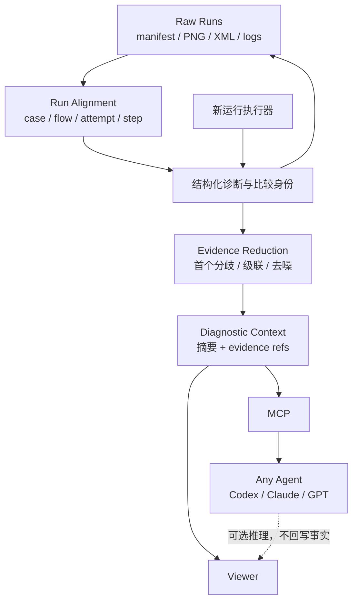

## Context

状态：详细设计，尚未实现。日期：2026-09-18。

目标是回答：这次与上次哪里不同、最早在哪里出现可确认差异、哪些证据支持失败分类、下一步应该检查什么。比较结果是辅助诊断，不改写测试通过条件。FlowAssert 负责确定性地回答“发生了什么”，任何上层 Agent 才负责基于这些事实推理“为什么”。

当前实现提供了基础材料：`src/workbench-store.ts` 保存 TestRun、RunStep、PNG/XML 清单和 SHA-256；`src/workbench-plan.ts` 保存编排路径；`src/workbench-suites.ts` 维护 case/数据行/attempt；`src/workbench-timing.ts` 区分执行和取证耗时；`src/workbench-recovery.ts` 保存恢复过程。现有路径主要由步骤位置产生，不保证 YAML 改动后稳定；现有错误文本也不足以可靠区分产品缺陷和驱动故障。

## Goals / Non-Goals

目标：
- 从历史运行选两次记录，在不连接手机、不调用模型的情况下生成可复核报告。
- 对齐步骤，比较截图、结构、断言、业务验证、清理、AI 恢复和耗时，保留证据链接。
- 对缺失、损坏、不匹配、未知做明确标记；Android/iOS 采用相同规则。
- Viewer 提供完整使用入口，报告重启后可读，计算不阻塞其他控制。
- 将 case、flow、attempt、业务验证、断言、设备/平台与 artifact 关系压缩为 Agent 可直接消费的 Diagnostic Context，支持按证据引用回钻。

首期不做：内置通用 AI Analyzer、AI 根因判定或 AI verdict、自动修复、自动修改 YAML、视觉通过门禁、性能统计回归门禁、视频逐帧比较、多次趋势、Allure、云上传。跨平台仅并排查看，不做自动结构或像素判定。MCP 输出是对现有已授权证据的只读诊断上下文，不是第二个设备控制入口。

## Decisions

### 1. 用独立只读分析层组合现有归档，并把领域语义前置给 Agent



分析层没有 MirrorService 控制权限，不获取手机租约。复用 runtime 已初始化的存储，增加专用只读快照读取接口；不得为了比较另行初始化会执行恢复逻辑的 store。读取、证据校验、分析失败均不得写回原 run 的 verdict、cleanup 或 manifest。派生图与报告写独立 comparisons 目录。

不采用新 Runner：重复控制与判定体系没有收益。也不先让 LLM 阅读全部材料：每个 Agent 都要重复文件发现、格式理解、case/step 对齐、动态噪声过滤与首分歧定位；这会扩大 token/tool-call 消耗、降低可复现性，并让历史查询无法复用。`Diagnostic Context` 把这些由领域语义可确定的工作做一次，Agent 只消耗紧凑摘要并在需要时沿 evidence refs 回钻。

这不是“项目内再造一个 AI”。AI provider、模型、prompt 与结论格式可由任意上层 Agent 替换；FlowAssert 的稳定价值是同一份原始运行材料得到同一份对齐、差异、证据覆盖和规则分类。未来 Viewer AI 解读若引入，必须只是该 Context 的可选消费者，显示为推测，且不能参与 verdict、事实或基线选择。

### 2. 先建立运行身份，再推荐基线

新运行增加 `comparison` 元数据，字段在启动时冻结：

| 字段 | 来源与用途 |
| --- | --- |
| contractVersion | 新比较记录契约版本；不是 YAML version 开关 |
| logicalTestKey | 项目登记身份 + flow 登记 ID；套件另外带 case ID、row ID，不用标题或文件绝对路径代替 |
| inputDigest | 类型参数及已解析输入的规范化指纹，不在报告暴露原始秘密 |
| planDigest | 展开计划、子流程、断言、扩展登记配置的规范化指纹 |
| executionContext | 平台、provider、驱动版本、设备型号、OS、屏幕尺寸/方向、runtime 版本；无法取得写 unknown |
| appContext | bundle/package ID、显式提供的 build/version；未提供不推断，不为采集版本额外操作手机 |
| implementationDigest | 可获取的可信扩展实现/worker 构建指纹，缺少时提示比较限制 |

未登记的 Viewer 临时 YAML 以输入计划指纹形成临时身份，只自动推荐相同计划；若改了内容，用户手动选择，标为人工指定。参数规范化严格保留类型；含秘密的指纹使用本机私有密钥 HMAC，报告不输出秘密或可枚举的裸哈希。密钥代次不同视为输入身份未知。

默认候选：同 logicalTestKey、inputDigest、平台、App ID，结束时间早于目标且 verdict 为 pass。排除 recovered、flaky 套件中的成功 attempt、取消及证据不完整运行。先按环境一致程度排序，再按时间降序；候选阶段只做清单检查，分析时完整验证引用证据。没有合适候选时不擅自换用其他用例。

App build 改变通常正是回归比较目的，因此展示变化并允许比较；OS/设备/provider/驱动变化则降低耗时可比性。未知字段不能当作相同。

| 可比状态 | 条件 | 行为 |
| --- | --- | --- |
| comparable | 身份、输入、平台一致且当前比较契约有效 | 按维度执行比较；仍逐项校验证据 |
| review-only | 人工选择不同输入/计划身份或不同环境 | 显示差异和限制，不给整体回归结论 |
| unavailable | 运行未结束、缺新契约、非法 ID、快照不可读 | 说明原因，原历史入口仍可查看 |

跨平台属于 review-only，只并排查看。单个文件损坏不会阻止其余有效维度分析，整体标 partial；不得把“有部分结果”呈现为全部已验证。

### 3. 保守对齐步骤，不制造虚假的首次失败点

执行器为新步骤记录 `stepKey`、`semanticDigest`、`ancestry`、`iteration`、`occurrence` 与原始 sourceLine/path。签名涵盖命令、目标、断言和作用域；参数只记录脱敏值或安全指纹。分支判断、循环进出和子流程调用也记录控制事件。

- 同 planDigest：按编译节点身份 + 调用路径 + 循环迭代对齐。源行只用于跳转。
- 不同计划：仅在相同结构上下文内匹配唯一且完全一致的语义签名，保留原顺序；交叉匹配、重复动作或变化后的断言标记 ambiguous/changed，不按第几个按钮强行配对。
- 新增、删除、分支未走到、循环次数变化分别呈现；取消后的未执行步骤不能算删除。
- 失败后恢复产生的观察和动作属于原步骤的恢复子时间线，不与正常步骤配对；原失败与最终 recovered 同时保留。

“首次可确认分歧”仅在顺序明确且此前所需比较维度完整的对齐前缀上产生。此前缺证据时显示“最早已观察差异，前序存在缺口”；不能称为真正首次差异，更不能称为根因。

### 4. 每个维度独立给出结果和证据状态

每维结果包含 `same / different / not-comparable / unavailable`、`complete / partial`、原因码、两侧证据引用和算法版本。

| 维度 | 首期算法 | 限制 |
| --- | --- | --- |
| 截图 | 相同尺寸/方向 PNG 解码后逐像素比较，输出差异像素比例、包围框及差异图；默认通道容差 0 | 不隐式缩放；动画、时间、电量变化只是画面差异，不等于失败 |
| 结构 | 安全解析 XML，优先唯一资源 ID/accessibility ID + 上下文；其次唯一稳定属性结构签名 | 重复节点不靠坐标猜身份；bounds/text/visibility 等分列；禁止外部实体 |
| UI 断言 | 比较声明内容、实际结果及关联观察 | 断言改变必须显示，不能把两个不同断言当同一判定 |
| 业务验证 | 按命名 verifier、阶段与受控字段路径比较结果 | 不抓取任意后端数据；只使用扩展声明可归档、可展示的字段 |
| 清理 | 对照 resourceCleanup、cleanup 与阶段诊断 | UI 成功但清理失败仍保留原失败语义 |
| AI 恢复 | 展示原失败、候选/决策、恢复动作、再次断言与终态 | abstain、策略拒绝、服务错误分开，不统称模型拒绝 |
| 耗时 | 墙钟、动作、等待、PNG/XML 取证、模型、业务阶段绝对差和比例 | 缺失不是 0，基线为 0 不计算比例；嵌套阶段不可叠加成总耗时 |

截图可显式指定两侧共用的矩形遮罩，必须显示遮罩并存其配置指纹；未遮罩原图始终可查看，遮罩不能改变测试断言。首期不自动识别动态区。不同尺寸只显示并排预览，预览缩放不参与计算。

耗时提醒默认要求增加同时达到 500ms 和 20%，仅表示“本次更慢”，阈值写入报告。环境不一致时关闭提醒，仅展示数值。两次测量无法证明统计显著的性能退化。

PNG 与 XML 是各自时间窗内采集，不声称同一原子现场。视频继续通过已有历史播放器跳到近似步骤时间，不做视频差异。

### 5. 失败分类是有证据的多标签，不是单一根因猜测

新增结构化诊断：`domain/code/phase/stepKey/retryable/evidenceRefs/observedAt`。在驱动、执行、取证、verifier、清理和恢复边界采集；既有展示文本保留，但不能只凭字符串匹配确定原因。

| 分类 | 可确认的事实 | 不允许推断 |
| --- | --- | --- |
| business-assertion | 独立 verifier 返回业务值不符合声明 | 不直接断言具体后端服务有 bug |
| ui-assertion | 目标/文本/状态断言不满足 | 不凭这一项排除遮挡、异步或错误数据 |
| device-driver | 命令超时、设备离线、会话失效等结构化事件 | ADB 超时不证明线材老化 |
| model-service / model-decision / policy | 服务错误、显式 refusal、abstain、策略拒绝分别编码 | abstain 不等于网络错误或产品失败 |
| evidence | 文件丢失、哈希不符、采集失败、材料不完整 | 不把缺图当作页面不存在 |
| cleanup | 资源清理失败或状态未确认 | 不因主流程成功忽略 |
| cancelled / unknown | 用户取消或证据不足 | 不强制归类成产品缺陷 |

报告分“观察事实”“可能解释”“建议检查”三段。事实必须指向事件/证据；推测明确标记 suspected，不输出伪精确概率。按事件发生顺序展示主要阻断与后续故障，可同时存在业务失败和证据缺失。原 verdict 原样展示，分析结果另存。

### 6. Evidence Reduction 产出可回钻的 Diagnostic Context，而不是替 Agent 下结论

Diff Engine 的完整逐步结果适合 Viewer 审阅与本机留档，但不应原样塞入每个 Agent 上下文。Evidence Reduction 必须以确定性规则生成紧凑的 `DiagnosticContext`：

```ts
interface DiagnosticContext {
  schemaVersion: 1
  comparison: { id: string; comparability: 'comparable' | 'review-only' | 'unavailable'; limits: string[] }
  subject: { logicalTestKey: string; flowId?: string; caseId?: string; attempt?: number }
  baseline: RunReference
  candidate: RunReference
  verdictFacts: { baseline: Verdict; candidate: Verdict; business: DimensionSummary; assertions: DimensionSummary }
  firstDivergence?: { kind: 'confirmed' | 'observed-with-prior-gap'; step: StepReference; facts: Fact[]; evidenceRefs: EvidenceRef[] }
  downstreamDifferences: StepReference[]
  classifications: ClassificationFact[]
  environment: EnvironmentDifference[]
  evidenceCoverage: CoverageSummary
  drillDown: { reportRef: string; evidenceRefs: EvidenceRef[] }
}
```

它只收录：运行身份与可比限制、两侧原 verdict、最早可确认/已观察分歧、由该分歧之后产生的级联差异、业务/断言/清理/设备等分类事实、环境变化、证据覆盖与稳定 ID 引用。它不收录原始 PNG/XML/log 的内容、秘密参数、宿主路径，也不将截图变化改写为业务失败。原完整报告仍可经 `reportRef` 和受控 `evidenceRefs` 查询。

“downstream/cascading”是诊断优先级，不是根因结论：仅当步骤在明确对齐路径上位于首分歧之后，且其差异可由未发生导航、未创建业务结果或未执行前置步骤等已记录状态解释时才标记；否则保持独立差异或 unknown。对同 logicalTestKey 的历史运行可按同一身份聚合首分歧位置、分类和环境切片，但聚合仅提供频率/覆盖/证据链接，不能从相关性断言因果。

### 7. MCP / Agent 契约：先给摘要，按需给受控证据

Viewer 与 MCP 使用同一 ComparisonService、同一报告版本和同一访问控制。首期 MCP-friendly 输出至少支持：列出可比基线、创建/读取比较、读取 `DiagnosticContext`、按已登记的 `reportRef`/`evidenceRef` 获取有限详情。工具返回先包含 Context 摘要和限制，Agent 明确请求后才读取一项受权的截图、XML 子树、诊断事件或报告片段。

这使任何 Agent 都能直接把问题聚焦为例如“step 8 tap 成功，但导航仍停在 ConfirmPage、业务 verifier 未见订单”，而无需先扫描数十份 artifact；同时仍能检查该结论引用的 step、assertion、verifier 与截图。MCP 不接受自由文件路径、批量原始归档导出或把材料转发给模型服务；Agent 的解释结果也不写回比较事实。

### 8. Viewer 交互与本机 API

入口：历史运行详情 → 与上次比较 → 基线候选（说明推荐理由）→ 确认分析。也允许手动选两条记录；第一版按单个 case attempt 比较，套件详情只提供跳转，不对整个套件自动下结论。

页面上部显示两侧运行、App/环境/计划变化、原 verdict 和证据覆盖；中部是可点击步骤对照时间线；下部按截图、结构、断言与业务、耗时展开。顶部突出最早已确认差异及限制；没有差异但有缺证据时不能显示“完全一致”。

拟新增路由均在现有 Viewer 鉴权与来源校验下：

| 接口 | 契约 |
| --- | --- |
| GET /api/workbench/comparison-candidates?runId=… | 有界候选与不可比原因，游标分页 |
| POST /api/workbench/comparisons | 输入 baselineRunId、targetRunId、显式遮罩/阈值；202 返回 comparisonId |
| GET /api/workbench/comparisons/:id | 状态、进度、摘要、限制；详情分页 |
| POST /api/workbench/comparisons/:id/cancel | 有界取消，保留上一个完整结果 |
| GET /api/workbench/comparisons/:id/artifacts/:artifactId | 校验后读取派生产物，禁止任意路径 |
| GET /api/workbench/comparisons/:id/report | 本机 JSON 报告下载，默认不打包截图/XML |
| GET /api/workbench/comparisons/:id/diagnostic-context | 受控、版本化的 Agent-friendly 摘要与 evidence refs |

状态：queued → running → completed / partial / failed / cancelled；重启遗留任务标 interrupted，不自动重新计算。受理与进度查询目标小于 300ms，大文件校验放 worker；进度按校验、对齐、各维分析、保存显示，不用虚假百分比。失败保留上一份报告，实时画面及无关控件继续响应。

### 9. 资源、安全与报告复现

默认单 worker、最多 4 个排队任务，超额返回明确 busy；同输入快照哈希、规则版本、选项的重复请求复用已完成且再次校验有效的产物。worker 硬超时 120s，取消 2s 未响应则终止；父服务独立记终态。初始预算：单图 16MP、单 XML 8MiB/深度 128/10万节点、每次 1000 步与 512MiB 输入、worker 堆 256MiB、派生产物 256MiB。解码前限制尺寸并串行处理图像；堆上限不等于原生解码内存上限，需测峰值并限制解码器缓存。超限逐项标 unavailable/partial，不静默跳过。

只接受已登记 runId/证据 ID；解析后验证真实路径仍在归档内，拒绝 symlink 越界。报告沿用本机授权，外部源拒绝；不把原始 XML、参数、密钥或图片发给模型。所有可展示字符串按文本渲染；结构解析拒绝 DTD/外部实体。下载页说明截图可能含业务敏感内容，不自动对外发布。

报告保存：输入 manifest 哈希、使用的每份证据哈希、rulesVersion、脱敏选项及摘要、对齐记录、分类依据、派生产物哈希。读入时一次性快照并校验实际参与计算的字节；结束时复核 manifest，变化标 stale，禁止当作当前结果。后续打开时校验派生产物，并区分原件已删除、变化与报告损坏。缓存从不覆盖历史报告；报告不包含宿主绝对路径。相同输入和规则产生相同分析内容，任务 ID/计算时间不参与内容摘要。

### 10. 工程落点与交付顺序

| 阶段 | 预计落点 | 完成边界 |
| --- | --- | --- |
| A：事实契约 | workbench-store、plan、worker、suites、recovery 及诊断产生处 | 新运行有身份、控制事件、结构化失败；原执行语义不变 |
| B：离线核心 | 新 workbench-comparison、comparison-worker、comparison-store 模块 | 可比性、对齐、各维比较、证据校验、报告和取消可独立测试 |
| C：上下文出口 | ComparisonService、现有 MCP adapter、Viewer server | 版本化 Diagnostic Context、受控 evidence drill-down；不引入模型调用 |
| D：产品入口 | 现有 Viewer server、历史 UI | 选择基线、异步比较、并排阅读、Context 预览、下载；截图与交互验收 |
| E：真实验收 | Fixture 场景、validation 文档 | Android/iOS 各一组正常对照、故意业务失败对照、重启复核；运行证据归档 |

首期不改 provider/transport 控制边界，因此不新增相关 ADR；若实施发现需要新控制权限，先更新方案与 ADR，再实施。

## Risks / Trade-offs

- 保守对齐会产生较多未匹配项，但比错误归因可接受；先不做模糊文本/坐标猜测。
- 原始截图动态区域噪声较多；用明确遮罩和 UI/业务断言交叉查看，不设置自动视觉失败阈值。
- 老记录无法加入新比较；保持原历史查看，重新运行产生新契约数据。不得为了便利加旧字段推断。
- App 构建与扩展身份未必齐全；明确 unknown 和环境限制，不能声称完整构建溯源。
- 大材料与 worker 原生内存可能影响媒体；预算、单并发、取消和慢任务交互必须实测。

## Migration Plan

不迁移、不回填、不删除旧记录，不新增 YAML version 门槛。新字段仅新运行产生；旧记录在比较入口显示“缺少比较元数据，请重新运行”，保留既有历史阅读。禁用新功能时仍能使用原历史和执行入口；派生报告独立存放，不反向污染原证据。

## Validation

1. 确定性核心：一致记录、业务值变化、UI 失败、输入类型变化、相同标题不同用例、重复动作、步骤插入、分支/循环/子流程、恢复、取消、清理失败。
2. 证据反例：PNG/XML 独立缺失、哈希篡改、解码失败、尺寸/方向变化、重复节点、DTD、超限、原件变化、任意路径、symlink 越界。比较前后原归档字节与 verdict 一致。
3. 归因反例：设备超时不指认硬件；abstain 不当作 refusal；未知保持未知；多个故障不互相覆盖；缺前序证据不宣称首次分歧。
4. 服务与 UI：排队、超时、取消、重启中断、缓存失效、分页、未授权访问；慢比较时无关控制保持可用，保留并检查 Viewer 运行截图。
5. Context 契约：验证 case/flow/attempt、首分歧、级联差异、分类、环境和覆盖摘要准确且可回钻；Agent-only 输出不得改变原比较内容、不得携带秘密或原始媒体。验证同一输入得到相同 Context，MCP 与 Viewer 输出同一 report/evidence ID。
6. 双端各跑相同 Fixture 正例两次，再与故意失败记录比较。另用受控派生样本验证损坏材料，不修改原真机证据。重启后逐个复核报告及引用哈希。
7. 完成 pnpm check、pnpm test:e2e、pnpm build、pnpm pack:check、严格 OpenSpec 和链接检查；更新能力表、TODO、验收记录，未验项继续开放。

## Open Questions

无阻塞设计的问题。资源预算和耗时提醒数值是首期工程默认值，需要通过大归档与真机验收校准；不能把这些数值表述为已测得的 SLO。
