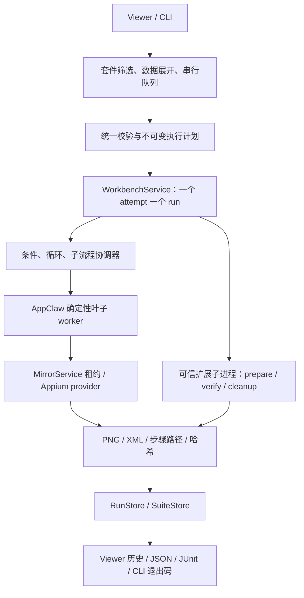

# 确定性回归能力扩展方案

设计日期：2026-09-16；2026-09-18 状态：代码与声明的双端编排、Fixture 业务验收已完成，tasks 22/22，尚未归档。这里的“三项”指流程复用与数据驱动、代码校验与环境清理、套件管理。以下 Context 保留设计前基线。

## Context

当前 `workbench-flow.ts` 接受两段 YAML、1–100 个扁平步骤，禁止插值和自定义代码，至少包含一个结构化断言。`WorkbenchService` 只有一个 active run，负责租约、worker、检查点、取消和持久化；业务/视觉验证默认为 not-performed。ADR 0006 规定 AppClaw 2.7.0 原生叶子执行与共享 Appium 会话。本设计保留这些设备和取证边界，但新增有限编排层。

## Goals / Non-Goals

目标：同一个流程可以覆盖多组公开测试数据；测试能独立核对业务事实并清理数据；整组用例可在本机和 CI 重复执行，失败有完整 lineage。

非目标：任意 JavaScript 表达式、敏感 UI 输入、AI 恢复、任意脚本安全沙箱、并行设备管理、自动安装/刷机、性能与音视频质量测试。首期支持注册的可信 JS/预编译 TS，暂不新增 TS loader。Android/iOS 使用同一编排语义，平台 selector 和 appId 显式提供，不自动翻译。

## Decisions

### 1. 参考对象及取舍

| 工作包 | 参考对象与官方依据 | 借鉴内容 | 为什么适合，为什么不整套引入 |
| --- | --- | --- | --- |
| A 流程复用与数据驱动 | [Maestro 流程控制](https://docs.maestro.dev/maestro-flows/flow-control-and-logic/flow-control-and-logic-overview) | 参数、条件、有限重复、子流程 | 面向移动测试且适合 YAML 维护。借语义，不切换设备栈、不兼容全部 Maestro 语法；用户已测的 iPhone fork 仍独立保留 |
| B 代码校验与清理 | [AppClaw SDK/fixtures](https://appclaw.in/usage)、[Playwright fixtures](https://playwright.dev/docs/test-fixtures) | 少量代码扩展、准备/验证/反向清理、资源作用域 | AppClaw 靠近现有执行层，Playwright 的生命周期可借鉴；完整 runner 默认掌管 session，直接接入可能和现有 owner 冲突 |
| C 套件管理 | [Playwright retries](https://playwright.dev/docs/test-retries)、[参数化](https://playwright.dev/docs/test-parameterize)、AppClaw runner | case/attempt 分离、参数用例、重试历史、汇总报告 | 使用成熟的测试管理模型，设备调度仍由本工程控制；不把浏览器 runner 当手机驱动 |

以上是当日在线文档能力参考，不表示本项目固定 AppClaw 2.7.0 包含上游最新 runner API。实现前锁定所需接口；第一版主要借鉴契约，不增加框架运行依赖。

### 2. 总体结构



新编排器只负责控制结构、绑定和调度，不重写 selector 或底层动作。条件查询经租约获取新 observation，查询失败不能当成 false。叶子执行必须保留当前检查点屏障；不能先将动态分支盲目全部展开并执行。

实现选择同一租约下顺序创建块 worker，连续叶子合并为一个块。已验证 AppClaw runYamlFlow 自动追加 done，worker 过滤超出输入步骤长度的合成回调；全局索引、inputModes 和证据屏障保留，跨块不另开 session。每步阶段计时保留，块启动开销仍属于执行器开销；不宣称性能优于旧单块流程。

### 3. A：流程复用与数据驱动

**用户收益**：一份搜索流程测试多组词；公共登录/导航只维护一次；已出现的提示页可以显式处理。

格式：统一采用 header + steps 两段，直接扩展当前解析器，不要求 version 字段，不维护旧 YAML 兼容分支。新增 `params` 声明 string/number/boolean、默认值；绑定仅接受完整标记 `{{ params.keyword }}` 或 `{{ outputs.seed.id }}`，不支持字符串拼接、求值、环境变量读取。只对明确的数据字段绑定，禁止改变命令名、扩展名或文件路径；解析后再校验字段类型、selector 与公开文字输入限制。

参数来自“声明默认值 < suite 公共参数 < 数据行 < 显式运行覆盖”；未知参数报错。数据集首期只支持已登记 JSON 对象数组，行有唯一 id；每行是独立 case。数据值只是数据，不二次解析为 YAML。

新增三种控制节点：
- `runFlow: {ref, with}`：ref 指向项目登记的子流程。预检整个依赖图，拒绝循环引用、越界路径和平台/appId 冲突；子流程没有独立 session 或 done 终止根流程语义。
- `if: {condition, then, else}`：condition 仅支持参数 equals、platform、结构化 visible/notVisible；取证记录所走分支，不支持内联 JS。必须能区分“确实不在”与“设备查询失败”。
- `repeat: {times, steps}` 或 `{until, maxIterations, steps}`：二者互斥；until 采用先检查再执行，未满足就有界重复，耗尽为 fail，查询错误为 inconclusive。

初始上限：每文件 64 KiB、项目快照 1 MiB、嵌套深度 5、循环每节点最多 20 次、每行最坏路径不超过 500 个叶子步骤、数据集最多 100 行、单 attempt 10 分钟。静态检查最坏预算，运行再计数；资源数值后续只能通过显式契约调整。所有分支预检，实际路径必须执行至少一个 UI 断言才允许 pass，不能因跳过分支而空通过。

统一 YAML 示例：
```yaml
name: 搜索回归
platform: android
appId: com.example.demo
params:
  keyword: {type: string}
---
- runFlow:
    ref: open-search
    with: {}
- type:
    into: {id: search_input}
    text: "{{ params.keyword }}"
- assertVisible: {text: "{{ params.keyword }}"}
```

落点：新 workbench-plan/composition 模块，扩展 flow 入口但保留旧 parser；native step ID 与逻辑 stepPath 分开。证据记录 root/subflow/iteration/leaf 路径、源文件行、参数快照、条件观察与选择，重跑使用原快照或显式“以最新版本运行”。首期仅注册项目支持文件依赖，Viewer 粘贴 YAML 不能借此任意读取宿主文件。

### 4. B：代码校验与环境清理

**用户收益**：运行前创建测试数据，UI 执行后通过业务接口确认结果，失败也能清理。页面成功提示不再是唯一判断依据。

本机项目配置维护扩展注册表：name → 打包 JS 文件、输入/输出 JSON schema、角色、超时、凭据引用。YAML 只引用 name/args/as；不允许路径、shell 或 eval。快照包含 flow、数据集、扩展 bundle、依赖锁与 hashes；拒绝不能固化的动态依赖。可信模块可执行任意宿主代码这一事实必须明确，子进程隔离只解决生命周期，不是安全沙箱。

生命周期：预检/快照 → 获取运行租约 → prepare → UI steps → verify → cleanup → 校验材料并终结。扩展不创建手机会话；首期扩展仅负责数据/API，不提供设备写操作。UI 失败默认跳过验收 verify，仍执行 cleanup；诊断读取不能覆盖原失败。

prepare 返回命名 publicOutputs 和 cleanupToken；允许创建资源后立即登记补偿信息，避免“创建成功但返回失败”丢失清理线索。多 prepare 顺序执行，成功登记的资源逆序清理，首期不实现任意 fixture 依赖图或 worker 共享 fixture。cleanupToken 单独私有存储，不进入普通报告。

verify 返回 `{verdict: pass|fail|inconclusive, expected, actual, source, artifactRefs}`，输出必须符合 schema。明确值不匹配为 fail；超时、接口不可达、输出不合法为 inconclusive；未配置保持 not-performed。业务证据至少包含关联资源 id、接口/查询身份、读取时间与脱敏结果，不能仅返回 success。最终 pass 要求 UI 断言、所有必选 verifier、必需证据以及 cleanup 均通过；保留各分项，cleanup 失败不能抹去已观察到的业务失败，但必须阻止干净通过。

每扩展默认 30 秒、最大 60 秒，输出上限 256 KiB，纳入 attempt 总预算；取消后停止新增工作，回收扩展进程树和在途设备请求，再用独立的最多 30 秒 cleanup 预算尝试补偿。终态后丢弃迟到结果。清理失败记录资源引用与人工清理指引，不自动重试未知副作用。SIGKILL 后标记中断和 cleanup pending，不宣称回滚；重启不自动重放写操作。

API 凭据仅按注册引用注入该扩展的最小环境，禁止进入普通快照、UI、日志；屏蔽已知值并仅导出 schema 允许的结果字段，不能保证恶意可信模块不泄漏。密码/UI 敏感输入仍禁用；A 的数据绑定只接受公开字段。

落点：独立 workbench-extensions/extension-host，workbench-service 增加阶段调度；RunStore 新版 manifest 保存 extensionResults、cleanupResults、scope 和 artifact refs；旧 schema 1 历史按既有含义展示。

### 5. C：套件管理

**用户收益**：一次运行选定的一组回归，看到每个数据行、每次尝试和失败原因；CI 能可靠决定是否放行。

suite 配置声明已登记 flow 引用、标签、数据集、公开参数、stopOnFailure、预算和 retryPolicy。选中设备必须匹配用例 platform，不自动选另一台设备或改连接。首期一条串行队列、一台当前设备；Android/iOS 在对应设备分别运行同一套件的平台用例。混合平台未明确筛选则预检失败，不能静默跳过并报全绿。

结构：SuiteRun → CaseRun(flowId + dataRowId) → AttemptRun(runId)。SuiteStore 保存不可变计划与事件，复用独立 run 的截图/XML/视频，不另存一份相同材料。每个 case 从 prepare 开始，cleanup 完成后才执行下一个；未声明重置条件的用例要明确依赖既有 App 状态。首期不承诺全新安装级隔离。

服务内套件排队与手工单次运行互斥；设备租约仍按 attempt 管理。跨 attempt 若 session identity 变化、动作状态不确定或清理失败，停止剩余队列，不换设备续跑。任意宿主另开服务不在当前内存租约保护范围。

自动重试默认 0，最高 1；只有用例显式 retrySafe 且声明并成功执行 reset prepare、上次 cleanup 完成、设备无未知在途写入，才可创建新 attempt。网络超时或发送结果未知不盲重跑。第一次失败第二次通过标记 flaky，原始失败永久保留，默认 CI 非零。

命令接口由现有 CLI 增加 `test suite <registered-id> --tags ... --report-dir ...`，连接现有 loopback runtime，共用调度器，不偷偷启动 Appium。首期 JSON + JUnit + Viewer 历史，HTML 独立报告、分片和多设备并行延后。退出码建议：0 全部选中用例干净通过；1 fail/flaky；2 配置或基础设施不确定（优先于 1）；130 用户取消。零匹配返回 2；未执行用例显示 skipped/cancelled，不算 pass。JUnit 对 inconclusive/flaky 显式 error/failure，并链接各 attempt 证据。

取消套件先冻结队列，再取消当前 attempt 和有界 cleanup；中断后不自动续跑，显式重跑产生新的 suite lineage。Viewer 显示排队/准备/执行/验证/清理/归档进度、case 与 attempt 树；长操作保留旧结果，历史和媒体查看仍可用，控制入口遵守租约。

### 6. 完成后覆盖哪些缺口

| 原缺口 | 本次覆盖 | 仍未覆盖 |
| --- | --- | --- |
| 1 变量与数据驱动 | A：类型参数、公开输出绑定、JSON 数据集逐行测试 | 任意表达式、数据库自动枚举、敏感 UI 数据 |
| 2 条件/循环/子流程 | A：受限分支、有界重复、注册子流程 | 通用脚本语言、无界循环 |
| 3 代码与业务校验 | B：可信 JS/编译 TS、API 数据准备、独立结果核对 | 任意不可信代码、业务 verifier 自动生成 |
| 4 自然语言/视觉恢复 | 不覆盖 | 保留 AppClaw/Midscene PoC 独立计划 |
| 5 手势/系统操作 | 不新增；复用现有动作 | 长按、拖拽等独立补齐 |
| 6 环境管理 | B+C：数据准备/清理、每用例重置契约 | App 安装/刷机、全环境隔离、设备农场 |
| 7 套件/CI | C：串行、筛选、安全重试、分项汇总、JSON/JUnit/退出码 | 多设备并行、分片、云调度 |
| 8 专项验证 | B：提供业务持久化/API 核对接入点 | 弱网、性能、音视频质量、视觉差异检测 |

不按百分比宣称覆盖率；完成后属于“可维护、可核验的小规模本机回归套件”，覆盖数量需对真实用例清单逐项统计。

## Risks / Trade-offs

- 新 DSL 扩大维护面 → 统一格式、只有少量控制节点、叶子仍由固定 AppClaw 执行；不宣称 Maestro YAML 兼容。
- 拆块改变原生 done/索引/耗时 → 先验证块执行与检查点屏障，正反例和取消测试通过再接 UI。
- 数据准备产生外部副作用 → 专用测试环境、资源登记和逆序补偿，未知结果阻断重试。
- fixtures 成功但业务真值不可信 → verifier 保留 source/expected/actual/证据，使用受控测试 API 正反例验收，不以第三方 App无业务接口的场景证明后端正确性。
- 串行吞吐有限 → 先测耗时；并行需要多 runtime/session 管理的独立架构，不在本次隐式引入。

## Migration Plan

A → B → C 三个可独立验收工作包，同一 OpenSpec 追踪。按用户调整取消 YAML 版本门槛和旧格式兼容要求。manifest 的 schemaVersion 属于证据存储协议，保持可选字段扩展；历史证据不删除。先更新 ADR 0006 和未归档基础规格，再交付新运行行为。

验收：A 用两组数据、嵌套子流程、真假条件、上限/循环引用/注入反例；B 用可控测试 API 的持久化真值/错值/超时、部分 prepare、cleanup 失败/取消/强杀反例；C 用 pass/fail/inconclusive/flaky/零匹配/取消/中断套件，验证退出码及重启可追溯。每阶段跑 pnpm check、pnpm test:e2e、pnpm build、pnpm pack:check；Viewer 保留并检查截图。最后在 Android/iOS 真机各跑多数据流程和故意失败反例，确认最终状态截图、源树、manifest 哈希和 lineage；业务持久化验收必须使用具有独立测试接口的自研 App。没有该测试对象时只标记受控 API 验证通过，不代替真机业务验收。
