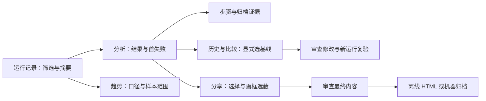
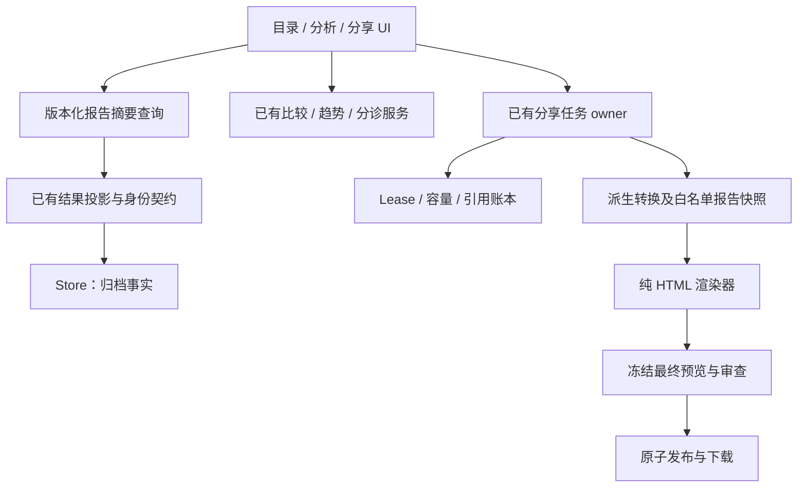

## Context

方案基线：2026-10-06 远端 `dev@REDACTED_REVISION`。主工作目录 `dev@REDACTED_REVISION` 有用户未提交内容，因此本轮只新增规划目录，实施前必须切到包含基线的干净工作区。本方案状态为 **待实施**，完成规划不表示用户体验或工程验收通过。

本次已在基线独立副本启动 Viewer，以仓库脱敏 iOS 失败归档走通“运行记录→首失败分析→安全导出选择”。截图保存于 `本机 Codex 可视化目录 report-audit/`（本机审阅材料，不是仓库依赖）。样本 PNG 只有 68 B，不足以评估真实图像、缩放、录像和大数据性能。

| 现状证据 | 用户成本 | 本次改进 |
| --- | --- | --- |
| `journey.js` 把名称、verdict、平台、设备、ISO 时间拼成链接，独立运行逐条设标题 | 难以扫读多个失败与设备差异 | 固定列、状态徽标、短原因、结构化筛选 |
| `journey-analysis.js` 已默认首失败，三栏证据、源码联动 | 基础路径成立，但摘要过长、原始步骤名和小号页签密集 | 压缩首屏、业务名称、失败导航、证据大图 |
| `workbench-share.js` 以文件名选材料，手输像素坐标 | 使用者需理解文件结构及坐标系 | 按步骤选材料、图片上画框、整体预览 |
| `/api/workbench/history` 已有 50 条分页及 generation，趋势面板另有严格统计 | 无需重新建库，但目录和趋势割裂 | 新的摘要查询契约，复用原统计服务 |
| 既有 share jobs、像素转换、10 分钟 review token、来源映射与引用账本 | 能安全生成 JSON；接收者仍需导入产品 | 同一审查流程生成独立 HTML 阅读版 |

主流参考的边界：Playwright 提供单次报告筛选和 Trace 联动；Allure 提供附件、历史、重试；ReportPortal 强在跨运行筛选和缺陷归类；Maestro 提供移动测试 HTML 报告。此为官方文档对照，不是竞品同条件实测。

- https://playwright.dev/docs/running-tests
- https://playwright.dev/docs/trace-viewer
- https://allurereport.org/docs/features-overview/
- https://allurereport.org/docs/history-and-retries/
- https://reportportal.io/docs/work-with-reports/
- https://docs.maestro.dev/maestro-flows/workspace-management/test-reports-and-artifacts

## Goals / Non-Goals

**Goals:**

- 开发者从运行记录找到需要处理的失败，在同一分析页理解预期、实际、证据和下一步。
- 测试人员按设备、构建、用例与时间筛选，区分新增失败、持续失败、重试后通过与不可比较。
- 接收者双击 HTML 即可阅读已审查报告，不安装 Viewer、不启动服务器、不登录。
- 保持原始事实、材料可用性、验证范围、人工意见和派生副本身份各自准确；减少阅读负担时不隐藏影响判定的信息。
- 用同一结果投影解释旧/新归档、Android/iOS、Mock、导入、runtime 门禁及证据缺失。

**Non-Goals:**

- 本轮不做云托管链接、多用户权限、评论协作、通知系统、缺陷平台写入或自动提交 issue。
- 不新增 AI 根因引擎、DOM 时间旅行、网络录制、设备 daemon、自动基线选择或自动修复执行。
- 首版离线报告不导出录像、原始完整日志、原始 YAML、任意附件；不重做报告执行和结果裁决。
- 不新建前端框架或数据库。性能测量证明现有查询不可接受后，再单独讨论可重建索引。

## Decisions

### D1. 一个报告入口，四类阅读任务

顶层导航继续为“用例 / 运行记录 / 设备 / 管理”。“运行记录”内部提供“全部运行 / 用例历史 / 趋势”，默认全部运行；“用例历史”需选定 caseId 或明确 suite case 身份，无可靠关联的旧运行保留独立项。P0 交付全部运行，P1 交付用例历史，P2 接入趋势。旧“测试工作台”保留为高级入口，已有 URL 可继续打开。

选择保留原导航，而不是再增加“报告”顶层入口：执行记录就是报告源，避免让用户猜“运行记录”和“报告”的区别。页面只读路径不依赖设备就绪。

### D2. 可扫读的运行目录

桌面默认列为：结果、用例/运行名、首个失败摘要、平台/设备别名、构建、开始时间、耗时、操作。case/revision/hash/source 的完整技术身份在展开行中读取；显示构建未知，不能以最近构建补齐。运行中以阶段和已耗时呈现，不假装有最终判定。窄屏改为同信息优先级卡片，长文本截断可展开。

筛选包括结果、平台、来源、本地日期范围、caseId、构建及自由词；P0 至少交付结果、平台、来源、日期和词搜索，其余在 P1 完成。默认最近开始时间倒序、runId 作为同时间稳定次序；P0 不增加任意列排序。日期输入按当前显示时区解释，提交明确 UTC 区间，终点排除；中文界面用本地时间，展开可看 ISO 值与时区。查询超过当前预算或记录损坏时给出范围与原因，不静默少算。

顶部显示当前筛选集合的通过、失败、未确定、恢复后通过和进行中计数；取消/中断单列，不合并成产品失败。目录统计是“运行次数”，不称套件成功率；分页 50 条，在同一 query + generation 下统计与列表一致。普通通过按原运行结果计数，当前证据问题另标识，不能改写历史通过或声称已重新验证全部材料。

返回目录恢复筛选、页游标、滚动及焦点；有新数据时提示刷新，不把新旧 generation 拼在一起。自由词、设备名及 App 信息仅存当前会话，不自动复制到分享地址。旧 `#/runs/<id>?step=...&tab=...` 深链继续可用。

### D3. 分析页先回答四个问题

首屏固定顺序为：

1. **结果如何**：记录结果、运行名、平台/构建/时间/耗时；旁边是简短材料状态。
2. **哪里失败**：第几步、可读步骤名、预期、实际、失败数量，以及上/下一个失败。
3. **证据是什么**：桌面步骤列表、主要截图与上下文同屏；截图缩放/适应/原尺寸，结构和日志按需打开。
4. **下一步是什么**：查看前后步骤、选择基线、查看检查建议、审查后复验、导出。每个动作说明产生读取、草稿或新运行中的哪一种结果。

“概览 / 步骤与证据 / 历史与比较 / 分享”是主阅读任务；技术详情、原始 YAML、完整维度和来源进入抽屉或折叠区；分诊与人工复核作为失败解释的展开区域。旧 tab 参数映射到对应区域，保留 step；不把旧链接送到默认页面。

压缩摘要不等于折叠所有限制：证据缺失/损坏、派生未重验证、必需验证未完成、runtime 必需门禁失败或不支持始终显露。其余背景说明移入“结果如何判定”。“证据已复验”改为“材料完整性校验通过”，避免误解为测试再次执行。

步骤标签优先用归档的人类可读描述，缺少时按动作类型和脱敏目标组合，保留原始 kind 供查证。未知错误给出已记录内容和查看详情，不用自然语言生成确定根因。失败导航集合包括执行失败、checkpoint 错误及已声明验证非通过；运行级门禁失败显示独立“运行级检查”，不杜撰失败步骤。步骤内搜索不得改变失败总数或丢失当前选中项。

截图切换时可以保留上一张已核验图片，但必须显示其步骤身份和新步骤正在读取；迟到响应不能覆盖当前选择。读取失败在当前选择处显示错误与重试，绝不拿实时手机画面填补。现有视频仍在 Viewer 中按需播放、近似定位，不进入离线分享首版。

### D4. 结果语义集中映射

增加纯展示投影，由现有领域结果构造 `ReportSummary` / `ReportDetail`，集中做标签和说明。字段使用已有枚举，遇到未知枚举显示“不支持的结果项”及原值，不能映射成成功。原始 schema/判定算法不在 UI 内复制。

必须区分：recorded verdict、当前 evidence availability、UI/business/visual/cleanup 验证，以及 runtime contract v2 中必需功能的声明、执行状态、阈值与不支持原因。旧记录未声明 runtime 功能显示“未声明”，不是“0 个问题”；Mock 或 imported 来源持续可见。

离线材料的 hash 正确，只证明所带字节自洽，不是独立验收，也不是来源真实性签名。不能以打开 HTML 的时间更新测试完成时间。原始时间若因脱敏被移除，显示“未提供”；导出生成时间独立标注。

### D5. 历史、比较与分诊复用现有领域服务

用例历史展示明确身份对应的运行、修订、输入变化、构建和重试；同名不关联。选择两个运行后先列出比较范围：App、平台、输入、版本、环境、所需能力及材料可用性，再由用户明确选定基线。

默认可以排序候选，但不可自动把最近绿色运行设为基线。“新增/持续/已恢复”只在已有比较器能够建立有效关联时显示；缺字段、跨平台或输入不兼容时显示不可比较的原因，保留两份报告阅读能力。

比较结果将事实差异、排查建议、人工复核和子运行结果分区；复用现有 comparison、triage、investigation、repair 服务，不改变它们的权限和裁决。复验仍产生新运行；原失败固定保留，复验成功不自动标记为已找到根因。

P2 趋势使用已有计划套件/attempt 分母，明确首次通过率、干净通过率、flaky、缺材料、导入/派生排除数及不可比较分组。选中图表或统计进入同范围目录；若无法映射则明确说明，不能跳到不相关“全部运行”。不直接把目录的运行通过次数作为质量趋势。

### D6. 画框脱敏和精确审查

导出入口默认呈现按步骤分组的材料选择器，不自动勾选附件；“仅失败相关步骤”是显式快捷操作。用户在原图预览上拖拽矩形，支持选择、调整、删除和撤销；键盘可创建区域、调整位置/大小，数字坐标保留为精确方式。

存储统一用原始 PNG 像素坐标。缩放、DPR、滚动和横竖屏仅影响显示转换，遮蔽边界向外取整并钳制在原图内，零面积/非有限/越界异常拒绝。每图最多 64 个区域，每次操作有可见反馈；超大图片遵循既有 4096×4096 和文件预算。默认以不透明像素替换，预览来自现有转换 worker，不能用可移除 CSS 遮罩冒充脱敏。

最终审查同时覆盖所有文字、摘要、图片和缺省材料列表。变更选择、mask、任何输出字段、模板版本、格式或源 manifest 后使审查失效。review token 最多 10 分钟，重启需重新预览；用户明确确认后才下载。已导出的本地文件无法撤回，撤销本机来源映射不声称能撤回文件。

### D7. 单文件离线 HTML 与机器归档分开

首版交付 `mobile-mirror-report-<shareId>.html`：内嵌静态样式、已审查文本和 PNG，结构文本默认折叠。使用原生 details、锚点及打印 CSS，首版不需要可执行脚本。顶部呈现“审查后的派生报告 / 未重新执行验证”，来源记录结果单列；目录、失败摘要、步骤图片、验证范围和省略项均可离线阅读。

HTML 渲染器仅接收版本化 `ReviewedReportSnapshot v1`，不能访问 Store、源 run、文件系统路径或设备。snapshot 由现有分享转换服务中的适配层生成：材料来自现有审查派生管线；可选可读步骤名、预期/实际、验证维度等额外文本通过枚举/结构化模板和独立白名单清理，再纳入同一次完整预览。缺少安全映射的任意错误、目标字符串、日志和注释默认省略并说明，不能在渲染器补读原文。

不直接修改 v2/v4 JSON 的语义或将 HTML 作为 JSON 导入。JSON 仍由现有版本选择规则生成；同一材料审查基础可分别生成 HTML 和 JSON，但不同输出格式需要对应预览/确认。旧不认识 runtime 必需功能的读取器按原规则拒绝或保守显示，不降级为旧版通过。

采用单文件而非 ZIP 网站：接收者可双击打开，减少目录丢失。代价是体积增加，首版原材料继续受 64 文件、单文件 4 MiB、总原始 16 MiB 约束；新增 snapshot 文本不超过 256 KiB、单字段不超过 8 KiB、500 个步骤、最终 HTML 不超过 24 MiB。超限给出需减少材料的原因，不自动省略后声称完整。实际清洗导致缺少内容必须列入 withheld，人工选择子集在报告中明确范围。

所有文本转义为文本，URL/路径不变成活动链接，禁用任意 HTML/SVG、iframe、表单、外部字体和网络资源。meta CSP 至少 `default-src 'none'; img-src data:; style-src 'unsafe-inline'; script-src 'none'; connect-src 'none'; base-uri 'none'; form-action 'none'`，实际边界以渲染白名单与字节检查为准；不依赖 file URL 的 CSP 实现保证安全。截图 data URL 仅允许已验证 PNG。报告内容自洽校验与真实来源证明分别描述。

导出使用已有单 owner、lease、容量预留、任务队列及原子提交，不另开 worker 池。一次完整预览需生成并冻结最终 HTML candidate 和摘要，确认时核对 source manifest、选择、mask、模板版本、输出格式和最终字节摘要；动态 shareId/生成时间在预览时固定。确认后的下载字节与审查 candidate 完全一致，未提交产物不可下载。JSON 的既有授权与任务返回形状保持兼容；HTML 使用新增版本化请求/结果分支，不让旧消费者收到 HTML 字节。

### D8. 应用内模块和数据流

建议模块：`viewer/report-catalog.js`、`report-summary.js`、`report-evidence.js`、`report-redaction.js`；领域侧 `workbench-report-query.ts`、`workbench-report-presentation.ts`、`workbench-report-html.ts`。这些是职责建议，实施时遵循实际命名规范，不扩大到整个 Viewer 重构。

新增 `GET /api/workbench/reports` v1 摘要查询，参数 schema 采用枚举及长度限制；响应含 `contractVersion/generation/query/coverage/counts/items/nextCursor`。50 条每页，最多扫描 10,000 条运行摘要；排序、筛选摘要和 generation 绑定 cursor。目录不打开截图、XML 或独立 YAML 附件。现有 manifest 内嵌 YAML 随有界 JSON 解码后立即丢弃，不进入摘要；每份 manifest 上限 8 MiB、最多 4 个并发读取，不累计完整运行对象。材料深度 hash 验证在打开详情或导出时执行，列表标明未复验的缓存状态和其领域时间。坏摘要必须统计为未读取，禁止以空记录掩盖错误。

查询可先复用已有 Store 列表，但需测量该路径的 manifest 读取成本；超预算时显示可重试错误及上一有效列表。只有基准证明需要时才加按 generation 失效、可重建的摘要缓存，归档为唯一事实源。最多保留一个当前查询及一个上一成功页面，限制图片 object URL 生命周期，切页释放。

不新增 provider/transport 边界；因此本次不另造设备 ADR。实施中将报告展示/派生输出边界补入现有 workbench product-contract ADR 及架构文档；若实际设计改变 provider/transport，必须另行修订对应 ADR。

### D9. 长操作与无障碍是功能验收

遵循全局 `user-action-contract`。搜索防抖并取消过时读取；刷新、加载材料、比较、预览、导出各自显示局部状态。发起控件防重复，其他页面与安全控件保持可用。保留上一有效内容并显示所属输入；新任务失败后不显示旧内容属于新选择。取消与 committing 边界遵循既有任务规则，切页不隐式取消已受理执行或导出。

中文标签替换原始 enum，详细错误保留原文；状态采用文字与图形而非仅颜色。键盘能筛选、移动步骤、切失败、展开材料、操作遮蔽；焦点随路由与返回恢复。390×844、1440×900、200% 缩放检查；正常文字对比度至少 4.5:1，大字及必要非文字控件至少 3:1，以测量和键盘/读屏检查验证，不凭截图宣称合规。

### D10. 阶段与验收指标

| 阶段 | 范围 | 退出条件 |
| --- | --- | --- |
| P0 阅读与定位 | 查询契约、目录筛选/计数、首屏摘要、失败导航、截图阅读、runtime 范围 | 旧/新/导入/缺证据均正确；桌面/窄屏和 ≥500ms 操作中交互验证；四项工程门禁 |
| P1 比较与交接 | 用例历史、基线选择与比较整合、画框遮蔽、最终预览、HTML 下载 | 同候选包兼容验证；遮蔽字节/注入/中断测试；浏览器断网打开 HTML，零外部请求 |
| P2 持续分析与独立验收 | 趋势入口、范围跳转、真实材料、5 人任务研究 | 趋势口径不变；Android/iPhone 独立材料；用户指标实测或逐项记录阻塞 |

工程目标：在记录清楚的同一 Mac、浏览器和候选构建上，1,000 条摘要冷/热查询分别测量，目录首屏 p95 ≤2s；最大 10,000 条要有显式预算结果。至少 30 次性能样本，记录数据大小和硬件；若目标达不到，记录偏差并决定优化，不用改测试阈值掩盖。

用户研究材料：50 条混合运行、至少 20 步且有 3 个失败的报告；包含同名不同用例、旧 schema、缺图、未知构建、派生副本、runtime 必需门禁未执行。图片为真实分辨率的脱敏材料，不能用 1×1 fixture 代替。4/5 名非实现作者应独立达到：

- 从目录找到指定失败并说出状态、设备和构建：≤60 秒。
- 已打开报告后定位首失败的预期、实际和对应证据：≤30 秒。
- 能解释来源报告通过与派生副本未重验证、业务未验的差异，不把未知门禁当通过。
- 对含一个敏感区域的三步报告完成遮蔽、预览和 HTML 导出：≤3 分钟；接收者断网打开后 ≤60 秒指出失败步骤和省略范围。

记录每人耗时、错误、提示帮助及任务成功率，不以作者演示或五次 Mock 测试替代。没有参与者时独立验收保持未完成，软件阶段仍可单独报告完成。报告接收者不能仅靠自包含 hash 确认真实执行，这一理解也列入访谈。

## Risks / Trade-offs

- [折叠说明导致把未验当通过] → 影响结论的警示常显，详细术语才折叠；未知/派生/缺材料专项理解测试。
- [新增报告文本绕过原脱敏] → 独立白名单 snapshot、完整最终预览、绑定字节摘要；渲染器拿不到源对象。
- [HTML 大文件或 file URL 浏览器差异] → 固定 24 MiB、无脚本原生结构；Safari/Chrome/Firefox 实际离线读取，浏览器不可用则列为具体缺口。
- [历史记录规模与摘要扫描成本] → 保留 10,000 条和分页预算，先基准后索引；失败保留旧列表。
- [同一含义出现多套投影] → 共享领域结果做纯展示映射，UI/HTML/JSON 不各自重算 verdict。
- [和现有 change 重叠] → 复用已实现 owner 和契约；本 change 管呈现/新 HTML；各 change 的真机与用户验收独立留账。
- [自动词清洗遗漏敏感内容] → 仅白名单字段并人工审阅，默认附件不选；不宣称自动检测能保证无泄漏。
- [一次改造过大] → P0/P1/P2 顺序交付，单阶段要求完整可验证；后续阶段阻塞不阻止推进可完成任务。

## Migration Plan

1. 在最新 dev 干净 worktree 核对重叠 change、schema、归档版本与现有测试，冻结兼容样本；不合并当前主目录未提交文件。
2. 先添加纯读投影与新查询，旧 API 和原始归档保持不变；逐步替换目录和分析模块。无需迁移原 run，也不批量写回旧字段。
3. 新界面继续解析旧深链；用例创建、设备界面和高级 YAML 走原实现。较旧 schema 缺字段保守说明。
4. HTML 新增独立产物版本和存储类型，复用引用账本。新任务字段的旧读取兼容须在候选 tarball 验证；不认识的类型明确拒绝，不能误删或自动续跑。
5. 回滚 UI 时保留原始 run、share jobs、映射、导出文件和所有引用；新 HTML 可独立读取，旧版本不要求删除新目录才能启动。每个阶段记录可回滚的前一版本及已验证限制。
6. 每阶段运行 `pnpm check`、`pnpm test:e2e`、`pnpm build`、`pnpm pack:check`，保留并检查运行截图；计划文件以 OpenSpec strict 和 diff 检查验收。实施完成后同步主规范，所有未完成任务必须有具体阻塞说明，不能将软件通过等同完整验收。

## Open Questions

- 真实材料与 5 人参与者尚未登记：不阻塞 P0/P1 软件实施，但阻塞对应真实材料/用户成效验收；实施时列材料来源与参与者角色，不使用私有生产材料作默认样本。
- 离线报告首版目标浏览器为当前稳定 Safari/Chrome/Firefox；实施时固定实际版本及测试操作系统，缺少浏览器不能标为通过。
- 是否在后续支持自托管只读链接及缺陷平台集成：另立 change，需明确接收者、访问控制和上传授权，不属于本方案的隐含承诺。
